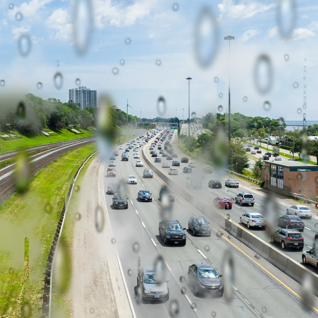
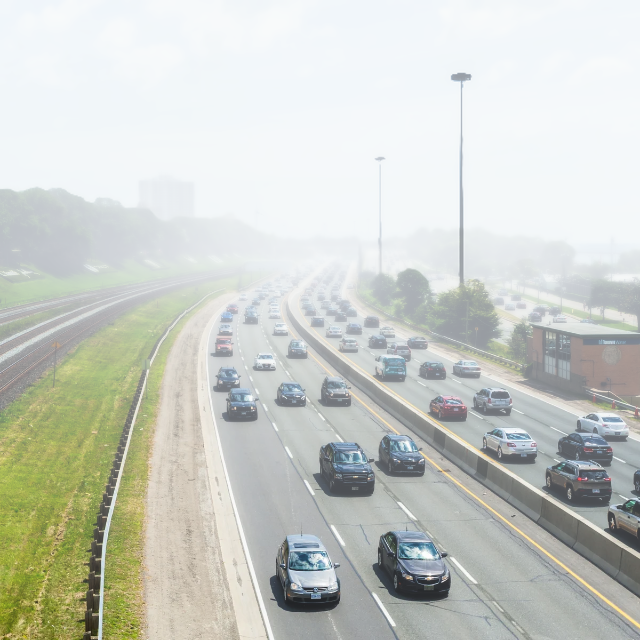
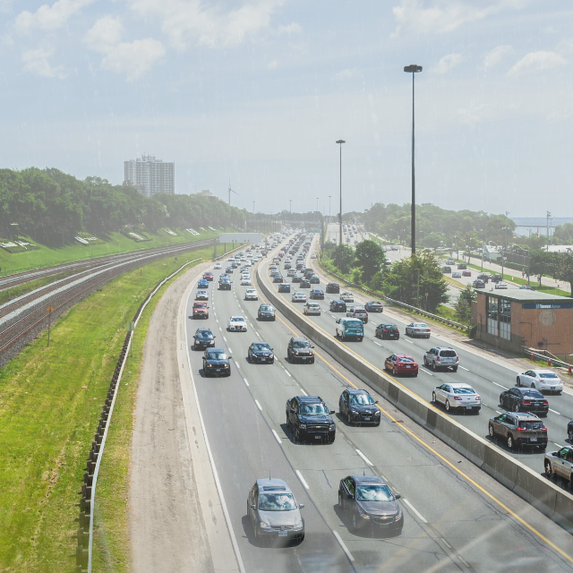
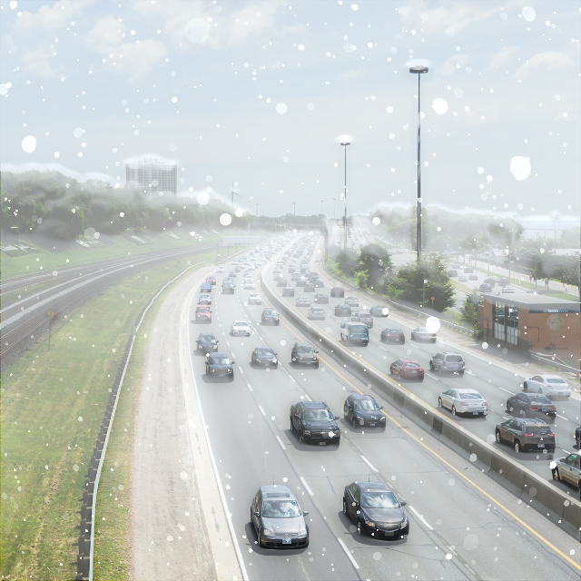

# weathermentations

Albumentations-compatible, physically-grounded weather and lens-artifact
augmentations: rain, snow, fog, dirt/soil, water droplets on lens, sun
flare. Built for training-time robustness augmentation — see
[`plan.md`](plan.md) for the full design, physical models, and
implementation roadmap.

## Install

```bash
pip install -e ".[dev]"   # editable install with lint/type/test tooling
```

Requires a CUDA GPU for the depth-conditioned effects (fog, rain, snow) —
see [Depth-conditioned effects](#depth-conditioned-effects-fog-rain-snow)
below.

## Quickstart: lens effects (no GPU needed)

`WaterDroplets`, `DirtSoil`, and `SunFlare` are camera-local optical effects
that don't need scene depth, so they work out of the box on CPU:

```python
import albumentations as A
from weathermentations.lens import WaterDroplets, DirtSoil, SunFlare

transform = A.Compose([
    WaterDroplets(p=0.3),
    DirtSoil(p=0.2),
    SunFlare(p=0.1),
])

augmented = transform(image=image)["image"]
```

## Depth-conditioned effects (fog, rain, snow)

`RandomFog`, `RandomRain`, and `RandomSnow` condition their output on scene
depth (estimated via Depth Anything V2), so they require a CUDA GPU and a
shared `SharedDepthProvider` — construct **one** provider and pass the same
instance to every depth-conditioned transform in your pipeline, so depth is
computed once per image and reused rather than recomputed per transform:

```python
import albumentations as A
from weathermentations.atmosphere import RandomFog, RandomRain, RandomSnow
from weathermentations.depth import DepthAnythingV2Estimator, SharedDepthProvider

depth_provider = SharedDepthProvider(DepthAnythingV2Estimator())

transform = A.Compose([
    RandomFog(depth_provider=depth_provider, p=0.2),
    RandomRain(depth_provider=depth_provider, p=0.2),
    RandomSnow(depth_provider=depth_provider, p=0.1),
])

augmented = transform(image=image)["image"]
```

If no CUDA device is available, constructing `DepthAnythingV2Estimator`
raises a `RuntimeError` immediately with an actionable message, rather than
silently falling back to a CPU path slow enough to blow a training-step
time budget.

## Parameter conventions

Three rules apply across every transform:

- **Physical `(min, max)` ranges.** Constructors take ranges of physical
  quantities (fog's extinction coefficient `beta`, a raindrop's diameter in
  millimetres, a lens's aperture diameter and blade count, a shutter time in
  seconds), not opaque 0-1 "strength" dials.
- **Quantities that follow from others are derived, not exposed.** Rain and
  snow are driven by a precipitation rate, and it settles the rest: the
  drop-size distribution (Marshall-Palmer / Gunn-Marshall), how many
  particles are in frame, and — through the standard visibility relations —
  how dense the veil is. These are not independent knobs in reality, and
  making them independent here is what allows a frame with a downpour's haze
  and a drizzle's streaks. Likewise, whether a drop on glass slides follows
  from its size against the capillary length, and where snow settles follows
  from surface orientation recovered from the depth map.
- **Sizes are resolution-independent.** Camera-local effects express sizes
  as fractions of the image diagonal; effects with a real scene scale
  (rain, snow) work in metres and millimetres and project through a stated
  field of view. Either way an effect looks the same on a 256px crop and a
  4K frame.

Compositing happens in linear light throughout, because scattering, flare
and bloom add *radiance* — summing them onto gamma-encoded sRGB values is a
large part of why synthetic weather usually looks like a flat white wash.

## Surveillance-stream effects

Most of what degrades a CCTV feed is not weather. These model the camera and
the link instead, and they live in `camera/` (sensor, ISP, transmission),
`lens/` and `scene/`:

```python
from weathermentations.camera import (
    AcFlicker, ExposureTransient, NightIrMode, RollingShutter,
    TemporalDenoiseArtifacts, VideoCodecArtifacts, WdrToneMapping,
)
from weathermentations.lens import HousingOccluders
from weathermentations.scene import CastShadows
```

| Effect | What it models |
| --- | --- |
| `VideoCodecArtifacts` | H.264/H.265 at a target bitrate, **encoded for real via ffmpeg** — deblocking, 4:2:0 chroma and rate control come out correct rather than approximated. Optionally simulates stale macroblocks from a lost P-frame. |
| `NightIrMode` | IR-cut filter out: monochrome by *infrared* reflectance (foliage goes bright, which a luma conversion gets backwards), the camera's own illuminator falling as 1/z², and gain-scaled noise. |
| `TemporalDenoiseArtifacts` | 3D-NR's "watercolour" flattening and chroma blotching. |
| `AcFlicker` | Mains banding. Cancels exactly when the exposure is a whole number of flicker periods — the basis of a camera's anti-flicker setting. |
| `WdrToneMapping` | Local tone mapping, with the black halos a cheap edge-preserving filter leaves. |
| `ExposureTransient` | AE/AWB caught mid-correction. White-balance error is the ratio of two blackbody colours, so it stays on the blue-orange axis real illuminants vary on. |
| `RollingShutter` | Row-dependent shear and wobble from camera motion during readout. |
| `HousingOccluders` | Insects and spider webs on the dome — hugely magnified, hugely defocused, silhouetted by day and glowing under the IR ring. |
| `CastShadows` | Hard cast shadows on upward-facing surfaces, the classic false-positive source. A loss of the direct beam, so texture survives and the shadow is bluer. |

`VideoCodecArtifacts` needs the `ffmpeg` binary on PATH and costs tens of
milliseconds per call (two subprocesses), so keep its `p` low.

### Composition order

These compose in a physical chain — scene → atmosphere → optics → sensor →
ISP → codec — and applying them out of order produces images that could not
exist (codec blocking underneath lens blur, say). `physical_order` sorts a
list into it:

```python
import albumentations as A
from weathermentations.presets import physical_order

transform = A.Compose(physical_order([
    VideoCodecArtifacts(p=0.4),
    RandomRain(depth_provider=provider, p=0.3),
    DirtSoil(p=0.2),
]))
```

One limitation worth knowing: these are per-image transforms, so anything
whose mechanism is genuinely *temporal* — 3D-NR's motion trails, banding
drifting between frames — is only rendered as the single-frame state it
leaves behind. Each module says so where it applies rather than approximating
it silently.

## Severity presets

For ImageNet-C-style severity sweeps, unpack a preset from
`weathermentations.presets.SEVERITY` (levels 1-5) instead of picking ranges
by hand:

```python
from weathermentations.presets import SEVERITY
from weathermentations.lens import WaterDroplets

transform = WaterDroplets(p=1.0, **SEVERITY[3]["WaterDroplets"])
```

## Effect gallery

Rendered from [`docs/generate_examples.py`](docs/generate_examples.py) on the
real reference photo below. Each effect is rendered once per severity level,
so `<effect>_0.png` is severity 1 and `<effect>_4.png` is severity 5; the
images shown here are the mid-ladder ones. Each variant also re-rolls the
setup knobs severity leaves alone — sun position, camera pitch, deposit mix,
how much glass the frame spans — since those change the picture as much as
the weather does. See [`docs/examples/`](docs/examples/) for the full sweep.

| Base scene | Water droplets | Dirt / soil |
| --- | --- | --- |
|  |  |  |

| Sun flare | Fog | Rain | Snow |
| --- | --- | --- | --- |
|  |  |  |  |

## Status

v1 effect set (water droplets, dirt/soil, sun flare, fog, rain, snow) is
implemented and tested. See [`plan.md`](plan.md)'s implementation checklist
for what's left (packaging/release), and §6 for the post-v1 backlog. That
backlog has two halves worth reading separately:

- **General optical/environmental effects** — chromatic aberration,
  vignetting, low-light glare, condensation/frost/mud.
- **Surveillance-stream robustness** — what a model deployed on a CCTV feed
  actually meets that augmentation pipelines never produce, and mostly not
  weather: video codec artefacts (H.264/H.265, including inter-frame damage,
  which JPEG compression cannot stand in for), night/IR as its own domain,
  ISP temporal-denoiser ghosting, mains flicker banding, WDR tone-mapping
  halos, auto-exposure transients, rolling shutter, and insects/webs on the
  housing.

§6.3 records two constraints that cut across all of them: effects must
compose in physical order (scene -> atmosphere -> optics -> sensor -> ISP ->
codec), and anything trained on video needs temporally coherent augmentation
rather than per-frame redraws.

## Benchmarking

These transforms run per-sample inside a `DataLoader` worker, so throughput
matters. `scripts/benchmark.py` reports per-transform cost, split into
parameter sampling (where depth estimation happens) and rendering:

```bash
python scripts/benchmark.py                       # 512px and 1024px
python scripts/benchmark.py --sizes 1024 --csv out.csv
python scripts/benchmark.py --no-depth            # CPU-only subset
```

It also reports the depth-conditioned transforms twice — once paying for
depth per image, once with depth already cached — which is what you get for
the second and subsequent depth-conditioned transform in a `Compose` that
shares one `SharedDepthProvider`. On a 1024px frame that sharing is worth
roughly 85 ms per extra transform, so passing the same provider to all of
them (rather than constructing one each) is the single biggest throughput
decision in a pipeline.

## Auditing the physics

Most quantities here are *derived* — a rain rate fixes a size distribution,
which fixes a drop count, which fixes each streak's opacity. An image only
shows whether the result looks plausible, not whether that chain held, so the
draws behind each frame can be recorded and checked:

```bash
PYTHONPATH=. python scripts/diagnose.py --out diagnostics --seeds 3
```

That writes one frame plus one compact JSON record per call — the constructor
ranges, the physical quantities actually sampled, and a summary of every
parameter handed to the renderer. Recording is opt-in and costs nothing when
off; transforms do not opt in, `WeatherTransform` instruments every subclass
automatically.

```python
from weathermentations.diagnostics import recording, write_jsonl

with recording() as log:
    augmented = transform(image=image)["image"]
write_jsonl(log, "draws.jsonl")
```

[`docs/physical_review.md`](docs/physical_review.md) is a critical assessment
built from such a sweep: what verified exactly (drop counts, flake sizes,
flicker depth and veil extinction all follow from their inputs to float
precision), and what did not — chiefly that apparent precipitation intensity
is resolution-dependent, and that the pseudo-metric depth scale puts the
nearest scene point 0.3 m from the camera.

## Development

```bash
pip install -e ".[dev]"
ruff check src tests
mypy src/weathermentations
pytest tests -q
```

Depth-conditioned tests are skipped automatically when no CUDA device is
present. Regenerate visual-regression goldens deliberately (only when a
render intentionally changes) with:

```bash
python -m tests.visual_regression.generate_goldens
```

## License

MIT — see [LICENSE](LICENSE).
