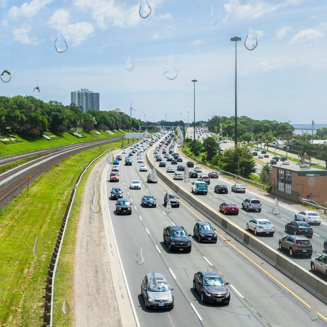
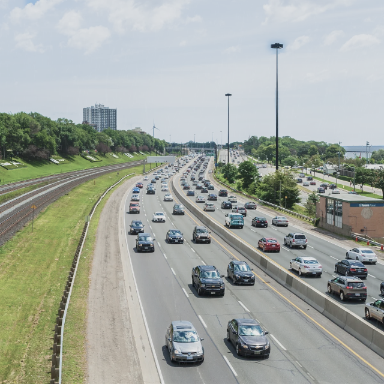

# weathermentations

Albumentations-compatible, physically-grounded weather and lens-artifact
augmentations: rain, snow, fog, dirt/soil, water droplets on lens, sun
flare. Built for training-time robustness augmentation — see
[`plan.md`](plan.md) for the full design, physical models, and
implementation roadmap.

## Install

```bash
pip install -e ".[dev]"   # editable install with lint/type/test tooling
```

Requires a CUDA GPU for the depth-conditioned effects (fog, rain, snow) —
see [Depth-conditioned effects](#depth-conditioned-effects-fog-rain-snow)
below.

## Quickstart: lens effects (no GPU needed)

`WaterDroplets`, `DirtSoil`, and `SunFlare` are camera-local optical effects
that don't need scene depth, so they work out of the box on CPU:

```python
import albumentations as A
from weathermentations.lens import WaterDroplets, DirtSoil, SunFlare

transform = A.Compose([
    WaterDroplets(p=0.3),
    DirtSoil(p=0.2),
    SunFlare(p=0.1),
])

augmented = transform(image=image)["image"]
```

## Depth-conditioned effects (fog, rain, snow)

`RandomFog`, `RandomRain`, and `RandomSnow` condition their output on scene
depth (estimated via Depth Anything V2), so they require a CUDA GPU and a
shared `SharedDepthProvider` — construct **one** provider and pass the same
instance to every depth-conditioned transform in your pipeline, so depth is
computed once per image and reused rather than recomputed per transform:

```python
import albumentations as A
from weathermentations.atmosphere import RandomFog, RandomRain, RandomSnow
from weathermentations.depth import DepthAnythingV2Estimator, SharedDepthProvider

depth_provider = SharedDepthProvider(DepthAnythingV2Estimator())

transform = A.Compose([
    RandomFog(depth_provider=depth_provider, p=0.2),
    RandomRain(depth_provider=depth_provider, p=0.2),
    RandomSnow(depth_provider=depth_provider, p=0.1),
])

augmented = transform(image=image)["image"]
```

If no CUDA device is available, constructing `DepthAnythingV2Estimator`
raises a `RuntimeError` immediately with an actionable message, rather than
silently falling back to a CPU path slow enough to blow a training-step
time budget.

## Parameter conventions

Two rules apply across every transform:

- **Physical `(min, max)` ranges.** Constructors take ranges of physical
  quantities (fog's extinction coefficient `beta`, a drop's diameter, a
  lens's aperture blade count), not opaque 0-1 "strength" dials.
- **Sizes are fractions of the image diagonal, not pixels.** A feature of a
  given physical size subtends a fixed fraction of the field of view, so
  this keeps an effect looking the same on a 256px crop and a 4K frame.

Compositing happens in linear light throughout, because scattering, flare
and bloom add *radiance* — summing them onto gamma-encoded sRGB values is a
large part of why synthetic weather usually looks like a flat white wash.

## Severity presets

For ImageNet-C-style severity sweeps, unpack a preset from
`weathermentations.presets.SEVERITY` (levels 1-5) instead of picking ranges
by hand:

```python
from weathermentations.presets import SEVERITY
from weathermentations.lens import WaterDroplets

transform = WaterDroplets(p=1.0, **SEVERITY[3]["WaterDroplets"])
```

## Effect gallery

Rendered from [`docs/generate_examples.py`](docs/generate_examples.py) on
the synthetic scene below. See [`docs/examples/`](docs/examples/) for more
variations per effect.

| Base scene | Water droplets | Dirt / soil |
| --- | --- | --- |
|  |  |  |

| Sun flare | Fog | Rain | Snow |
| --- | --- | --- | --- |
|  |  |  |  |

## Status

v1 effect set (water droplets, dirt/soil, sun flare, fog, rain, snow) is
implemented and tested. See [`plan.md`](plan.md)'s implementation checklist
for what's left (packaging/release) and the documented post-v1 backlog
(optical/sensor artifacts, low-light/nighttime, condensation/frost/mud,
compound presets).

## Benchmarking

These transforms run per-sample inside a `DataLoader` worker, so throughput
matters. `scripts/benchmark.py` reports per-transform cost, split into
parameter sampling (where depth estimation happens) and rendering:

```bash
python scripts/benchmark.py                       # 512px and 1024px
python scripts/benchmark.py --sizes 1024 --csv out.csv
python scripts/benchmark.py --no-depth            # CPU-only subset
```

It also reports the depth-conditioned transforms twice — once paying for
depth per image, once with depth already cached — which is what you get for
the second and subsequent depth-conditioned transform in a `Compose` that
shares one `SharedDepthProvider`. On a 1024px frame that sharing is worth
roughly 85 ms per extra transform, so passing the same provider to all of
them (rather than constructing one each) is the single biggest throughput
decision in a pipeline.

## Development

```bash
pip install -e ".[dev]"
ruff check src tests
mypy src/weathermentations
pytest tests -q
```

Depth-conditioned tests are skipped automatically when no CUDA device is
present. Regenerate visual-regression goldens deliberately (only when a
render intentionally changes) with:

```bash
python -m tests.visual_regression.generate_goldens
```

## License

MIT — see [LICENSE](LICENSE).
