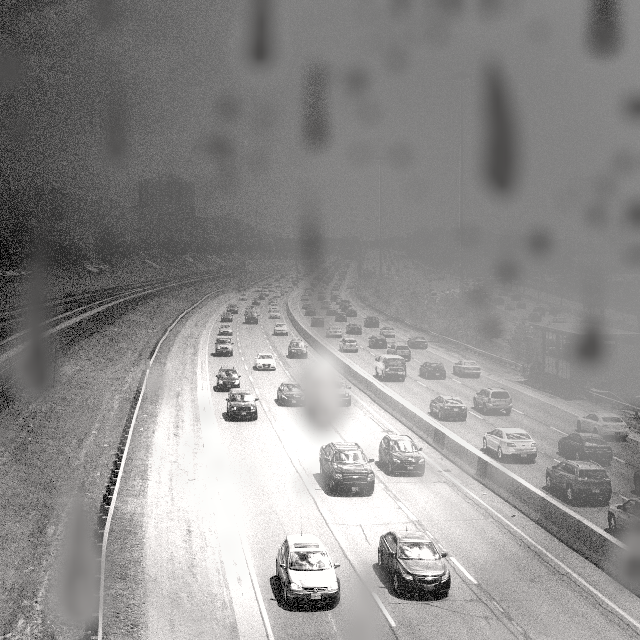
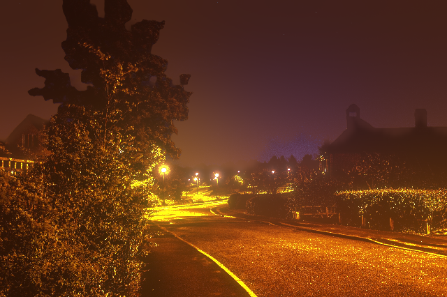
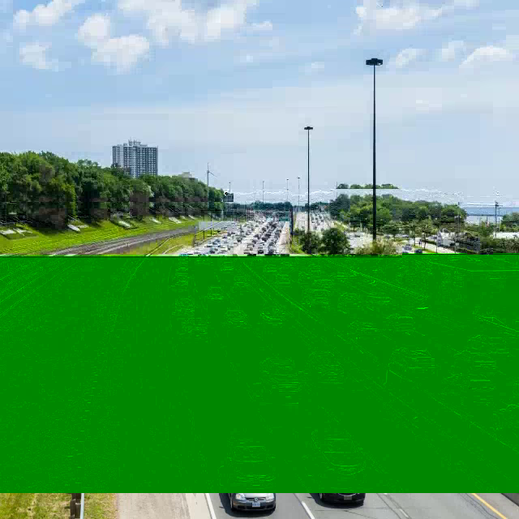
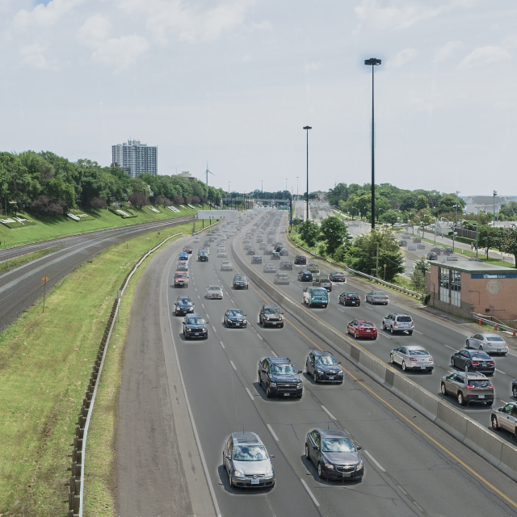

# weathermentations

Albumentations-compatible, physically-grounded augmentations for training
models that run on real camera feeds: weather (rain, snow, fog), lens
artifacts (water droplets, dirt, flare, insects on the housing), and the
sensor/ISP/codec chain that degrades a CCTV stream far more often than
weather does.

Effects are parameterised by **physical quantities** — a rain rate in mm/h, a
drop diameter in millimetres, a shutter time in seconds — not opaque 0-1
"strength" dials, and everything that follows from those is derived rather
than exposed.

- **[`docs/how_it_works.md`](docs/how_it_works.md)** — what each effect
  models and why, with diagrams. Start here to decide which knobs matter.
- **[`docs/rain_visibility.md`](docs/rain_visibility.md)** — why rain streaks
  are faint at surveillance resolutions, measured; and the drop-size
  distribution options.
- **[`docs/pipelines.md`](docs/pipelines.md)** — a worked composite whose
  effects cannot contradict each other, with measured frequencies and cost.
  Start here if you want a pipeline rather than a transform.
- **[`docs/physical_review.md`](docs/physical_review.md)** — a critical audit
  of whether the implementation lives up to that, including where it did not.
- **[`optimizations.md`](optimizations.md)** — where the CPU time actually
  goes, and an assessment of what is worth optimising.
- **[`docs/native_kernels.md`](docs/native_kernels.md)** — the optional
  compiled kernels: what was moved to C and why, what it bought, and why
  there is no hand-written SIMD.
- **[`docs/proposed_augmentations.md`](docs/proposed_augmentations.md)** —
  effects not yet built, in the order to build them, each with its model,
  its place in the chain and what would show it works.
- **[`plan.md`](plan.md)** — design record and roadmap.

---

## Install

```bash
pip install -e ".[dev]"   # editable install with lint/type/test tooling
```

Optional runtime dependencies:

| Need | Required for |
| --- | --- |
| CUDA GPU | the depth-conditioned effects (fog, rain, snow, night IR, cast shadows) |
| `ffmpeg` on PATH | `VideoCodecArtifacts` and `TransmissionFaults` |

Everything else runs on CPU with no extra setup.

If a C compiler (`cc`, `gcc` or `clang`) is present, installing also builds a
small native library that draws rain and snow and converts colour several
times faster. It is optional and changes no picture: without it the same
transforms run their numpy code. `python -c "from weathermentations import
_native; print(_native.tier())"` prints the instruction set in use, or
`None` if it was not built; `python hatch_build.py` builds it in a checkout.
See [`docs/native_kernels.md`](docs/native_kernels.md).

**Fast and exact mode.** By default a few operations use a faster form that
differs slightly from the reference arithmetic. The two that show: wide
blurs, the sky's edge in fog, rain and snow among them, are made on a
reduced copy of the frame, which is 5 to 7 times faster at 1024 px and
moves about 1% of pixels along the skyline; and the depth network runs in
half precision, which halves the depth estimate and moves depth-dependent
edges by a pixel here and there (`DepthAnythingV2Estimator(half_precision=False)`
keeps full precision).
`weathermentations.set_fast(False)`, `with weathermentations.exact():` or
`WEATHERMENTATIONS_FAST=0` selects exact mode. The bounds are in
[`docs/native_kernels.md`](docs/native_kernels.md#fast-and-exact-mode).

**In a `DataLoader` worker**, `weathermentations.keep_freed_memory()` tells
glibc's allocator to reuse freed frames instead of returning them to the
system. It made `SensorNoise` twice as fast at 512 px and several other
transforms 6 to 10% faster, at the cost of the worker not shrinking after a
peak. It is a process-wide setting, so it is yours to call.

---

## Quickstart

### Camera-local effects — no GPU

```python
import albumentations as A
from weathermentations.lens import WaterDroplets, DirtSoil, SunFlare

transform = A.Compose([
    WaterDroplets(p=0.3),
    DirtSoil(p=0.2),
    SunFlare(p=0.1),
])

augmented = transform(image=image)["image"]
```

### Depth-conditioned effects — needs CUDA

Construct **one** `SharedDepthProvider` and pass that same instance to every
depth-conditioned transform, so depth is estimated once per image instead of
once per transform. This is the single biggest throughput decision in a
pipeline here — see [Performance](#performance). `provider.cache_info()`
reports hits and misses if you want to confirm it is happening.

```python
import albumentations as A
from weathermentations.atmosphere import RandomFog, RandomRain, RandomSnow
from weathermentations.depth import DepthAnythingV2Estimator, SharedDepthProvider

depth_provider = SharedDepthProvider(DepthAnythingV2Estimator())

transform = A.Compose([
    RandomFog(depth_provider=depth_provider, p=0.2),
    RandomRain(depth_provider=depth_provider, p=0.2),
    RandomSnow(depth_provider=depth_provider, p=0.1),
])
```

With no CUDA device, constructing `DepthAnythingV2Estimator` raises a
`RuntimeError` immediately with an actionable message, rather than silently
falling back to a CPU path slow enough to blow a training-step budget.

---

## The effects

### Weather and scene

| Transform | Models | Needs depth |
| --- | --- | --- |
| `RandomFog` | Koschmieder extinction with per-channel scattering, the sky found and put at the far plane, and a veil the colour of the horizon sky, not of the brightest pixels | yes |
| `RandomRain` | Marshall-Palmer (or Ulbrich gamma) drop sizes, Gunn-Kinzer fall speeds, Garg-Nayar streak photometry, a distance veil, and wet ground: dark surfaces darkened far more than pale ones, each object's reflection smeared down the road from its foot, Fresnel-weighted, with puddles that mirror the sky cleanly. At night, streaks lit by the lamps in the frame and a road that reflects them | yes |
| `RandomSnow` | Gunn-Marshall sizes corrected for snow density, Locatelli-Hobbs fall speeds, and settled snow: level ground covered up to the foot of each object, clumps on tree foliage, lit by the light on the spot, so white by day and orange under sodium lamps | yes |
| `NightRain` | Rain lit by the camera's **own infrared illuminator**, brightness falling as 1/z² from the lamp. The one case where rain reads as streaks rather than haze — see [`docs/rain_visibility.md`](docs/rain_visibility.md). Needs no depth, so it runs on CPU | no |
| `NightSnow` | Snow lit by the camera's own illuminator: each flake's brightness is set by *its* distance from the lamp, not by the scene behind it. `RandomSnow` before `NightIrMode` loses its flakes over anything distant; this is what puts them back. Needs no depth | no |
| `NightFog` | Fog lit by the lamps in the frame: everything fades with distance into a veil as bright and as coloured as the light around it, brightest near the lamps, and each lamp gets a halo. With the illuminator on, an even wall of backscatter across the beam | yes |
| `CastShadows` | Shadows of people, vehicles and foliage on upward-facing surfaces, all thrown by one sun — a classic false-positive source. A loss of the direct beam, so texture survives and the shadow is bluer | yes |

### Lens and housing

| Transform | Models | Needs depth |
| --- | --- | --- |
| `WaterDroplets` | Water on the glass of a camera focused far beyond it: every drop a lobe of one refracting surface, so drops merge; large drops individually shaped — lopsided and bottom-heavy when pinned, and as runners anything from a blunt slug to a head trailing a thread that breaks into beads; sharpness set by the lens aperture, not chosen; condensation as scattering of the scene's own light; lit by the infrared ring at night | no |
| `DirtSoil` | Grime as a *scattering* layer, not paint, with per-deposit albedos from grey dust through yellow pollen to brown spray. Lit from the whole hemisphere in front of the glass, so it glows under a sky the camera is not looking at; patches over an even film of settled dust | no |
| `SunFlare` | Veiling glare, halo, coating-tinted ghost chain, diffraction starburst, dispersion corona, plus CCTV-specific dome scratches, smear and IR leak | no |
| `SourceGlare` | The same optics on each compact light found in the frame (street lamps, headlights), with strength from the clipped area. Leaves a frame with no lights unchanged | no |
| `HousingOccluders` | Insects and webs on the dome — hugely magnified and defocused, silhouetted by day, glowing under the IR ring | no |

### Sensor, ISP and transmission

| Transform | Models | Needs depth |
| --- | --- | --- |
| `NightIrMode` | IR-cut filter out: monochrome by *infrared* reflectance (foliage goes bright, which a luma conversion gets backwards), an illuminator falling as 1/z², gain-scaled noise | yes |
| `AcFlicker` | Mains banding. Cancels exactly when the exposure is a whole number of flicker periods — the basis of a camera's anti-flicker setting | no |
| `RollingShutter` | Row-dependent shear and wobble from camera motion during readout. The one transform that moves pixels, so masks, boxes and keypoints move with it | no |
| `SensorNoise` | Shot and read noise in photoelectrons, set by sensor gain, drawn on the Bayer mosaic and demosaiced, so the grain is coarse and coloured as in a real low-light frame | no |
| `ExposureTransient` | AE/AWB caught mid-correction. White-balance error is the ratio of two blackbody colours, so it stays on the blue-orange axis real illuminants vary on | no |
| `WdrToneMapping` | Local tone mapping, with the black halos a cheap edge-preserving filter leaves | no |
| `TemporalDenoiseArtifacts` | 3D-NR's "watercolour" flattening and chroma blotching | no |
| `VideoCodecArtifacts` | H.264/H.265 **encoded for real via ffmpeg**, so deblocking, 4:2:0 chroma and rate control come out correct rather than approximated. Optionally simulates stale macroblocks from a lost P-frame | no |
| `TransmissionFaults` | Packet loss, **decoded for real**: a short H.264 clip is encoded, packets are removed from the bitstream in bursts, and ffmpeg decodes what is left. Stale, smeared, green and garbage bands that start mid-row and stop at a slice boundary | no |

---

## Configuration

### Parameter conventions

Three rules hold across every transform.

**Physical `(min, max)` ranges.** Constructors take ranges of physical
quantities — fog's extinction coefficient, a raindrop's diameter in
millimetres, an aperture's diameter and blade count, a shutter time in
seconds. Ranges are validated by a pydantic `InitSchema`, so an impossible
value fails at construction rather than at render.

**Derived quantities are not exposed.** A rain rate settles the drop-size
distribution, the particle count, and — through published visibility
relations (Atlas 1953 for rain) — how dense the veil is. These are not independent in reality, and
making them independent here is what allows a frame with a downpour's haze
and a drizzle's streaks.

**Sizes are resolution-independent.** Camera-local effects express sizes as
fractions of the image diagonal; effects with a real scene scale work in
metres and project through a stated field of view. A feature's *geometry* is
the same on a 256 px crop and a 4K frame.

### Configuration reference

The knobs that change the picture most, per transform. Every one is a
`(min, max)` range unless noted; see each module's docstring for the full set
and the physics behind it.

| Transform | Start with |
| --- | --- |
| `RandomFog` | `beta_range` (extinction, 1/m), `scattering_gamma_range` (0 grey, ~1.3 blue haze, 4 Rayleigh), `depth_scale` |
| `RandomRain` | `rain_rate_range_mm_h`, `drop_diameter_range_mm`, `dsd_shape_mu`, `scene_illuminance_range_lux` and `aperture_diameter_range_mm` (together they meter the shutter time), `exposure_time_range` (the shutter's limits), `wetness_probability`, `wetness_darkening_range`, `puddle_coverage_range`, `min_streak_width_px`, `lamp_glint_range` (night: how far past full scale the lamps lighting the rain were) |
| `NightRain` | `illuminator_gain_range` (what makes streaks visible), `rain_rate_range_mm_h`, `illuminator_range_m`, `backscatter_range`, `exposure_time_range` |
| `NightSnow` | `snowfall_rate_range_mm_h`, `illuminator_gain_range`, `illuminator_range_m`, `backscatter_range`, `exposure_time_range`, `glare_range` |
| `NightFog` | `visibility_range_m` (read against the provider's depth range), `glow_radius_range`, `illuminator_backscatter_range` (infrared ring on; apply after `NightIrMode`) |
| `RandomSnow` | `snowfall_rate_range_mm_h`, `snow_density_range_g_cm3`, `accumulation_probability`, `accumulation_strength_range`, `vehicle_cover_range` (0 moving traffic, 1 parked overnight), `min_flake_width_px`, `max_flakes` |
| `CastShadows` | `casters` (person, vehicle, foliage), `shadow_count_range`, `shadow_scale_range`, `sun_elevation_range_deg`, `direct_fraction_range`, `penumbra_range`, `camera_pitch_deg` |
| `WaterDroplets` | `droplet_count_range`, `droplet_radius_range`, `pane_width_range_mm` (sets the physical scale), `aperture_diameter_range_mm` (sets how sharp the water looks), `coalescence_range`, `condensation_coverage_range`, `condensation_milkiness_range`, `illuminator_glow_range` (infrared ring on) |
| `DirtSoil` | `coverage_range`, `dust_film_range` (even film between the patches), `ambient_light_range` (how much brighter the surroundings are than the frame), `veil_strength_range`, `highlight_boost_range`, `deposits` (which substances), `smudge_count_range` |
| `SunFlare` | `flare_position`, `intensity_range`, `ghost_count_range`, `aperture_blades_range`, `dispersion_ring_probability`, `scratch_count_range` |
| `SourceGlare` | `intensity_range` (stands for how far past full scale the lights were), `max_sources_range`, `ghost_count_range`, `streak_probability` |
| `HousingOccluders` | `insect_count_range`, `insect_size_range`, `web_count_range`, `defocus_range`, `glow_range` (0 by day, >0 under the IR ring) |
| `NightIrMode` | `illuminator_range_m`, `beam_falloff_range`, `gain_range` (noise, not level), `read_noise_range`, `vegetation_gain_range` |
| `AcFlicker` | `mains_frequency_hz` (50 or 60), `readout_time_range_s` (sets the band *count*), `exposure_time_range_s` (sets the depth), `pulse_exponent_range`, `modulation_depth_range` |
| `RollingShutter` | `pan_shift_range_px`, `wobble_amplitude_range_px`, `wobble_cycles_range` |
| `SensorNoise` | `gain_range_db` (the knob: how few electrons make a full-scale picture), `full_well_range_e`, `read_noise_range_e` |
| `ExposureTransient` | `exposure_error_stops_range`, `assumed_temperature_range_k`, `actual_temperature_range_k` |
| `WdrToneMapping` | `compression_range`, `detail_gain_range`, `halo_strength_range` |
| `TemporalDenoiseArtifacts` | `strength_range`, `iterations_range`, `edge_threshold_range`, `chroma_blur_range` |
| `VideoCodecArtifacts` | `codec` (`"h264"` / `"h265"`), `crf_range`, `stale_block_probability` |
| `TransmissionFaults` | `packet_loss_range`, `burst_length_range`, `scene_motion_range` (how far the picture moved since the frame the decoder falls back on: what makes loss visible), `missing_reference_probability`, `concealment_probability` (a decoder that does not conceal shows green), `slices_range`, `frames_since_keyframe_range` |

Two of these are worth singling out because their effect is not what the name
suggests. `AcFlicker`'s `readout_time_range_s` matters more than
`modulation_depth_range`: band *count* is what makes flicker legible, and two
deep bands read as an exposure difference. `NightIrMode`'s `gain_range` scales
the **noise**, not the signal — the auto-exposure has already placed the
level, and gain is one of the levers it used to get there.

### Ready-made pipelines

Listing every effect with an independent probability produces frames that
could not exist — fog and snow at once, a sun flare under an IR night sky.
Two pipelines that cannot are importable directly:

```python
from weathermentations.presets import surveillance, surveillance_lite

transform = surveillance(provider, codec=0.0)   # needs CUDA
transform = surveillance_lite()                 # CPU only, no night
```

**`severity` is the dial for how degraded a frame gets** (1-5, default 1) and
the first thing to change if the output looks too heavy. It defaults low
because a pipeline stacks two or three effects and per-effect severity
compounds — level 2 on each of three effects is not an ordinary frame. It matters more than
it sounds: without it the transforms run on their own constructor defaults,
which span the whole physically plausible range — `RandomRain` reaches
200 mm/h, a tropical cloudburst, where severity 1 is 2-12 mm/h. Those wide
defaults are right for exploring one transform and wrong for stacking three.

Measured at 512 px: `surveillance` 124 ms median, `surveillance_lite` 78 ms
and no GPU. A typical frame keeps 75-81% of its high-frequency detail.

Two arguments are worth knowing beside `severity`. `ground_severity` (0-5)
fixes how wet the road is under rain and how much snow has settled; left
unset, each frame draws it over the whole range, independently of how hard
it is raining or snowing. `faults` is the probability of packet-loss damage
(`TransmissionFaults`), 0.03 by default and 0 when `codec=0.0`, so that
setting still runs without ffmpeg.

`surveillance_lite` renders no night at all — nothing in it can relight a
daylit frame, and tinting one does not approximate night. Its `night`
fraction only raises the mains-flicker and denoiser artefacts. Use
`surveillance` if you need night as a domain, or `ir_night=0.0` there if you
do not. Every probability is a keyword argument, because the defaults
encode a temperate maritime climate on a mixed camera fleet and will not match
your footage. [`docs/pipelines.md`](docs/pipelines.md) explains what each
encodes and which to change first.

> **Seed once, not per frame.** `set_random_seed` before every call correlates
> every transform's probability check, so frames come out with nearly all
> effects or nearly none — 27% of frames untouched against 8%. Set the seed on
> the `Compose` once and stream samples through it.

### Severity presets

For ImageNet-C-style sweeps, unpack a preset instead of picking ranges by
hand. Levels are 1-5 and every ladder is tested for monotonicity.

```python
from weathermentations.presets import SEVERITY
from weathermentations.lens import WaterDroplets

transform = WaterDroplets(p=1.0, **SEVERITY[3]["WaterDroplets"])
```

The ground under rain and snow has a ladder of its own, `GROUND_SEVERITY`,
from 0 (dry road, bare ground) to 5 (soaked, buried). How wet a road is and
how much snow lies on it follow how long the weather has lasted, not how
hard it is coming down, so the two are combined freely:

```python
from weathermentations.presets import GROUND_SEVERITY, SEVERITY

# A blizzard that has only just started: heavy fall, bare ground.
RandomSnow(depth_provider=provider, **SEVERITY[5]["RandomSnow"],
           **GROUND_SEVERITY[0]["RandomSnow"])
# The morning after: a few flakes over deep snow.
RandomSnow(depth_provider=provider, **SEVERITY[1]["RandomSnow"],
           **GROUND_SEVERITY[5]["RandomSnow"])
```

Without a ground entry the transform draws the ground's state itself, over
the whole range. The pipelines do the same unless given `ground_severity`.

### Composition order

These model stages of one imaging chain — scene → atmosphere → optics →
sensor → ISP → codec — and applying them out of order produces images that
could not exist (codec blocking underneath lens blur means the lens blurred
an already-compressed image). `physical_order` sorts a list into it:

```python
from weathermentations.presets import physical_order

transform = A.Compose(physical_order([
    VideoCodecArtifacts(p=0.4),
    RandomRain(depth_provider=provider, p=0.3),
    DirtSoil(p=0.2),
]))
```

It sorts a *list*; it does not build the `Compose`, so you keep control of
probabilities and seeding. Sorting is stable, so transforms sharing a stage
keep the order you gave them.

### Seeding

Randomness goes through each transform's own RNG, so pipeline-level seeding
reaches these transforms exactly as it does built-in ones:

```python
transform = A.Compose([...], seed=42)
```

---

## Performance

Measured with `scripts/benchmark.py` on one machine (Intel Core Ultra 9 285H,
RTX PRO 1000 Blackwell Laptop GPU, torch 2.11 + CUDA 12.8), median of 15
calls per measurement. Treat these as *relative* costs; absolute numbers will
differ on your hardware.

```bash
python scripts/benchmark.py                        # 512px and 1024px
python scripts/benchmark.py --sizes 1024 --csv out.csv
python scripts/benchmark.py --no-depth             # CPU-only subset
```

### CPU-only transforms — total ms per image

| Transform | 512 px | 1024 px |
| --- | --- | --- |
| `RollingShutter` | **0.2** | 1.1 |
| `AcFlicker` | 4.1 | 21.3 |
| `ExposureTransient` | 4.8 | 24.3 |
| `SensorNoise` | 13.1 | 50.1 |
| `HousingOccluders` | 10.8 | 66.7 |
| `SunFlare` | 21.4 | 125.5 |
| `DirtSoil` | 35.4 | 173.5 |
| `SourceGlare` | 38.7 | 196.1 |
| `TemporalDenoiseArtifacts` | 38.6 | 237.4 |
| `WdrToneMapping` | 102.9 | 146.2 |
| `WaterDroplets` | 112.7 | 194.7 |
| `TransmissionFaults` | 151.4 | 190.0 |
| `VideoCodecArtifacts` | 170.4 | 251.9 |

### Depth-conditioned transforms — total ms per image

"Cold" pays for depth estimation; "warm" is what the second and subsequent
depth-conditioned transform costs when they share one provider.

| Transform | 512 cold | 512 warm | 1024 cold | 1024 warm |
| --- | --- | --- | --- | --- |
| `CastShadows` | 61.5 | **24.2** | 209.0 | 126.7 |
| `NightIrMode` | 81.4 | **13.5** | 136.0 | 77.3 |
| `RandomFog` | 86.7 | **19.8** | 212.7 | 114.0 |
| `NightFog` | — | 28.9 | — | 125.0 |
| `RandomRain` | 140.1 | 81.4 | 384.4 | 304.8 |
| `RandomSnow` | 135.4 | **32.1** | 245.8 | 177.0 |

Sharing one provider saves roughly **62 ms per extra transform at 512 px and
86 ms at 1024 px**. Constructing a provider per transform throws that away.

The saving holds along a whole pipeline, not only between adjacent
transforms: each transform here passes the scene on with its output, so depth
is estimated from the clean frame and reused by everything downstream —
`CastShadows` → `RandomFog` → `RandomRain` all firing on one frame is one
estimate, and so is `RandomFog` → `DirtSoil` → `NightIrMode`. Two things end
the chain, and the next depth-conditioned transform then estimates afresh:
`RollingShutter`, which moves pixels, and any transform from outside this
library, which cannot be assumed not to. If you know such a step keeps
geometry (a colour jitter, a blur), `provider.carry(before, after)` says so.

**Both tables predate the `native-kernels` work and were measured with
OpenCV using every core.** A `DataLoader` worker has one, and there the
picture is different: see the single-core table in
[`docs/native_kernels.md`](docs/native_kernels.md), where `RandomFog`,
`RandomRain` and `RandomSnow` are 3 to 7 times faster than they were at
1024 px.

These are a laptop under thermal limits: absolute numbers move by up to 2x
between runs, and the relative ordering plus the cold/warm gap are the parts
worth planning around. For that reason the `WaterDroplets`, `DirtSoil` and
`RandomRain` rows, whose renderers changed after the table was measured, are
not from a fresh run: each is the table's earlier figure scaled by the
new-to-old ratio timed back to back in one session (droplets 1.17x at 512 px
and 0.93x at 1024 px, dirt 1.08x and 1.01x, rain 1.21x and 1.13x).

### Choosing a budget

A `DataLoader` worker must keep ahead of the GPU. Rough guidance:

- **Cheap enough to apply liberally** (under ~25 ms at 512 px):
  `RollingShutter`, `AcFlicker`, `ExposureTransient`, `SensorNoise`,
  `HousingOccluders`,
  `SunFlare`.
- **Moderate** (25-115 ms): `DirtSoil`, `TemporalDenoiseArtifacts`,
  `WaterDroplets`, `WdrToneMapping`, and any *warm* depth-conditioned
  transform.
- **Expensive, keep `p` low**: `VideoCodecArtifacts` and `TransmissionFaults`
  (two ffmpeg subprocesses per call each), and the first depth-conditioned transform in a pipeline.

Cost is paid only when `p` fires, so a pipeline of ten effects at `p=0.2`
costs about two of them per image, not ten. The depth estimate is the
exception: it is paid once if *any* depth-conditioned transform fires.

---

## Usage considerations

**These are per-image transforms.** Anything whose mechanism is genuinely
*temporal* — 3D-NR's motion trails, banding drifting between frames — is
rendered only as the single-frame state it leaves behind. Each module says so
where it applies rather than approximating silently. If you train on video and
need temporal coherence, you need to hold the draws fixed across a clip
yourself.

**`p` decides whether; parameters decide how strongly.** A transform
constructed with `p=1.0` will change the image. Ranges are not permitted to
include "no effect" as a legal draw — that was a bug twice, and both are now
guarded by tests. If you want an effect to sometimes not apply, lower `p`.

**Precipitation intensity is resolution-dependent, by design.** Geometry is
resolution-independent, but the amount of precipitation visible as *discrete
particles* rises with image size (roughly 6-8× over 256→1920 px), because the
cut deciding what is drawn individually rather than left to the veil is in
pixels — a bigger sensor really does resolve more drops. Total extinction is
unaffected (rendered particles carry ~0.3% of it). If you train multi-scale
and want the look held constant, `min_streak_width_px` and
`min_flake_width_px` are the knobs.

**Depth is pseudo-metric, not measured.** Monocular depth has no absolute
scale, so it is mapped onto a near and a far plane — 3 m and 50 m by default,
set in `depth/scale.py`. Effects that depend on distance *linearly* (fog,
rain, snow) tolerate a wrong guess; `NightIrMode`'s inverse-square illuminator
does not, and a scene whose real near plane is 10 m will read too contrasty
at the bottom of the frame.

The calibration belongs to the provider, so one setting reaches every
depth-conditioned transform:

```python
provider = SharedDepthProvider(DepthAnythingV2Estimator(), depth_range_m=(1.0, 12.0))
```

`RandomFog` can additionally override the far plane for itself with
`depth_scale`.

**Severity is extinction per metre, so it has to match the scene's scale.**
The presets suit the default 3-50 m. Calibrate a provider to a landscape and
the same fog or snow hides everything past a few hundred metres, and heavy
rain everything past a kilometre or two — which is what that weather does,
and leaves a blank frame. For long views, set fog
by visibility (`beta = 3.912 / visibility_m`) and cap the precipitation veils
with `veil_beta_range`, as `docs/generate_scene_examples.py` does.

**The scene's own conditions are mostly not detected.** Nothing here knows
that a frame is under a roof, so snow settles indoors if you ask it to.
Three things are inferred, by heuristics that are documented as such:

- **Where the sky is** (`utils/sky.py`): featureless, at a single depth, and
  reached from the top of the frame. It misses sky seen through branches and
  can take a pale distant surface touching the top edge for sky.
- **What colour a veil is** (`utils/color.py`): the horizon sky's, read off
  the sky where there is one and inferred where there is not. On a real night
  frame fog, rain and snow therefore stay dark instead of taking the colour
  of the street lamps. They are still daylight models: fog at night does not
  glow round the lamps: `NightFog`, `NightRain` and `NightSnow` are the
  night models, and the pipelines use them.
- **What is paving** (`atmosphere/rain.py`): everything level that is not
  green vegetation. Bare soil and gravel still get a film of water.

Rain and snow also relight the frame towards overcast in step with their
rate (`overcast_range`). That softens a sunny scene; it cannot remove the
shadows it has.

**Clips.** Passed as `images=`, an `(N, H, W, 3)` array is treated the way
Albumentations treats it: one set of parameters for every frame. Depth is
estimated once, from the first frame, on the assumption that a clip is one
camera looking at one scene. Nothing *advances* between frames, though — rain
streaks sit in the same place in each — so this gives consistent conditions
across a clip, not motion.

**Annotations.** Every effect but one changes appearance only, so masks,
boxes and keypoints pass through untouched. `RollingShutter` moves pixels and
moves its annotations with them: masks are resampled, boxes become the box
enclosing the sheared original, keypoints follow.

**Input is RGB, `uint8` or float in `[0, 1]`.** Anything else — greyscale,
RGBA, 16-bit — is refused with an error before any parameter is sampled,
rather than rendered wrongly. The effects model colour radiance, so there is
no greyscale form of them; convert a mono frame to three channels first.
`RollingShutter` is the exception, since it only moves pixels: it takes any
channel count and bit depth.

**Compositing is in linear light.** If you chain these with other
augmentation libraries that work on gamma-encoded values, the ordering matters
more than usual — put colour-space-naive transforms outside this chain, not in
the middle of it.

**GPU memory.** One `DepthAnythingV2Estimator` holds a model on the GPU.
With multiple `DataLoader` workers each constructing their own, memory scales
with worker count — construct the provider inside the worker init, and size
`num_workers` accordingly.

---

## Effect gallery

Rendered by [`docs/generate_examples.py`](docs/generate_examples.py) on the
reference photo below. Each effect gets one image per severity level, so
`<effect>_0.png` is severity 1 and `<effect>_4.png` is severity 5. Each
variant also re-rolls the setup knobs severity leaves alone — sun position,
camera pitch, deposit mix, mains frequency — since those change the picture as
much as the weather does.

The same effects over eight other scenes — a crossing from straight above, a
covered car park, a real night street, mountains across a valley — are in
[`docs/examples/scenes/`](docs/examples/scenes/README.md), one page per scene,
with the shipped pipelines run over each. That set is the place to look for
where the models stop fitting, and each page says what the transforms had to
be told about the scene to get there.

Each cell shows the **median of seven draws**, not the first: effects that can
legitimately draw themselves out of existence otherwise produce a cell the
reader cannot tell from a bug. See [`docs/examples/`](docs/examples/) for the
full sweep.

| Base scene | Water droplets | Dirt / soil |
| --- | --- | --- |
|  |  |  |

| Sun flare | Fog | Rain | Snow |
| --- | --- | --- | --- |
|  |  |  |  |

| Night IR | Night rain | AC flicker | Cast shadows |
| --- | --- | --- | --- |
|  |  |  |  |

| Night snow | Wet glass under the infrared ring | Night fog | Glare from lamps |
| --- | --- | --- | --- |
|  |  |  |  |

| Packet loss | Soaked road, light rain | Deep snow, light fall |
| --- | --- | --- |
|  |  |  |

The `rain` and `snow` rows raise the ground with the weather, level for
level, because a row has one axis. `wet_ground` and `snow_cover` hold the
weather at level 1 and climb `GROUND_SEVERITY` alone: the two are separate
ladders, and `snow_cover_4` is a light fall over deep snow.

`night_rain` and `night_snow` are rendered over an IR night frame rather than
the daylit base scene, because their particles are lit by the camera: on a
sunny road they would be as invisible as `RandomRain`'s streaks, which is the
finding the transforms exist to answer. `night_droplets` is `WaterDroplets`
over the same frame with `illuminator_glow_range` set, which is how the
pipelines build it at night. `night_fog` and `source_glare` act on the lights
in a frame, which the daylit reference does not have, so they are rendered
over the night street from `sample_scenes/`.

The `water_droplets` row alternates a stopped-down iris with an open one
(0.6, 2.4, 0.9, 2.8 and 0.5 mm). That is the largest single difference
between two frames of wet glass, and it is a property of the lens, not of the
weather: behind a 2.5 mm aperture most drops are narrower than the blur disc
and dissolve into soft patches of lost contrast.

---

## Auditing the physics

Most quantities here are *derived* — a rain rate fixes a size distribution,
which fixes a drop count, which fixes each streak's opacity. An image only
shows whether the result looks plausible, not whether that chain held, so the
draws behind each frame can be recorded and checked:

```bash
PYTHONPATH=. python scripts/diagnose.py --out diagnostics --seeds 3
```

That writes one frame plus one compact JSON record per call: the constructor
ranges, the physical quantities actually sampled, and a summary of every
parameter handed to the renderer. Recording is opt-in and costs one flag check
when off; transforms do not opt in, `WeatherTransform` instruments every
subclass automatically.

```python
from weathermentations.diagnostics import recording, write_jsonl

with recording() as log:
    augmented = transform(image=image)["image"]
write_jsonl(log, "draws.jsonl")
```

[`docs/physical_review.md`](docs/physical_review.md) is a critical assessment
built from such sweeps across four passes. Every derived chain that can be
checked closes to float precision — drop counts, flake sizes, flicker depth,
veil extinction — and the document is equally explicit about what did not hold
and what the failures had in common.

---

## Development

```bash
pip install -e ".[dev]"                      # also builds the native kernels
ruff check src tests docs scripts hatch_build.py
mypy src/weathermentations
pytest tests -q
WEATHERMENTATIONS_NATIVE=0 pytest tests -q   # the numpy path alone
WEATHERMENTATIONS_FAST=0 pytest tests -q     # exact mode
python hatch_build.py                        # rebuild after editing native/*.c
```

Depth-conditioned tests skip automatically when no CUDA device is present.
Regenerate visual-regression goldens deliberately — only when a render
intentionally changes:

```bash
python -m tests.visual_regression.generate_goldens
python docs/generate_examples.py          # the severity gallery
python docs/generate_scene_examples.py    # every effect over sample_scenes/
```

Two test files are worth knowing about because they guard properties rather
than pixels: `test_severity_ladders.py` checks every severity ladder is
monotonic and that level 1 is visible, and `test_gallery_configs.py` renders
the configuration the *gallery* builds — overrides included — and requires
each cell to change the image. The second exists because a stale override in
the gallery once discarded a library fix while every library test passed.

---

## License

MIT — see [LICENSE](LICENSE).

The photographs in [`sample_scenes/`](sample_scenes/) and the images derived
from them under [`docs/examples/scenes/`](docs/examples/scenes/) are not
covered by it. They are from Wikimedia Commons under CC BY, CC BY-SA and CC0
licences, listed with their authors in
[`sample_scenes/SOURCES.md`](sample_scenes/SOURCES.md).
