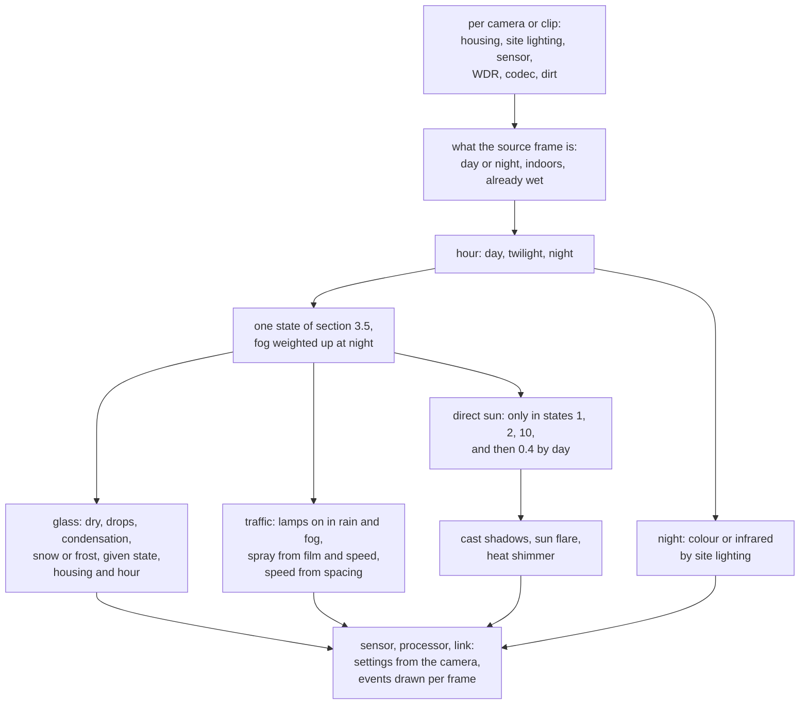

# Review: scene-aware effects, further awareness, and the pipelines' statistics

18 November 2026. Written as a review only. On 19 and 20 November its
order of work was carried out, at your word:

| Finding or awareness | State | Where |
| --- | --- | --- |
| S0, wakes behind their vehicles (awareness 0) | built | `wake_lies`, `vehicle_spray(ground=)` |
| S1, speed from spacing (awareness 1) | built | `spaced_speeds` |
| S3, thickness by the line of sight | built for wakes; the mist still has one constant | `vehicle_spray` |
| Parked or moving (awareness 3) | a parked row is a queue to the spacing; one parked car alone is not told | |
| Lamps in day fog (awareness 5) | built | `RandomFog(vehicle_lamp_range=)` |
| N2 and N3, which way the light is going (awareness 6) | built, with estimated constants | `headlamp_light`, `street_air` |
| What the frame already is (awareness 2) | built: night, and indoors with labels; not "already wet" | `presets/source.py` |
| P1, P2, P3: weather by its shares and its strengths | built | `weather_shares`, `rebalanced`, `weather_state` |
| P4, the sun only over dry air | built | `weather_state(sunlit=)` |
| Section 3.4, what occurs together | water on the glass by state, rain through fog, snow on the housing with snow: built, and measured in `pipelines.md`; insects and webs under infrared and out of snow, heat shimmer over dry ground by day: built on 22 November; frost and wind: not | `weather_state(insects=, webs=, shimmer=)` |
| P5, fog by the hour | built | `FOG_BY_HOUR` |
| P7, the night in colour | built | `NightColorMode` in `surveillance` |
| P8, lamps and spray in the pipelines | built, by day | `weather_state(traffic=)` |
| P10, the camera chain's odds | built as the table suggests, but `codec`, `faults` and `dirt` left as they were | `_stream` |
| P6, colour or infrared per site | documented, not changed: two weights | |
| S2, S4 to S8, N1, N4 to N6 | not started | |
| Awareness 4 and 7 to 12 | not started | |

Your three decisions were taken as recommended, each a default you can
change: rebalanced at the square root (`prior_power`), a lowland site in
central Europe, and frames taken evenly in time (the branch weights).
[`pipelines.md`](pipelines.md) is rewritten for the result; what follows is
the review as it was written, with S0's note of what was done.

It covers four questions:

1. Are the effects that read the scene physically sound, the spray behind
   vehicles ("car fog") in particular?
2. What else would be worth reading from the scene?
3. Do the ready-made pipelines (`surveillance`, `surveillance_lite`,
   [`pipelines.md`](pipelines.md)) describe a statistically reasonable
   set of frames?
4. Which conditions occur together, and how often?

"Car fog" is the spray that `RandomRain(spray_range=...)` draws: wheel
tufts, a wake behind each vehicle, and the mist over the carriageway.
Your concern with it was the direction of the plumes against the
direction of the cars; that is finding S0, added on 19 November after
you sent the city-road sample, and it is now the first thing to fix.

How far each statement can be trusted is marked:

| Mark | Meaning |
| --- | --- |
| **[code]** | Read in the source for this review |
| **[seen]** | Seen in a frame rendered for this review, at full size |
| **[found]** | From a source located for this review, through a search summary; the source itself was not read in full |
| **[recalled]** | From memory of a standard or a textbook figure; not looked up |
| **[estimate]** | My own estimate, to the nearest factor of two at best |

## The short version

- **Wakes do not lie behind their vehicles.** A wake takes its direction
  from one road model for the whole frame, or from the long way of the
  vehicle's outline, and its length from the outline's size. On the city
  road the cars on the exit ramp trail spray sideways across the verge,
  60° to 80° off and three times too long. Which end is the back is
  right; the angle and the length are not.
- **The spray's speed is not read from the frame either.** The
  traffic's speed is drawn from a range the caller gives and nothing in
  the frame is asked. A queue at a junction, drawn at the default 40 to
  130 km/h, trails a dense cloud behind every car. The spacing between
  vehicles bounds their speed, and the frame shows the spacing.
- **The night lighting has no sense of which way light is going.** A
  headlamp's pool on the road and the lit air in fog are drawn equally
  bright for a car coming on and one driving away. In both cases the
  camera facing the lamps sees several times more.
- **The pipelines draw common weather at rare strengths.** Rain fires on
  6 % of frames, which is how often it rains, at 21 to 46 mm/h, which
  falls for a few hours a year. Fog fires on 3 % of frames at 94 to 191 m
  of visibility. The mild states that make up most bad weather cannot be
  drawn at all: light rain, a wet road after the rain has stopped, snow
  lying under a clear sky, fog thin enough to see through.
- **Sun-only effects fire in the rain.** `CastShadows` (30 %) and
  `SunFlare` (12 %) are drawn in every day frame whatever the weather.
- **Rain and fog are made exclusive, and they are not.** Drizzle with fog
  is one of the commonest kinds of fog.
- **The pipelines use none of what was built since.** No spray, no lamps
  in rain, no `NightColorMode`: the street-lit night is still an
  exposure and tint shift.

The order I would work in is at the end, with three questions for you.

---

## 1. Are the scene-aware effects physically sound?

### 1.1 Verdict by effect

| Effect | Where | Verdict | Main fault | Fix |
| --- | --- | --- | --- | --- |
| Spray: tufts, wakes, mist | `RandomRain(spray_range=)` | Structure sound, placing unsound | Wakes not behind their vehicles (S0); speed unrelated to the traffic shown (S1) | medium |
| Wet road on labelled paving | `RandomRain` | Sound | Only ever drawn while rain falls (section 3) | pipeline |
| Lamps lit in daytime rain | `RandomRain(vehicle_lamp_range=)` | Sound | Shares of lit lamps are Europe's | none |
| Street-lamp pools | `NightIrMode`, `NightColorMode` | Acceptable | Pools about twice as contrasty as a road lit to standard (N1) | small |
| Headlamp beams on the road | same | Unsound in one respect | As bright seen from behind as from ahead (N2) | small |
| Lamp cones in fog, rain, snow | `lamp_cone_range` | Unsound in one respect | Scattering taken as equal in all directions (N3) | small |
| Signs and plates under infrared | `retroreflector_range` | Sound | Paint keeps its return when the road is wet (N5) | small |
| Wheel tracks, snow on vehicles | `RandomSnow` | Sound in kind | Moving and parked vehicles carry the same snow | with parked vehicles |
| Night in colour | `NightColorMode` | Sound | Not in any pipeline | pipeline |
| Ground fog under the camera | `GroundFog` | Sound | none found | |

### 1.2 Spray and the mist over the road

Rendered for this review: `RandomRain` at rain level 2 on a soaked road
(ground level 5), seed 4, `spray_range` 0.6 and 1.0, on the motorway
reference scene, the city road, the Paris street and the underpass.

What is right, and should be kept **[code]**:

- Three parts with different physics: coarse drops that fall within a
  metre or two, fine spray carried in the wake, and a layer over a busy
  carriageway.
- The mist's optical depth grows in proportion to distance. For a camera
  above a layer of height *h*, a sight line that meets the road at
  distance *d* runs *h·d/H* through the layer (*H* the camera's height).
  Linear in distance is the right law.
- Spray is hidden by what stands nearer and by nothing else, lamps show
  through it, and it is off by default.

What is wrong, most serious first:

**S0. Wakes do not lie behind their vehicles. Major, and the first to
fix.** On the city-road sample the two cars and the lorry on the right,
seen from behind, trail their spray to the right, across the verge. To
find why, I drew each wake's axis over the photograph on the city road,
the motorway and the underpass. Which end of each vehicle is the back
was right on all three, as far as I can judge them. The angle and the
length are wrong, for three separate reasons **[code, seen]**:

1. **The direction is the road's, and there is one road model for the
   whole frame.** `RoadModel` has one vanishing point, and every
   carriageway, slip road and ramp takes its direction from it.
   - On the city road the three vehicles on the right are on the exit
     ramp, which climbs away to the right. The model gives them a
     direction that is nearly horizontal in the picture, 60° to 80° from
     the ramp's.
   - On the same scene the model's vanishing point is at column 380,
     where the main carriageway's lane lines meet near column 460 (by
     eye, on the overlay). Wakes on the main carriageway are 15° to 25°
     off, too steep left of centre and too flat right of it, and one
     car's wake runs over the lane line into its neighbour's lane.
   - On the underpass the fit degenerates (a vanishing point 62 000
     pixels outside the frame) and every car on the bend gets the same
     direction.
2. **The long way of a vehicle's outline is taken for its heading.**
   Where the outline is longer one way than the other, within 35° of
   the road's direction, `_vehicle_lie` turns the wake to it. Seen from
   a mast, an outline is rear, side and roof together, and its long way
   leans towards the horizontal. On the motorway eleven vehicles of the
   right carriageway are turned 15° to 30° this way, and their wakes
   cross the lanes and the barrier. The night beams had the same fault
   and were cured of it in the twelfth round: `vehicle_heading` in
   `utils/night_light.py` uses which end is seen and how the outline
   leans from its lamps. The spray was never moved to it, so the
   library has two headings for one vehicle.
3. **A wake's length is counted in outlines, not in metres.** It is the
   distance travelled in 0.75 s, in car lengths, times the outline's
   extent along the wake. For a vehicle seen end-on that extent is its
   width or its height, not its foreshortened length. Wakes come out
   120 to 200 px long on the 800 px city road, where the ground gives
   about 40 **[estimate, from the provider's camera: 8 m up, the car
   some 70 m off]**, and up to 383 px in the 640 px motorway frame. A
   wake three times too long carries its error in direction three times
   as far, which is why the plumes end on the verge and not merely on
   the wrong side of their lane.

**Done on 19 November.** `vehicle_spray(ground=...)` and
`wake_lies` in `utils/road.py`; `RandomRain` passes the ground's plane.
Checked by eye on the four scenes and by six new tests on a drawn
camera. The first version had hard edges, which you sent back the same
day; their four causes and cures are in
[`road_surface.md`](road_surface.md#spray) ("With no edge of its own
making"). Each puff is also 0.6 of its old density, set by eye so that a
wake seen along itself from a mast is about what it was. What it leaves:

- The road model itself is not corrected. Lanes, wheel tracks and the
  "lies across the road" rule still use its direction.
- A vehicle with no pair of lamps and no neighbour that has one points
  along the line from the camera.
- The night beams take such a vehicle by its outline, as before, so the
  two headings are one only for vehicles with a pair.
- Speed (S1) is untouched: the queue on the ramp of the city road still
  trails spray, now behind it.

The cure was to lay the wake on the ground and not in the picture: the
tail's place on the ground's plane, a heading along the ground, a
length in metres, and each puff projected through the scene's camera.
The heading is the one the beams use. For a vehicle seen from behind or
from the front it is the line from the camera along the ground, turned
by how the outline leans from its lamps; the road's direction serves
only for vehicles seen side-on or not read, and then per road and not
per frame. Direction, length and the narrowing with distance then come
out together. A wake is also thicker seen along it than across it, which
is the wakes' half of S3.

**S1. Speed is not read from the frame. Major.** `traffic_speed_range_kmh`
defaults to 40 to 130 km/h and is drawn per frame with no regard to the
traffic **[code]**. Spray goes with speed to the power 2.8, so this one
draw decides everything.

- On the underpass scene, a queue rounding a bend one or two car lengths
  apart is drawn with a dense white cloud behind every car **[seen]**.
- On the motorway reference scene the gaps are one to three car lengths
  in every lane **[seen]**. A gap of 10 m at 100 km/h is a headway of
  0.36 s. Drivers keep about a second at the least, and a lane at
  capacity runs at 1.5 to 1.8 s **[recalled]**. Traffic that close is
  moving at 35 km/h or less, where the power law gives 4 % of the spray
  that was drawn.
- The fix is a cap, not a model: speed ≤ gap ÷ about one second. The gap
  along a lane comes from the road model and the vehicle reader, in
  metres where the camera's height is known and in car lengths (4.5 m)
  where it is not.
- Parked vehicles are the same fault. A car at the kerb, aligned with
  the road, is given a wake **[code]**: only vehicles lying across the
  road are excluded.

**S2. The power law is used below where it was fitted. Medium.** The
2.8th power is a fit above 45 mph (72 km/h), by its own source, itself
unverified. Below about 50 km/h there is splash at the wheels and next to
no hanging spray **[recalled]**; one secondary source puts sheet-like
spray at about 40 km/h and only on films deeper than 0.5 mm **[found]**.
The code extrapolates smoothly to 21 km/h. A soft threshold between 40
and 60 km/h for the wake and the mist would be nearer the truth; the
tufts can stay.

**S3. A wake is as thick seen along it as across it. Medium.** Each puff
has a peak that does not depend on how it is viewed **[code]**. A wake
2 m wide and 15 m long has 5 to 8 times the optical depth end-on that it
has side-on. From a mast the path through it is its height over the sine
of the viewing angle, so the error is about a factor of two either way
for a typical camera, and more for a low one. The mist has the right
law but uses one constant (optical depth 1 at 110 m) whatever the
camera's height, though the provider often knows it: a camera on a 14 m
bridge sees through half the mist that one at 6.5 m does.

**S4. Spray is lit by the frame's sky wherever it hangs. Medium.** Its
colour is the rain veil's airlight times 0.9 **[code]**. Under the
underpass's bridge and trees the clouds come out paler than everything
round them and read as smoke **[seen]**. Spray in shade is lit by less
sky; scaling its light by the local brightness of the road it hangs over
would do.

**S5. No wind. Minor.** The rain's streaks slant with a wind; the wakes
go straight back **[code]**. A 5 m/s crosswind moves a cloud nearly 4 m
sideways in the 0.75 s it is taken to hang, which is two car widths.

**S6. The mist stops at the road's label. Minor.** An empty hard
shoulder is as misty as the lanes, and the verge beside it is clear with
a visible line between **[seen]**. Things beyond the road seen through
the layer are not veiled **[code]**.

**S7. Lorries. Minor.** A lorry throws at most four times a car's spray
and is held to 90 km/h, which nets about twice a fast car's. Every
source says lorries dominate **[found]**; the true ratio is probably
several times larger. Not checked.

**S8. By eye, the wakes are smooth blobs.** Fourteen Gaussian puffs with
a frame-wide noise. On the motorway the result reads as ground fog more
than spray **[seen]**. This matters less than S0 to S4: with honest
speeds most frames have little of it.

### 1.3 Night lighting

**N1. Street-lamp pools are a point source with a cosine. Acceptable.**
Light falls as the inverse square times cos^1.5 of the angle from
straight down **[code]**. With columns 3.5 heights apart that gives
about 6:1 between the brightest and darkest road **[estimate, from the
formula]**. A road lit to standard is 3:1 to 5:1, because luminaires are
shaped to throw light along the road **[recalled]**. Old or sparse
lighting is worse than the code's. Leave it, or flatten the exponent a
little.

**N2. A headlamp's pool is as bright from behind as from ahead.
Medium.** `_BEAM_LEVEL` puts the pool at four times what a street lamp
puts under itself **[code]**. In illuminance a dipped pair gives 10 to
30 lux a few metres ahead, against 20 to 50 lux under a street lamp
**[estimate]**: comparable, not four times. What a camera sees depends
on the direction. Asphalt at a grazing angle throws light forward: a
camera the car is driving towards sees the pool several times brighter
than a matt surface would show it, and a camera behind the car sees
less than matt **[recalled, road photometry; not checked against
measurements]**. So four is fair for traffic coming on and several times
too bright for traffic driving away. The eleventh round of the
road-surface work raised this level so that cars seen from behind would
show a beam at all; they should show one, fainter.

**N3. Lit air scatters equally in all directions. Medium.** The cones
use a phase factor of a quarter, which is exactly isotropic scattering
in the frame's units **[code]**. Fog and rain scatter mostly forward:
light turned through 90° is some 3 to 10 times weaker than isotropic,
and light turned through a few degrees far stronger **[recalled]**. So
a cone under a lamp seen from the side is drawn too bright, and the
wedge ahead of a car coming on, seen nearly along the beam, too faint.

N2 and N3 are one missing term: the angle between the way the light
travels and the way to the camera. One function of that angle fixes
both.

**N4. Nothing casts a shadow in lamp light.** Documented. Still the
largest thing a lit night lacks, and the most expensive to add.

**N5. Road paint returns the illuminator's light when wet. Minor.**
Water floods the glass beads and a wet marking returns a fraction of
what a dry one does **[recalled]**. The paint gain (3×) does not know
the road is wet **[code]**.

**N6. A wet road does not mirror lamps lit after it was wetted.**
Documented. In the pipelines' night rain this is the cue most missed:
the streak of every lamp down the film.

**Checked and sound:**

- **Sheeting return, 500× a matt white.** White sheeting of the middle
  grade returns about 250 cd/lx/m², a matt white 0.32, a ratio near 800;
  the lowest grade gives about 220 and number plates 200 to 600
  **[recalled]**. With each plate drawn between a quarter and all of
  500, the range is centred where it should be.
- **Lamps lit by day in rain, 6× full scale.** A camera on a mast is
  above a dipped beam's cut-off and sees a few hundred candela, as it
  does from a daytime running lamp. That is some 5 to 40 times the
  luminance of a white surface under cloud **[estimate from recalled
  regulation limits]**.

---

## 2. What else would be worth reading from the scene?

Ranked by what each would fix against what it costs. "Reader" is the
vehicle reader (`vehicles=`); "geometry" the camera's height and tilt.

| # | Awareness | Read from | What it fixes | Size |
| --- | --- | --- | --- | --- |
| 0 | **One heading per vehicle, on the ground** | The reader's end and lamps, the ground's plane, `vehicle_heading` | S0: wakes laid sideways and too long. Shared by spray, beams and lamps | medium |
| 1 | **Speed from spacing** | Road model, reader, geometry | S1: spray and mist in queues and dense traffic | small |
| 2 | **What the source frame already is** | Labels, brightness, lamps burning | Rain in a garage, a day branch on a night photograph, wetting a wet road. The pipelines assume a dry daylit outdoor frame and never check | small |
| 3 | **Parked or moving** | Position across the road against the lanes, the kerb, the footway label | Spray and lamps on parked cars; snow kept on parked cars and shed by moving ones | small |
| 4 | **Sun in the source frame** | Existing shadows of vehicles and poles | `CastShadows` throws its shadows by a drawn azimuth, across the photograph's own. Also tells a sunlit source from an overcast one, which gates shadows and flare | medium |
| 5 | **Lamps in day fog** | Reader, `vehicle_lamps`, the fog's density | In dense fog a car is two haloes before it is a car. `RandomFog` lights nothing | small |
| 6 | **Direction of light against the camera** | Already known: vehicle heading, lamp places | N2 and N3 | small |
| 7 | **One exposure per frame** | A light level drawn once, on the provider | Shutter, aperture and gain are drawn separately by `RandomRain`, `AcFlicker`, `SensorNoise`, `CameraVibration`, `WaterDroplets`. The night branches give rain a slow shutter and flicker a 1 to 8 ms one **[code]**. The same repair that "one camera per scene" was for geometry | medium |
| 8 | **One wind per frame** | Drawn once, on the provider | Rain slant, spray drift, mount vibration, runners on the glass. None in fog | small |
| 9 | **A road layout given per camera** | The caller, as `InstallationGeometry` is | Lanes, direction of each carriageway, speed limit. Surer than any reading, for a fixed camera | medium |
| 10 | **Day shade taken off a rainy road** | `even_road`, already built for night | A soaked road with the sun's shade still across it | small |
| 11 | **Lit windows and shop fronts** | Building labels | A lit night with dark buildings | medium |
| 12 | **Camera and clip identity** | The caller | Dirt, drops, WDR, the codec and the weather held fixed over a camera or a clip (section 3.7) | medium |

Not worth it, in my judgment:

- **Season** (bare trees, dry grass). Large, and the least physical.
  Its absence has a cost worth knowing: settled snow under trees in full
  leaf is what every summer source frame gives.
- **Wet bodywork and facades.** Real, small in the picture.
- **Shadows in lamp light.** Worth it for realism, but it needs depth
  good enough to cast from, which the depth map is not at thin things.

---

## 3. The pipelines

### 3.1 What "statistically reasonable" has to mean

Two different aims are both called this, and
[`pipelines.md`](pipelines.md) serves each halfway:

- **Matched**: frames in the proportions a deployment sees. Mostly clear
  and dry, bad weather rare and mostly mild.
- **Covering**: rare conditions over-sampled so a model sees enough of
  them, with the common ones still the majority.

The shipped defaults take the *frequency* from the first ("climatological
rather than convenient") and the *strength* from the second (weather one
level above everything else, so a draw is "not wasted"). The result
matches neither: severe weather at the rate of ordinary weather.

My recommendation is to state the aim as a parameter. Estimate the real
shares once (section 3.3), then sample each state in proportion to its
share raised to a power between 0 and 1: 1 is matched, 0.5 is the
square-root rebalancing used for long-tailed classes, 0 is uniform.
Strength within a state is drawn from its real spread, not from a band.

### 3.2 Findings

**P1. Frequency and strength contradict each other. Major.** At the
default weather level 2 **[code]**:

| State | Share of frames | Drawn strength | How often that strength occurs |
| --- | --- | --- | --- |
| Rain | 6 % | 21.5 to 46.5 mm/h | Above 22 to 42 mm/h for 0.01 % of the time in temperate Europe, about an hour a year **[recalled, ITU-R P.837]** |
| Fog, day | 3 % | 94 to 191 m visibility | Fog under 1 km is 0.5 to 1 % of hours at large west European airports **[found]**; under 200 m is a fraction of that |
| Fog, night | 3 % | 181 to 447 m | as above |
| Snow | 3 % | 1.65 to 4.4 mm/h of water | Moderate to heavy snow; snow of any strength falls for well under 1 % of hours in a lowland maritime climate **[estimate]** |

About a quarter of rain time is above 2 mm/h and under 2 % of it above
10 mm/h **[derived from the recalled ITU-R figures]**. The pipeline's
rain starts at twice the second figure.

**P2. The commonest bad-weather frames cannot be drawn. Major.** The
ground follows the sky in the pipelines: a wet road only in the rain
arm, settled snow only in the snow arm **[code]**. In fact:

- A road stays wet for longer than the rain lasts, so a wet road with no
  rain is more common than rain.
- Snow lies for days after falling for hours.
- Most rain is below `RandomRain`'s floor of 2 mm/h. Its streaks are
  invisible, and the frame is a wet road, a grey light and perhaps drops
  on the glass.
- Fog between 200 m and 1 km is most fog. By day the pipeline draws none
  of it.

Section 3.5 puts numbers on this: the states the pipeline cannot draw
are about a fifth of all hours.

**P3. Rain, snow and fog are exclusive. Wrong for rain with fog.**
`pipelines.md` opens by calling fog with snow a frame that "could not
exist". Precipitation fog (cloud base lowering in light rain or drizzle)
is the most common type of fog around New York **[found: Tardif and
Rasmussen, 2007]**, and falling snow is itself a loss of visibility.
What is exclusive is the *kind* of precipitation. Visibility is a second
variable, dependent on the first.

**P4. Sun-only effects ignore the weather. Major, and cheap to fix.** In
the day branch `CastShadows` (p = 0.30) comes before the weather and
`SunFlare` (p = 0.12) after it, both unconditionally **[code]**. Three
day frames in ten with rain, fog or snow are given new hard shadows.
`RandomRain` then pulls contrast down for the overcast it implies,
softening shadows that should not be there. Both belong in the clear
arm, and there only as often as the sun is out (section 3.3).

**P5. Weather does not depend on the hour.** The same weather
probabilities serve all three lighting states **[code]**. Radiation fog
forms at night and clears after sunrise **[found, qualitative]**; dew on
the glass is a matter of night and dawn. Rain is close to even through
the day.

**P6. Infrared or colour at night is a property of the site.** The
branch weights (0.15 colour, 0.30 infrared) are drawn per frame. A
camera on a lit street stays in colour every night and one on an unlit
road goes to infrared every night. For a dataset from many cameras a
per-frame draw is a fair stand-in. For a single camera it is wrong, and
the 2:1 in favour of infrared is doubtful for road cameras in towns,
which is what the sample scenes are.

**P7. The street-lit night is still a tint.** That branch underexposes
and warms a daylight frame **[code]**. `NightColorMode` relights the
scene from its lamps and is used nowhere. The caveat in `pipelines.md`
that "neither night branch relights the scene" is out of date for the
infrared branch on a provider with labels, and need not be true of the
other.

**P8. Nothing built for the road is switched on.** Spray and daytime
lamps are off in the pipelines **[code]**. Lamps in rain are close to
universal and safe to turn on now. Spray should wait for S0 and S1.

**P9. One strength per pipeline.** The reason given holds: gates of the
same shape share Albumentations' random stream and fire together. But it
does not rule out a spread. The weather is already one `OneOf`, and
giving it more arms (light, moderate and heavy rain as three arms)
consumes the same single draw. The transforms draw uniformly inside
their ranges (`rain_rate`: **[code]**), so a wide range alone would
centre on the wrong value; arms, or a skewed draw inside the transform,
are the two ways to a real spread.

**P10. The camera chain mixes events with settings.** `pipelines.md`
says so. In detail:

| Stage | Now | What it is | Suggested **[estimate]** |
| --- | --- | --- | --- |
| `RollingShutter` | 0.50 | A whole-frame shear, which a fixed camera has only when its mount moves | 0.10, with wind; none in fog. At level 1 it is ±3 px, which changes little and still resamples half of all frames |
| `AcFlicker` | 0.45 night, 0.05 day | Site lighting and shutter. Its shutter is 1 to 8 ms in a branch that otherwise assumes a slow one **[code]** | 0.10 to 0.20 in a street-lit night, 0.02 by day |
| `AcFlicker`, infrared branch | 0.45 | The camera's own LEDs are not on the mains | 0 on an unlit site; as street-lit where lamps are found |
| `HousingOccluders` | 0.12 everywhere | Insects and webs gather at a lit lens in warm months | 0.03 by day, 0.20 under infrared, none with snow or frost |
| `ExposureTransient` | 0.10 | An event of a second or two | 0.03 as an event. As a spread of exposure and white balance 0.10 is fine, but then it is not a transient |
| `TemporalDenoiseArtifacts` | 0.12 day, 0.30 night | A setting; always on at night | 0.8 night, 0.2 day |
| `WdrToneMapping` | 0.12 | A setting | 0.3 of cameras, fixed per camera |
| `VideoCodecArtifacts` | 0.15 | Always, or already in the pixels | 0 for frames decoded from video, else 0.6 |
| `TransmissionFaults` | 0.03 | Link quality | 0.005 wired, 0.03 to 0.05 wireless |
| `SensorNoise` | 0.70 lit night, 0.15 day | Always present; its level is the gain | 1.0 at night |
| `DirtSoil` | 0.25 | Persistent for weeks | Keep; fix per camera |

The honest values for the three settings are more expensive, as
`pipelines.md` already says. The table is what is true, not what is
affordable.

**P11. The water-on-glass odds are reasonable.** 0.35 in rain, 0.18 in
fog, 0.10 in snow and 0.06 in clear weather **[code]** sit inside my
estimates for a mixed fleet (section 3.4). They are a housing's
property more than a frame's: 0.7 for an exposed dome and 0.2 for a
hooded bullet.

**P12. The climate named is not the climate drawn.** "Temperate
maritime" fits rain at 6 %. Snow at 3 % and fog at 3 % belong to
somewhere colder and to a river basin.

### 3.3 How often each condition occurs

Share of hours over a year, frames taken evenly in time. The reference
is a lowland site in central Europe or northern Italy.

| Condition | Reference | Across sites | Basis |
| --- | --- | --- | --- |
| Sun above the horizon | 0.50 | the same everywhere over a year | geometry |
| Civil twilight | 0.05 | 0.04 to 0.07 | **[recalled]** |
| Night | 0.45 | | |
| Direct sun, as a share of daylight | 0.40 | 0.30 north-west Europe, 0.60 Mediterranean | **[recalled]** sunshine hours against 4400 daylight hours |
| Rain falling | 0.065 | 0.03 Mediterranean, 0.07 to 0.08 Netherlands and Britain | **[recalled]**; the search confirmed only rain *days* (192 to 197 a year in the Netherlands **[found]**) |
| of it, under 2 mm/h | 0.70 to 0.75 | | **[derived, ITU-R recalled]** |
| of it, 2 to 10 mm/h | 0.23 to 0.28 | | same |
| of it, over 10 mm/h | 0.015 to 0.02 | higher on Mediterranean coasts | same |
| Snow falling | 0.006 | 0 to 0.03 | **[estimate]** |
| Fog under 1 km | 0.02 | 0.005 to 0.01 at large west European airports (40 to 90 h a year **[found]**); 0.03 to 0.06 in the Po valley of past decades (92 fog days a year at Milan Linate **[found]**, since about halved **[found]**) | |
| of it, under 200 m | 0.2 to 0.3 | | 29 very dense of Linate's 92 days **[found]** |
| Road wet or damp | 0.16 | 0.04 (Alabama **[found]**) to 0.3 in a north-west European winter | **[estimate]** |
| Snow lying | 0.03 | 0 to 0.3 | **[estimate]** |

Two things move all of it:

- **How frames are sampled.** Frames taken when something passes follow
  the traffic, and 17 to 23 % of traffic runs in darkness **[found:
  Dutch motorways 1975, a New Zealand count]**, not 45 %.
- **The camera.** Housing for the glass, site lighting for the night.

### 3.4 What occurs together

For the reference site **[estimate throughout]**:

| Given | Then | Probability |
| --- | --- | --- |
| Rain | Road wet | 0.95 |
| No rain | Road wet or damp | 0.10 |
| Rain | Fog under 1 km | 0.05 to 0.08 |
| Fog | Rain or drizzle | 0.15 in a river basin, 0.4 by the sea |
| Fog | Night or dawn, against day | about 3 to 1 |
| Rain, fog or falling snow | Direct sun | 0.02 |
| Snow lying, day, none falling | Direct sun | as any day: 0.4 |
| Rain | Drops on the glass | 0.7 exposed dome, 0.2 hooded, 0.45 mixed fleet |
| Road wet, no rain | Drops left on the glass | 0.15 |
| Dry, night or dawn | Dew on the glass | 0.05 |
| Dry, day | Water on the glass | 0.01 |
| Fog | Condensation on the glass | 0.3 |
| Snow falling | Snow or ice on the housing | 0.3 |
| Rain, day | Traffic's front lamps lit | 0.8 to 0.9 in Europe |
| Dense fog, day | Traffic's lamps lit | 0.95 |
| Soaked road, traffic over 70 km/h | Spray | certain |
| Wet road, traffic under 50 km/h | Spray | none |

Joint shares of all hours that follow:

| Combination | Share of hours |
| --- | --- |
| Rain and wet road | 6 % |
| Wet road, no rain | 10 % |
| Rain and drops on the glass | 3 % (1.3 % hooded, 4.5 % exposed) |
| Wet road, drops left, no rain | 1.5 % |
| Rain and fog | 0.4 % |
| Rain, fog and drops | 0.2 % |
| Fog and condensation | 0.6 % |
| Fog at night or dawn | 1.4 % |
| Snow lying, none falling | 3 % |
| Snow falling on lying snow | 0.5 % |
| Rain at night | 3 % |

What must *not* occur together:

| Pair | Why |
| --- | --- |
| Rain, fog or falling snow, with hard shadows or sun flare | No direct sun |
| Fog with a wind (slanted rain, vibration, rolling-shutter wobble) | Fog needs still air |
| Snow or frost with insects, webs or heat shimmer | Season |
| Heat shimmer with rain, fog, night or overcast | Needs hot sunlit ground |
| Infrared night with sun flare, cast shadows, mains flicker on the camera's own light | Lighting |
| Spray with a queue, or with a merely damp road | S1; needs a film |
| Weather indoors | A garage has none |

### 3.5 The states, real and rebalanced

One exclusive list of atmosphere and ground together, with the share of
hours at the reference site **[estimate]** and that share rebalanced by
its square root:

| # | State | Real | Rebalanced | Shipped pipeline |
| --- | --- | --- | --- | --- |
| 1 | Dry air, dry road | 0.78 | 0.42 | 0.88 |
| 2 | Dry air, road wet or damp | 0.10 | 0.15 | cannot |
| 3 | Light rain or drizzle, under 2 mm/h | 0.045 | 0.10 | cannot |
| 4 | Moderate rain, 2 to 10 mm/h | 0.016 | 0.06 | cannot |
| 5 | Heavy rain, over 10 mm/h | 0.0015 | 0.018 | 0.06 |
| 6 | Fog, 200 m to 1 km | 0.012 | 0.052 | at night only |
| 7 | Dense fog, under 200 m | 0.004 | 0.030 | 0.03 |
| 8 | Fog or thick mist with drizzle | 0.004 | 0.030 | cannot |
| 9 | Snow falling | 0.006 | 0.037 | 0.03, moderate to heavy only |
| 10 | Snow lying, none falling | 0.03 | 0.082 | cannot |
| 11 | Sleet, rain on slush | 0.0015 | 0.018 | cannot |

States 2, 3, 4, 8, 10 and 11, and state 6 by day, are about 20 % of
real hours and nearly half of the rebalanced set. The shipped pipeline spends
its weather on states 5, 7 and 9, which are 1.2 % of real hours.

All but state 11 can be drawn with what exists:

| State | With |
| --- | --- |
| 2 | `RandomRain`, no streaks (`max_streaks=0`), rate at its floor, ground levels 1 to 4 |
| 3 | `RandomRain` at its floor, ground levels 2 to 4 |
| 4 | `RandomRain` level 1 |
| 5 | `RandomRain` levels 2 and 3 |
| 6 | `RandomFog` level 1 (326 to 978 m); `NightFog` levels 1 and 2 |
| 7 | `RandomFog` levels 2 and 3 |
| 8 | `RandomRain` without streaks, then `RandomFog` level 1; drops likely |
| 9 | `RandomSnow` levels 1 and 2, the ground left to chance |
| 10 | `RandomSnow` without flakes, ground levels 2 to 5, wheel tracks |

### 3.6 The order to sample in

Differences from the shipped structure:

- The ground is part of the state, not a consequence of what is falling.
- Sun-only effects hang off a "direct sun" draw that only clear states
  have.
- Fog is weighted by the hour.
- The camera's settings are drawn once per camera or clip where the
  caller can say which frames share one, and per frame only where it
  cannot.

### 3.7 Per camera, per clip, per frame

| Level | What is fixed at it |
| --- | --- |
| Camera | Geometry, housing, site lighting, sensor and its rolling shutter, WDR, codec, dirt and scratches, a web in season |
| Clip (minutes) | Weather and ground state, water on the glass, exposure and gain, wind, which lamps are lit |
| Frame | Noise, streak and flake positions, flicker phase, packet loss, exposure transients, insects in flight |

Albumentations draws everything per frame. A caller with camera and clip
identifiers could be given a way to seed the first two levels from them
(awareness 12). Without that, the pipelines describe a fleet sampled one
frame at a time, which is what `pipelines.md` says, and is right for
detection datasets pooled from many cameras.

---

## 4. Order of work, and what I need from you

What I would do, in order:

1. **Pipelines, with what exists** (no new transforms): the states of
   section 3.5 as arms of the one weather choice, sun-only effects moved
   under clear states, `NightColorMode` in the street-lit branch,
   daytime lamps on in rain, the corrections of P10.
2. **Wakes laid on the ground, by each vehicle's own heading**
   (awareness 0), then **speed from spacing, and parked vehicles**
   (awareness 1 and 3). Then
   spray can be switched on in the pipelines' rain arms.
3. **The direction term** for beams and lit air (awareness 6).
4. **Source-frame gate** (awareness 2).
5. **Lamps in day fog** (awareness 5).
6. The rest of section 2 as they are wanted.

Three decisions are yours:

1. **Matched or rebalanced by default?** I recommend rebalanced at the
   square root, with the power as an argument.
2. **Which climate is the reference?** I used lowland central Europe and
   northern Italy. The numbers in 3.3 change by a factor of two to five
   between a Mediterranean coast and a river basin.
3. **Frames even in time, or following traffic?** It moves the night
   share from 45 % to about 20 %.

## 5. Limits of this review

- The climate figures marked **[recalled]** and **[estimate]** should be
  replaced by counts from hourly records of the reference site before
  they go into defaults. Hourly station data (precipitation, visibility,
  present weather) gives every row of 3.3 and 3.4 directly. I did not
  fetch any.
- The road-photometry claims behind N2 and the scattering claims behind
  N3 are from memory. Their direction is certain; their size is not.
- Spray was judged on four scenes and one seed, and its wakes'
  directions on three. The infrared and colour
  nights were assessed from the code, not re-rendered.
- The spray literature's speed threshold was not found at source.

## Sources located for this review

Read as search summaries, not in full.

- Tardif, R., Rasmussen, R. M. (2007). Event-based climatology and
  typology of fog in the New York City region. J. Appl. Meteor. Climatol.
  46, 1141–1168.
  [ucar.edu](https://impacts.ucar.edu/en/publications/event-based-climatology-and-typology-of-fog-in-the-new-york-city-/)
  (precipitation fog the most common type)
- Hazardous weather affecting European airports: climatological
  estimates from ERA5.
  [researchgate.net](https://www.researchgate.net/publication/338870763_Hazardous_weather_affecting_European_airports_Climatological_estimates_of_situations_with_limited_visibility_thunderstorm_low-level_wind_shear_and_snowfall_from_ERA5)
  (40 to 90 hours a year of limited visibility at large airports)
- Fog in the Po valley: some meteo-climatic aspects.
  [researchgate.net](https://www.researchgate.net/publication/242556716_Fog_in_the_Po_valley_some_meteo-climatic_aspects)
  (92 fog days and 29 very dense a year at Milan Linate)
- Observed trends in aviation-related weather hazards at major Italian
  airports. [doi:10.3390/meteorology5010007](https://doi.org/10.3390/meteorology5010007)
- KNMI: rain days in the Netherlands.
  [knmi.nl](https://www.knmi.nl/over-het-knmi/nieuws/als-het-regent-valt-er-9-meer-regen-dan-50-jaar-geleden)
- A Europe-wide fog and low stratus climatology from satellite.
  [mdpi.com](https://mdpi.com/2072-4292/10/4/628) (daily cycle,
  qualitative)
- FHWA: wet-pavement exposure, Alabama.
  [fhwa.dot.gov](https://www.fhwa.dot.gov/publications/research/infrastructure/pavements/ltpp/06109/paper3.cfm)
- FHWA: Empirical Studies on Traffic Flow in Inclement Weather.
  [ops.fhwa.dot.gov](https://ops.fhwa.dot.gov/publications/weatherempirical/sect2.htm)
  (speeds fall 2 to 17 % in rain)
- SWOV: Preliminary survey of the problem of spray thrown up by
  vehicles.
  [swov.nl](https://swov.nl/en/publicatie/preliminary-survey-problem-spray-throw-vehicles)
- SWOV R-79-17, on traffic at night.
  [swov.nl](https://swov.nl/system/files/publication-downloads/r-79-17.pdf)
