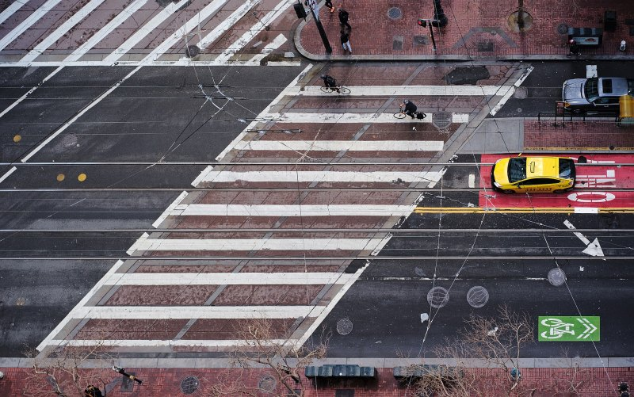
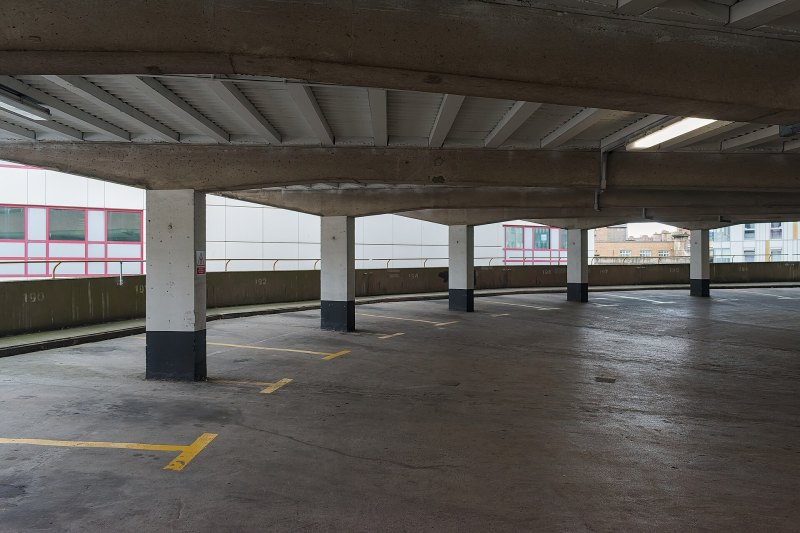
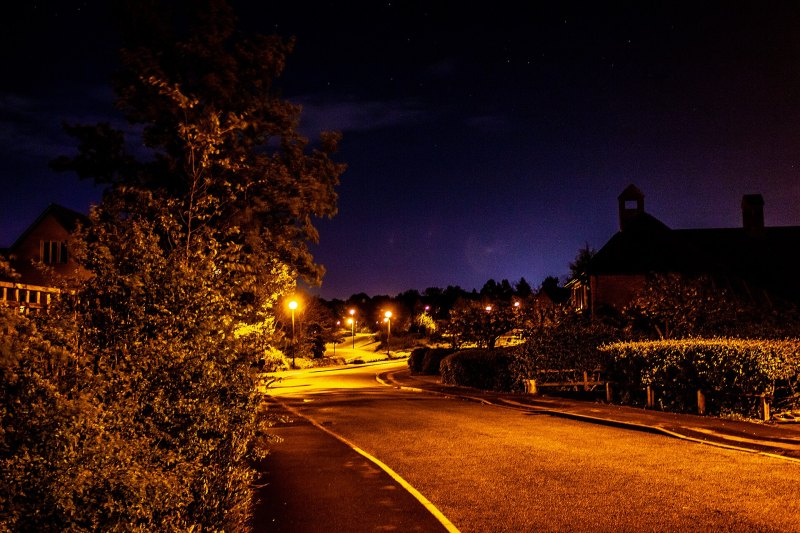
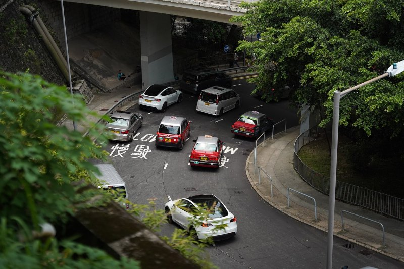
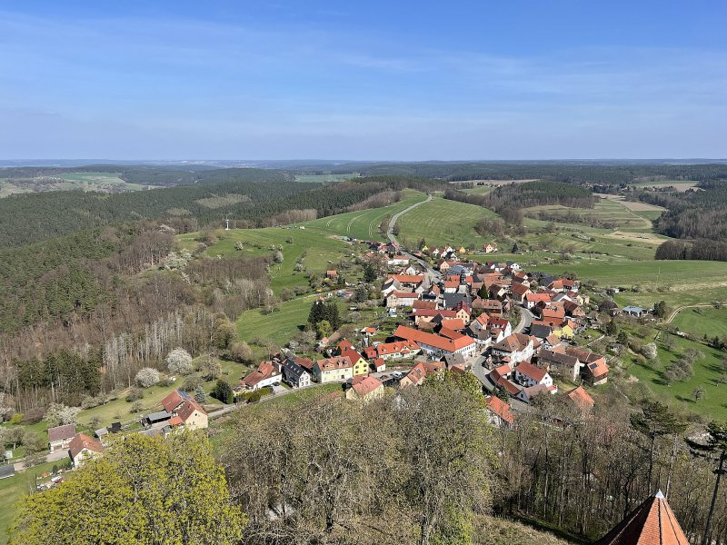
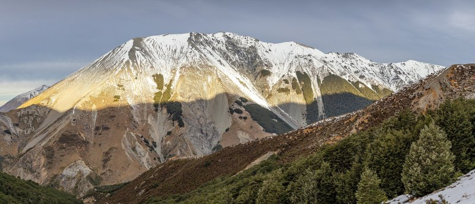
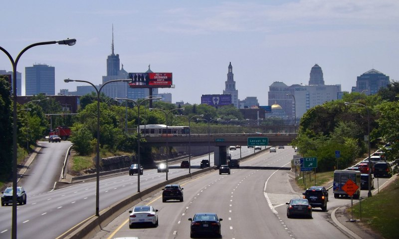
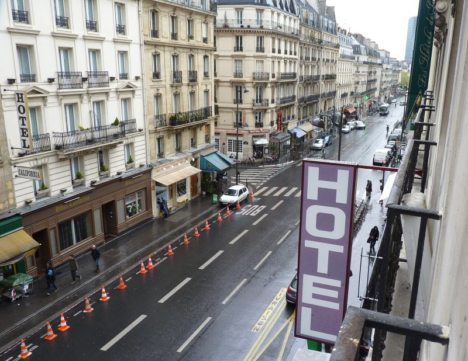

# Effects on other scenes

The severity gallery one level up shows every effect at five strengths over one
photograph. These are the same effects at one strength over eight scenes chosen
to be unlike it: a crossing from straight above, a covered car park, a real
night street, mountains across a valley.

Each scene's page says how the transforms were told about it: its distances,
the camera's pitch, whether it is night or under a roof, and which effects were
left out as not applying. Severity fixes extinction per metre, which suits a
street and blanks a landscape, so fog is set by visibility as a fraction of the
scene's depth and the veils of rain and snow are capped the same way.

Regenerate with `python docs/generate_scene_examples.py` (needs a CUDA GPU).
The inputs are in [`sample_scenes/`](../../../sample_scenes/), with their authors
and licences in [`SOURCES.md`](../../../sample_scenes/SOURCES.md). The images here
are derived from them and carry the same licences, not the library's.

| Scene | | What it stresses |
| --- | --- | --- |
| [`crosswalk_day`](crosswalk_day/README.md) |  | near-vertical view of a crossing; people, cyclists, vehicles; no sky |
| [`parking_garage`](parking_garage/README.md) |  | covered car park; pillars and a ceiling; short depth range |
| [`street_night`](street_night/README.md) |  | real night street under sodium lamps |
| [`underpass_from_above`](underpass_from_above/README.md) |  | road passing under a flyover, seen from slightly above; cars; foliage in the foreground |
| [`wooded_hills`](wooded_hills/README.md) |  | wooded hills and a village seen from a hilltop; very long depth range |
| [`mountain`](mountain/README.md) |  | mountain face with snow seen across a valley; conifers in the foreground |
| [`urban_road_day`](urban_road_day/README.md) |  | urban road by day from overpass height; traffic, lamp posts, skyline |
| [`urban_street_wet`](urban_street_wet/README.md) |  | city street from a first-floor balcony on a genuinely wet day |

## What these show that is not right

They are unretouched output, and some of it is wrong in ways worth knowing:

- **Wet ground is level ground that is not green.** Vegetation is left dry;
  bare soil, gravel and roofs seen from above still get a film of water.
- **A reflection from outside the frame is a guess.** Where the mirrored point
  is above the picture the road reflects an estimate of the sky, which is
  right under open sky and wrong under the flyover in `underpass_from_above`.
- **Overcast light cannot remove shadows.** Rain and snow grey the sky and
  lower contrast, but the hard shadows of a sunny photograph stay.
- **Night fog knows only the lamps it can see.** One outside the frame lights
  fog inside it, and `night_fog` cannot show that.
- **Rain at night is the daylight model.** It stays dark, as it should, but its
  streaks are lit by the frame's average light and not by the nearest lamp.
- **Depth is relative and stretched to the range it is given.** The facades in
  `urban_street_wet` are placed further away than they are, so its fog is
  heavier than the stated visibility would make it.
- **Wet ground stops at a few hundred metres.** Beyond that, level ground is
  taken to be terrain; a distant wet road loses its sheen with it.
- **Flakes close to an infrared lamp are very large.** `night_snow` draws the
  nearest ones as long white bars.
