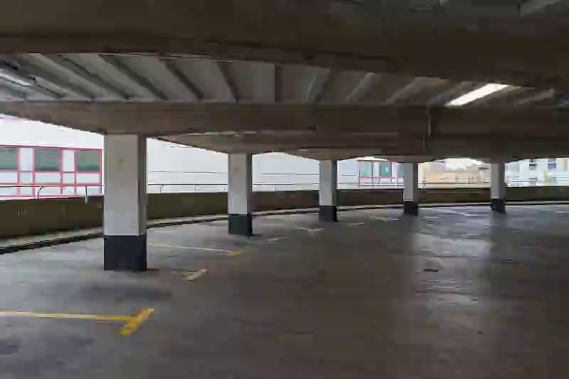
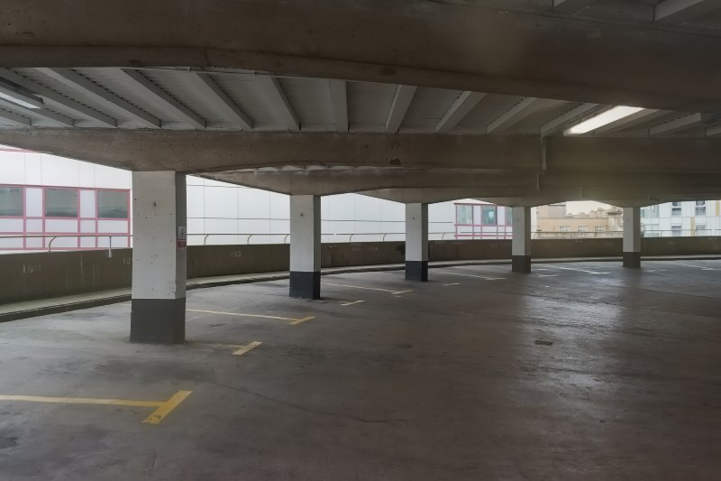

# parking_garage

Covered car park; pillars and a ceiling; short depth range.

Source: [Interior of Rupert Street parking garage - DSC 8051.jpg](https://commons.wikimedia.org/wiki/File:Interior_of_Rupert_Street_parking_garage_-_DSC_8051.jpg) by Tadeusz Hare, CC BY-SA 4.0. Every image in this folder is derived from it and is available under the same licence.

## How the transforms were told about this scene

| | |
| --- | --- |
| Distance of nearest and farthest point | 2 m to 45 m (estimated by eye) |
| Camera pitch below level | 4 degrees |
| Lighting | day, under a roof |
| Sky in frame | no |
| Fog | visibility 27 m (0.6 x the farthest point) |
| Rain and snow veils | capped so visibility stays above 67.5 m and 45 m |

## Effects at severity 3

One representative draw each: the median of seven by how much the frame changed.

| water_droplets | dirt_soil | fog |
| --- | --- | --- |
|  |  |  |

| housing_occluders | night_ir | ac_flicker |
| --- | --- | --- |
|  |  |  |

| rolling_shutter | exposure_transient | wdr_tone_mapping |
| --- | --- | --- |
|  |  |  |

| denoise_artifacts | video_codec | night_droplets |
| --- | --- | --- |
|  |  |  |

| sensor_noise |  |  |
| --- | --- | --- |
|  |  |  |

Not rendered: `sun_flare`, `rain`, `snow`, `cast_shadows`, `night_rain`, `night_snow` — the scene is under a roof.

Not rendered: `night_fog`, `source_glare` — it acts on artificial lights at night, and this is a daylit scene.

## `surveillance_lite` pipeline

4 consecutive draws. Each is a different combination of effects.

| draw 0 | draw 1 |
| --- | --- |
|  |  |

| draw 2 | draw 3 |
| --- | --- |
|  |  |
