# parking_garage

Covered car park; pillars and a ceiling; short depth range.

Source: [Interior of Rupert Street parking garage - DSC 8051.jpg](https://commons.wikimedia.org/wiki/File:Interior_of_Rupert_Street_parking_garage_-_DSC_8051.jpg) by Tadeusz Hare, CC BY-SA 4.0. Every image in this folder is derived from it and is available under the same licence.

## How the transforms were told about this scene

| | |
| --- | --- |
| Distance of nearest and farthest point | 2 m to 45 m (estimated by eye) |
| Camera pitch below level | 4 degrees |
| Lighting | day, under a roof |
| Sky in frame | no |
| Fog | visibility 0.6 x the scene's depth: about 27 m by eye |
| Rain and snow veils | visibility kept above 1.5 x and 1 x the scene's depth: about 67.5 m and 45 m |

## What a provider with scene labels and geometry read off it

The photograph and its label map, with the horizon the geometry estimator
found drawn across both. See
[scene understanding](../../../scene_understanding.md) for how each is made
and how far to trust it.

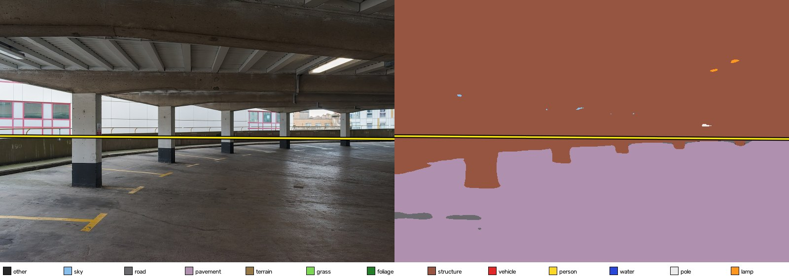

| | |
| --- | --- |
| Field of view | 68°, assumed: a picture does not tell it |
| Horizon | 0.52 of the frame's height from the top, or above: there is no sky in the frame to mark it |
| Camera pitch below level | at least -1°, so the by-eye 4° stands |
| Roll | +0.4° |
| Camera height | not found: fewer than three usable vehicles or people in view |
| Depth | the by-eye range above: there is no height to measure from |
| Labels | structure 58%, pavement 41%, road 0%, lamp 0%, sky 0%, pole 0% |

## Without and with it

Every effect that depends on what the provider knows, twice: on the left with
the plain provider and the by-eye values above, on the right with the provider
that read the scene. The parameters and the seed are the same, so what differs
is what the labels and the geometry changed.

| `fog` without | `fog` with |
| --- | --- |
|  |  |

| `night_ir` without | `night_ir` with |
| --- | --- |
|  |  |

| `local_plumes` without | `local_plumes` with |
| --- | --- |
|  |  |

## The other effects at severity 3

One representative draw each: the median of seven by how much the frame changed.
These do not read the scene, and are the same with either provider.

| water_droplets | dirt_soil | housing_occluders |
| --- | --- | --- |
| 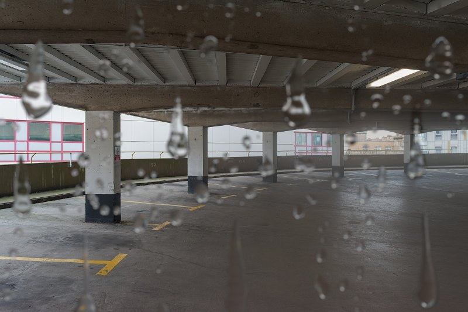 | 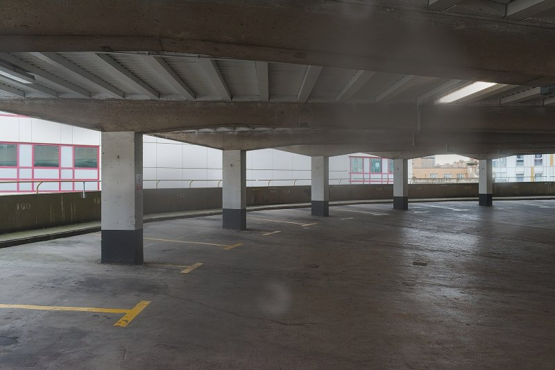 | 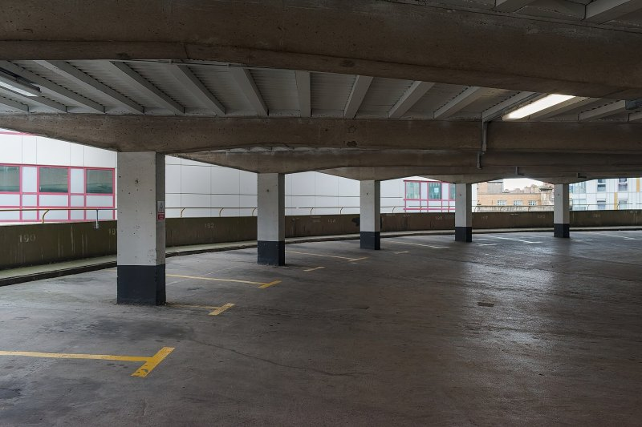 |

| ac_flicker | rolling_shutter | exposure_transient |
| --- | --- | --- |
|  |  | 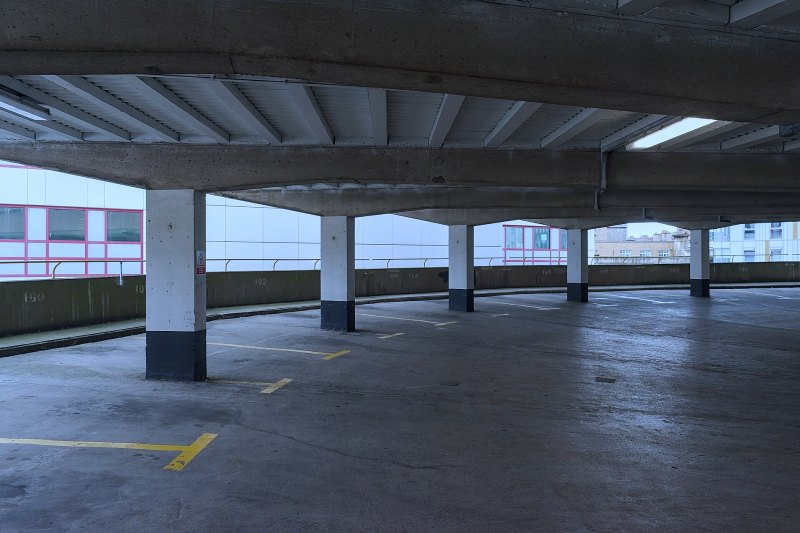 |

| wdr_tone_mapping | denoise_artifacts | video_codec |
| --- | --- | --- |
| 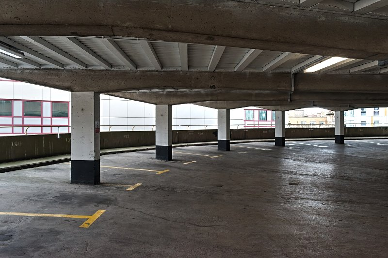 | 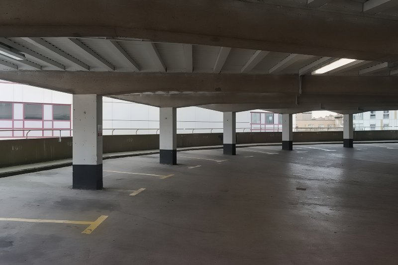 |  |

| night_droplets | sensor_noise | transmission_faults |
| --- | --- | --- |
| 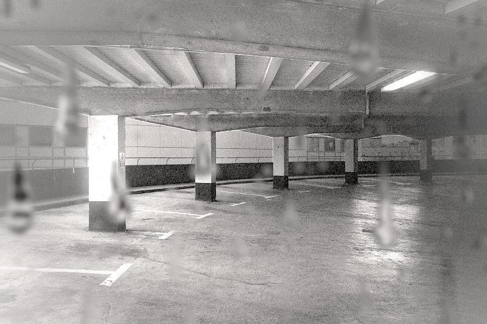 |  | 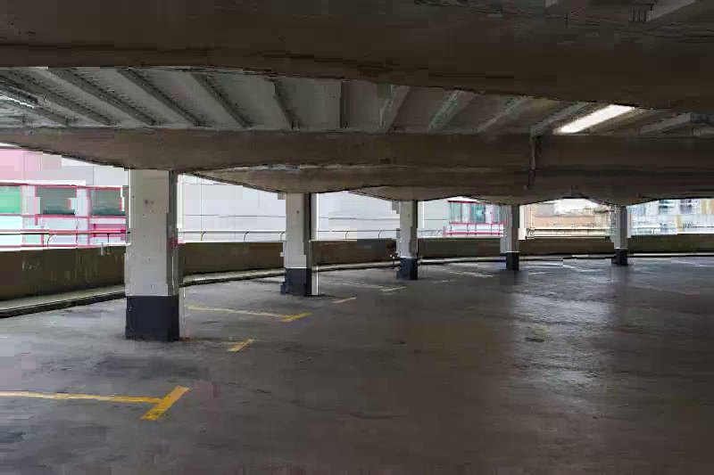 |

| spider_web | night_insects | ir_dome_glare |
| --- | --- | --- |
| 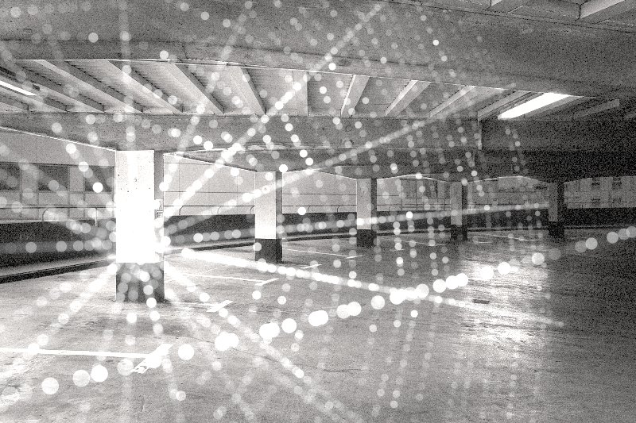 | 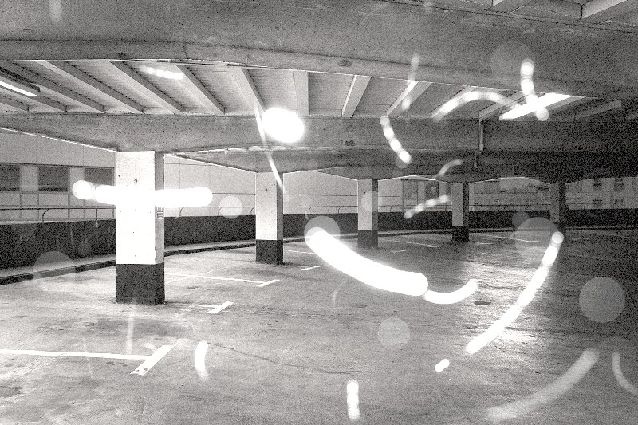 | 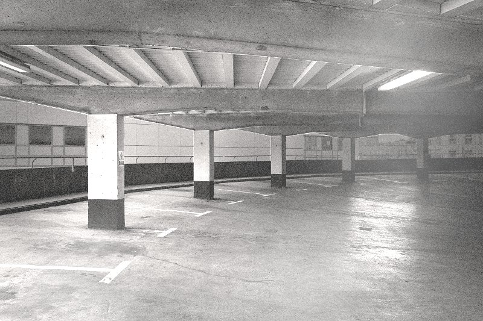 |

| lens_tamper | ir_cut_filter_fault | demosaic_artifacts |
| --- | --- | --- |
|  | 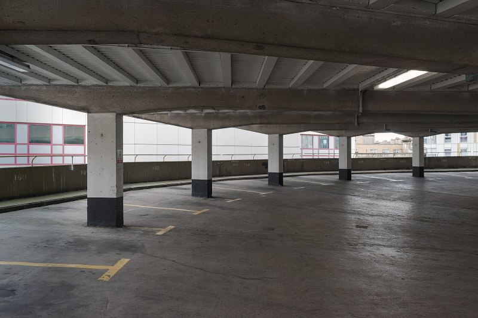 |  |

| analog_video | focus_shift | camera_vibration |
| --- | --- | --- |
|  | 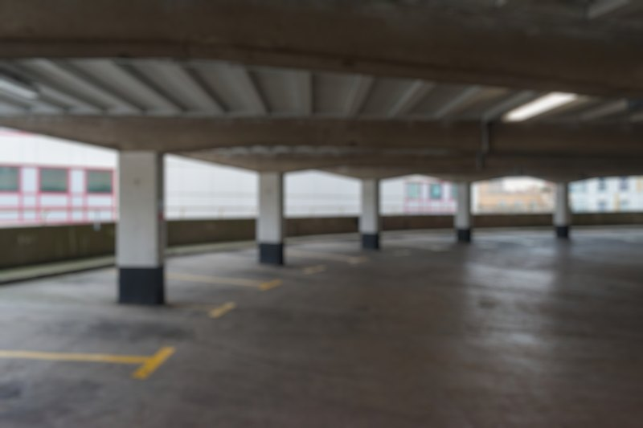 |  |

| on_screen_overlay |  |  |
| --- | --- | --- |
| 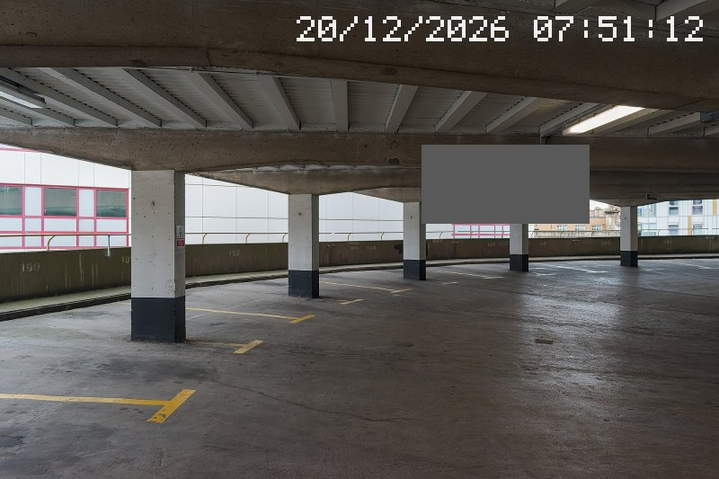 |  |  |

Not rendered: `sun_flare`, `rain`, `snow`, `cast_shadows`, `night_rain`, `night_snow`, `wet_ground`, `snow_cover`, `frost_on_glass`, `snow_on_housing`, `foliage_intrusion`, `ground_fog`, `night_foliage` — the scene is under a roof.

Not rendered: `night_fog`, `source_glare` — it acts on artificial lights at night, and this is a daylit scene.

Not rendered: `heat_shimmer` — it is turbulence over sunlit ground, which shows over a kilometre or so by day: this scene is too short, under a roof or at night.

## `surveillance_lite` pipeline

4 consecutive draws. Each is a different combination of effects.
This pipeline takes no depth provider, so there is nothing to compare.

| draw 0 | draw 1 |
| --- | --- |
|  | 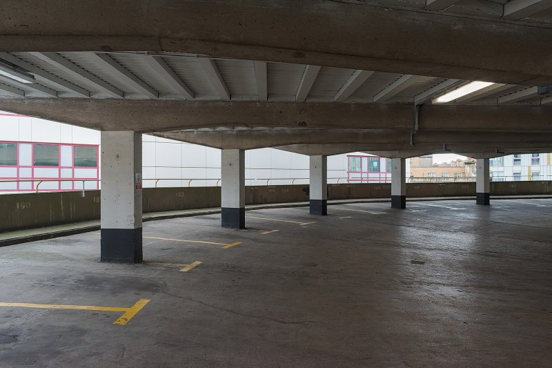 |

| draw 2 | draw 3 |
| --- | --- |
|  | 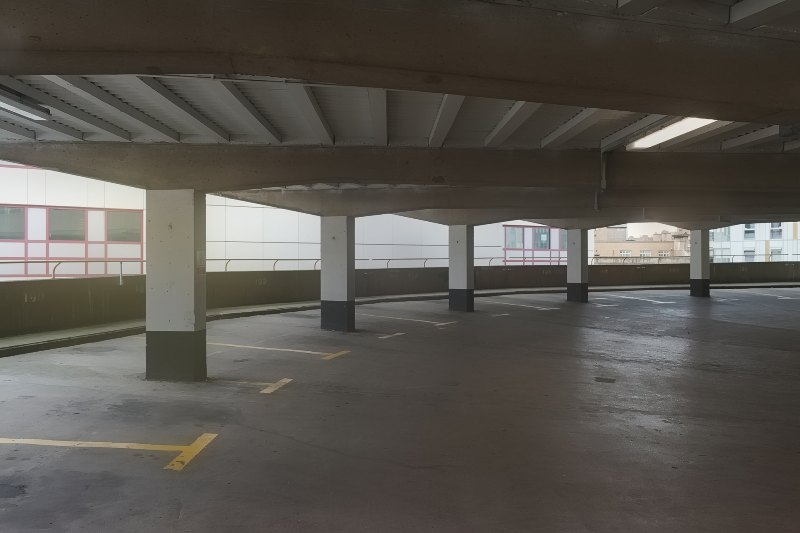 |
