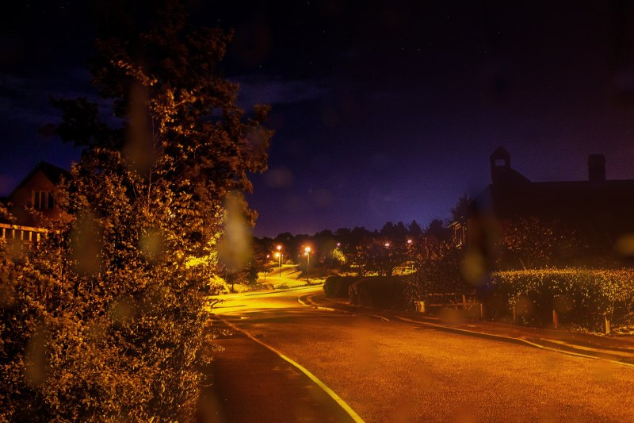
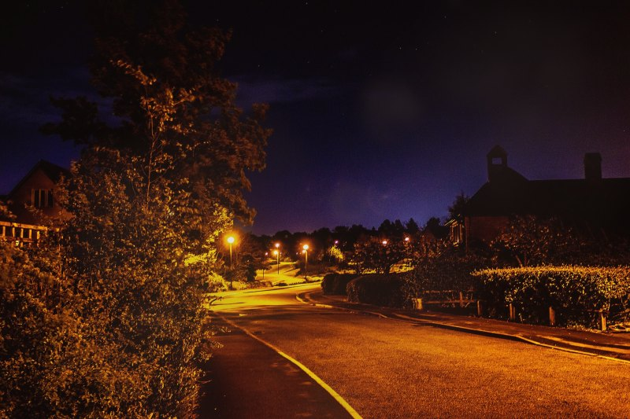
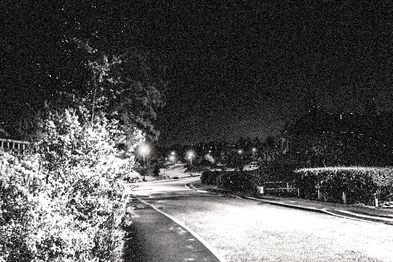
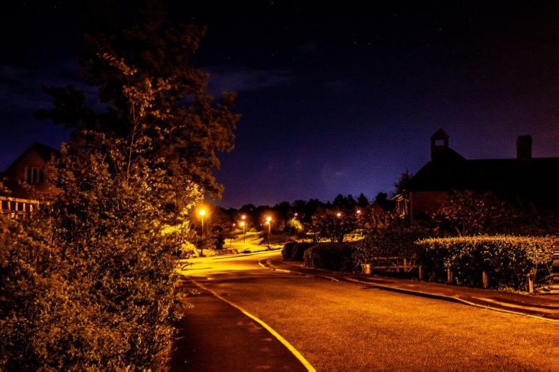
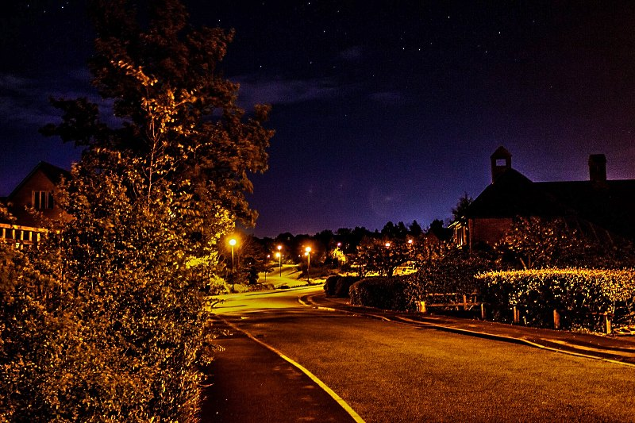
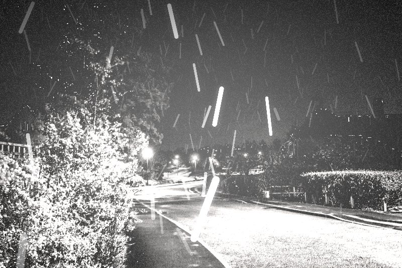
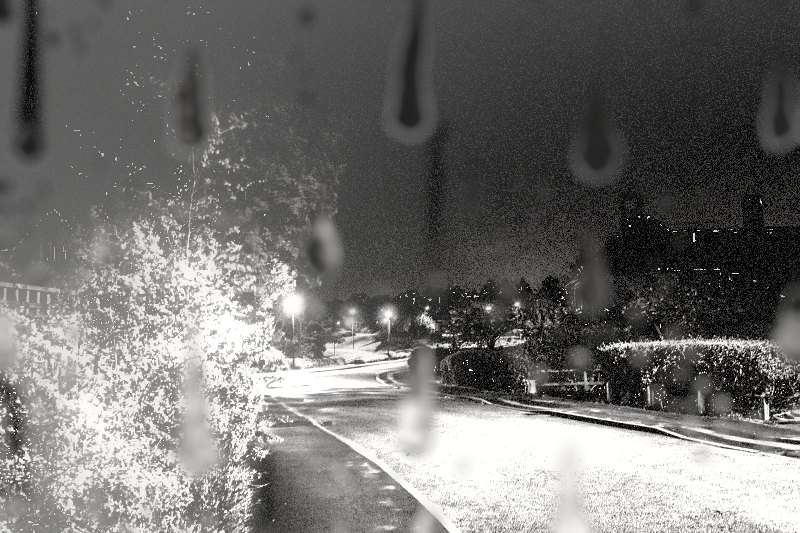
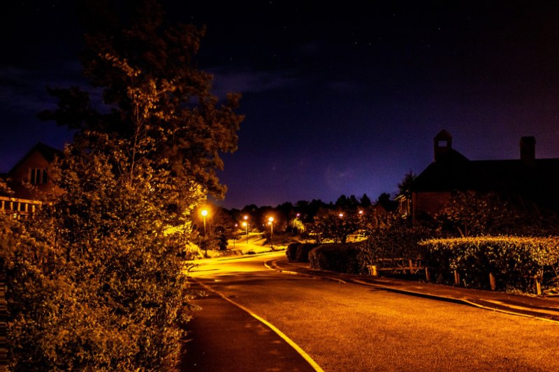
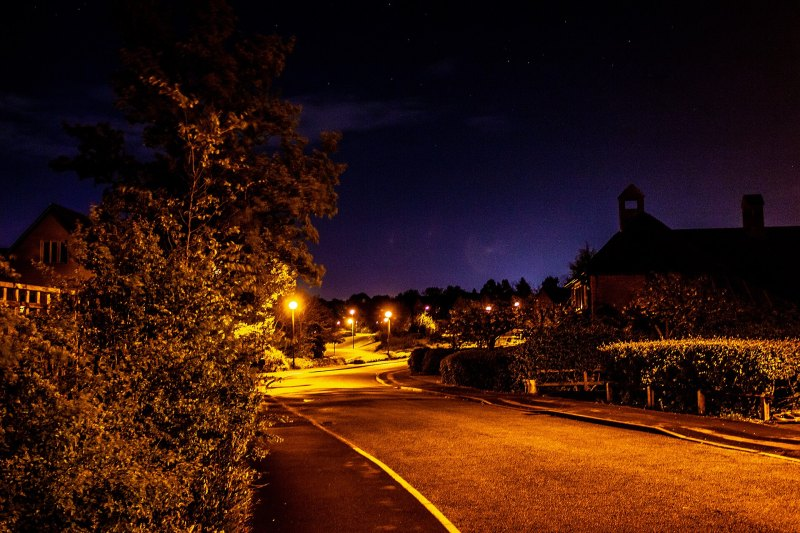

# street_night

Real night street under sodium lamps.

Source: [Great Holm Milton Keynes at night.jpg](https://commons.wikimedia.org/wiki/File:Great_Holm_Milton_Keynes_at_night.jpg) by John Chryslar, CC0. Every image in this folder is derived from it and is available under the same licence.

## How the transforms were told about this scene

| | |
| --- | --- |
| Distance of nearest and farthest point | 3 m to 150 m (estimated by eye) |
| Camera pitch below level | 5 degrees |
| Lighting | night, open to the sky |
| Sky in frame | yes |
| Fog | visibility 90 m (0.6 x the farthest point) |
| Rain and snow veils | capped so visibility stays above 225 m and 150 m |

## Effects at severity 3

One representative draw each: the median of seven by how much the frame changed.

| water_droplets | dirt_soil | housing_occluders |
| --- | --- | --- |
|  |  |  |

| night_ir | night_rain | ac_flicker |
| --- | --- | --- |
|  |  |  |

| rolling_shutter | exposure_transient | wdr_tone_mapping |
| --- | --- | --- |
|  |  |  |

| denoise_artifacts | video_codec | night_snow |
| --- | --- | --- |
|  |  |  |

| night_droplets |  |  |
| --- | --- | --- |
|  |  |  |

Not rendered: `sun_flare`, `cast_shadows` — it needs the sun, and the scene is at night.

Not rendered: `fog`, `rain`, `snow` — it is a daylight model: its veil takes its colour from the brightest pixels in the frame, which at night are the street lamps, and the whole frame turns their colour. `NightRain` and `NightSnow` are the night models.

## `surveillance_lite` pipeline

4 consecutive draws. Each is a different combination of effects.

| draw 0 | draw 1 |
| --- | --- |
|  |  |

| draw 2 | draw 3 |
| --- | --- |
|  |  |
