# urban_road_day

Urban road by day from overpass height; traffic, lamp posts, skyline.

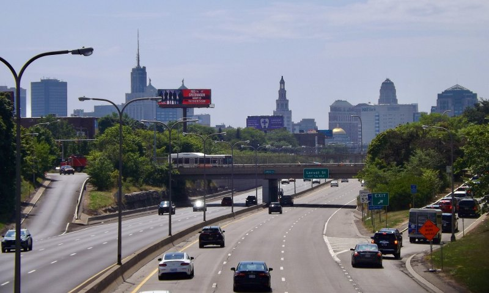

Source: [NFTA Metro Bus 18 @ Kensington Expressway overpass bridge, Buffalo, New York - 20220805.jpg](https://commons.wikimedia.org/wiki/File:NFTA_Metro_Bus_18_@_Kensington_Expressway_overpass_bridge,_Buffalo,_New_York_-_20220805.jpg) by Andre Carrotflower, CC BY-SA 4.0. Every image in this folder is derived from it and is available under the same licence.

## How the transforms were told about this scene

| | |
| --- | --- |
| Distance of nearest and farthest point | 8 m to 900 m (estimated by eye) |
| Camera pitch below level | 10 degrees |
| Lighting | day, open to the sky |
| Sky in frame | yes |
| Fog | visibility 540 m (0.6 x the farthest point) |
| Rain and snow veils | capped so visibility stays above 1350 m and 900 m |

## Effects at severity 3

One representative draw each: the median of seven by how much the frame changed.

| water_droplets | dirt_soil | sun_flare |
| --- | --- | --- |
| 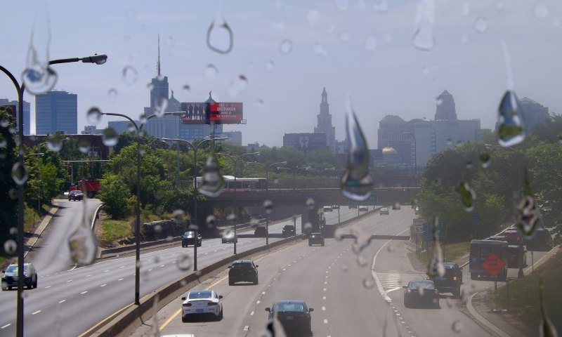 | 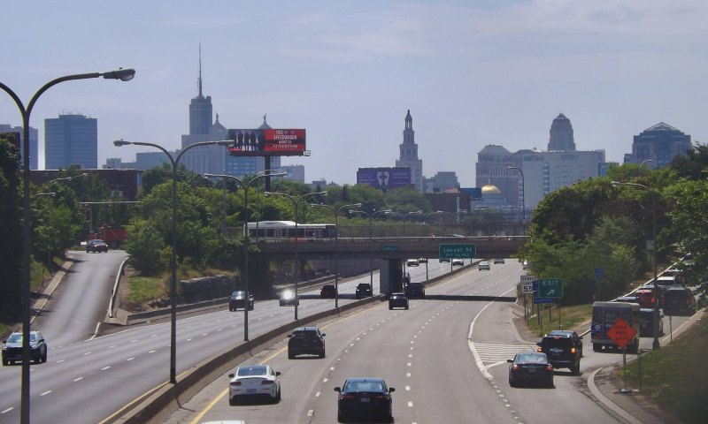 | 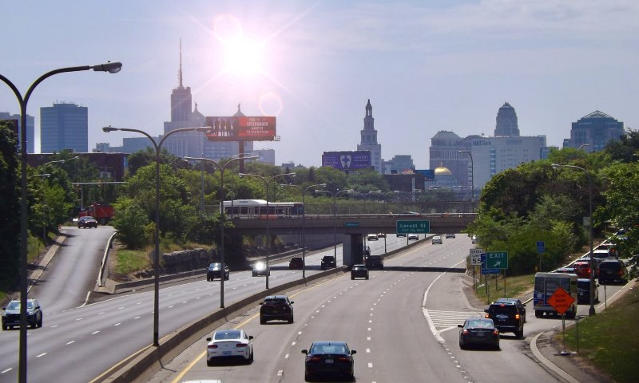 |

| fog | rain | snow |
| --- | --- | --- |
| 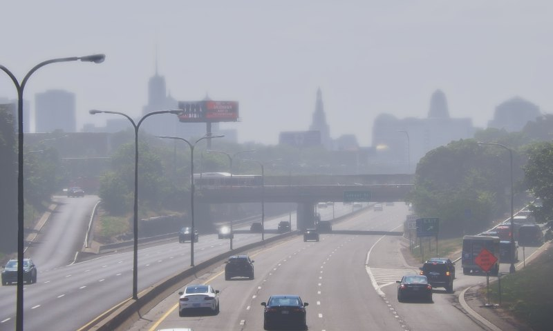 | 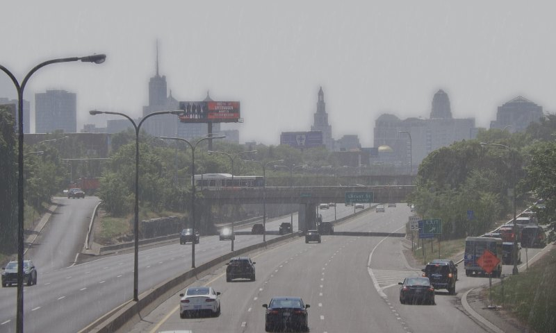 | 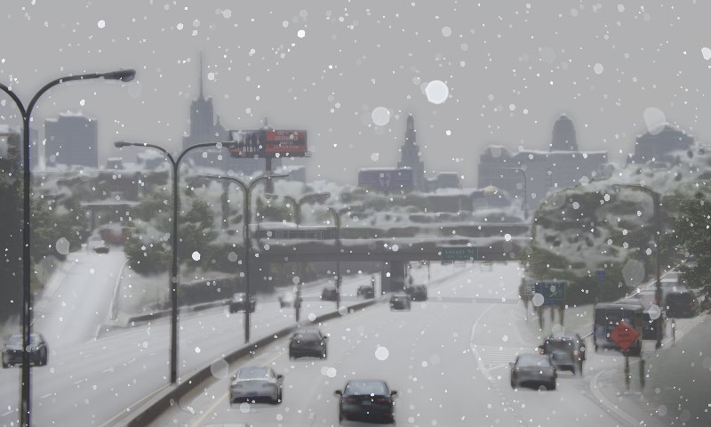 |

| housing_occluders | cast_shadows | night_ir |
| --- | --- | --- |
| 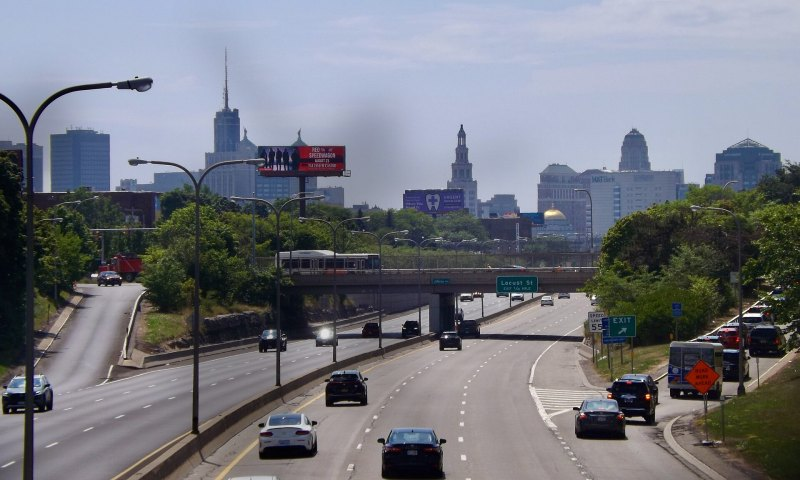 | 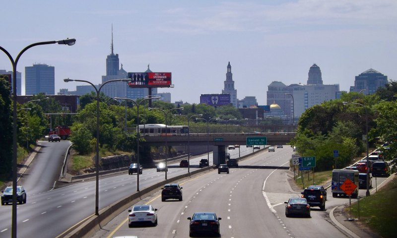 | 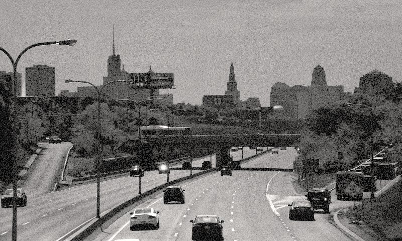 |

| night_rain | ac_flicker | rolling_shutter |
| --- | --- | --- |
| 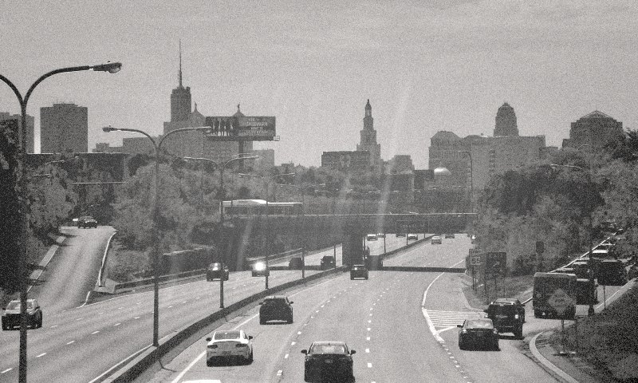 | 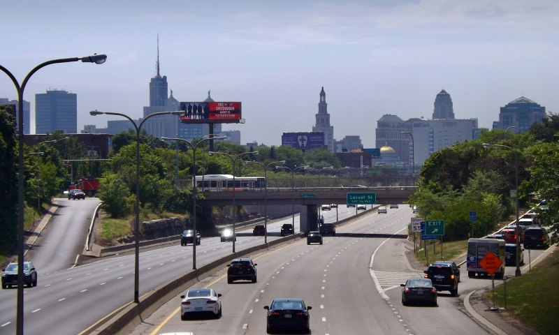 | 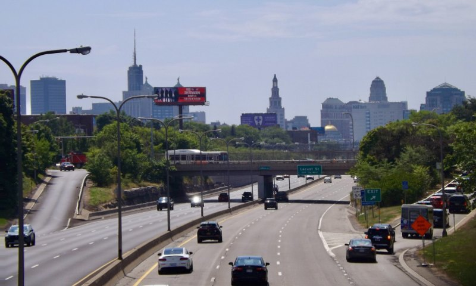 |

| exposure_transient | wdr_tone_mapping | denoise_artifacts |
| --- | --- | --- |
| 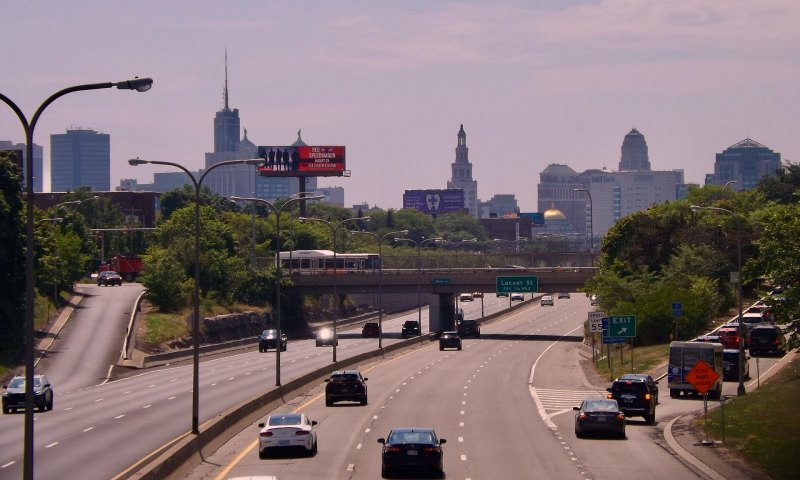 | 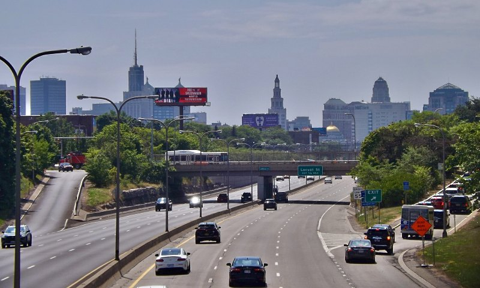 |  |

| video_codec | night_snow | night_droplets |
| --- | --- | --- |
| 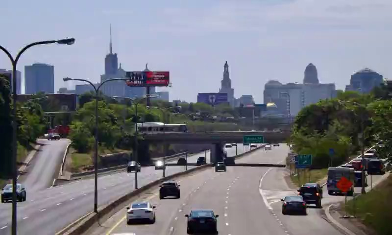 | 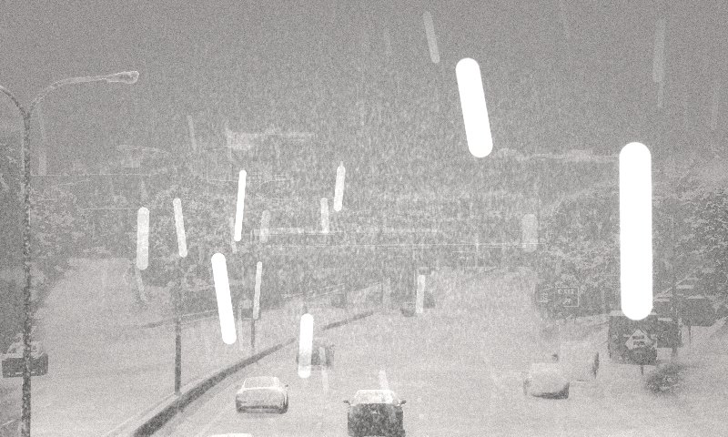 | 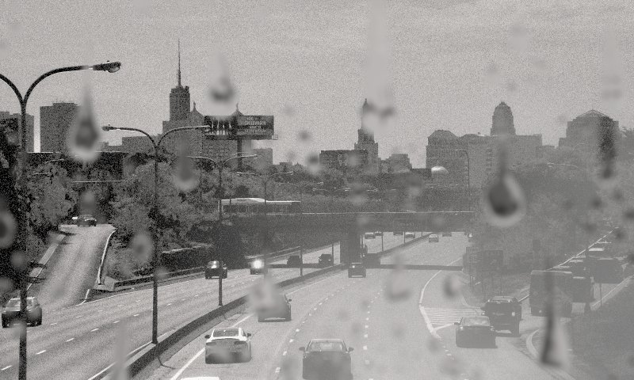 |

| sensor_noise |  |  |
| --- | --- | --- |
|  |  |  |

Not rendered: `night_fog`, `source_glare` — it acts on artificial lights at night, and this is a daylit scene.

## `surveillance` pipeline

4 consecutive draws. Each is a different combination of effects.

| draw 0 | draw 1 |
| --- | --- |
| 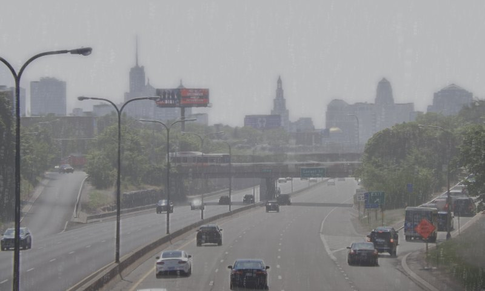 | 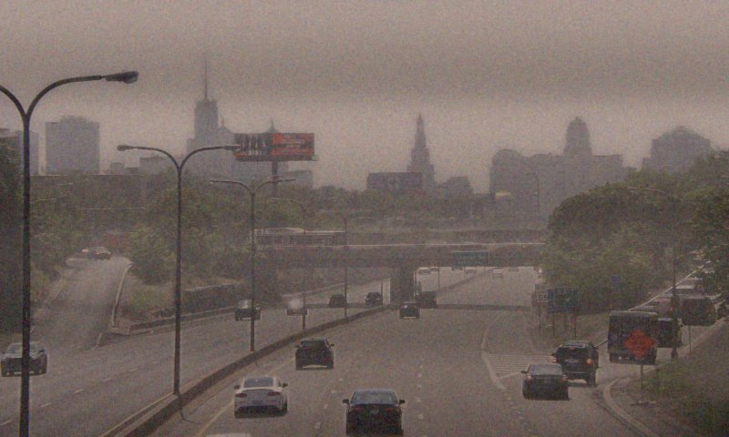 |

| draw 2 | draw 3 |
| --- | --- |
| 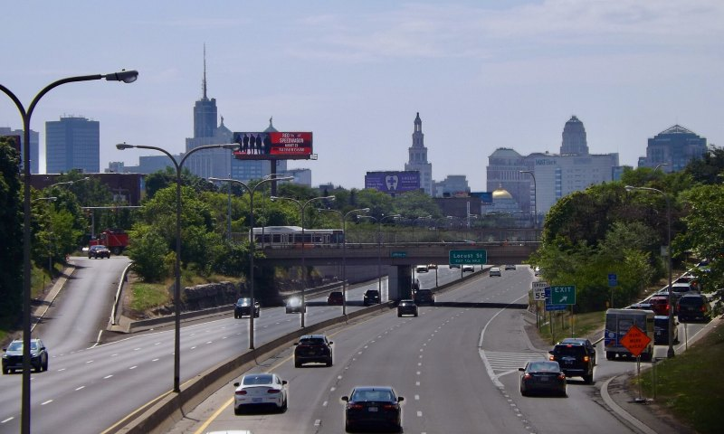 | 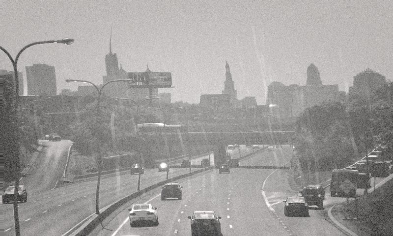 |
