# How it works

What each effect actually models, and why it is built that way. This is the
explanatory companion to the API docs in the README: read it to decide which
knobs matter for your data, or before changing a model.

Two documents sit either side of it. [`plan.md`](../plan.md) is the design
record and roadmap. [`physical_review.md`](physical_review.md) is a critical
audit of whether the implementation lives up to what is described here — it
is the honest counterweight, including the places where it did not.

---

## 1. The shape of the library

Every effect is an Albumentations `ImageOnlyTransform`. They divide into
those that need to know how far away things are, and those that do not.

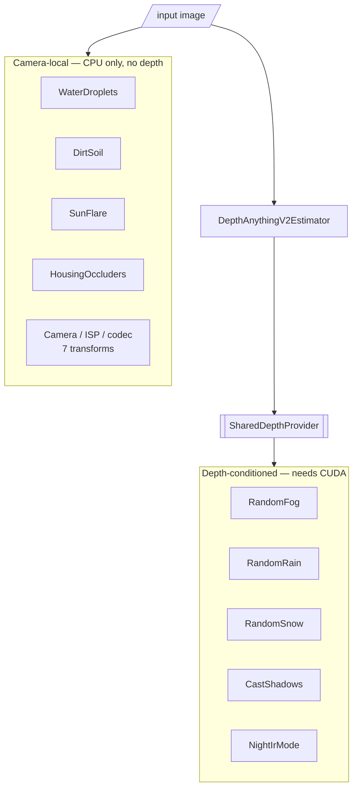

The split matters for deployment: a pipeline built only from the
camera-local group runs anywhere, in a `DataLoader` worker, with no GPU.
Adding anything depth-conditioned makes CUDA a hard requirement — `DepthAnythingV2Estimator`
raises immediately rather than falling back to a CPU path slow enough to
wreck a training step.

---

## 2. Two invariants that hold everywhere

### Compositing happens in linear light

Scattering, flare and bloom add **radiance**. sRGB values are not radiance —
they are radiance through a ≈2.2 power curve. Adding on top of the encoded
values lifts mid-tones far too much, which is a large part of why synthetic
weather usually looks like a flat white wash.

`utils/photometry.py` owns the conversion, via LUT for 8-bit input. It
rounds rather than truncates on the way back — truncating biased every
transform by −0.25 levels, which is invisible in one pass and not in twelve.

### Quantities that follow from others are derived, not exposed

A rain rate is a choice. A drop count is not — it follows. Exposing both
would allow a frame with a downpour's haze and a drizzle's streaks.

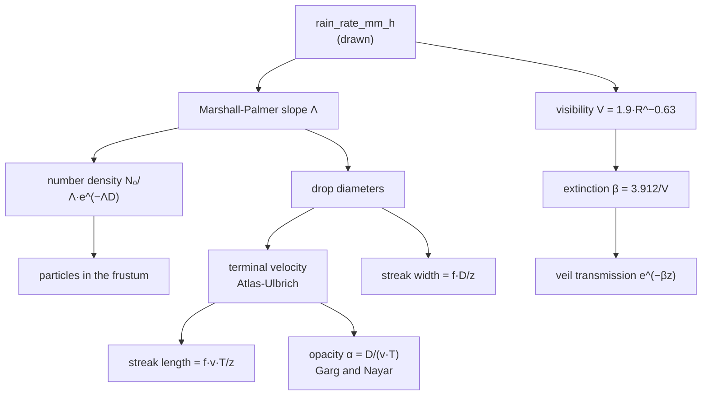

The same shape holds for snow (Gunn-Marshall sizes, Locatelli-Hobbs fall
speed) and for fog (β straight to Koschmieder). `physical_review.md` checks
these chains numerically against the logged draws; they close to float
precision.

---

## 3. Depth: estimate once, share everywhere

Monocular depth costs ~85 ms on a 1024 px frame. Estimating it per transform
is the single most expensive mistake available in a pipeline here.

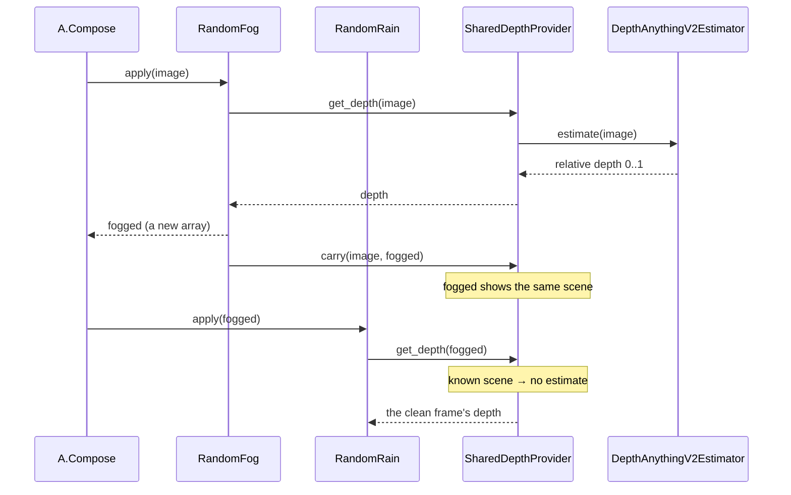

Construct **one** provider and pass that instance to every depth-conditioned
transform.

A transform returns a new array, so the second depth-conditioned transform in
a chain never sees the array depth was estimated for. Recognising an image by
the array alone therefore shares nothing: every depth-conditioned transform
that fires pays for its own estimate. (The loss is cost, not accuracy — depth
re-estimated from a fogged frame differs by only 1–3%, and by up to 5.5%
behind droplets.) So each
transform reports its output back, and the provider records that it shows a
scene it already holds depth for. Depth belongs to the scene's geometry, which
no appearance-only effect changes.

The chain ends at `RollingShutter` (it moves pixels) and at any transform from
outside this library (it might). The next request then estimates afresh: the
slower path, never a wrong answer. `provider.carry(before, after)` vouches for
a step of your own.

An image is recognised by identity — through a weak reference, **not**
`id()` — plus a sparse fingerprint of its pixels. The distinction is not
pedantic. CPython gives a freed object's address to the next allocation of the
same size, so in a `Dataset.__getitem__` that loads, transforms and returns,
every frame has the previous frame's `id`; keyed on that, 51 of 60 consecutive
frames were rendered with another image's depth. The fingerprint covers the
case a weak reference cannot: a buffer overwritten in place, as
`capture.read(frame)` does in a video loop. Nothing is kept across samples —
a scene is dropped as soon as its arrays are freed.

### From relative depth to metres

Depth Anything predicts a **disparity**-like quantity — larger means nearer,
and disparity goes as `1/z`. So the estimator inverts it rather than
flipping it linearly, then `to_pseudo_metric` maps the result onto a near
and a far plane.

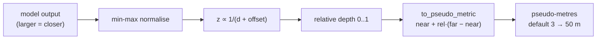

The near plane is not decoration. Mapping onto `[0, far]` put the nearest
scene point at **zero metres**, a singularity for anything inverse-square:
night mode's illuminator saw a 27 778× near:far irradiance ratio instead of
278×. Both planes are overridable when you know your scene's real scale.

### Surface normals, and what settles on what

Snow lands on surfaces that face **up** — not on surfaces near the bottom of
the frame. Back-projecting depth through a pinhole gives a 3-D point per
pixel, and the normal is the cross product of its two tangent derivatives.

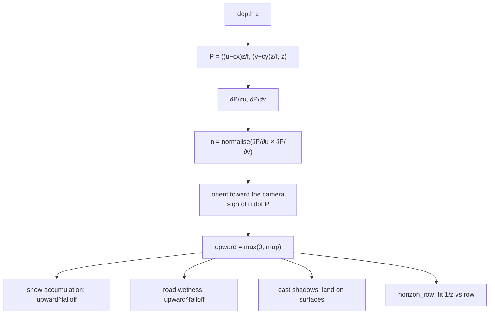

Orientation must use `n·P < 0`, not `n_z > 0`: a horizontal ground plane has
`n_z == 0` exactly, so the naive test leaves the single most important
surface in the scene arbitrarily signed.

Apply the falloff exponent **before** thresholding. A distant flat plane's
normal points at the camera, so `n·up` there equals `sin(pitch)` and crosses
a lenient threshold at about 18° of downward tilt — past which a raw mask
swallows the sky.

---

## 4. Atmosphere

### Fog — Koschmieder, per channel

The simplest of the three, and the template for the other two. Radiance
reaching the camera is the scene attenuated along the path plus airlight
scattered into it.

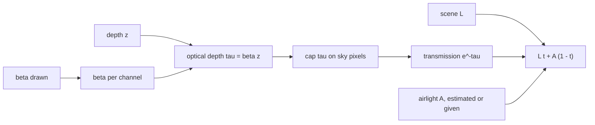

Two details earn their place. The **per-channel gamma** makes extinction
wavelength-dependent, so fog is not perfectly grey — Mie scattering off
larger droplets is near-neutral, haze off smaller particles is not. The
**sky cap** stops the sky flattening to pure airlight and losing its
gradient, since the depth model has no meaningful distance for it anyway.

### Rain — a volume of drops in front of the lens

Rain is not a texture. It is a population of drops in a frustum of air, each
imaged as a motion-blurred streak.

The **resolvability cut is on projected width, not diameter**. A 2 mm drop
at 1 m is 0.7 px wide and worth drawing; the same drop at 20 m is 0.035 px
and is not. Cutting on diameter instead truncated the population unevenly
and broke severity monotonicity.

Drop distance is sampled **volume-uniformly** and is unrelated to the scene
depth behind it — a falling drop is in the air in front of the scene.
Reading a drop's scale off the depth map made streaks shrink over distant
sky and swell over near road, i.e. pasted onto surfaces rather than falling
through air.

What a streak looks like is the camera's doing more than the weather's, so
the camera's **exposure is modelled, not drawn**. The light level and the
aperture are drawn; the shutter time follows from the metering equation,
`T = K N² / E`, held within what the shutter can run. That gives the
correlation a real camera has and two independent ranges do not: stopped
down, a long shutter and long thin streaks a percent opaque; wide open, a
short one and soft near-opaque flecks. A 2 mm drop is 22 cm of streak at
1/30 s and 3 mm of travel at 1/2000 s, with the same light deposited either
way. At night under street lighting the meter pins the shutter at its slow
end, which is why night rain is always long streaks.

Coverage compounds as `1 - e^-occupancy` because drops crossing one pixel
during the exposure occlude independently: the fractions of the exposure
they are *absent* for multiply.

Wet ground is masked by surface orientation, not by image rows, and its
reflectance is Fresnel over the depression angle below the horizon — mirror-
bright toward the horizon, dark and matte underfoot. A single blend weight
cannot produce that gradient in either direction.

Four more things decide whether it reads as wet, and each was missing at
some point:

- **Dark surfaces darken most.** Light scattered inside a wet surface is
  partly turned back at the water over it for another pass at being
  absorbed. Asphalt loses about half its brightness, white paint almost
  none, and colours deepen because the weak channels fall furthest
  (`wet_albedo`). A flat multiplier greys the markings instead.
- **A reflection lies under the thing reflected.** Everything far off is
  mirrored about the horizon. A compact object standing on the road is
  mirrored about its own foot, for as far down the road as it is tall.
  Mirrored about the horizon, a car's reflection lands far below it, under
  nothing; mirrored about its foot with no limit, every car and lamp post
  rules a stripe down the whole road.
- **Film and puddles are different mirrors.** The film is as rough as the
  road: it smears a reflection a long way down the road and its
  reflectance rises sooner towards the horizon. Standing water
  (`puddle_coverage_range`), laid out in ground coordinates so it
  foreshortens with the road, is smooth and mirrors the sky cleanly.
- **The whole road is wet, and stays dark.** Level ground now carries the
  full effect up to the foot of each object, where estimated normals used
  to leave it at 40-70% with a dry outline round every car; and the
  exposure correction runs before the ground, not after, where it handed
  the darkening back.

### Snow — the same skeleton, different constants

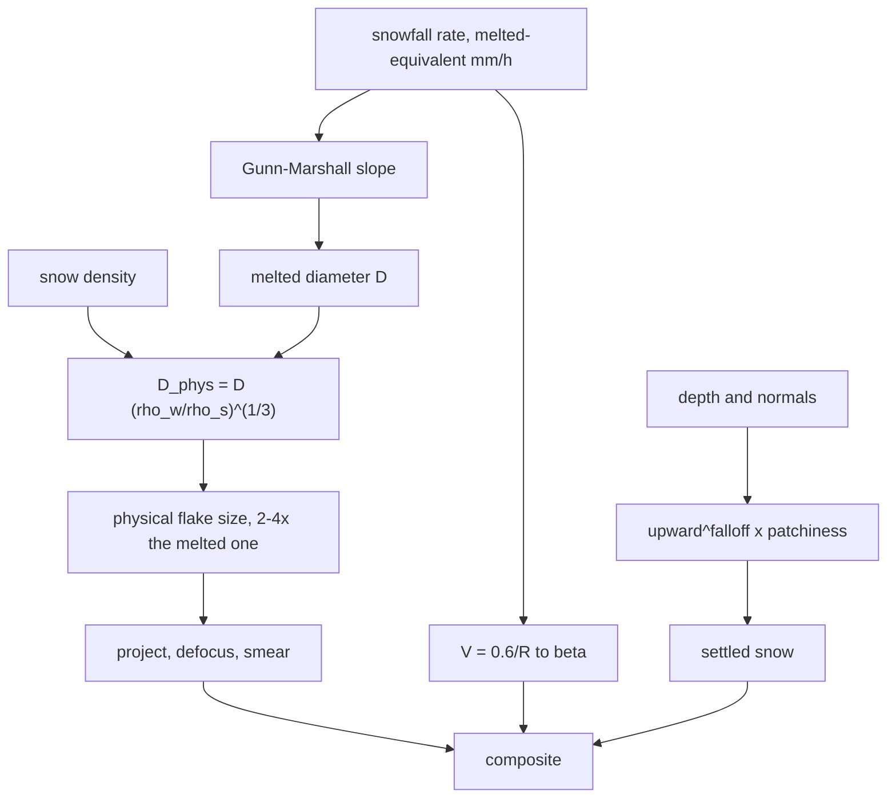

The melted-equivalent conversion is the step that decides whether snow is
visible at all. A snowflake's *physical* diameter is 2-4x its melted-water
equivalent because snow density is 30-100 kg/m3 against water's 1000.
Omitting it renders flakes at raindrop sizes, which at these distances means
sub-pixel, which means invisible.

Settled snow shares its reading of the ground with wet roads
(`utils/ground.py`): level ground carries the full covering, up to the foot
of whatever stands on it. Three things are its own.

- **Foliage is not ground.** From above a canopy reads as level and was
  covered into a grey smear. Vegetation with relief in it, light and
  shadow at every scale, is a canopy and takes snow in clumps on the parts
  that catch the light; flat vegetation is a lawn and is buried.
- **Snow is lit by the light on the spot, with a floor.** The light on a
  patch is what it sends back over a typical albedo, but black asphalt
  sends back a quarter of that and snow shaded by it was grey. By day the
  frame's own illuminant puts a floor under the estimate; at night the
  floor is low, so snow stays dark where no lamp reaches.
- **It takes the colour of the light when the light has one.** Under
  sodium lamps the whole frame is orange, and so is the snow.

How much has settled is not set by how hard it is snowing: see
`GROUND_SEVERITY`.

---

### What the photograph does not say: sky, veil colour, paving, light

Four things every weather model needs and no depth map gives.

**Where the sky is.** Not at the far plane: the depth network puts sky at
mid-range in most frames and, over a skyline, nearer than the buildings
under it. What sky reliably is, is featureless, all at *one* depth to three
decimals, and reachable from the top of the frame (`utils/sky.py`). Found
that way it is lifted to the far plane, so fog thickens up into the sky
instead of stopping at the roofline.

**What colour a veil is.** The horizon sky's. It used to be read off the
frame's brightest pixels, which at night are lamps. Now it is read off the
sky where there is one — at its bright end and mostly desaturated, because
droplets scatter all colours alike — and where there is none it is inferred
from the frame's mean and a typical albedo (`utils/color.py`).

**What is paving.** Rain's mirror goes on level ground that is not green
vegetation. And where a reflection's source row is above the frame the road
reflects that sky estimate; repeating the top row, as it did, drew vertical
stripes down any steeply viewed road.

**What the light is.** Rain and snow fall from cloud. In step with the rate,
the frame is pulled towards its local average (the direct beam is gone, so
shadows fill), desaturated, and its sky turned to even grey
(`utils/overcast.py`). Shadow edges already in the photograph stay.

## 5. Optics — things on or in the lens

### Water droplets: a droplet is a lens, not a blur

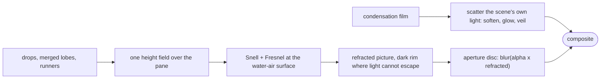

The camera is focused metres away and the water is centimetres from its
lens. Three things follow, and each replaces something that used to be
painted on.

**Sharpness is the aperture's, not a parameter.** Focused at infinity, a lens
images any point on the glass as a disc whose diameter *on the glass* equals
its entrance pupil. A drop is therefore sharp only if it is much wider than
the aperture: behind the 2.5 mm pupil of a 4 mm f/1.6 lens a 0.6 mm bead is
spread over seventeen times its own area, and the same bead behind an iris
stopped to 0.5 mm is nearly crisp. Rays that miss the water still see the
scene undisturbed, so the image is `(1 - blur(alpha)) * scene +
blur(alpha * refracted)`: small drops fade into the scene instead of becoming
blurry pictures.

**All the water is one surface.** Each drop is a lobe of a single height
field, and lobes that touch merge through a smooth union — a peanut for two
drops caught mid-coalescence. No large drop is the same shape as another.
How far one departs from a round cap follows its size against the capillary
length (2.7 mm): fine beads are round because surface tension makes them so,
while a large pinned drop keeps the lopsided outline its contact line was
left with, wider and deeper towards its lower edge. A runner is a head of
that kind plus whatever it trails, drawn row by row: a blunt slug that has
just let go, a pear, or a thread that swells into bulges and breaks into
beads from its far end, with two uneven sides and a centreline that follows
its track. One remap of the
frame through the field's slope does the refraction: Snell's law gives the
deflection, and because a convex surface turns rays towards its own centre
the picture inside a drop comes out inverted whenever the lens is further
behind the glass than the drop's focal length, `r / (c (n - 1))`. Past 48.8°
of surface tilt the ray cannot leave the water at all; that band of total
internal reflection is the dark outline, and it is wider on a steeper drop.

**Nothing is lit by a light that is not there.** A camera behind the glass
never sees a specular highlight off the outside of a drop. What it sees as a
glint is the refracted image of a bright source, so glints are relative to
the scene's own brightest light and a black frame stays black. The exception
is the camera's own infrared ring (`illuminator_glow_range`): on, the film
scatters it back as a veil and each drop returns it from its rim.

Condensation works the same way. Its droplets are far below the aperture
disc, so it can only scatter, and scattering redistributes the light arriving
at the glass: a narrow lobe that softens, a mid-range one that puts a glow
round each lamp, and a wide one that veils. By day that is a milky loss of
contrast; at night the frame stays dark and the lamps bloom. The film itself
is one region clearing outward from the warmest point of the glass, not a
scatter of patches.

Whether a droplet slides still follows from physics: below the capillary
length, surface tension holds it; above it, gravity beats contact-angle
hysteresis. A runner's track meanders in short sideways jogs, wipes the film
off the glass, swallows the drops in its path and leaves a few beads behind.

### Dirt: scattering, not paint

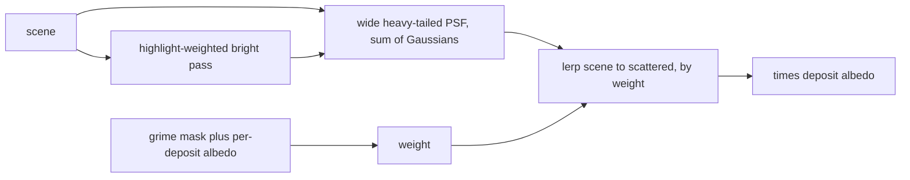

Dirt sits far outside the depth of field, so it never resolves as a shape —
it **redistributes** light. The whole effect is a lerp toward an
energy-conserving blur, which is why it cannot blow out the way an additive
bloom can (and did). Highlights are weighted up *inside* the scattered term,
because forward scatter off dust is strongly intensity-dependent. That keeps
the defining behaviour: grime is nearly invisible in flat light and awful the
moment a bright source is near frame.

It is also not one substance. Deposits carry their own albedos, drawn per
smudge, spanning hue 30-52 degrees at 1-45% saturation — grey dust through
yellow pollen to brown road spray.

And it is **lit from everywhere**, not only from where the camera looks. The
forward peak of the scattering is what smears a lamp across the grime, but
40% of what a deposit sends the lens comes from wide angles: the whole
hemisphere in front of the glass, most of which is outside the frame and, by
day, mostly sky. So the light scattered in is the forward part from the
scene around the pixel plus the frame's mean radiance times `ambient_light`,
how much brighter the surroundings are than the view. Without that term a
patch of grime over asphalt was replaced by a blur of the same asphalt, and
the effect was close to invisible on a daylit scene. Under the patches sits
an even `dust_film`, what settles from the air rather than what splashes.

### Sun flare: a chain of distinct phenomena on one line

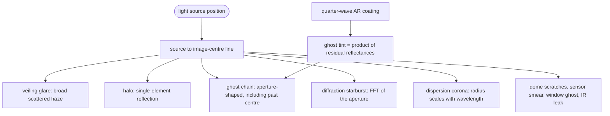

Ghosts line up along the source-to-centre line because each internal
reflection roughly mirrors the ray through the optical axis — including
*past* the centre on the opposite side. Their colour is not decorative: it
is the product of the residual reflectances of the surfaces the light bounced
off, so a six-bounce ghost is tinted differently from a two-bounce one, and
moving the source changes the angle of incidence and blue-shifts the
coating's notch.

The dispersion ring integrates over 48 wavelengths rather than tinting three
rings, because sampling it at R, G and B gives three discrete coloured rings
instead of a continuous spectrum.

---

## 6. Sensor, ISP and transmission

Most of what degrades a CCTV feed is not weather.

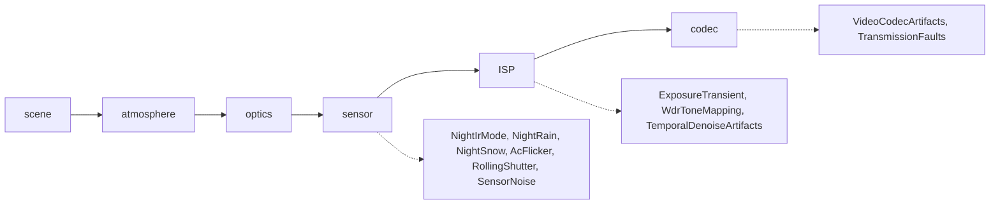

`physical_order()` sorts a list of transforms into this chain. Out of order
produces images that could not exist: codec blocking underneath lens blur
means the lens blurred an already-compressed image.

### AC flicker — why the band *count* is the whole story

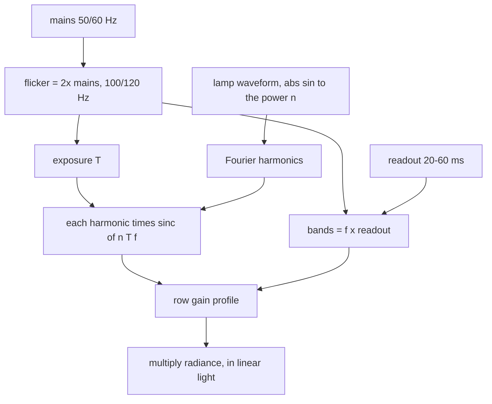

Three things this gets right that a hand-drawn band pattern would not.

**Cancellation is exact.** An exposure spanning a whole flicker period
averages the oscillation away — the physical basis of a camera's anti-flicker
setting — so the effect must *vanish*, not merely weaken. Each harmonic
carries its own `sinc(n T f)`, so when `T f` is a whole number so is every
multiple, and the entire profile goes together.

**The lamp is not a sinusoid.** Only an incandescent filament is, because its
thermal mass low-passes the supply. A discharge lamp follows `|sin|`; a cheap
LED driver conducts in narrow pulses near the mains peaks. The exponent spans
them, and the harmonics are what give bands visible edges.

**Band count decides legibility.** Two broad bands is a smooth luminance
gradient, and the eye discounts those as an exposure difference however deep
they are. Readout time therefore matters more than depth: a rolling shutter
reads out over roughly its frame period, so 25-30 fps gives 33-40 ms and a
bandwidth-limited 17 fps stream gives 60 ms, for 2-7 bands rather than 1-3.

### Sensor noise: counted in electrons, drawn on the mosaic

Shot noise is the square root of the electrons a pixel collected; read noise
is a few electrons whatever it collected. Gain creates neither. It decides
how few electrons count as full scale, so `gain_range_db` is the knob:
`electrons = image x full_well / gain`.

The noise is drawn per site of the Bayer mosaic and then demosaiced with the
picture's own interpolation. One sample in four is red and one in four blue,
so their noise comes out spread over more pixels than green's: the coarse,
coloured blotching of a real low-light frame, which independent per-channel
noise does not have. It runs before the ISP, which is what gives
`TemporalDenoiseArtifacts` something to remove.

### Night fog and glare: what the lights in the frame do

At night the fog is not lit by a sky, so its veil is not even. `NightFog`
dims everything by `exp(-beta z)` as by day and fades it towards the fog's
own brightness, which it reads off the frame: the light the surfaces in a
region send back, divided by a typical albedo, is the light that fell
there, and fog under it is `0.4` of a white surface. Blurred over a tenth
of the diagonal, that is a veil bright and lamp-coloured near the lamps and
dark between and above them. Each lamp also gets a halo: droplets scatter
forward, so 60% of what leaves its beam arrives from just beside it, wider
the more fog is in front. (The first version had the halo and no veil, and
made its halo by blurring everything the fog removed. That is a dim frame
plus a blurred copy, and it looked blurred, not foggy.) Under the infrared
ring it adds the camera's own
backscatter — an even wall across the beam, because the lamp's `1/z^2` and
the lit volume's `z^2` cancel — and attenuates the scene twice.

`SourceGlare` is `SunFlare`'s optics on each compact clipped region of the
frame (`utils/sources.py`): glare, starburst and ghosts per lamp. Both
transforms treat a clipped pixel as several times full scale, since a lamp's
recorded value is a lower bound; that factor is a parameter, not a
measurement. Large clipped areas — a blown sky, a sunlit wall — are not
lights and are left alone.

### Packet loss: done to the bitstream, not drawn

`TransmissionFaults` encodes a clip of two to six frames with x264, cuts
the slices into 1200-byte packets, loses some in bursts, and has ffmpeg
decode the rest. A slice that lost its first packet is gone; one that lost
a later packet is either cut off there or passed on with the gap closed,
and the second is where blocks of garbage come from. The decoder either
conceals a missing region from the previous picture or leaves it as zeroed
memory, which is green. Damage is then where a decoder puts it: from a
macroblock to the end of its slice, and carried into every later frame of
the group.

A still image has no previous picture to conceal from, so the clip is the
image sliding into place from `scene_motion_range` away, with the last
frame where it was given. On an unmoving scene concealed loss is nearly
invisible, which is true of real streams. Moving objects are not modelled:
nothing puts a car where it was two seconds ago.

### Night rain: the same drop, lit by the camera

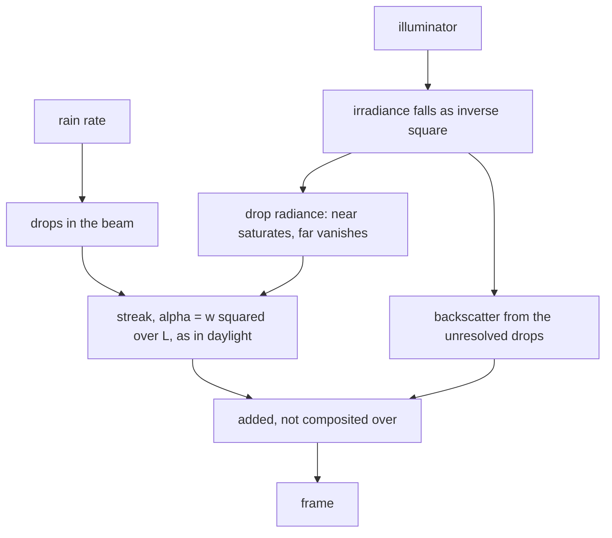

A daylight streak takes the sky's radiance, so it lifts the pixels it crosses
by about 8 sRGB levels against 17 levels of asphalt texture — half a sigma
into the background, which is why `RandomRain` reads as haze rather than as
streaks. Nothing about the drop is wrong; its illumination is.

`NightRain` changes only that. The lamp lights the drop rather than the sky,
so brightness falls as inverse-square distance *from the camera*, and the
scene behind it is dark — both sides of the contrast move at once. It adds
rather than occludes, because a drop scattering the lamp's light back is not
hiding anything behind it. And it sorts **after** `NightIrMode`, because its
streaks are already in infrared terms.

See [`rain_visibility.md`](rain_visibility.md) for the measurements behind
all of that.

`NightSnow` is the same correction for snow, for a failure that is easier to
miss. `RandomSnow` placed before `NightIrMode` sends its flakes through the
infrared conversion with the rest of the frame, and that conversion lights
each pixel by the depth of the *scene* there. A flake half a metre from the
lens, drawn over a sky fifty metres away, is lit as though it were fifty
metres away. Measured over a dark sky, the share of pixels standing clear of
the background was 0.01-0.11% that way and 2.7-6.5% with the flakes lit by
their own distance from the lamp. So at night the snow is split: its veil and
whatever has settled stay with `RandomSnow`, before the conversion, and the
falling flakes come after it.

### Night IR

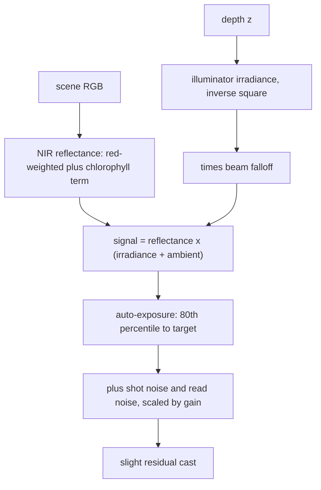

Foliage goes **bright**, which a luma conversion gets backwards —
chlorophyll reflects strongly in the near infrared. Gain scales the noise but
not the signal: on a real camera gain is one of the levers the AE loop uses
to *reach* its target, not something applied on top of a level it already
hit. Applying it twice put a fifth of the frame against the clipping point by
construction.

---

## 7. Severity, composition, and what varies

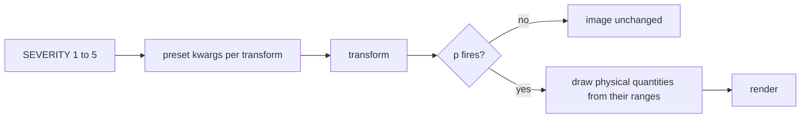

One rule worth stating because breaking it caused two visible bugs:
**whether an effect applies is what `p` is for.** A count range starting at
zero, or an exposure range straddling the flicker null, means a caller who
set `p=1.0` — and so explicitly asked for the effect — gets a bit-identical
frame back a quarter of the time. Parameters decide how *strongly*, never
*whether*.

---

## 8. Auditing: the loop that keeps this honest

Almost nothing here is chosen directly, so an image cannot tell you whether a
derivation held — only whether the result looks plausible. A chain that
quietly breaks still produces a plausible picture, which is the failure mode
worth hunting.

`WeatherTransform.__init_subclass__` instruments every subclass
automatically, so transforms do not opt in and recording costs one flag check
when off.

Both arms are load-bearing, and [`physical_review.md`](physical_review.md)
exists because each has caught things the other missed. The numeric checks
found a recorder whose schema changed with particle count; looking at frames
found two effects that rendered as nothing while every numeric check passed.
