# How it works

What each effect actually models, and why it is built that way. This is the
explanatory companion to the API docs in the README: read it to decide which
knobs matter for your data, or before changing a model.

Two documents sit either side of it. [`plan.md`](../plan.md) is the design
record and roadmap. [`physical_review.md`](physical_review.md) is a critical
audit of whether the implementation lives up to what is described here — it
is the honest counterweight, including the places where it did not.

---

## 1. The shape of the library

Every effect is an Albumentations `ImageOnlyTransform`. They divide into
those that need to know how far away things are, and those that do not.

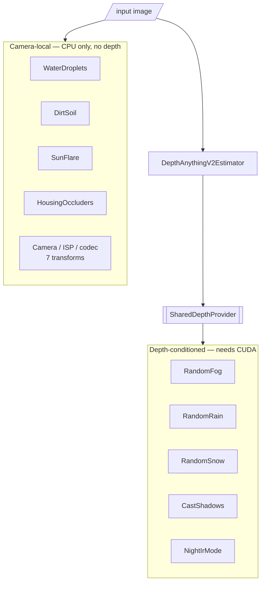

The split matters for deployment: a pipeline built only from the
camera-local group runs anywhere, in a `DataLoader` worker, with no GPU.
Adding anything depth-conditioned makes CUDA a hard requirement — `DepthAnythingV2Estimator`
raises immediately rather than falling back to a CPU path slow enough to
wreck a training step.

---

## 2. Two invariants that hold everywhere

### Compositing happens in linear light

Scattering, flare and bloom add **radiance**. sRGB values are not radiance —
they are radiance through a ≈2.2 power curve. Adding on top of the encoded
values lifts mid-tones far too much, which is a large part of why synthetic
weather usually looks like a flat white wash.

`utils/photometry.py` owns the conversion, via LUT for 8-bit input. It
rounds rather than truncates on the way back — truncating biased every
transform by −0.25 levels, which is invisible in one pass and not in twelve.

### Quantities that follow from others are derived, not exposed

A rain rate is a choice. A drop count is not — it follows. Exposing both
would allow a frame with a downpour's haze and a drizzle's streaks.

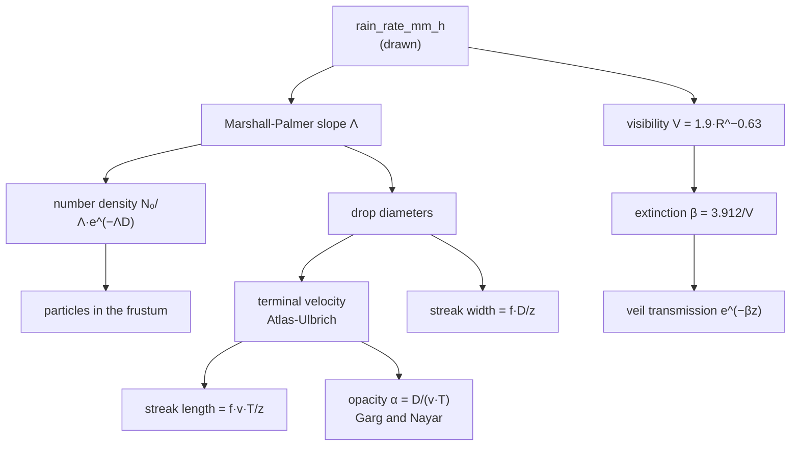

The same shape holds for snow (Gunn-Marshall sizes, Locatelli-Hobbs fall
speed) and for fog (β straight to Koschmieder). `physical_review.md` checks
these chains numerically against the logged draws; they close to float
precision.

---

## 3. Depth: estimate once, share everywhere

Monocular depth costs ~85 ms on a 1024 px frame. Estimating it per transform
is the single most expensive mistake available in a pipeline here.

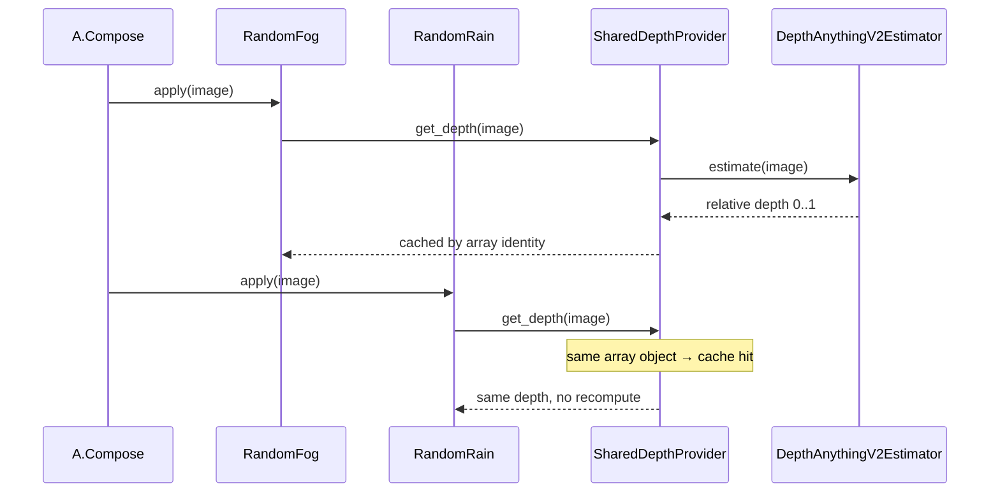

Construct **one** provider and pass that instance to every depth-conditioned
transform. The cache is keyed on the identity of the image array, so it hits
exactly when it should: within one sample, never across samples.

### From relative depth to metres

Depth Anything predicts a **disparity**-like quantity — larger means nearer,
and disparity goes as `1/z`. So the estimator inverts it rather than
flipping it linearly, then `to_pseudo_metric` maps the result onto a near
and a far plane.

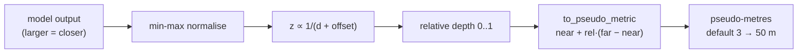

The near plane is not decoration. Mapping onto `[0, far]` put the nearest
scene point at **zero metres**, a singularity for anything inverse-square:
night mode's illuminator saw a 27 778× near:far irradiance ratio instead of
278×. Both planes are overridable when you know your scene's real scale.

### Surface normals, and what settles on what

Snow lands on surfaces that face **up** — not on surfaces near the bottom of
the frame. Back-projecting depth through a pinhole gives a 3-D point per
pixel, and the normal is the cross product of its two tangent derivatives.

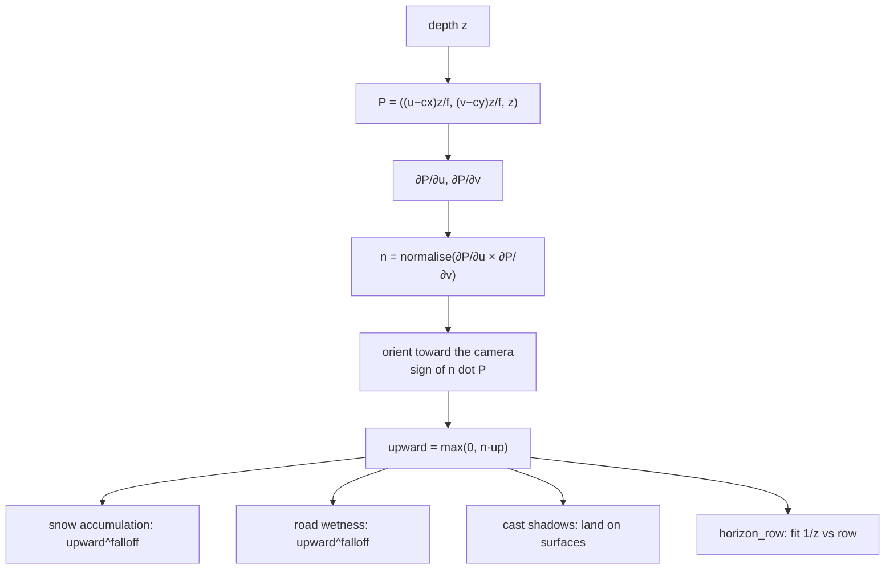

Orientation must use `n·P < 0`, not `n_z > 0`: a horizontal ground plane has
`n_z == 0` exactly, so the naive test leaves the single most important
surface in the scene arbitrarily signed.

Apply the falloff exponent **before** thresholding. A distant flat plane's
normal points at the camera, so `n·up` there equals `sin(pitch)` and crosses
a lenient threshold at about 18° of downward tilt — past which a raw mask
swallows the sky.

---

## 4. Atmosphere

### Fog — Koschmieder, per channel

The simplest of the three, and the template for the other two. Radiance
reaching the camera is the scene attenuated along the path plus airlight
scattered into it.

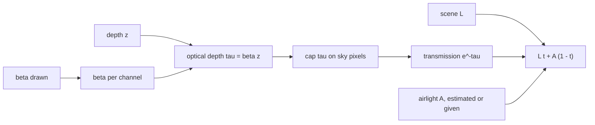

Two details earn their place. The **per-channel gamma** makes extinction
wavelength-dependent, so fog is not perfectly grey — Mie scattering off
larger droplets is near-neutral, haze off smaller particles is not. The
**sky cap** stops the sky flattening to pure airlight and losing its
gradient, since the depth model has no meaningful distance for it anyway.

### Rain — a volume of drops in front of the lens

Rain is not a texture. It is a population of drops in a frustum of air, each
imaged as a motion-blurred streak.

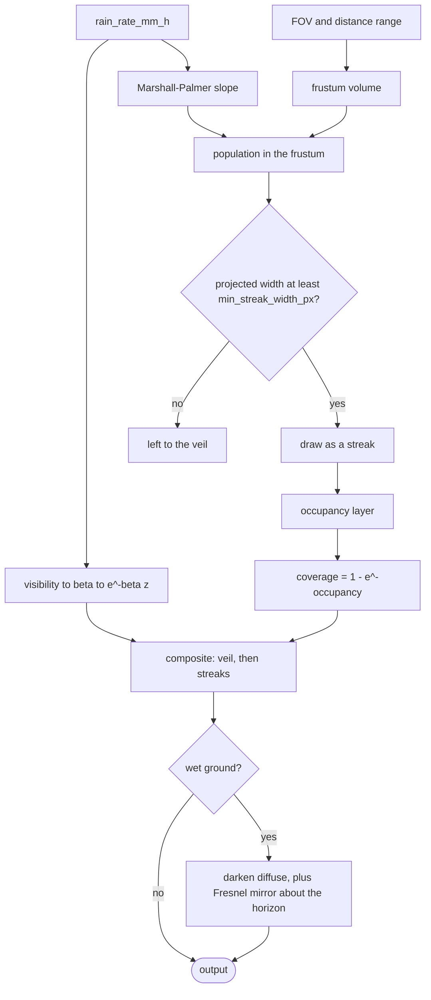

The **resolvability cut is on projected width, not diameter**. A 2 mm drop
at 1 m is 0.7 px wide and worth drawing; the same drop at 20 m is 0.035 px
and is not. Cutting on diameter instead truncated the population unevenly
and broke severity monotonicity.

Drop distance is sampled **volume-uniformly** and is unrelated to the scene
depth behind it — a falling drop is in the air in front of the scene.
Reading a drop's scale off the depth map made streaks shrink over distant
sky and swell over near road, i.e. pasted onto surfaces rather than falling
through air.

Coverage compounds as `1 - e^-occupancy` because drops crossing one pixel
during the exposure occlude independently: the fractions of the exposure
they are *absent* for multiply.

Wet ground is masked by surface orientation, not by image rows, and its
reflectance is Fresnel over the depression angle below the horizon — mirror-
bright toward the horizon, dark and matte underfoot. A single blend weight
cannot produce that gradient in either direction.

### Snow — the same skeleton, different constants

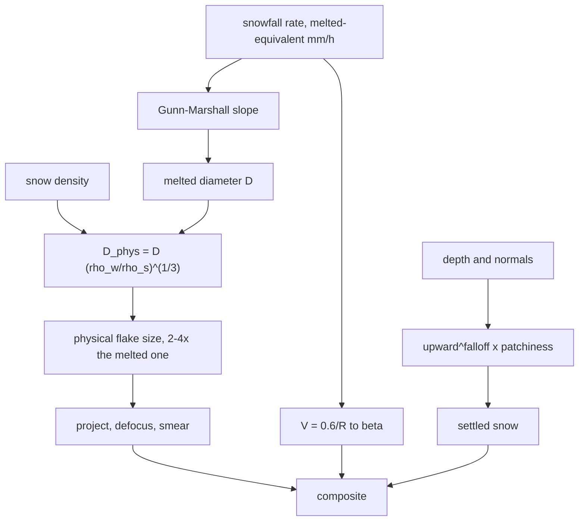

The melted-equivalent conversion is the step that decides whether snow is
visible at all. A snowflake's *physical* diameter is 2-4x its melted-water
equivalent because snow density is 30-100 kg/m3 against water's 1000.
Omitting it renders flakes at raindrop sizes, which at these distances means
sub-pixel, which means invisible.

---

## 5. Optics — things on or in the lens

### Water droplets: a droplet is a lens, not a blur

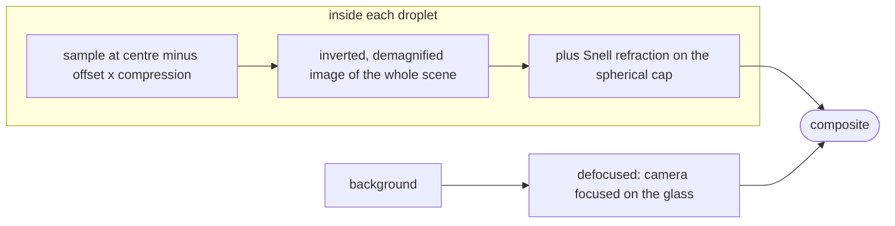

For water at `n = 1.33` the focal distance is `f = nR/(2(n-1))`, about `2R`,
so the scene — effectively at infinity relative to `R` — is imaged just
behind the droplet, **inverted and strongly demagnified**. That is why a real
droplet holds a tiny upside-down picture of the whole scene, not a warped
copy of what is directly behind it.

Whether a droplet slides follows from physics too: below the capillary
length, surface tension holds it; above it, gravity and contact-angle
hysteresis win and it leaves a trail. Droplets never overlap — surface
tension keeps sessile droplets separate until they coalesce — so positions
are rejection-sampled with a mandatory gap.

### Dirt: scattering, not paint

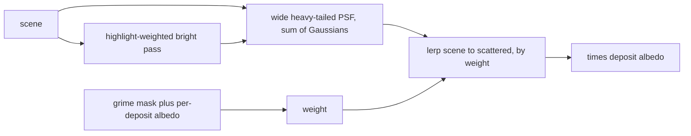

Dirt sits far outside the depth of field, so it never resolves as a shape —
it **redistributes** light. The whole effect is a lerp toward an
energy-conserving blur, which is why it cannot blow out the way an additive
bloom can (and did). Highlights are weighted up *inside* the scattered term,
because forward scatter off dust is strongly intensity-dependent. That keeps
the defining behaviour: grime is nearly invisible in flat light and awful the
moment a bright source is near frame.

It is also not one substance. Deposits carry their own albedos, drawn per
smudge, spanning hue 30-52 degrees at 1-45% saturation — grey dust through
yellow pollen to brown road spray.

### Sun flare: a chain of distinct phenomena on one line

Ghosts line up along the source-to-centre line because each internal
reflection roughly mirrors the ray through the optical axis — including
*past* the centre on the opposite side. Their colour is not decorative: it
is the product of the residual reflectances of the surfaces the light bounced
off, so a six-bounce ghost is tinted differently from a two-bounce one, and
moving the source changes the angle of incidence and blue-shifts the
coating's notch.

The dispersion ring integrates over 48 wavelengths rather than tinting three
rings, because sampling it at R, G and B gives three discrete coloured rings
instead of a continuous spectrum.

---

## 6. Sensor, ISP and transmission

Most of what degrades a CCTV feed is not weather.

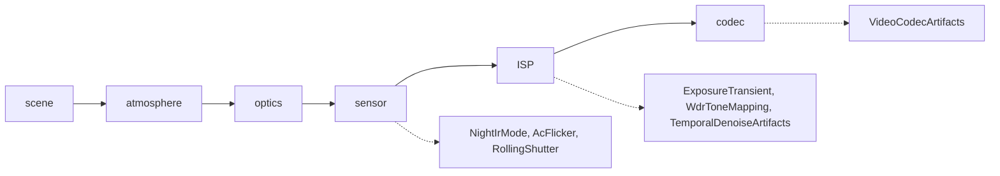

`physical_order()` sorts a list of transforms into this chain. Out of order
produces images that could not exist: codec blocking underneath lens blur
means the lens blurred an already-compressed image.

### AC flicker — why the band *count* is the whole story

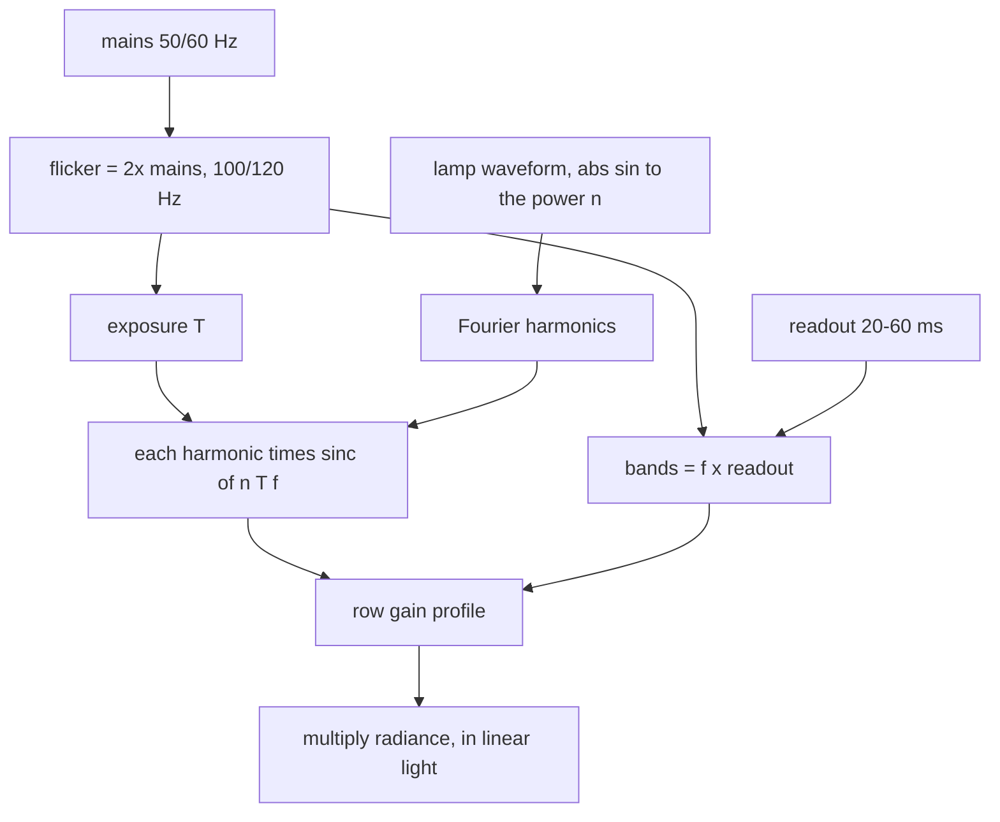

Three things this gets right that a hand-drawn band pattern would not.

**Cancellation is exact.** An exposure spanning a whole flicker period
averages the oscillation away — the physical basis of a camera's anti-flicker
setting — so the effect must *vanish*, not merely weaken. Each harmonic
carries its own `sinc(n T f)`, so when `T f` is a whole number so is every
multiple, and the entire profile goes together.

**The lamp is not a sinusoid.** Only an incandescent filament is, because its
thermal mass low-passes the supply. A discharge lamp follows `|sin|`; a cheap
LED driver conducts in narrow pulses near the mains peaks. The exponent spans
them, and the harmonics are what give bands visible edges.

**Band count decides legibility.** Two broad bands is a smooth luminance
gradient, and the eye discounts those as an exposure difference however deep
they are. Readout time therefore matters more than depth: a rolling shutter
reads out over roughly its frame period, so 25-30 fps gives 33-40 ms and a
bandwidth-limited 17 fps stream gives 60 ms, for 2-7 bands rather than 1-3.

### Night IR

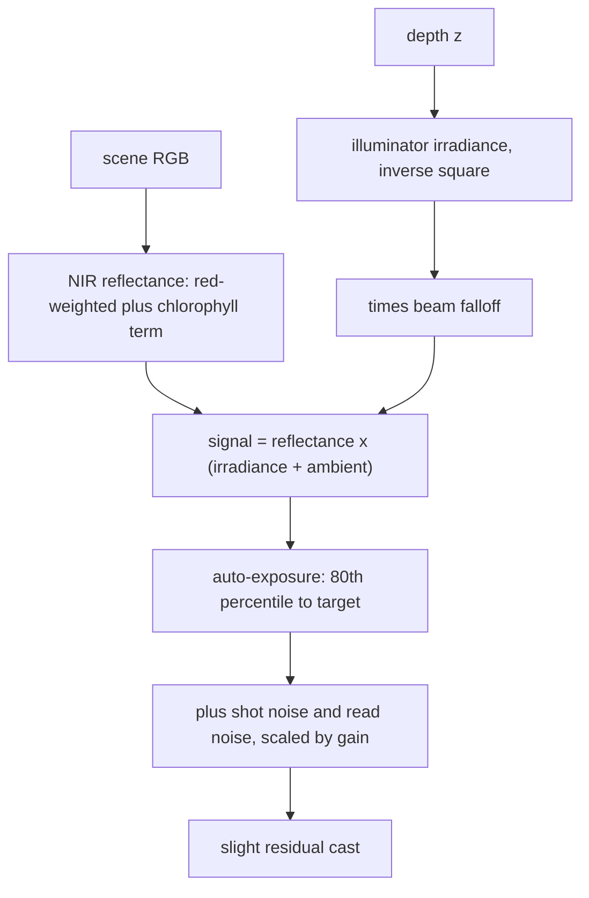

Foliage goes **bright**, which a luma conversion gets backwards —
chlorophyll reflects strongly in the near infrared. Gain scales the noise but
not the signal: on a real camera gain is one of the levers the AE loop uses
to *reach* its target, not something applied on top of a level it already
hit. Applying it twice put a fifth of the frame against the clipping point by
construction.

---

## 7. Severity, composition, and what varies

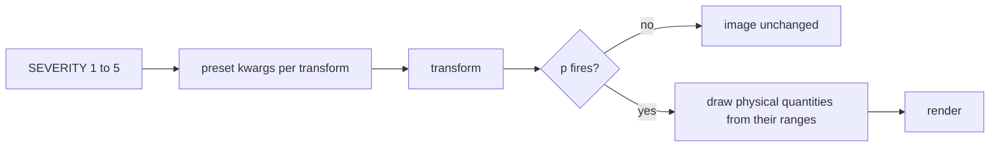

One rule worth stating because breaking it caused two visible bugs:
**whether an effect applies is what `p` is for.** A count range starting at
zero, or an exposure range straddling the flicker null, means a caller who
set `p=1.0` — and so explicitly asked for the effect — gets a bit-identical
frame back a quarter of the time. Parameters decide how *strongly*, never
*whether*.

---

## 8. Auditing: the loop that keeps this honest

Almost nothing here is chosen directly, so an image cannot tell you whether a
derivation held — only whether the result looks plausible. A chain that
quietly breaks still produces a plausible picture, which is the failure mode
worth hunting.

`WeatherTransform.__init_subclass__` instruments every subclass
automatically, so transforms do not opt in and recording costs one flag check
when off.

Both arms are load-bearing, and [`physical_review.md`](physical_review.md)
exists because each has caught things the other missed. The numeric checks
found a recorder whose schema changed with particle count; looking at frames
found two effects that rendered as nothing while every numeric check passed.
