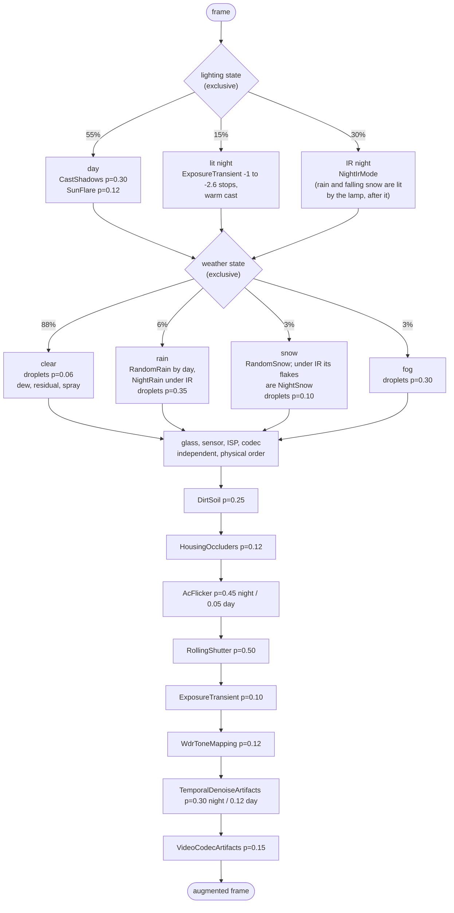

# A composite pipeline that makes physical sense

The obvious way to use this library is to list every effect with a
probability and let them fire independently. That is what the README's
examples do, and for two or three effects it is fine. At fourteen it produces
frames that could not exist: fog and snow at once, a sun flare in a scene the
camera is lighting with its infrared illuminator, hard midday shadows under
an IR-mode night sky.

This is a worked composite that does not, with measured frequencies and a
measured cost. It ships as
[`weathermentations.presets.surveillance`](../src/weathermentations/presets/pipelines.py),
alongside a CPU-only `surveillance_lite`:

```python
from weathermentations.presets import surveillance, surveillance_lite
```

Every probability below is a keyword argument, because the defaults encode how
often each condition occurs in a temperate maritime climate on a mixed camera
fleet, and **that will not match your footage**. The rest of this document is
why the numbers are what they are, so you can change them deliberately.

> **`severity` decides how degraded a frame gets** (1-5, default 1), and it is
> the first thing to change if the output looks too heavy. Omitting it is not
> neutral: the transforms then run on their own constructor defaults, which
> span the whole physically plausible range, so `RandomRain` reaches 200 mm/h
> — a tropical cloudburst — where severity 1 is 2-8 mm/h. Those wide defaults
> exist so one transform can explore its parameter space; they are the wrong
> thing for a pipeline that stacks three or four effects at once — and it
> compounds, so level 2 on each of three effects is not an ordinary frame but
> a bad one. That is why the default is 1. Measured, a typical frame keeps
> 75-81% of its high-frequency detail; on the library defaults the median
> frame kept 77% and the worst kept 9%.
>
> Two other things were driving the "too aggressive" impression and are now
> fixed. The night branches used a strong under-exposure and warm cast, which
> put a **29-level median red-blue shift** on `surveillance_lite` — it read as
> a sepia filter over a daylit frame rather than as night, because neither
> branch can relight the scene. `surveillance_lite` now renders no night at
> all and says so, and `surveillance`'s version is mild enough that the
> under-exposure carries the impression while the tint only hints: the median
> cast is 3.1 levels, with 2 frames in 20 above 15.

> **Severity is fixed per pipeline, not drawn per frame**, and that is
> deliberate. Picking it per frame with a `OneOf` gate looks obvious and is
> wrong: Albumentations seeds every child of a `Compose` from the same stream,
> and a `OneOf` that declines to fire consumes exactly one number, so a
> pipeline of same-shaped gates never desynchronises — they all fire together
> whenever the shared draw falls below the smallest `p`. Measured, that turned
> an expected 2.4 effects per frame into 64% of frames with one effect or none
> and 12% with nine or more stacked, which is exactly the "too invasive" look.
> Build two pipelines and alternate if you want a mixture; that composes
> correctly because the choice is then outside Albumentations' RNG.
>
> Applying severity directly rather than through a gate brings the effect
> count back to 2.3 with a variance of 1.85 — what independent draws give —
> and heavily stacked frames from 12% to **0.0-0.3%** across seeds. It is
> reduced rather than eliminated: the containers choosing the lighting and
> weather state still share the stream, so a frame with eight or more effects
> turns up occasionally. `tests/unit/test_pipeline_presets.py` pins the rate.

> **Seed once, not per frame.** Calling `set_random_seed` before every frame
> correlates every transform's probability check: frames then come out with
> nearly all effects or nearly none. Measured on `surveillance_lite`, 27% of
> frames are left untouched with a variance of 7.25 effects per frame, against
> 8% and 1.81 when the seed is set once and samples are streamed through. This
> is the behaviour a training loop wants anyway.

## What the naive pipeline gets wrong

**Mutually exclusive states fire together.** Rain, snow and fog are different
states of the same atmosphere. Independent probabilities give you all three at
once on `p³` of frames, each compositing its own veil over the last.

**Contradictory lighting.** `NightIrMode` converts the frame to what an IR
sensor sees under its own illuminator. `SunFlare` and `CastShadows` are
direct-sunlight phenomena. A frame with both is not a hard case for a model to
learn — it is an impossible one.

**Correlated things are drawn independently.** Water on the front element is
far more likely while it is raining than on a dry afternoon. Drawing the two
independently gets the *joint* distribution wrong even when each marginal is
right.

Note the shape of that third problem, because it is easy to over-correct.
Droplets are **not** implied by rain and rain is **not** required for
droplets: a recessed or shielded lens stays dry through a downpour, and dew,
overnight condensation, residual drops after the rain stops and wind-blown
spray all put water on the glass under a clear sky. The relationship is a
conditional probability, not an implication. An earlier version of this recipe
made droplets strictly conditional on wet weather, which is simply the same
error pointing the other way.

There is also a statistical error underneath all of it: **probability is doing
two different jobs.** Some of these are *events* (it started raining), some
are *camera properties* (this sensor has a rolling shutter and always has). A
rolling-shutter artefact at `p=0.15` asserts that 85% of frames came from a
global-shutter sensor, which for CCTV is close to backwards.

## The structure

Sample a lighting state, then a weather state (each of which carries its own
probability of water on the glass), then apply the camera's own degradations
in physical order.



Two different mechanisms are at work here and it is worth being explicit about
which is which.

**The two `{diamond}` nodes are exclusive choices** — one lighting state and
one weather state per frame, implemented as `OneOf`, so nothing can select
two. That is what makes the impossible combinations impossible: it is
structural, not a matter of probabilities being small.

**Everything in the tail is independent** and each has its own probability, as
listed. They are not all applied; a typical frame gets two or three of them.
They are independent because they genuinely are — a dirty dome tells you
nothing about whether the encoder dropped a frame.

## The recipe

```python
import albumentations as A
from weathermentations.atmosphere import RandomFog, RandomRain, RandomSnow
from weathermentations.camera import (
    AcFlicker, ExposureTransient, NightIrMode, RollingShutter,
    TemporalDenoiseArtifacts, VideoCodecArtifacts, WdrToneMapping,
)
from weathermentations.lens import DirtSoil, HousingOccluders, SunFlare, WaterDroplets
from weathermentations.scene import CastShadows


def _weather(
    depth_provider,
    rain=0.06, snow=0.03, fog=0.03,
    wet_rain=0.35, wet_snow=0.10, wet_fog=0.30, wet_clear=0.06,
):
    """Exactly one atmospheric state, including 'clear'.

    Each state carries its own probability of water on the front element, so
    rain can arrive without droplets (a shielded lens) and droplets can arrive
    without rain (dew, residual drops, spray). The weather sets the odds; it
    does not decide the outcome.
    """
    clear = max(1.0 - rain - snow - fog, 1e-6)
    return A.OneOf([
        A.Sequential([
            RandomRain(depth_provider=depth_provider, p=1.0),
            WaterDroplets(p=wet_rain),
        ], p=rain),
        A.Sequential([
            RandomSnow(depth_provider=depth_provider, p=1.0),
            WaterDroplets(p=wet_snow),
        ], p=snow),
        A.Sequential([
            RandomFog(depth_provider=depth_provider, p=1.0),
            WaterDroplets(p=wet_fog),
        ], p=fog),
        A.Sequential([
            WaterDroplets(p=wet_clear),
        ], p=clear),
    ], p=1.0)


def _stream(lit_by_mains, codec_p, infrared=False):
    """Glass, sensor, ISP and transmission: independent, each with its own p.

    Ordered by hand in the physical chain, because `physical_order` sorts a
    flat list and cannot see inside containers.
    """
    return [
        # Optics: on the glass, in front of everything the sensor does.
        DirtSoil(p=0.25),
        # A dark silhouette by day; lit by the IR ring, and glowing, only
        # once the camera has switched its illuminator on.
        HousingOccluders(p=0.12, glow_range=(0.6, 1.6) if infrared else (0.0, 0.0)),
        # Sensor. Mains banding needs artificial light, so it belongs to the
        # night branches outdoors (and would be all-day indoors).
        AcFlicker(p=0.45 if lit_by_mains else 0.05),
        RollingShutter(p=0.50),
        # ISP.
        ExposureTransient(p=0.10),
        WdrToneMapping(p=0.12),
        TemporalDenoiseArtifacts(p=0.30 if lit_by_mains else 0.12),
        # Transmission, last: it acts on the finished picture.
        VideoCodecArtifacts(p=codec_p),
    ]


def surveillance(depth_provider, day=0.55, lit_night=0.15, ir_night=0.30, codec_p=0.15):
    """One lighting state, one weather state, then the camera's own chain."""
    day_branch = A.Sequential([
        CastShadows(depth_provider=depth_provider, p=0.30),
        _weather(depth_provider),
        SunFlare(p=0.12),
        *_stream(lit_by_mains=False, codec_p=codec_p),
    ], p=day)

    # Night under street or shop lighting, camera still in colour: under-
    # exposed and warm-cast, with the IR-cut filter still in place.
    lit = A.Sequential([
        _weather(depth_provider),
        ExposureTransient(
            p=1.0,
            exposure_error_stops_range=(-2.6, -1.0),
            assumed_temperature_range_k=(5000.0, 6500.0),
            actual_temperature_range_k=(2000.0, 3200.0),
        ),
        *_stream(lit_by_mains=True, codec_p=codec_p),
    ], p=lit_night)

    # Ambient low enough that the camera has cut to monochrome and switched
    # its own illuminator on.
    ir = A.Sequential([
        _weather(depth_provider),
        NightIrMode(depth_provider=depth_provider, p=1.0),
        *_stream(lit_by_mains=True, codec_p=codec_p, infrared=True),
    ], p=ir_night)

    return A.Compose([A.OneOf([day_branch, lit, ir], p=1.0)])
```

Used as:

```python
from weathermentations.depth import DepthAnythingV2Estimator, SharedDepthProvider

provider = SharedDepthProvider(DepthAnythingV2Estimator())   # construct once
transform = surveillance(provider)
augmented = transform(image=image)["image"]
```

### Why `NightIrMode` is `p=1.0` *inside* its branch

Because the branch **is** the IR-night state, and its weight — 30% — is what
says how often that state occurs. A camera that has cut to monochrome and
switched its illuminator on has done so completely; there is no such thing as
30% of an IR frame.

Night that is not IR night is a separate state, and it gets its own branch.
The split matters: modern cameras hold colour far into the evening under
street lighting, and a model trained only on IR night has never seen the
colour-at-night domain.

So the thing to tune is the **branch weights**, not the transform's `p`.
`ir_night=0.30, lit_night=0.15` says 45% of frames are after dark and two
thirds of those have tripped to IR.

## Measured behaviour

Over 3000 images, recorded with `weathermentations.diagnostics`:

| Property | Measured | Designed |
| --- | --- | --- |
| Two or more weather states at once | **0** | impossible |
| `NightIrMode` with `SunFlare` or `CastShadows` | **0** | impossible |
| IR night | 29.5% | 30% |
| Rain / snow / fog | 7.0 / 3.2 / 2.7% | 6 / 3 / 3% |
| Droplets given rain | 37.0% | 35% |
| Droplets given fog | 29.3% | 30% |
| Droplets given snow | 12.6% | 10% |
| Droplets given clear | 5.0% | 6% |
| **Droplets with no weather** | **131 frames** | allowed — dew, residual, spray |
| **Weather with no droplets** | **274 frames** | allowed — shielded lens |

The last two rows are the point of the revision: both directions occur, at
rates the weather conditions but does not dictate.

## Cost

Measured at 512 px on the reference photograph, 100 images:

| | median | mean | p90 | 8 workers |
| --- | --- | --- | --- | --- |
| this recipe | 112 ms | 181 ms | 380 ms | **44 img/s** |
| 14 effects, independent, `p=0.15` | 104 ms | 193 ms | 384 ms | 41 img/s |

At 1024 px: 252 ms median, 338 ms mean, 24 img/s from 8 workers.

The mean sits well above the median because cost depends on which effects
fire; the p90 is what a `DataLoader` worker must keep up with, not the median.

### Where the time goes, and what to trim

| | ms | share |
| --- | --- | --- |
| `VideoCodecArtifacts` | 28.5 | ~26% |
| depth estimate (paid once if any depth-conditioned effect fires) | 26.0 | ~23% |
| `WdrToneMapping` | 13.1 | ~12% |
| `DirtSoil` | 8.5 | ~8% |
| `TemporalDenoiseArtifacts` | 7.2 | ~7% |
| `WaterDroplets` | 8.1 | ~7% |
| everything else | ~20 | ~17% |

**The codec is the biggest line, and for most datasets it should be near
zero.** If your frames came out of an H.264 or H.265 stream — which CCTV
frames did — the compression artefacts are already in the pixels, and
`VideoCodecArtifacts` adds a *second* generation of them. Set `codec_p=0.0`
and you lose nothing your data does not already have. It earns its place only
when training on clean or synthetic imagery destined for a compressed stream.

Physically honest probabilities for the always-on camera properties would put
codec at `p≈0.6`, WDR at `p≈0.25` and denoise at `p≈0.3`, costing roughly
**210 ms** instead of 112. The values above are a deliberate trade, and they
under-represent how often a real camera applies those three.

## Adapting the priors

| Parameter | Here | What it encodes |
| --- | --- | --- |
| `day` / `lit_night` / `ir_night` | 0.55 / 0.15 / 0.30 | Share of frames in each lighting state. Latitude, season, whether labels concentrate in daylight, and how readily your cameras trip to IR. |
| `rain` / `snow` / `fog` | 0.06 / 0.03 / 0.03 | Absolute frequency of each weather state; the remainder is clear. ~12% total suits a temperate maritime climate, an arid site nearer 2%. Set `snow=0` outside snow latitudes. |
| `wet_rain` / `wet_fog` / `wet_snow` / `wet_clear` | 0.35 / 0.30 / 0.10 / 0.06 | P(water on the glass \| weather state). A recessed lens stays dry far longer than an exposed dome; `wet_clear` covers dew, residual drops and spray, so a coastal or irrigated site wants more. |
| `codec_p` | 0.15 | See above — usually 0 for footage already sourced from video. |
| `DirtSoil` `p` | 0.25 | How much of your fleet is overdue for cleaning. Rises steeply with maintenance interval. |
| `RollingShutter` `p` | 0.50 | Not "how many cameras have a rolling shutter" (all of them) but how often there is enough motion — wind, a passing vehicle — for the artefact to show. |

### Rain at night is a different transform

The IR-night branch does not reuse the weather state the other two share, and
the reason is ordering rather than taste. Rain lit by the camera's own
illuminator has to follow the reflectance-to-infrared conversion — its
streaks are *already* in infrared terms, so running them through that
conversion would apply it twice. Fog still precedes it: it veils the scene,
and the sensor then sees the veiled scene.

Snow is split across the conversion. Its veil and settled snow are the scene
and go before; its falling flakes are lit by the lamp and go after, as
`NightSnow`, with `RandomSnow` built at `max_flakes=0` so the two do not both
draw them. Left to `RandomSnow` alone the flakes were lit by the depth of
whatever was behind them and vanished over anything distant.

The same branch is the only one in which things on the dome glow. An insect
or a web is a dark silhouette by day and under street lighting; under the
infrared ring it is lit from centimetres away, so `HousingOccluders` is given
a glow there and none anywhere else.

Water on the glass follows the lighting state in two ways. Under the infrared
ring `WaterDroplets` is given the same glow (`illuminator_glow_range`): a
fogged dome scatters the ring's light back as a veil and each drop returns it
from its rim, which is why a wet camera whites out at night. And in both
night branches its `aperture_diameter_range_mm` is pinned to an open iris,
1.4-3 mm. How sharp a drop looks is set by the aperture, so at night most of
them dissolve into soft patches, while the day branch keeps the transform's
default range, which also covers lenses that stop down in sunlight.

The rain in the street-lit night branch is seen by the same camera, so it is
metered for 5-150 lux with that open iris. `RandomRain` derives its shutter
time from the light level and the aperture, and at those levels it sits at
the slow end of the shutter's range: long faint streaks, where the day
branch mostly gets short flecks and dashes.

So that branch builds its own four-way weather choice with the shared tail
duplicated across the arms. That costs four sets of constructed objects and
no runtime, and it keeps the exclusivity structural: a frame still gets
exactly one weather state, and `NightRain` can only fire on the arm that
chose rain. Measured over 2000 frames at `rain=0.10`: `NightRain` fires on
3.3% (against `ir_night` 0.30 × `rain` 0.10 = 3%), always alongside
`NightIrMode`, never alongside `RandomRain`.

This matters more than it sounds, because it is the only configuration in
which the rain is actually visible as rain — see below.

## Why rain looks like haze and not like streaks

Worth knowing before concluding the rain is broken, because it is the most
common thing to misread about this library.

A raindrop's streak is **one pixel wide** with an opacity of 0.02-0.08 (see
F7 in [`physical_review.md`](physical_review.md)), and it carries the *sky's*
radiance because a drop is a wide-angle lens pointed at the sky. Against a
bright overcast sky that is almost no contrast. A 512 px frame at severity 2
genuinely contains **1076 streaks**; you cannot see them, and neither can a
camera.

Lengthening the shutter does not help, which is the part worth measuring
rather than assuming. Going from 1/333-1/100 s to 1/50-1/22 s takes the
median streak from 10 px to 52 px — and the high-frequency energy the rain
adds stays flat, 4.21 against 4.13. That is `α = D/(vT)` doing its job: a
longer exposure spreads one drop's light over more pixels, so the streak gets
longer and proportionally fainter.

A shorter shutter does the opposite, and helps somewhat: on a 1280 px road
scene at 30 mm/h the same measure goes from 5.9 at 1/30 s to 9.7 at 1/2000 s,
flecks in place of streaks. Which of those a camera produces is set by the
light and its aperture, so `RandomRain` meters its shutter time from a drawn
light level and aperture instead of drawing it from that one narrow range.
The picture varies a good deal more as a result. There is still no shutter
speed at which daylight rain becomes dramatic.

What actually says "rain" in a daylit frame is the **wet road** and water on
the glass, which is why this pipeline raises `wetness_probability` to 0.85
inside the rain branch rather than leaving it at the severity preset's value.
Streaks become visible against dark backgrounds — night, dark buildings,
shadowed foliage — so they carry the effect at night and the wet road
carries it by day, with a distance veil only in views a kilometre or more
deep. Both are correct; only one is photogenic.

### Droplets follow the camera chain's severity, not the weather's

A drop on the front element is centimetres from the sensor; a raindrop in the
air is metres away. The one on the glass therefore dominates any frame it
appears on, and at the weather's severity it dominated frames whose rain was
invisible — which is how a sample can end up looking like it has more
lens-water than rain even when the counts are 7 rain to 6 droplets.

So `WaterDroplets` takes `droplet_severity`, defaulting to the camera chain's
level rather than the weather's. Measured at 512 px, that is 15% of the
frame's high-frequency detail rather than 24%. `wet_fog` also came down from
0.30 to 0.18: rain splashing onto an exposed dome is the commonest source of
water on glass, while fog has to condense on glass colder than the air.

**At night it is visible**, and that is what `NightRain` is for. Lit by the
camera instead of the sky, a drop at 0.4 m returns a hundred times what one
at 4 m does and saturates, while the scene behind it is dark — both sides of
the contrast move at once. Same drop physics, same `α = w²/L`; only the
illumination changed. [`rain_visibility.md`](rain_visibility.md) has the
measurements.

**Snow is different and is visible even by day**, roughly 180 flakes at
severity 2 on a 512 px frame. If it appears to be missing, check whether you are looking at a
downscaled image: a flake and a streak are both about a pixel across, so any
2:1 area averaging removes them entirely. `scripts/benchmark_pipelines.py`
writes its contact sheets at native resolution for exactly this reason — an
earlier version downscaled them and made a frame containing a thousand
streaks look untouched.

## Caveats

**Neither night branch relights the scene.** This is the weakest part of the
recipe and it is worth stating plainly. The source frame is daylit, with
daylight shadow structure and daylight shading. `NightIrMode` replaces its
tonality with a real model — NIR reflectance, an inverse-square illuminator,
gain-scaled noise — but the *shadows* underneath are still the sun's. The
`lit_night` branch is cruder still: it underexposes and warms a daylight
frame, which is a fair rendering of "an under-exposed frame under sodium
lighting" and not a rendering of night. If your training set already contains
genuine night footage, prefer it and lower both branch weights.

**`physical_order` cannot sort this.** It works on flat lists and identifies
transforms by class name, so a `OneOf` or `Sequential` gets the default stage.
The order inside each branch is written by hand and verified monotonic against
`stage_of`. If you restructure, check that again rather than assuming.

**Some of these are per-camera, not per-image.** WDR is a setting; a camera
either has it enabled or does not. Modelling it per-image samples a *fleet* of
cameras rather than a stream from one — right for a dataset drawn from many
installations, wrong for one long recording. For the latter, fix those choices
per clip.

**Per-image, not per-clip.** Every draw is independent across images. If you
train on video, consecutive frames will disagree about the weather.

**The exclusions are structural, so they are cheap to break.** Moving
`SunFlare` into the shared tail would silently reintroduce flare-at-night and
nothing would fail. `tests/unit/test_pipeline_recipe.py` runs this recipe as
the document prints it and asserts the table above — re-run it after editing.
