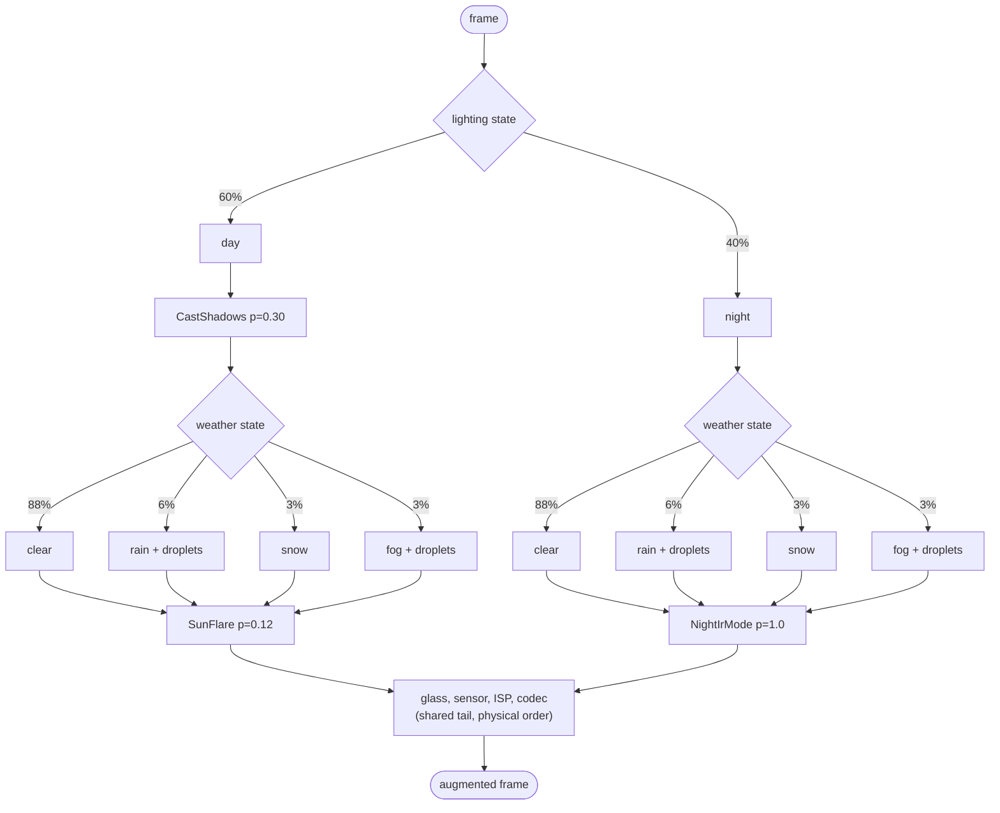

# A composite pipeline that makes physical sense

The obvious way to use this library is to list every effect with a
probability and let them fire independently. That is what the README's
examples do, and for two or three effects it is fine. At fourteen it produces
frames that could not exist: fog and snow at once, a sun flare in a scene the
camera is lighting with its infrared illuminator, hard midday shadows under
an IR-mode night sky.

This is a worked composite that does not, with measured frequencies and a
measured cost. **It is a recipe to copy and edit, not a library function** —
the probabilities encode how often each condition occurs in *your* footage,
which depends on climate, latitude, camera model and mounting. Baked-in
priors would be wrong for almost everyone.

## What the naive pipeline gets wrong

Three separate problems, all invisible until you look at what co-occurs.

**Mutually exclusive states fire together.** Rain, snow and fog are different
states of the same atmosphere. Independent probabilities give you all three
at once on `p³` of frames, each compositing its own veil over the last.

**Contradictory lighting.** `NightIrMode` converts the frame to what an IR
sensor sees under its own illuminator. `SunFlare` and `CastShadows` are
direct-sunlight phenomena. A frame with both is not a hard case for a model
to learn — it is an impossible one.

**Effects that should be conditional are not.** Droplets on the front element
come from rain or condensation. Applying them to clear-weather frames teaches
the model that lenses are randomly wet.

There is also a statistical error underneath: **effect probability is being
used for two different things.** Some of these are *events* (it started
raining), some are *camera properties* (this camera has a rolling shutter and
always has). A rolling-shutter artefact at `p=0.15` says 85% of frames came
from a global-shutter sensor, which for CCTV is close to backwards.

## The structure

Sample a lighting state, then a weather state, then apply the camera's own
degradations in physical order.



Exclusivity is structural, not probabilistic: the two lighting branches are
alternatives of one `OneOf`, so nothing can select both, and the weather
states are alternatives of another.

## The recipe

```python
import albumentations as A
from weathermentations.atmosphere import RandomFog, RandomRain, RandomSnow
from weathermentations.camera import (
    AcFlicker, ExposureTransient, NightIrMode, RollingShutter,
    TemporalDenoiseArtifacts, VideoCodecArtifacts, WdrToneMapping,
)
from weathermentations.lens import DirtSoil, HousingOccluders, SunFlare, WaterDroplets
from weathermentations.scene import CastShadows


def _weather(depth_provider, wet):
    """One atmospheric state or none. Droplets on the glass ride on the wet
    states only — a dry lens in clear weather is the common case."""
    return A.OneOf([
        A.Sequential([
            RandomRain(depth_provider=depth_provider, p=1.0),
            WaterDroplets(p=wet),
        ], p=0.50),
        A.Sequential([
            RandomSnow(depth_provider=depth_provider, p=1.0),
        ], p=0.25),
        A.Sequential([
            RandomFog(depth_provider=depth_provider, p=1.0),
            WaterDroplets(p=wet * 0.5),
        ], p=0.25),
    ], p=0.12)


def _stream(night, codec_p):
    """Glass, sensor, ISP and transmission — shared by both lighting branches.

    Ordered by hand in the physical chain, because `physical_order` sorts a
    flat list and cannot see inside containers.
    """
    return [
        # Optics: on the glass, in front of everything the sensor does.
        DirtSoil(p=0.25),
        HousingOccluders(p=0.12),
        # Sensor: mains banding needs artificial light, so it is a night
        # phenomenon outdoors and an all-day one indoors.
        AcFlicker(p=0.45 if night else 0.05),
        RollingShutter(p=0.50),
        # ISP.
        ExposureTransient(p=0.10),
        WdrToneMapping(p=0.06 if night else 0.12),
        TemporalDenoiseArtifacts(p=0.25 if night else 0.12),
        # Transmission, last: it acts on the finished picture.
        VideoCodecArtifacts(p=codec_p),
    ]


def surveillance(depth_provider, night_fraction=0.40, codec_p=0.15, wet=0.35):
    day = A.Sequential([
        CastShadows(depth_provider=depth_provider, p=0.30),
        _weather(depth_provider, wet),
        SunFlare(p=0.12),
        *_stream(night=False, codec_p=codec_p),
    ], p=1.0 - night_fraction)

    night = A.Sequential([
        _weather(depth_provider, wet),
        NightIrMode(depth_provider=depth_provider, p=1.0),
        *_stream(night=True, codec_p=codec_p),
    ], p=night_fraction)

    return A.Compose([A.OneOf([day, night], p=1.0)])
```

Used as:

```python
from weathermentations.depth import DepthAnythingV2Estimator, SharedDepthProvider

provider = SharedDepthProvider(DepthAnythingV2Estimator())   # construct once
transform = surveillance(provider)
augmented = transform(image=image)["image"]
```

## Measured behaviour

Over 1500 images, recorded with `weathermentations.diagnostics`:

| Property | Measured | Designed |
| --- | --- | --- |
| Two or more weather states at once | **0** | impossible |
| `NightIrMode` with `SunFlare` or `CastShadows` | **0** | impossible |
| `WaterDroplets` with no weather | **0** | impossible |
| Night fraction | 40.0% | 40% |
| Any weather | 11.6% | 12% |
| Rain / snow / fog | 5.6 / 3.6 / 2.4% | 6 / 3 / 3% |
| `AcFlicker` given night / given day | 48.5% / 4.8% | 45% / 5% |
| Effects per image | mean 2.4, max 9 | — |

## Cost

Measured at 512 px on the reference photograph, 80 images:

| | median | mean | p90 | 8 workers |
| --- | --- | --- | --- | --- |
| this recipe | **85 ms** | 172 ms | 364 ms | **46 img/s** |
| 14 effects, independent, `p=0.15` | 104 ms | 193 ms | 384 ms | 41 img/s |

It is cheaper *and* more realistic, which is not a coincidence: exclusivity
means the expensive atmospheric effects never stack, and tying droplets to
wet weather removes the single most expensive lens effect from 97% of frames.

The mean sits well above the median because cost depends on which effects
fire; the p90 is what a `DataLoader` worker must keep up with, not the median.

### Where the time goes, and what to trim

Expected cost per image, from measured per-transform costs times these
probabilities:

| | ms | share |
| --- | --- | --- |
| `VideoCodecArtifacts` | 28.5 | 27.3% |
| depth estimate (paid once if any depth-conditioned effect fires) | 26.0 | 24.9% |
| `WdrToneMapping` | 10.5 | 10.1% |
| `DirtSoil` | 8.5 | 8.1% |
| `TemporalDenoiseArtifacts` | 6.7 | 6.4% |
| everything else (10 effects) | 23.8 | 23.2% |

**The codec is the biggest line, and for most datasets it should be near
zero.** If your frames came out of an H.264 or H.265 stream — which CCTV
frames did — the compression artefacts are already in the pixels, and
`VideoCodecArtifacts` adds a *second* generation of them. Set `codec_p=0.0`
and you lose nothing your data does not already have. It earns its place only
when training on clean or synthetic imagery that will be deployed against a
compressed stream.

Physically honest probabilities for the always-on camera properties would put
codec at `p≈0.6`, WDR at `p≈0.25` and denoise at `p≈0.3`. That version costs
**208 ms** instead of 85 — a 2.4× price for a difference most models will not
notice, because those three are the effects a network adapts to fastest.
The trimmed values above are a deliberate trade, and the honest framing is
that they under-represent how often a real camera applies them.

## Adapting the priors

These are the numbers to change first, and what they should reflect:

| Parameter | Here | What it encodes |
| --- | --- | --- |
| `night_fraction` | 0.40 | Share of frames captured after dark. Depends on latitude, season, and whether your labels concentrate in daylight hours. |
| weather `OneOf` `p` | 0.12 | Fraction of frames with any precipitation or fog. ~12% suits a temperate maritime climate; an arid site is nearer 2%, and somewhere with real winters wants more snow weight. |
| rain / snow / fog weights | 0.50 / 0.25 / 0.25 | Relative frequency of the three states. Snow should be 0 outside snow latitudes. |
| `wet` | 0.35 | How often rain puts droplets on *this* camera's glass. A recessed or shielded lens stays dry far longer than an exposed dome. |
| `codec_p` | 0.15 | See above — usually 0 for footage already sourced from video. |
| `DirtSoil` `p` | 0.25 | How much of your fleet is overdue for cleaning. Rises steeply with maintenance interval. |

## Caveats

**`physical_order` cannot sort this.** It works on flat lists and identifies
transforms by class name, so a `OneOf` or `Sequential` gets the default
stage. The order inside each branch above is therefore written by hand, and
verified monotonic against `stage_of`. If you restructure the branches, check
that again rather than assuming.

**Some of these are per-camera, not per-image.** WDR is a setting; a camera
either has it enabled or does not. A rolling shutter is a sensor. Modelling
them per-image samples a fleet of cameras rather than a stream from one,
which is right for a dataset drawn from many installations and wrong for one
long recording. For the latter, fix those choices per clip.

**Per-image, not per-clip.** Every draw here is independent across images. If
you train on video, consecutive frames will disagree about the weather. See
the temporal note in the README.

**The exclusions are structural, so they are cheap to break.** Adding
`SunFlare` to the shared tail rather than the day branch would silently
reintroduce the flare-at-night case, and nothing would fail. The measured
table above is the check — re-run it after editing.
