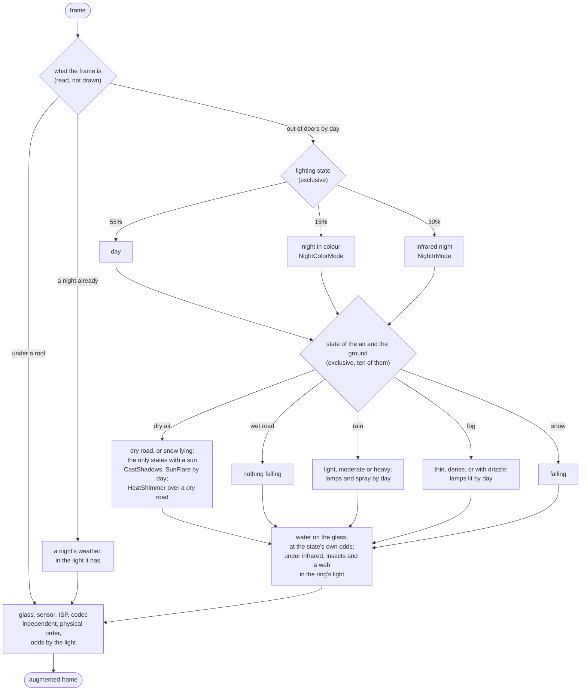

# A composite pipeline that makes physical sense

The obvious way to use this library is to list every effect with a
probability and let them fire independently. That is what the README's
examples do, and for two or three effects it is fine. At fourteen it produces
frames that could not exist: a sun flare in a scene the camera is lighting
with its infrared illuminator, hard midday shadows under falling rain, a
downpour in a car park under a roof.

This is a worked composite that does not. It ships as
[`surmentations.presets.surveillance`](../src/surmentations/presets/pipelines.py),
alongside a CPU-only `surveillance_lite`:

```python
from surmentations.presets import surveillance, surveillance_lite
```

Every number below is a keyword argument or a named constant, because the
defaults are estimates of how often each condition holds at a lowland site
in central Europe, and **that will not match your footage**. The rest of
this document is why the numbers are what they are, so you can change them
deliberately. Where each estimate comes from, and how far to trust it, is in
[`aware_effects_and_pipelines_review.md`](aware_effects_and_pipelines_review.md).

> **`severity` decides how degraded the camera's own chain is** (1-5,
> default 1), and it is the first thing to change if the output looks too
> heavy. A pipeline stacks several effects and their severities compound,
> so level 2 on each of three is not an ordinary frame but a bad one. The
> weather is not on this dial: each state of it is drawn at its own
> strength (below).

> **Severity is fixed per pipeline, not drawn per frame**, and that is
> deliberate. Picking it per frame with a `OneOf` gate looks obvious and is
> wrong: Albumentations seeds every child of a `Compose` from the same stream,
> and a `OneOf` that declines to fire consumes exactly one number, so a
> pipeline of same-shaped gates never desynchronises — they all fire together
> whenever the shared draw falls below the smallest `p`. Measured, that turned
> an expected 2.4 effects per frame into 64% of frames with one effect or none
> and 12% with nine or more stacked. Build two pipelines and alternate if you
> want a mixture; that composes correctly because the choice is then outside
> Albumentations' RNG. The weather's spread of strengths does not need it:
> its states are the arms of *one* choice, which consumes one draw however
> many arms it has.

> **Seed once, not per frame.** Calling `set_random_seed` before every frame
> correlates every transform's probability check: frames then come out with
> nearly all effects or nearly none. Set the seed once and stream samples
> through, which is what a training loop does anyway.

## What a naive pipeline gets wrong

**Contradictory lighting.** `NightIrMode` converts the frame to what an IR
sensor sees under its own illuminator. `SunFlare` and `CastShadows` are
direct-sunlight phenomena. So is neither of them possible under rain, fog or
falling snow, which come with cloud: an earlier version of this pipeline
drew hard shadows on three day frames in ten whatever was falling.

**Common weather at rare strengths.** It rains for about one hour in
fifteen, and most of that rain is too light for a camera to see falling. A
pipeline that draws rain on 6% of frames, as often as it rains, and always
at 20 to 45 mm/h, which falls for an hour a year, matches neither what a
camera sees nor what a model should be shown more of. That is what this
pipeline did until November 2026.

**The ground outlasts the sky.** A road stays wet for longer than the rain
lasts, and snow lies for days after an hour's fall. A wet road with nothing
falling is a commoner frame than rain, and it could not be drawn: the road
was wet only in the rain's own branch.

**Rain, snow and fog are not three exclusive things.** Rain and snow are:
they are kinds of precipitation. Fog is a state of the air, and drizzle
falls through it a good part of the time. What is exclusive is a *state of
the air and the ground together*, of which there are ten here.

**Correlated things are drawn independently.** Water on the front element is
far more likely while it is raining than on a dry afternoon. Drawing the two
independently gets the *joint* distribution wrong even when each marginal is
right. But droplets are **not** implied by rain and rain is **not** required
for droplets: a recessed or shielded lens stays dry through a downpour, and
dew and residual drops put water on the glass under a clear sky. The
relationship is a conditional probability, not an implication.

**The frame is not always what the pipeline takes it for.** Every branch
below turns a dry daylight photograph into something else. A photograph
taken at night, lit again by `NightIrMode`, and one taken under a roof and
rained on, are impossible frames of a different kind.

**Probability is doing two different jobs.** Some of these are *events* (it
started raining), some are *camera properties* (this camera has wide dynamic
range switched on and always has). Drawing a property per frame describes a
fleet of cameras sampled one frame at a time, which is right for a dataset
pooled from many installations and wrong for one long recording.

## The structure



Three different mechanisms are at work and it is worth being explicit about
which is which.

**The first diamond is read off the frame.** Nothing is drawn. A frame half
of which is nearly black is a night already
([`read_source`](../src/surmentations/presets/source.py)); a frame whose
labels show no sky, road, vegetation or open ground is under a roof, which
only a provider with scene labels can tell.

A night photograph and a car park under a roof, with the same draw of the
pipeline each: taken for dry daylight frames on the left (`read_source=False`),
read for what they are on the right. The night is not lit a second time,
and it does not rain indoors:


**The other two are exclusive choices** — one lighting state and one state
of the air and the ground per frame, each a `OneOf`, so nothing can select
two. That is what makes the impossible combinations impossible: it is
structural, not a matter of probabilities being small.

**Everything in the tail is independent** and each has its own probability.
They are independent because they genuinely are — a dirty dome tells you
nothing about whether the encoder dropped a frame.

## The states, and how often each is drawn

The caller gives five shares of time (`rain`, `snow`, `fog`, `wet_road`,
`snow_lying`); named constants say how rain divides by strength and fog by
thickness
([`weather_shares`](../src/surmentations/presets/pipelines.py)).

| State | Share of time | Drawn, by day | Drawn with |
| --- | --- | --- | --- |
| Dry air, dry road | 0.783 | 0.444 | nothing; by day, shadows, a flare and heat shimmer |
| Dry air, road still wet | 0.100 | 0.158 | `RandomRain` with no streaks, at its lowest rate |
| Light rain, to 3 mm/h | 0.044 | 0.106 | `RandomRain` |
| Moderate rain, to 10 mm/h | 0.016 | 0.063 | `RandomRain` |
| Heavy rain, 10 to 50 mm/h | 0.0015 | 0.020 | `RandomRain` |
| Fog, 200 m to 1 km | 0.012 | 0.039 | `RandomFog`; `NightFog` at night |
| Dense fog, 50 to 200 m | 0.004 | 0.022 | the same |
| Fog with drizzle | 0.004 | 0.022 | `RandomRain` with no streaks, then the fog |
| Snow falling | 0.006 | 0.039 | `RandomSnow`, 0.2 to 2.5 mm/h of water |
| Snow lying, none falling | 0.030 | 0.086 | `RandomSnow` with no flakes |

Each state by day, drawn alone on one scene, without the camera's own chain
after it and with nothing on the glass. The provider reads the scene and
its vehicles, so the traffic's lamps are lit in rain and fog; the sun is
out in the first and the last:


**"Drawn" is not "share of time", on purpose.** A pipeline that drew each
state as often as it happens would be nearly all dry frames: right for
measuring a model, wasteful for training one. `prior_power` raises each
share to a power before the draw
([`rebalanced`](../src/surmentations/presets/pipelines.py)): 1 is the share
itself, 0 makes every state as likely as every other, and the default, 0.5,
is the square root, the usual choice for classes with a long tail. Rare
states are drawn more often than they happen and still less often than
common ones.

**Fog follows the hour.** It forms after dark and clears after sunrise, so
its share is halved by day and half as much again at night
(`FOG_BY_HOUR`).

**The ground is drawn with the sky, not after it.** Nine rains in ten fall
on a road already wet, and eight snowfalls in ten on snow already lying
(`WET_UNDER_RAIN`, `SNOW_UNDER_SNOW`); how wet and how deep is drawn over
the transform's whole range unless `ground_severity` fixes it.

**`weather_severity` is for storms.** Left unset, each state has the
strength in the table. A level 1-5 draws all rain, snow and fog at that
level of the severity ladder instead, which is what this pipeline used to
do at level 2.

**Traffic.** By day, on a provider that reads the vehicles, the rain
states light the traffic's lamps and lay its spray, the fog states light
its lamps, and a road still wet has spray. Each vehicle goes no faster than
the gap ahead of it allows, so a queue throws up none
([`road_surface.md`](road_surface.md)). Without a reader none of this is
drawn.

## The recipe

A reduced version of the importable pipeline, to show its shape: two
lighting states where that has three, one strength of rain and one of fog,
no insects, webs or shimmer, and no reading of the frame.

```python
import albumentations as A
from surmentations.atmosphere import RandomFog, RandomRain, RandomSnow
from surmentations.atmosphere.night_fog import NightFog
from surmentations.atmosphere.night_rain import NightRain
from surmentations.camera import (
    AcFlicker, ExposureTransient, NightIrMode, RollingShutter, SensorNoise,
    TemporalDenoiseArtifacts, VideoCodecArtifacts, WdrToneMapping,
)
from surmentations.lens import DirtSoil, HousingOccluders, SunFlare, WaterDroplets
from surmentations.presets import rebalanced, weather_shares
from surmentations.scene import CastShadows

# P(water on the glass | state).
WET = {"dry": 0.06, "wet_road": 0.15, "rain": 0.35, "fog": 0.18, "snow": 0.10}


def _weather(provider, hour, relight=None, sunlit=(), sunlit_after=(), prior_power=0.5):
    """Exactly one state of the air and the ground, including 'dry'.

    Each state carries its own probability of water on the front element,
    so rain can arrive without droplets (a shielded lens) and droplets
    without rain (dew, residual drops). The sun is out only in the states
    with dry air. `relight` makes a night of the frame: what is in the
    scene goes before it and what is in the air after it.
    """
    share = rebalanced(weather_shares(hour=hour), prior_power)
    night = [relight] if relight is not None else []
    streaks = {"max_streaks": 0} if night else {}

    def road(rate, **more):
        return RandomRain(
            depth_provider=provider, p=1.0, rain_rate_range_mm_h=rate,
            wetness_probability=1.0, **more,
        )

    def drops(state):
        return WaterDroplets(p=WET[state])

    fog = NightFog if night else RandomFog
    arms = {
        "dry": [*sunlit, *night, drops("dry"), *sunlit_after],
        "wet_road": [road((2.0, 2.0), max_streaks=0), *night, drops("wet_road")],
        "rain": [
            road((2.0, 10.0), **streaks),
            *night,
            *([NightRain(p=1.0, rain_rate_range_mm_h=(2.0, 10.0))] if night else []),
            drops("rain"),
        ],
        "fog": [*night, fog(depth_provider=provider, p=1.0), drops("fog")],
        "snow": [RandomSnow(depth_provider=provider, p=1.0), *night, drops("snow")],
        "snow_lying": [
            RandomSnow(
                depth_provider=provider, p=1.0, max_flakes=0, accumulation_probability=1.0
            ),
            *sunlit, *night, drops("dry"), *sunlit_after,
        ],
    }
    weight = {
        "dry": share["dry"],
        "wet_road": share["wet_road"],
        "rain": share["rain_light"] + share["rain_moderate"] + share["rain_heavy"],
        "fog": share["fog_thin"] + share["fog_dense"] + share["fog_rain"],
        "snow": share["snow"],
        "snow_lying": share["snow_lying"],
    }
    return A.OneOf([A.Sequential(arms[name], p=weight[name]) for name in arms], p=1.0)


def _stream(lit_by_mains, codec_p, infrared=False):
    """Glass, sensor, ISP and transmission: independent, each with its own p.

    Ordered by hand in the physical chain, because `physical_order` sorts a
    flat list and cannot see inside containers.
    """
    return [
        # Optics: on the glass, in front of everything the sensor does.
        DirtSoil(p=0.25),
        # A dark silhouette by day; lit by the IR ring, glowing, and far
        # more often there, once the camera has switched its illuminator on.
        HousingOccluders(
            p=0.20 if infrared else 0.03,
            glow_range=(0.6, 1.6) if infrared else (0.0, 0.0),
        ),
        # Sensor. Mains banding needs mains light and a short shutter.
        AcFlicker(p=0.05 if infrared else 0.15 if lit_by_mains else 0.02),
        # A whole-frame shear needs the mount to move.
        RollingShutter(p=0.10),
        # Colour sensor noise, where the night's own transform has none.
        *([] if infrared else [SensorNoise(p=0.15, gain_range_db=(4.0, 10.0))]),
        # ISP.
        ExposureTransient(p=0.05),
        WdrToneMapping(p=0.30),
        TemporalDenoiseArtifacts(p=0.8 if lit_by_mains else 0.2),
        # Transmission, last: it acts on the finished picture.
        VideoCodecArtifacts(p=codec_p),
    ]


def surveillance(depth_provider, day=0.70, ir_night=0.30, codec_p=0.15):
    """One lighting state, one state of the air and ground, then the camera's own chain."""
    day_branch = A.Sequential([
        _weather(
            depth_provider, "day",
            sunlit=(CastShadows(depth_provider=depth_provider, p=0.30),),
            sunlit_after=(SunFlare(p=0.12),),
        ),
        *_stream(lit_by_mains=False, codec_p=codec_p),
    ], p=day)

    # Ambient low enough that the camera has cut to monochrome and switched
    # its own illuminator on.
    ir = A.Sequential([
        _weather(
            depth_provider, "night",
            relight=NightIrMode(depth_provider=depth_provider, p=1.0),
        ),
        *_stream(lit_by_mains=True, codec_p=codec_p, infrared=True),
    ], p=ir_night)

    return A.Compose([A.OneOf([day_branch, ir], p=1.0)])
```

Used as:

```python
from surmentations.depth import DepthAnythingV2Estimator, SharedDepthProvider

provider = SharedDepthProvider(DepthAnythingV2Estimator())   # construct once
transform = surveillance(provider)
augmented = transform(image=image)["image"]
```

The provider is also where a pipeline is told what its scenes hold and how
its camera is mounted. Nothing in the pipeline changes; every transform in
it asks the provider:

```python
from surmentations.perception import (
    InstallationGeometry, OpenVocabularyVehicleEstimator, SegmentationLabelEstimator,
)

provider = SharedDepthProvider(
    DepthAnythingV2Estimator(),
    labels=SegmentationLabelEstimator(),
    geometry=InstallationGeometry(horizontal_fov_deg=92.0, pitch_deg=24.0, height_m=6.5),
    vehicles=OpenVocabularyVehicleEstimator(),
)
transform = surveillance(provider)
```

The weather then falls through one camera, the wet road and the settled
snow keep off what stands on them, and a frame taken under a roof gets no
weather. With the vehicle reader, both night branches are lit from the
scene's own street lamps and traffic, the traffic's lamps are lit in rain
and fog, and a wet road has its spray. See
[`scene_understanding.md`](scene_understanding.md) and
[`road_surface.md`](road_surface.md).

### Why the night's transform is `p=1.0` *inside* its branch

Because the branch **is** the night, and its weight is what says how often
that state occurs. A camera that has cut to monochrome and switched its
illuminator on has done so completely; there is no such thing as 30% of an
IR frame.

Which of the two nights a camera has is a matter of where it stands. On a
lit street it holds colour all night; on an unlit road it goes to infrared
every night. The weights `lit_night=0.15, ir_night=0.30` describe a fleet of
both. For one camera, set the one it does not have to 0.

### Why the night's transform is in the *middle* of each state

A wet road and settled snow are the scene: they go before the frame is made
a night, so that the night's lamps light them. Rain and snow in the air are
lit by those lamps and go after it, as `NightRain` and `NightSnow`, with
`RandomRain` and `RandomSnow` before it told to draw no streaks and no
flakes. Fog goes after it too: at night it is lit by the lamps in it. Under
infrared the lamp is the camera's own, so what is in the air and on the
glass is lit from centimetres away; in a night in colour there is no such
lamp, and each drop and flake is lit by the street lamps and headlamps the
night put in the scene: by where it is, and most of all where it is near
the line of sight to a lamp, which it throws at the lens (`lamp_glint_range`).
Rain at night in colour is a swarm of streaks round the lamps, and unseen in
the dark between; a night with no lamp found in the scene shows none.

Four of the states in each lighting state. Down the middle and the right
the frame is made a night between the state's two halves: the wet road and
the settled snow are lit by the night's lamps, and the rain, the fog and
the snow in the air show in their light:


The pipeline's own draws, with the camera's chain after the weather, are
in the [scene gallery](examples/scenes/README.md), four to a scene.

## Measured behaviour

The importable `surveillance`, over 3000 draws, recorded with
`surmentations.diagnostics`:

| Property | Measured | Designed |
| --- | --- | --- |
| Day / night in colour / infrared night | 55.3 / 15.9 / 28.8% | 55 / 15 / 30% |
| Dry air over a dry road | 45.6% | 44% by day, 42% at night |
| Road still wet, nothing falling | 15.1% | 15 to 16% |
| Rain: light / moderate / heavy | 10.4 / 6.1 / 1.5% | 10 / 6 / 2% |
| Fog, without and with drizzle | 7.3 / 2.7% | 6 to 10 / 2 to 4% by the hour |
| Snow falling / lying | 4.3 / 7.1% | 4 / 8% |
| Droplets given rain falling | 28 to 31% | 35% |
| Droplets given a dry road | 7% | 6% |
| A sun effect given rain, fog or falling snow | **0** | impossible |
| A sun effect given dry air by day | 36% | 0.30 and 0.12, independent |
| A night made of a frame that was one | **0** | impossible |
| Insects given an infrared night over a dry or wet road | 26% | 25% |
| A web given an infrared night without snow | 11% | 10% |
| Heat shimmer given dry air over a dry road by day | 14% | 12% |
| Insects or a web by day or in a night in colour; insects with rain, fog or snow; a web with snow; shimmer at night or with anything on the ground or in the air | **0** | impossible |
| Effects per frame | mean 3.2, variance 3.0 | independent draws |
| Frames left untouched | 3.2% | |

The rows for insects, webs and shimmer, and the last two, were measured
when the three were added, in November 2026. Without them the pipeline as
it now stands draws 3.1 effects a frame, variance 2.9, and leaves 3.9% of
frames untouched.

## What is drawn together

A state is itself a combination: the air, the ground, and at night the
light. On top of it each state has its own odds of what goes with it on
the camera: water on the glass; with snow, snow on the housing; and under
infrared, insects in the beam and a web across the housing. Ten of them,
each drawn for certain here:


How often each comes up, over 4000 draws of the importable pipeline. The
first column is the estimate of how often it happens, for the reference
site; the second is the pipeline drawing the states as often as they happen
(`prior_power=1.0`), which should be near it; the third is the default.

| Together | Share of time, estimated | Drawn, matched | Drawn, default |
| --- | --- | --- | --- |
| Rain falling on a wet road | 6% | 5.6% | 18.2% |
| Road wet, nothing falling | 10% | 9.2% | 15.1% |
| Rain falling, water on the glass | 3% | 1.7% | 6.3% |
| Road wet, nothing falling, drops left on the glass | 1.5% | 1.0% | 1.9% |
| Rain through fog | 0.4% | 0.2% | 2.6% |
| Rain through fog, water on the glass | 0.2% | under 0.1% | 0.8% |
| Fog, water on the glass | 0.6% | under 0.1% | 1.4% |
| Fog at night / by day | 1.4 / 0.6% | 1.3 / 0.3% | 5.6 / 4.3% |
| Snow lying, none falling | 3% | 2.7% | 7.3% |
| Snow falling on lying snow | 0.5% | 0.5% | 3.5% |
| Snow, falling or lying, and on the housing | not estimated | 0.5% | 2.6% |
| Snow lying, the sun out | not estimated | 0.3% | 1.8% |
| Rain falling at night | 3% | 2.9% | 9.4% |
| Infrared night, rain, a wet lens in the lamp | not estimated | 0.5% | 1.8% |
| Insects in the infrared ring's beam | 6.5% | 6.0% | 3.5% |
| A web across the housing, in the ring's light | 2.9% | 3.0% | 2.8% |
| A web beaded by rain or fog | not estimated | 0.2% | 0.9% |
| Heat shimmer over a dry road by day | 5.2% | 5.1% | 2.9% |
| **The sun with rain, fog or falling snow** | never | **0** | **0** |
| **The sun at night** | never | **0** | **0** |
| **Snow with rain or fog** | sleet is not drawn | **0** | **0** |

Two rows fall short of their estimates on purpose or by sampling. Water on
the glass in rain is drawn at 0.35 where the estimate for a mixed fleet is
0.45: it is a housing's property, 0.7 for an exposed dome and 0.2 for a
hooded bullet, and `wet_rain` is the argument. And a combination under
half a percent is a handful of frames in 4000: the fog rows of the matched
column are too few to say more than that they are rare.

What the pipeline does not draw together, though it happens: frost on the
glass on a cold clear night, and a wind that slants the rain and shakes the
mount at once. The transforms exist (`FrostOnGlass`, `CameraVibration`);
neither has a place in the pipeline yet.

### Insects, webs and heat shimmer

Three more things go with a state, as water on the glass does, each at
odds of its own:

| | Drawn in | Never with | Argument |
| --- | --- | --- | --- |
| Insects in the illuminator's beam (`NightInsects`) | an infrared night, over a dry or a wet road with nothing falling | daylight, a night in colour, rain, fog, snow | `insects`, 0.25 |
| A web across the housing (`SpiderWeb`) | an infrared night, in any state but snow | daylight, a night in colour, snow falling or lying | `webs`, 0.10 |
| Heat shimmer (`HeatShimmer`) | by day, dry air over a dry road | night, a wet road, anything falling, fog, snow | `shimmer`, 0.12 |

**Insects and a web show by the camera's own lamp.** A thread of silk is a
few micrometres across and an insect a few millimetres; lit by the sky,
neither shows at the distances they are from the lens. The infrared ring
lights them from centimetres away, against a scene it lights from metres,
and they become the brightest things in the frame: a beaded streak where
an insect crossed the beam during the exposure, and a string of glowing
discs along each thread. A night in colour has no lamp at the lens, so
neither is drawn there, nor by day. Insects fly where nothing falls; a web
stays up in rain and fog, which bead it with water and make it brighter.
Neither is drawn with snow. In each state they come after the night's
conversion and what is in the air, and before the water on the glass:
they are nearer the lens than the air and further from it than the glass.
`HousingOccluders` (`occluders`) is something else, insects sitting on
the dome itself.

**Heat shimmer needs a long view.** It is the air over ground the sun has
warmed, which bends each ray a little at every parcel it passes. A point
moves by a pixel only over a path of a kilometre or so, seen through a
long lens. Over the 3 to 50 m a provider takes a scene to span by
default, a point moves by under a twentieth of a pixel, which is
right, and the frame is unchanged to the eye. For a camera that does look
a long way, tell the provider: `depth_range_m` for the distances its
scenes span, and its mounting (`geometry`) for its field of view. Without
a mounting the transform takes the lens to be a long one, 2 to 12 degrees
across.

**The odds are estimates averaged over the year.** Insects fly on the
warm nights, about half of them, and around a lamp on such a night half
the frames have one in the beam. Orb weavers build from spring to autumn,
four or five months of the year, and rebuild each night in the same place,
on perhaps one camera in four that is not cleaned. The ground is hot
enough for shimmer on sunny afternoons from late spring to early autumn:
the sun is out four days in ten, in half the year, for the middle of the
day. The pipeline has no season, only the weather: snow stands for
winter, and a dry winter night is given insects at the year's average.
For a site and a season of your own, set the three.

## Cost

On one CPU core with the depth network on the GPU, 512 px, `codec=0.0`,
300 frames, on a provider that has depth alone: **35 ms at the median, 34
on average and 57 at the 90th percentile**, each frame the least of three
runs. The pipeline it replaces took 12 at the median. The difference is the weather: a wet road, a fog or a
night is drawn on most frames now, where 88 frames in a hundred used to
get none.

Where it goes, as shares of the whole: `RandomRain` 37% (42 ms a call, on
four frames in ten, most of it the wet road), `RandomSnow` 11%, the noise
reducer 11%, water on the glass 6%, wide dynamic range 5%, and nothing
else over 4%.

The arguments that move it, each table measured in one run (the machine's
own drift between runs is several milliseconds, and only figures from one
run compare):

| | Median | Mean | 90th percentile |
| --- | ---: | ---: | ---: |
| As shipped, `prior_power=0.5` | 49 ms | 48 | 85 |
| `prior_power=0.75` | 32 | 38 | 74 |
| `prior_power=1.0`: four frames in five dry | 22 | 28 | 62 |
| `ground_severity=0, wet_road=0, snow_lying=0`: nothing on the ground | 29 | 31 | 59 |

| | Median | Mean | 90th percentile |
| --- | ---: | ---: | ---: |
| As shipped, `wdr=0.30, denoise=0.8` | 40 ms | 39 | 69 |
| `wdr=0` | 36 | 37 | 66 |
| `denoise=0` | 37 | 34 | 64 |
| `wdr=0, denoise=0`: a camera with both off | 36 | 33 | 62 |

(Each table is one run on a machine that was doing other work, so its
rows compare with each other and not with the figures above; the first
was taken before the last of the work below, which took a tenth off.)

Three things were done to bring it down, in November 2026:

- **No grain of far rain or far snow where nothing is falling**, or where
  the night's own transform draws what falls. It is the speckle of a count
  of drops, a tenth of the transform's time, and there was nothing for it
  to match.
- **What is read off the depth map is read at 384 pixels** in fast mode,
  for any frame over 480: the lie of the ground, where a road is wet. It
  was 518, for frames over 777, so a 512-pixel frame was read at full
  size. [`native_kernels.md`](native_kernels.md) has what that changes.
  These two took 14% off the mean and 19% off the median at 512 px, and
  8% off at 1024.
- **Twelve more compiled kernels**, for the surface normals, the lying
  snow and the ground's noise among them
  ([the eighth round](native_kernels.md#an-eighth-round-what-reads-the-scene)):
  another 9% off, frame for frame.

Insects, webs and heat shimmer add less than a millisecond a frame on
average. A call costs 3, 7 and 14 ms on one core at 512 px, and they come
on about 4, 3 and 3 frames in a hundred. Shimmer costs the same on a
street, where it changes nothing, as on a long view, where it shows: most
of it is working out how far each pixel's light has come through the air.

The camera's settings are also drawn nearer to how often they are on: wide
dynamic range on 0.30 of frames (it was 0.12) and the noise reducer on 0.8
of night frames (0.30). Together they are 6 to 7 ms of the 39, and both
are arguments (`wdr`, `denoise`).

### With a provider that reads the scene

Labels, the installation's geometry and the vehicle reader give the
effects a road to wet, traffic to trail spray and lamps to light, and each
costs what it reads. One core, the least of three runs taken turn about,
on a city road (800 x 480, 15 vehicles, 22 street lamps) and a motorway
(640 x 640, 46 vehicles); "before" is the library as it stood before the
kernels and the road's reading were reworked in November 2026:

| A frame of | City road, before | now | Motorway, before | now |
| --- | ---: | ---: | ---: | ---: |
| An infrared night | 153 ms | 54 | 200 | 64 |
| A night in colour | 146 | 45 | 203 | 57 |
| A night in colour, with fog | 183 | 63 | 240 | 78 |
| Fog by day, the traffic's lamps lit | 48 | 40 | 55 | 41 |
| A wet road | 147 | 86 | 163 | 92 |
| A wet road with spray and lamps | 211 | 125 | 263 | 152 |
| Snow lying | 147 | 97 | 170 | 103 |

The whole pipeline on such a provider, at 512 px on a frame with a road in
it, went from 172 ms a frame on average to 82 (180 to 81 at the median,
306 to 142 at the 90th percentile): `RandomRain` is 39% of that, the two
nights 29% and `RandomSnow` 8%.

What it was: the nights summed every street lamp's light along every line
of sight with a sine and a cosine at each of eight points, which is now a
kernel that takes no angle at all; and a road was read with a Python loop
over 200 trial roads and a pass over the frame for every vehicle, which
is now a matrix, one sort and three kernels, 72 ms to 23 on the motorway,
and reads the same road. The lamps' pools and beams, the wheel tracks,
the spray and the haloes round lamps in fog have a kernel each too
([`native_kernels.md`](native_kernels.md#a-ninth-round-lamps-tracks-and-the-roads-frame)).

Lying snow still reads the picture's own texture at full size: where a
canopy is, and where level ground runs to an object's edge. That was not
moved to a smaller copy. It is the picture's own edges that the snow's
edge has to follow, and reading only the depth map smaller already moves
that edge on about one pixel in a hundred. The snow was made cheaper by
kernels instead.

**The reading itself now costs more than what is drawn from it.** All of
the above is with the scene already read. A provider's first sight of a
frame, on the same machine's GPU (an 8 GB laptop card), is 170 ms at the
median at 512 px, from 115 to 265 over six scenes:

| | First sight of a frame |
| --- | ---: |
| Depth | 25 ms (14 on a provider that has depth alone) |
| Labels | 31 ms |
| Geometry, on the CPU | 3 ms |
| The vehicle reader: vehicles, their lamps, street lamps, signs | 115 ms, from 57 to 198 with the traffic |

A provider holds on to the last frames it read, so the transforms of one
pipeline share a reading, but a training set seen once an epoch is read
again every epoch. `SharedDepthProvider(disk_cache=...)` keeps each
reading in a file ([`depth/store.py`](../src/surmentations/depth/store.py))
and finds it again by the frame's own pixels:

| | A frame's first sight in a process |
| --- | ---: |
| Read by the networks | 163 ms |
| Read and written to disk, the first epoch | 177 ms |
| Found on disk, every later one | 8 ms |
| The same for a provider with depth alone | 29 ms, and 3 ms |

About 550 kB a frame at 512 px. For a fixed set of frames that is the
largest saving there is to make here, and the pipeline's pictures are the
same with it and without.

**The codec is the biggest single line, and for most datasets it should be
zero.** If your frames came out of an H.264 or H.265 stream — which CCTV
frames did — the compression artefacts are already in the pixels, and
`VideoCodecArtifacts` adds a *second* generation of them. Set `codec=0.0`
and you lose nothing your data does not already have.

**Packet loss rides with the codec.** `TransmissionFaults` damages a real
H.264 stream and decodes it, at `faults=0.03` by default. It needs ffmpeg
as the codec stage does, so when `codec=0.0` an unset `faults` is zero too
and the pipeline still builds on a machine without the binary.

## Adapting the priors

| Parameter | Here | What it encodes |
| --- | --- | --- |
| `day` / `lit_night` / `ir_night` | 0.55 / 0.15 / 0.30 | Share of frames in each lighting state. Frames taken evenly round the clock are nearly half at night; frames taken when something passes follow the traffic, a fifth of which runs in darkness. Colour or infrared is the site's lighting. |
| `rain` / `snow` / `fog` | 0.065 / 0.006 / 0.02 | The share of time each is there. A Mediterranean coast has half the rain and no snow; a river basin several times the fog. |
| `wet_road` / `snow_lying` | 0.10 / 0.03 | The share of time the ground still shows what fell. Both rise steeply in winter. |
| `prior_power` | 0.5 | 1 to draw the weather as often as it happens, lower to be shown more of what is rare. |
| `weather_severity` | unset | A level 1-5 to draw all weather at one strength. |
| `wet_rain` / `wet_fog` / `wet_snow` / `wet_after` / `wet_clear` | 0.35 / 0.18 / 0.10 / 0.15 / 0.06 | P(water on the glass \| state). A housing's property more than a frame's: 0.7 in rain for an exposed dome, 0.2 for a hooded bullet. |
| `snow_on_housing` | 0.30 | P(snow on the housing \| snow falling); half of it over snow that only lies. |
| `shadows` / `flare` | 0.30 / 0.12 | Hard shadows and a sun flare, on the day frames with dry air. |
| `shimmer` | 0.12 | Heat shimmer by day over dry air and a dry road: the sun on a warm day. It shows only on a long view. |
| `insects` / `webs` | 0.25 / 0.10 | Insects in the beam on an infrared night with nothing falling, and a web across the housing on an infrared night without snow. Averaged over the year; in summer both are higher. |
| `codec` | 0.15 | See above — usually 0 for footage already sourced from video. |
| `dirt` | 0.25 | How much of your fleet is overdue for cleaning. |
| `occluders` | 0.12 | Insects and webs under the infrared ring; a quarter of it by day. |
| `wdr` | 0.30 | The share of your cameras with wide dynamic range on: a setting, so 0 or 1 for one camera. |
| `denoise` | 0.8 | The noise reducer's artefacts at night; a quarter of it by day. A setting too: 0 for cameras that have it off. |
| `read_source` | on | Off to take every frame for a dry daylight one. |

The rest of the camera chain's odds (`RollingShutter` 0.10, `AcFlicker`
0.02 by day and 0.15 under street lamps, `ExposureTransient` 0.05) are
constants at the top of
[`pipelines.py`](../src/surmentations/presets/pipelines.py), with what each
is an estimate of. `surveillance_lite` takes `wdr` and `denoise` as well.

## Why rain looks like haze and not like streaks

Worth knowing before concluding the rain is broken, because it is the most
common thing to misread about this library.

A raindrop's streak is **one pixel wide** with an opacity of 0.02-0.08 (see
F7 in [`physical_review.md`](physical_review.md)), and it carries the *sky's*
radiance because a drop is a wide-angle lens pointed at the sky. Against a
bright overcast sky that is almost no contrast. A 512 px frame at severity 2
genuinely contains **1076 streaks**; you cannot see them, and neither can a
camera.

Lengthening the shutter does not help, which is the part worth measuring
rather than assuming. Going from 1/333-1/100 s to 1/50-1/22 s takes the
median streak from 10 px to 52 px — and the high-frequency energy the rain
adds stays flat, 4.21 against 4.13. That is `α = D/(vT)` doing its job: a
longer exposure spreads one drop's light over more pixels, so the streak gets
longer and proportionally fainter.

A shorter shutter does the opposite, and helps somewhat: on a 1280 px road
scene at 30 mm/h the same measure goes from 5.9 at 1/30 s to 9.7 at 1/2000 s,
flecks in place of streaks. Which of those a camera produces is set by the
light and its aperture, so `RandomRain` meters its shutter time from a drawn
light level and aperture instead of drawing it from that one narrow range.
The picture varies a good deal more as a result. There is still no shutter
speed at which daylight rain becomes dramatic.

What actually says "rain" in a daylit frame is the **wet road**, the grey
light and water on the glass, which is why nine rain frames in ten here
have the road wet, and why the commonest rain state of all, rain under
3 mm/h, is worth drawing though nothing of it can be seen falling.

How wet the road is, and how much snow has settled, are **not** tied to
how hard it is raining or snowing. They follow how long the weather has
lasted, so by default each frame draws the ground over its whole range
under whatever is falling: a downpour on a road barely damp, a flurry over
deep snow. Pass `ground_severity` (0 dry and bare, 5 soaked and buried,
from `GROUND_SEVERITY`) to `surveillance` or `weather_state` to fix it.
Streaks become visible against dark backgrounds — night, dark buildings,
shadowed foliage — so they carry the effect at night and the wet road
carries it by day, with a distance veil only in views a kilometre or more
deep. Both are correct; only one is photogenic.

### Droplets follow the camera chain's severity, not the weather's

A drop on the front element is centimetres from the sensor; a raindrop in the
air is metres away. The one on the glass therefore dominates any frame it
appears on. So `WaterDroplets` is built at the camera chain's level and not
at the weather's strength.

**At night it is visible**, and that is what `NightRain` is for. Lit by the
camera instead of the sky, a drop at 0.4 m returns a hundred times what one
at 4 m does and saturates, while the scene behind it is dark — both sides of
the contrast move at once. Same drop physics, same `α = w²/L`; only the
illumination changed. [`rain_visibility.md`](rain_visibility.md) has the
measurements.

**Snow is different and is visible even by day**, roughly 180 flakes at
severity 2 on a 512 px frame. If it appears to be missing, check whether you are looking at a
downscaled image: a flake and a streak are both about a pixel across, so any
2:1 area averaging removes them entirely. `scripts/benchmark_pipelines.py`
writes its contact sheets at native resolution for exactly this reason — an
earlier version downscaled them and made a frame containing a thousand
streaks look untouched.

## Caveats

**A night is as good as what the provider knows.** With scene labels and a
vehicle reader, both night branches light the scene from its own street
lamps and traffic. With depth alone there is nothing to say where a lamp
is: the infrared branch is lit by the camera's illuminator and an even
ambient, the colour branch by the sky's glow, and in both the day's
shadows are still on the ground. If your training set already contains
genuine night footage, prefer it and lower both weights.

**The estimates are estimates.** The shares of time are from memory of
climate normals and from summaries, not from hourly records of any site.
Replace them with counts from the records of yours before trusting the
proportions.

**`physical_order` cannot sort this.** It works on flat lists and identifies
transforms by class name, so a `OneOf` or `Sequential` gets the default stage.
The order inside each branch is written by hand and verified monotonic against
`stage_of`. If you restructure, check that again rather than assuming.

**Some of these are per-camera, not per-image.** WDR is a setting; a camera
either has it enabled or does not (`wdr=0.0` or `1.0` for a recording from
one). So are the noise reducer (`denoise`), the housing, and whether the
site is lit. Modelling them per-image samples a *fleet* of cameras rather than a
stream from one — right for a dataset drawn from many installations, wrong
for one long recording. For the latter, fix those choices per camera.

**Per-image, not per-clip.** Every draw is independent across images. If you
train on video, consecutive frames will disagree about the weather.

**One parked car is not known from one that is moving.** A row of them is a
queue to the spray and throws up none; one alone, on a wet road, is given
the spray of the speed the frame's traffic was drawn at.

**The exclusions are structural, so they are cheap to break.** Moving
`SunFlare` into the shared tail would silently reintroduce flare-at-night and
nothing would fail. `tests/unit/test_pipeline_recipe.py` runs this recipe as
the document prints it and `tests/unit/test_pipeline_presets.py` the
importable one — re-run them after editing.
