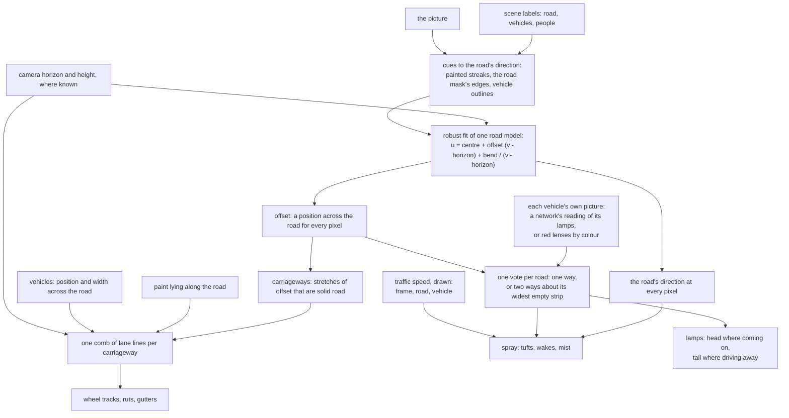
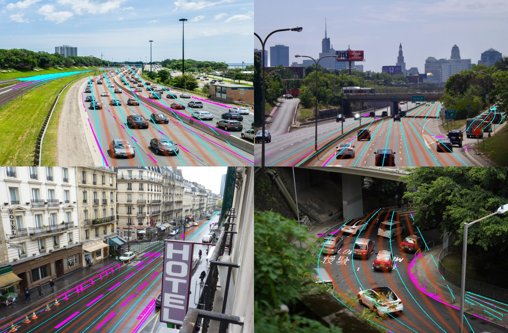
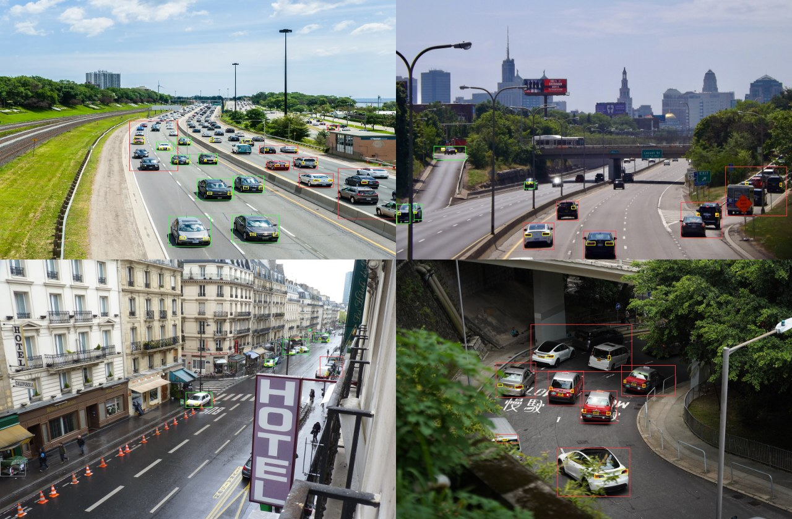
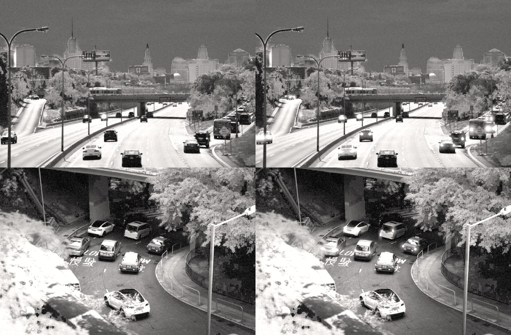

# The road surface: lanes, wheel tracks, standing water, spray and lamps

Some of what happens on a road is laid out *along* it. Wheels wear two
tracks down every lane of a snowy road. Water stands in the same ruts and
along the kerb. A car on a wet road trails its spray behind it, and drives
with its lamps on. None of that can be drawn from a mask of where the road
is: it needs the road's own coordinates, its lanes, and which way each
vehicle on it is going.

[`surmentations.utils.road`](../src/surmentations/utils/road.py) reads
both off the picture, and `RandomSnow` and `RandomRain` use them:

| | Argument | Default | Needs |
| --- | --- | --- | --- |
| Wheel tracks in settled snow | `RandomSnow(wheel_track_range=...)` | `(0.0, 0.9)` | scene labels |
| Water in the ruts and gutters | `RandomRain`, with its wet road | on | scene labels |
| A soaked road under cloud | `RandomRain`, with its wet road | on | nothing |
| Tail lamps reflected in the road | `RandomRain`, with its wet road | on | scene labels |
| Spray behind vehicles | `RandomRain(spray_range=...)` | `(0.0, 0.0)`: off | scene labels |
| How fast the traffic is going | `RandomRain(traffic_speed_range_kmh=...)` | `(40.0, 130.0)` | with spray |
| The traffic's lamps, lit | `RandomRain(vehicle_lamp_range=...)` | `(0.0, 0.0)`: off | scene labels |
| The traffic's lamps at night | `NightIrMode(vehicle_lamp_range=...)` | `(0.7, 1.3)` | a vehicle reader |

"Scene labels" means a provider built with `labels=`
([scene understanding](scene_understanding.md)): they say where the road
and its vehicles are. Without them there is no road to follow, and
everything in the table that needs them is simply not drawn. Spray and
lamps are much the better for a provider built with `vehicles=` as well,
which has a network say which end of each vehicle is seen and where its
lamps are ([vehicle views](scene_understanding.md#vehicle-views)).

```python
provider = SharedDepthProvider(
    DepthAnythingV2Estimator(),
    labels=SegmentationLabelEstimator(),
    vehicles=OpenVocabularyVehicleEstimator(),  # for spray and lamps
)
snow = RandomSnow(depth_provider=provider, wheel_track_range=(0.2, 0.8))
rain = RandomRain(
    depth_provider=provider,
    wetness_probability=1.0,
    spray_range=(0.3, 0.8),
    traffic_speed_range_kmh=(90.0, 130.0),  # this camera looks at a motorway
    vehicle_lamp_range=(0.6, 1.2),
)
```

## Reading a road



**One model for the whole road.** On level ground, every line that runs
along a road of constant curvature is, in the picture,

    u = centre + offset * (v - horizon) + bend / (v - horizon)

`horizon`, `centre` and `bend` are the road's, the same for every lane
line, kerb and wheel track; `offset` is each line's own. So `offset` is a
position across the road for every pixel, constant along a lane on a bend
as on a straight, and across two carriageways as across one
([`RoadModel`](../src/surmentations/utils/road.py)).

**Fitted to everything that points along the road.** Painted streaks, the
edges of the road's mask and the long way of each vehicle's outline are
each a short piece of line with a direction. None is trusted: a slip road,
the end of a kerb and a zebra crossing are in there too. Two cues make a
road, so many pairs are tried and the road kept is the one the largest
share of the cues lies along to within a few degrees; a straight road is
preferred unless a bend fits clearly better. Where the provider knows the
camera's horizon ([scene understanding](scene_understanding.md)) it is
used, which leaves two numbers to fit instead of three and is what keeps
the fit from bending a road to pass through anything.

**Carriageways.** Counted by offset, the road's mask is solid where there
is a carriageway and empty where there is a reserve.

**The lanes are one comb per carriageway**: a width and a phase, scored on
everything at once.

- *Paint lies on the comb's teeth.* The share of the paint that lies on a
  lane line, lowered for lane lines with no paint and by a small cost per
  line, so that a comb twice too fine does not win by having a tooth under
  everything.
- *Vehicles sit between the teeth*, in the middle of a lane.
- *A lane has a size.* Where the camera's height is known the road's width
  is known in metres, and a lane is 3.4 m give or take a quarter.
  Otherwise a lane is 1.7 times the width of what drives in it, within a
  wide margin.

**When no such road fits**, one running across the picture or seen from
straight above, the road is read off its mask alone, as before; and there
lanes are laid only where the paint or the vehicles vouch for them, never
guessed. Tracks ruled across a junction are worse than none.

Cues in yellow, paint in magenta, lane lines in cyan, tracks in orange:



## Wheel tracks in snow

Two tracks per lane where traffic has worn the settled snow off, with snow
left between the wheels, between the lanes and along the verges. Nothing
about them is even, because ruled lines are a pedestrian crossing: each
lane carries its own share of the traffic, a track strays a little from
side to side, and it is worn deep in one stretch and nearly gone in the
next. Far down the road the tracks run together into a greyer road, as they
do to the eye. The road under them is wet and darker than it was dry.

`wheel_track_range` runs from untouched snow (0) through two ruts a tyre
wide (0.3) to lanes worn bare (1). Left, without; right, with:


## The wet road

Everything in this section and the next two is in the scene, and the rain
that is seen as streaks is nearer the lens than the scene. So the streaks
are drawn last, over the wet road, the spray and the lamps, and none of
them darkens, mirrors or hides the rain in front of it
([how it works](how_it_works.md)).

- **Water in the ruts and gutters.** A road drains to its kerbs and has two
  ruts in every lane. The noise the puddles are cut from is lowered there,
  so a little water is strips along the road and only a lot of it is
  everywhere. Puddles have an edge, their share is a share of the wet road,
  and rain roughens them in step with its rate.
- **The sky that soaked it.** A road does not get soaked under a clear
  sky. A film on the road now brings cloud with it whatever is falling
  (scaled by `overcast_range`, so a caller who says there is none is
  believed). A soaked road under light rain used to be lit by the sun,
  which is the light a wet road is least seen in.
- **Tail lamps.** Lit lamps on labelled vehicles are reflected in the road
  as street lamps are, as a long streak. By day only red ones count: a
  white point on a car in daylight is the sun on its glass.

## Spray

A tyre on a wet road throws water up four ways (Weir et al., 1978, as
taken up by the FHWA's splash and spray work): a bow wave ahead of it and a
side wave beside it, which are coarse drops on short ballistic paths; and
tread pickup and capillary adhesion, which come off the tread as fine
droplets and are carried away in the air the vehicle drags. So what is seen
has three parts, and each is drawn:

- **Tufts at the wheels.** Coarse drops flung off the back of each tyre.
  Drag stops them quickly: thrown at 36 m/s and 30°, a 200 µm drop is down
  within about a metre and a half and never above about 0.6 m (von Bernuth,
  Volk and Bringmann, 2021). Two low dense knots at the rear wheels of a
  vehicle seen from behind.
- **The wake.** The fine spray, carried along behind the vehicle: some
  lengths long and longer the faster it goes (lidar studies of spray
  report a cloud some twenty metres long behind a vehicle at motorway
  speed; a figure met in a summary and not checked at source), as wide as
  the vehicle and widening, as
  tall as the vehicle a length back, thinning all the way, and turbulent,
  so no two stretches of it are alike. It scales with the vehicle: a
  lorry's is several cars' worth, and as tall as the lorry.
- **The mist over the road.** What one vehicle throws up the next drives
  through, and over a busy carriageway there is a layer of it a couple of
  metres deep. A sight line runs through more of it the further off it
  meets the road, so the nearest cars are clear and the far traffic is gone
  from the wheels up, its roofs last. This, more than any one wake, is what
  a motorway in rain looks like, and it is what the first version, a puff
  behind each car, did not have at all.

Where each wake lies:

- **Along the road's direction at the vehicle**, from the model above,
  turned to the vehicle's own outline where that is long and close to it.
- **Behind the vehicle**, which is the next section.
- **Some vehicles throw up nothing**: one lying across the road, which is
  crossing, turning or parked; and any on a scrap of road under a
  twentieth of the frame, whose direction is a guess.
- **It stays on its road.** A wake ends where its road does, at the road's
  far end or where it turns out of the frame. It used to run on across the
  verge.
- **It is a thing in the scene.** Every part of a wake is hidden by the
  vehicles that stand nearer the camera than it, and by no others. The
  wake of a car coming on is behind that car, and over the bonnet of the
  one that follows it. It used to be cut out round every vehicle in the
  frame, which left each car in a cloud standing in a clear hole with a
  hard edge. The mist over the road does the same by height: a sight line
  that ends on a car has run through the less of the layer the higher up
  the car it ends, and a roof is three quarters of the way up it, not
  clear of it. And a branch, a post or a parapet much nearer the camera
  than the vehicle hides its wake, by the scene's depth.

### Which way the traffic is going

The spray is behind the vehicle, so which end is the back has to be known.

**What one vehicle shows, to a network.** A provider built with
`vehicles=` has a detector look at each vehicle for a headlight and for a
tail light ([vehicle views](scene_understanding.md#vehicle-views)). Which
it is surer of is the end that is seen, and it was right for all 22 of
the single vehicles in these scenes, where colour was right for 12:



**What one vehicle shows, by colour**
([`vehicle_facing`](../src/surmentations/utils/road.py)), which is what is
used without a reader and for any vehicle the reader did not read:

- *A rear has red lenses*: a few small patches of red, each a small part
  of the vehicle. One is enough, the other being as often hidden or in
  shade. Red here is red and not amber: an indicator is on the front of a
  car too, and was being read as a tail lamp.
- *A front has none.* A vehicle large enough to show lenses and showing no
  red at all is seen from the front. This is weak: a rear in shade shows
  none either.
- *A red vehicle says nothing*; nor does an outline much wider than the
  rest, which is several vehicles run together.
- At night, white lamps burning are headlamps.

**What a road's traffic says together**
([`traffic_directions`](../src/surmentations/utils/road.py)). A road's
vehicles are not independent. They all go one way; or one way on one side
and the other way on the other, and what divides them is the widest strip
across the road with no vehicle in it, where a reserve would be. Those are
the only answers considered. Each vehicle's reading is a vote, weighted by
its size, a rear seen counting three times a front; the answer most of the
evidence agrees with is taken, two ways only when it explains more than
one. So a red taxi goes the way of the cars about it, and two rears in
shade among a carriageway's lanes do not turn their neighbours round. Where
no vehicle of a road says anything, its direction is drawn.

A network's reading is a vote like any other, weighted by how much surer it
is of one lamp than the other; and a vehicle it is sure of keeps its own
reading whatever its road says. That is what a junction needs, where one
road's traffic goes three ways, and a car parked facing the traffic.

### How fast it is going

A frame does not say, and spray is mostly a matter of speed.
`traffic_speed_range_kmh` is the speed of the frame's traffic, drawn per
call; give a camera's own range where it is known.

- **Each road has its own mean**, a little either side of the frame's (a
  standard deviation of 8 %): two carriageways never quite agree.
- **Each vehicle's speed is normal about its road's mean**, with a spread
  drawn between 11 and 18 % of it, the range reported for free-flowing
  traffic (Leong, 1968, as cited in reviews of speed distributions). A
  lorry, known by its width, keeps to 90 km/h.
- **Spray goes with the 2.8th power of speed**
  ([`spray_amount`](../src/surmentations/utils/road.py)): the Road Research
  Laboratory's fit to spray density behind cars and lorries (1965). Traffic
  at 55 km/h throws up a seventh of what it does at 110, and a queue none.
  The mist over a road is the sum of what its vehicles throw up, so a slow
  road has little and a standing one none.
- **A wake is as long as its vehicle travels while the cloud hangs**,
  three quarters of a second: twenty metres at 100 km/h, eight at 40.

Both figures were met in summaries and not checked at source; they are
used as the shape of the dependence, not as measurements of this model.

Left, a soaked road; right, the same with `spray_range=(0.6, 0.6)`, the
traffic's lamps lit, and each scene's traffic at its own speed (about 105
km/h on the motorway, 85 on the city road, under 45 in the street and at
the junction, where there is next to no spray to see):


Spray is off by default because of what one frame cannot say: how fast the
traffic is moving, which is the caller's to give, and, on a road none of
whose vehicles shows a lens, which way.

## Lamps

Traffic in rain drives with its lamps on, and a photograph taken in the
dry has them off. `vehicle_lamp_range` lights them
([`vehicle_lamps`](../src/surmentations/utils/road.py)):

- **Which lamps** is the reading above: two headlamps on a vehicle coming
  on, two tail lamps on one driving away.
- **Where, with a reader.** Where the network found them: the pair, each
  as large as it was found, and no larger than a lamp is against its
  vehicle. Where it found one of a pair on a vehicle seen end on, the
  other is lit across from it. Found on the end the vehicle is taken to
  show, or not used.
- **Where, without.** The end that is seen is the lower part of the
  outline, and the pair is put at one height on it, a little in from
  either side and a quarter of the way up. A rear whose lenses can be seen
  is lit where they are. A vehicle seen from the side, and an outline that
  is several vehicles, has no such end, and only lenses that are seen are
  lit on it. Placed lamps are on the car and seldom on its lamps.
- **How bright.** A lamp is far over full scale: a dipped headlamp about
  six times it at a strength of 1 and a tail lamp about twice, each a
  little more or less, halogen or LED in colour. One rear in eight is
  braking. By day nine fronts in ten are lit and three rears in four,
  daytime running lamps being at the front only; in a dark frame every
  vehicle is, except those whose lamps the picture already shows burning.
- **In wet air.** What rain and spray take out of a beam they scatter round
  it: each lamp has a glow five times its size, a third of it there in rain
  alone and all of it in thick spray. Spray that hides a car leaves its
  lamps showing, as it does on a road.
- **On the road.** The lamps are in the picture before the wet road is
  drawn, and the road reflects them as it does any lamp: a streak down the
  film towards the camera. Lamps the picture already shows burning are
  given the same glow.
- **With no road.** A vehicle the reader read shows which end it shows
  whether or not a road was read under it, and its lamps are lit from that
  alone: at a junction seen from above, or with the ground left dry.

### At night

A photograph taken by day has its traffic's lamps off, and by night they
are the brightest things in a frame. Two cases:

- **A daylight frame made into a night one.**
  [`NightIrMode`](transforms/NightIrMode.md) lights them itself, on a
  provider with a vehicle reader: headlamps on each vehicle seen from the
  front and tail lamps on each seen from behind, where the reader found
  them, about six in seven vehicles and the rest left dark as parked ones
  are. They are far over full scale, eight times further than in daylight
  rain because the camera has opened up for the dark, and they bloom. They
  are white whichever end they are on: with the infrared-cut filter out, a
  red lamp is a bright lamp and no more. They are added as light, after the
  illuminator's falloff and the auto-exposure, so neither dims them; and
  whatever follows in a pipeline, `NightFog`, `NightRain`, `NightSnow`,
  finds them as it finds any lamp in a frame. Without a vehicle reader no
  lamp is lit: which end a vehicle shows is not something colour says in a
  frame about to lose its colour. Light them here and not in `RandomRain`
  before it, where they would be painted on the car and then dimmed with
  it.
- **A frame that was taken at night.** Its lamps are in it already.
  `RandomRain` leaves a vehicle alone when a few of its pixels are at full
  scale and the rest of it is dark, gives the lamps it finds burning the
  glow it gives the ones it lights, and reflects them in the wet road. A
  vehicle that is dark all over is lit, every one.

The same draw without a vehicle reader and with one:



## Limits

- **Only with scene labels**, and only as good as they are. The network
  that names a crossing seen from straight above "building" leaves a piece
  of it that is read as a road running the wrong way. A road whose
  vehicles lie across it is caught; the rest is not.
- **The road is taken to be level and of one curvature.** A hill, an
  S-bend or a junction does not fit, and falls back to the mask.
- **Carriageways divided by a low barrier are often read as one road**,
  when the network labels the barrier as road. Lanes then keep one width
  and phase across both, and are right on one side and a little off on the
  other.
- **Lane counts are estimates.** Without a camera height they rest on the
  vehicles' widths; with one, on a height that is itself rough.
- **Paint on a wet or night road** is mostly glare and is ignored when
  there is too much of it to be paint.
- **A fixed camera's lanes do not move.** Lane lines given once per
  camera, as an installation geometry is, would be surer than any of
  this; that is not built.
- **Junctions, squares and car parks have no lanes.** A ragged mask gets
  no road; a tidy one is read as a road.
- **Touching vehicles are one vehicle** to a semantic mask. A provider
  built with `vehicles=` tells them apart
  ([vehicle views](scene_understanding.md#vehicle-views)); without one,
  dense traffic gives fewer, wider plumes, and no lamps on a merged
  outline unless its lenses are seen.
- **Without a reader, which way a vehicle faces is weak evidence
  pooled.** A one-way road whose every rear is in shade and shows no red
  reads as coming on. Two carriageways with an empty lane wider than their
  reserve are divided at the lane. A road with no evidence at all has its
  direction drawn. And lamps are placed, not found: a headlamp is put
  where a headlamp usually is on an outline.
- **With a reader, it is as good as the network.** It was right on every
  single vehicle of four scenes, which is not a measurement. It reads the
  32 largest outlines of at least 150 pixels; smaller and further ones are
  read by colour. A vehicle seen from the side shows one lamp of each
  kind, leans neither way and goes with its road. Vehicles it tells apart
  are divided along the edges of their boxes, which is square where the
  vehicles are not; and far traffic it cannot tell apart stays one
  outline.
- **Night lamps throw no light.** A headlamp lit by `NightIrMode` is a
  bright point with a halo. It does not light the road ahead of it, and a
  road wetted before the frame was made a night one does not reflect it.
- **Frames taken at night with traffic in them were tested on drawn
  frames only.** The sample scenes have no night photograph with a vehicle
  in it.
- **The traffic's speed is the caller's.** Nothing in a frame is read for
  it; the default range covers a town and a motorway and is right for
  neither.
- **A pale rim** can still show round vehicles on a dark wet road, where
  the tests that keep the road off the vehicle reach a pixel or two past
  it.
- The second and third roads of a frame, cut by its edge, have a rougher
  direction than the first.

## References

- Weir, D. H., Strange, J. F., Heffley, R. K. (1978). Reduction of Adverse
  Aerodynamic Effects of Large Trucks. Federal Highway Administration. (The
  four mechanisms of splash and spray. Known here only through the next
  entry, which summarises them; not read at source.)
- Federal Highway Administration (2015). Assessing Pavement Surface Splash
  and Spray Impact on Road Users. TechBrief FHWA-HRT-15-062.
  [fhwa.dot.gov](https://www.fhwa.dot.gov/publications/research/infrastructure/pavements/ltpp/15062/index.cfm)
- Road Research Laboratory (1965). Measurements of the spray thrown up by
  vehicles on wet roads, reported in Commercial Motor, 23 July 1965,
  "Cutting down the spray".
  [archive.commercialmotor.com](https://archive.commercialmotor.com/article/23rd-july-1965/47/cutting-down-the-spray)
  (spray density as the 2.8th power of speed, above 45 mph. Read in a
  summary of a scanned article whose text is garbled; not checked at
  source.)
- Leong, H. J. W. (1968). The distribution and trend of free speeds on
  two-lane two-way rural highways in New South Wales. Proc. Australian
  Road Research Board 4. (Free speeds normal, with a coefficient of
  variation of 0.11 to 0.18. Known here only as cited in later reviews of
  speed distributions; not read at source.)
- von Bernuth, A., Volk, G., Bringmann, O. (2021). Augmenting Image Data
  Sets With Water Spray Caused by Vehicles on Wet Roads. IEEE Intelligent
  Transportation Systems Conference (ITSC).
  [uni-tuebingen.de](https://www.embedded.uni-tuebingen.de/assets/publications/vonBernuth-Volk-Bringmann_Spray.pdf)
  (droplet size, and how far a drop thrown from a wheel travels)
- Linnhoff, C., et al. (2022). Simulating Road Spray Effects in Automotive
  Lidar Sensor Models. [arXiv:2212.08558](https://arxiv.org/abs/2212.08558)
  (spray as a plume behind the vehicle, in a sensor model)
- Hartley, R., Zisserman, A. (2004). Multiple View Geometry in Computer
  Vision, 2nd ed. Cambridge University Press.
  [doi:10.1017/CBO9780511811685](https://doi.org/10.1017/CBO9780511811685)
- Lekner, J., Dorf, M. C. (1988). Why some things are darker when wet.
  Applied Optics 27(7), 1278–1280.
  [doi:10.1364/AO.27.001278](https://doi.org/10.1364/AO.27.001278)
