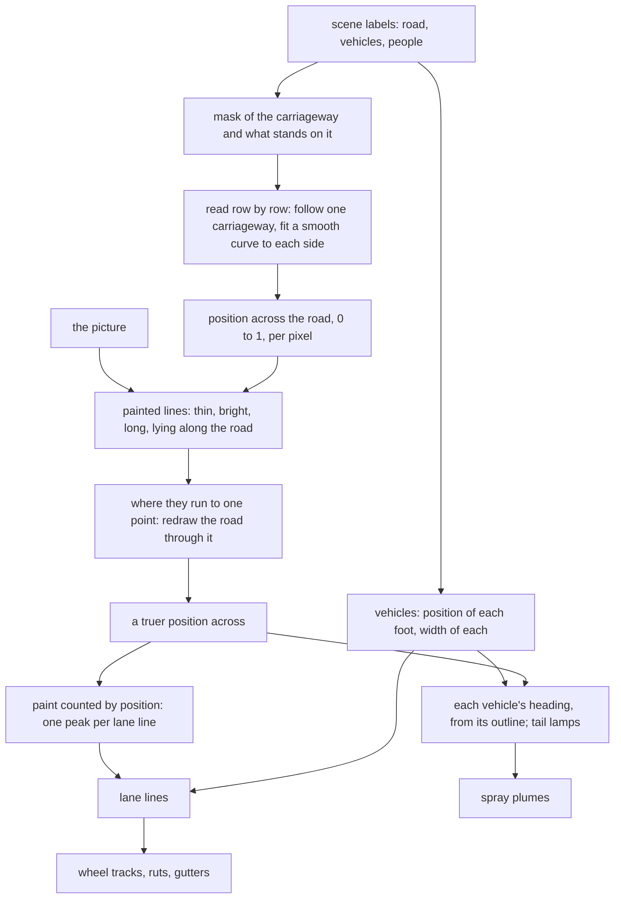

# The road surface: lanes, wheel tracks, standing water and spray

Some of what happens on a road is laid out *along* it. Wheels wear two
tracks down every lane of a snowy road. Water stands in the same ruts and
along the kerb. A car on a wet road trails its spray behind it. None of
that can be drawn from a mask of where the road is: it needs the road's own
coordinates, and its lanes.

[`surmentations.utils.road`](../src/surmentations/utils/road.py) reads
both off the picture, and `RandomSnow` and `RandomRain` use them:

| | Argument | Default | Needs |
| --- | --- | --- | --- |
| Wheel tracks in settled snow | `RandomSnow(wheel_track_range=...)` | `(0.0, 0.9)` | scene labels |
| Water in the ruts and gutters | `RandomRain`, with its wet road | on | scene labels |
| A soaked road under cloud | `RandomRain`, with its wet road | on | nothing |
| Tail lamps reflected in the road | `RandomRain`, with its wet road | on | scene labels |
| Spray behind vehicles | `RandomRain(spray_range=...)` | `(0.0, 0.0)`: off | scene labels |

"Scene labels" means a provider built with `labels=`
([scene understanding](scene_understanding.md)): they say where the road
and its vehicles are. Without them there is no road to follow, and
everything in the table that needs them is simply not drawn.

```python
provider = SharedDepthProvider(DepthAnythingV2Estimator(), labels=SegmentationLabelEstimator())
snow = RandomSnow(depth_provider=provider, wheel_track_range=(0.2, 0.8))
rain = RandomRain(depth_provider=provider, wetness_probability=1.0, spray_range=(0.3, 0.8))
```

## Reading a road



**The road's own coordinates.** For each pixel of road, how far it is from
one side as a share of the way to the other. Lines of constant position run
along the road: through its vanishing point where it is straight, round the
bend where it is not. The mask is read row by row, following one
carriageway, and a line or a parabola is fitted robustly to each side; a
side hidden by the frame's edge is carried from the road's far end to the
corner. What is left of the mask is read again, for the other carriageway
and the slip road.

**The lanes.** Three things say where they are, used in this order:

1. *Paint.* Lane lines are thin, brighter than the road, long, and lie the
   way the road runs; the last is what tells them from a crossing, an
   arrow or a patch of light. Where they run to one point, the road is
   redrawn through that point, which corrects a mask that took in a hard
   shoulder or lost a kerb behind a van. On such a road, and only there,
   the paint counted by position across the road stands in peaks, one per
   line. The gaps between them must each be a whole number of lanes of one
   width, a worn line being a gap of two; paint that fits no such spacing
   is ignored.
2. *Vehicles.* Each one's foot gives a position across the road and its
   width a size: a lane is about 1.7 vehicles wide. With one painted line
   or none, that sets the width, and the lanes are slid to where the
   vehicles sit in the middle of them.
3. *A guess.* A road with neither gets two or three lanes.

Paint in magenta, lane lines in cyan, the tracks laid in them in orange:


## Wheel tracks in snow

Two tracks per lane where traffic has worn the settled snow off, with snow
left between the wheels, between the lanes and along the verges. Nothing
about them is even, because ruled lines are a pedestrian crossing: each
lane carries its own share of the traffic, a track strays a little from
side to side, and it is worn deep in one stretch and nearly gone in the
next. Far down the road the tracks run together into a greyer road, as they
do to the eye. The road under them is wet and darker than it was dry.

`wheel_track_range` runs from untouched snow (0) through two ruts a tyre
wide (0.3) to lanes worn bare (1). Left, without; right, with:


## The wet road

- **Water in the ruts and gutters.** A road drains to its kerbs and has two
  ruts in every lane. The noise the puddles are cut from is lowered there,
  so a little water is strips along the road and only a lot of it is
  everywhere. Puddles have an edge, their share is a share of the wet road,
  and rain roughens them in step with its rate.
- **The sky that soaked it.** A road does not get soaked under a clear
  sky. A film on the road now brings cloud with it whatever is falling
  (scaled by `overcast_range`, so a caller who says there is none is
  believed). A soaked road under light rain used to be lit by the sun,
  which is the light a wet road is least seen in.
- **Tail lamps.** Lit lamps on labelled vehicles are reflected in the road
  as street lamps are, as a long streak. By day only red ones count: a
  white point on a car in daylight is the sun on its glass.

## Spray

Each vehicle on a road with a film of water trails a low cloud of mist that
lies on the road behind it: densest at the wheels and no higher than they
are, as wide as the vehicle, then a little wider and up to about its roof,
thinning out over a length and a half.

- **Where it lies is the vehicle's own heading**, read off its outline
  where the outline is long enough to say and lies near the road's
  direction; otherwise the road's direction. A car changing lanes trails
  its spray along its own line. The plume starts at the end of the outline
  it trails from and is as wide there as the vehicle is across its heading.
- **Which end is the tail** is read off tail lamps: a road on which two or
  more vehicles show red lamps is seen from behind, and its plumes trail
  towards the camera. Otherwise it is drawn once per road, since a
  carriageway goes one way.
- **How fast** each vehicle goes is drawn: each gets its own share of
  spray, and more than a third get none.
- **Some vehicles never get one**: a vehicle lying across the road, which
  is crossing, turning or parked; and any vehicle on a scrap of road under
  a twentieth of the frame, whose direction is a guess. Both used to
  shoot a jet of mist out sideways.
- The plume of a vehicle coming towards the camera is hidden by the
  vehicle.

Left, a soaked road; right, the same with `spray_range=(0.6, 0.6)`:


It is off by default because of what one frame cannot say: a queue of
standing traffic gets plumes, and without tail lamps a plume may trail the
wrong way. It is a soft grey cloud and no more: there is no ballistic
sheet of water off the tyres and no side spray.

## Limits

- **Only with scene labels**, and only as good as they are. The network
  that names a crossing seen from straight above "building" leaves a piece
  of it that is read as a road running the wrong way. A road whose
  vehicles lie across it is caught; the rest is not.
- **Lanes are approximate outside a straight, single carriageway.** The
  road's shape comes from a network's mask, read row by row with a line or
  a parabola for each side. On a bend the lanes drift from the paint; two
  carriageways whose masks run together at the bottom of the frame are
  read as one road, and lanes cross the barrier between them. Paint is
  trusted only where its lines run to one vanishing point, which on the
  sample scenes is one street; everywhere else the lanes come from where
  the vehicles sit. Faint dashes on a pale road are not found at all.
- **The reliable source is not in the picture.** A fixed camera's lanes do
  not move. Lane lines given once per camera, as an installation geometry
  is, or a lane-detection network, would replace all of the above; neither
  is built.
- **Junctions, squares and car parks have no lanes.** A ragged mask gets
  no road; a tidy one is read as a road.
- **Touching vehicles are one vehicle** to a semantic mask, so dense
  traffic gives fewer, wider plumes.
- **A pale rim** can still show round vehicles on a dark wet road, where
  the tests that keep the road off the vehicle reach a pixel or two past
  it.
- The second and third roads of a frame, cut by its edge, have a rougher
  direction than the first.

## References

- Hartley, R., Zisserman, A. (2004). Multiple View Geometry in Computer
  Vision, 2nd ed. Cambridge University Press.
  [doi:10.1017/CBO9780511811685](https://doi.org/10.1017/CBO9780511811685)
  (lines through a vanishing point; the cross-ratio that keeps position
  across a road constant along a lane line)
- Lekner, J., Dorf, M. C. (1988). Why some things are darker when wet.
  Applied Optics 27(7), 1278–1280.
  [doi:10.1364/AO.27.001278](https://doi.org/10.1364/AO.27.001278)
