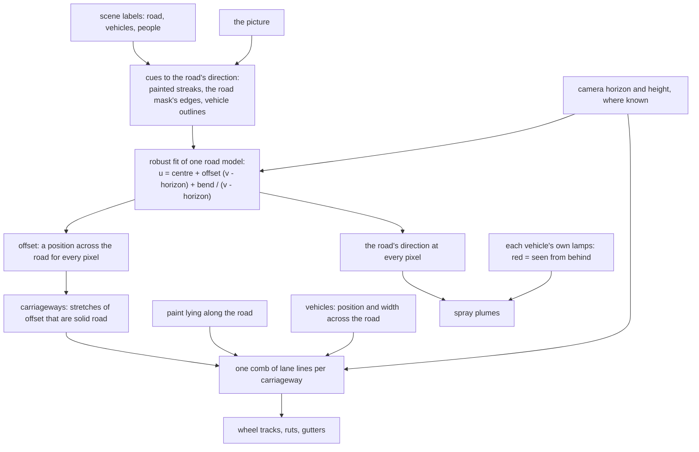
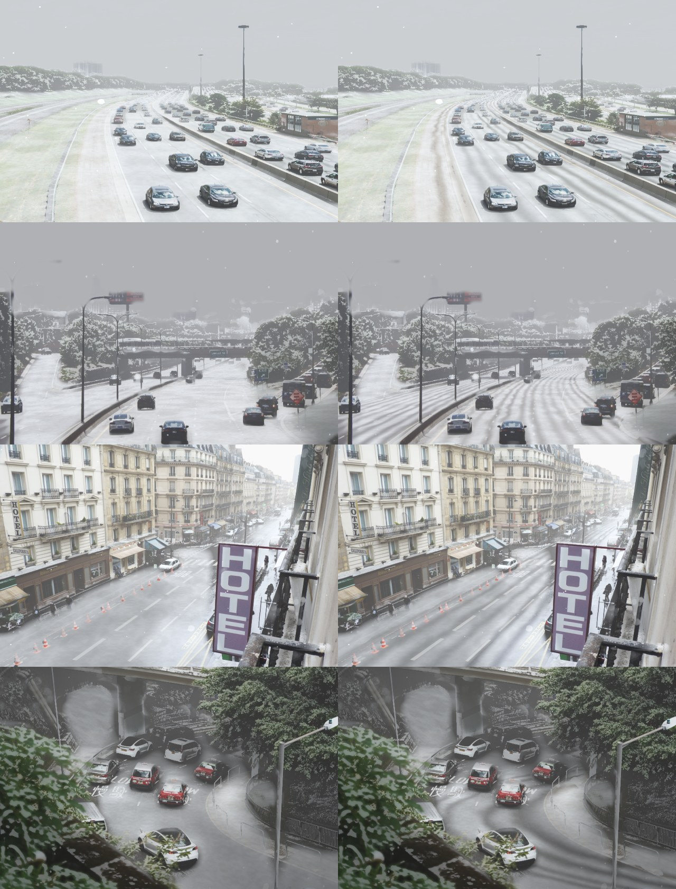
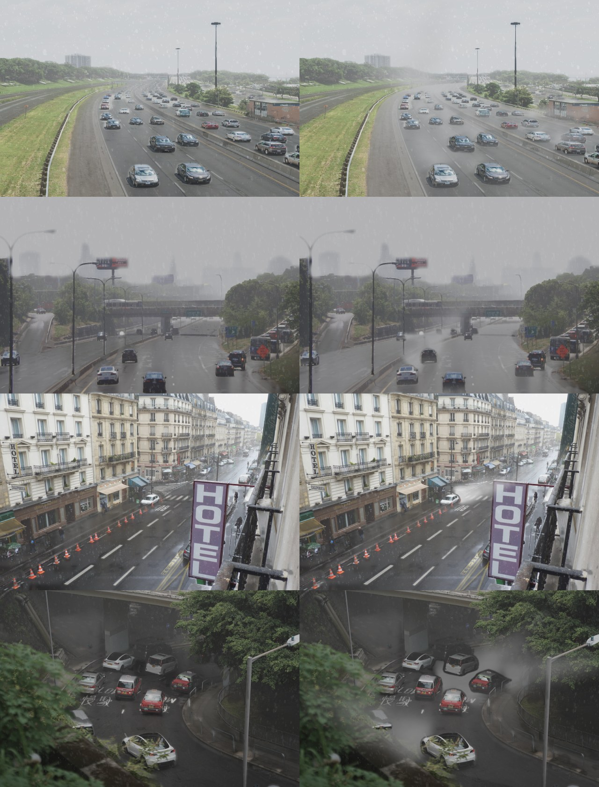

# The road surface: lanes, wheel tracks, standing water and spray

Some of what happens on a road is laid out *along* it. Wheels wear two
tracks down every lane of a snowy road. Water stands in the same ruts and
along the kerb. A car on a wet road trails its spray behind it. None of
that can be drawn from a mask of where the road is: it needs the road's own
coordinates, and its lanes.

[`surmentations.utils.road`](../src/surmentations/utils/road.py) reads
both off the picture, and `RandomSnow` and `RandomRain` use them:

| | Argument | Default | Needs |
| --- | --- | --- | --- |
| Wheel tracks in settled snow | `RandomSnow(wheel_track_range=...)` | `(0.0, 0.9)` | scene labels |
| Water in the ruts and gutters | `RandomRain`, with its wet road | on | scene labels |
| A soaked road under cloud | `RandomRain`, with its wet road | on | nothing |
| Tail lamps reflected in the road | `RandomRain`, with its wet road | on | scene labels |
| Spray behind vehicles | `RandomRain(spray_range=...)` | `(0.0, 0.0)`: off | scene labels |

"Scene labels" means a provider built with `labels=`
([scene understanding](scene_understanding.md)): they say where the road
and its vehicles are. Without them there is no road to follow, and
everything in the table that needs them is simply not drawn.

```python
provider = SharedDepthProvider(DepthAnythingV2Estimator(), labels=SegmentationLabelEstimator())
snow = RandomSnow(depth_provider=provider, wheel_track_range=(0.2, 0.8))
rain = RandomRain(depth_provider=provider, wetness_probability=1.0, spray_range=(0.3, 0.8))
```

## Reading a road



**One model for the whole road.** On level ground, every line that runs
along a road of constant curvature is, in the picture,

    u = centre + offset * (v - horizon) + bend / (v - horizon)

`horizon`, `centre` and `bend` are the road's, the same for every lane
line, kerb and wheel track; `offset` is each line's own. So `offset` is a
position across the road for every pixel, constant along a lane on a bend
as on a straight, and across two carriageways as across one
([`RoadModel`](../src/surmentations/utils/road.py)).

**Fitted to everything that points along the road.** Painted streaks, the
edges of the road's mask and the long way of each vehicle's outline are
each a short piece of line with a direction. None is trusted: a slip road,
the end of a kerb and a zebra crossing are in there too. Two cues make a
road, so many pairs are tried and the road kept is the one the largest
share of the cues lies along to within a few degrees; a straight road is
preferred unless a bend fits clearly better. Where the provider knows the
camera's horizon ([scene understanding](scene_understanding.md)) it is
used, which leaves two numbers to fit instead of three and is what keeps
the fit from bending a road to pass through anything.

**Carriageways.** Counted by offset, the road's mask is solid where there
is a carriageway and empty where there is a reserve.

**The lanes are one comb per carriageway**: a width and a phase, scored on
everything at once.

- *Paint lies on the comb's teeth.* The share of the paint that lies on a
  lane line, lowered for lane lines with no paint and by a small cost per
  line, so that a comb twice too fine does not win by having a tooth under
  everything.
- *Vehicles sit between the teeth*, in the middle of a lane.
- *A lane has a size.* Where the camera's height is known the road's width
  is known in metres, and a lane is 3.4 m give or take a quarter.
  Otherwise a lane is 1.7 times the width of what drives in it, within a
  wide margin.

**When no such road fits**, one running across the picture or seen from
straight above, the road is read off its mask alone, as before; and there
lanes are laid only where the paint or the vehicles vouch for them, never
guessed. Tracks ruled across a junction are worse than none.

Cues in yellow, paint in magenta, lane lines in cyan, tracks in orange:


## Wheel tracks in snow

Two tracks per lane where traffic has worn the settled snow off, with snow
left between the wheels, between the lanes and along the verges. Nothing
about them is even, because ruled lines are a pedestrian crossing: each
lane carries its own share of the traffic, a track strays a little from
side to side, and it is worn deep in one stretch and nearly gone in the
next. Far down the road the tracks run together into a greyer road, as they
do to the eye. The road under them is wet and darker than it was dry.

`wheel_track_range` runs from untouched snow (0) through two ruts a tyre
wide (0.3) to lanes worn bare (1). Left, without; right, with:



## The wet road

- **Water in the ruts and gutters.** A road drains to its kerbs and has two
  ruts in every lane. The noise the puddles are cut from is lowered there,
  so a little water is strips along the road and only a lot of it is
  everywhere. Puddles have an edge, their share is a share of the wet road,
  and rain roughens them in step with its rate.
- **The sky that soaked it.** A road does not get soaked under a clear
  sky. A film on the road now brings cloud with it whatever is falling
  (scaled by `overcast_range`, so a caller who says there is none is
  believed). A soaked road under light rain used to be lit by the sun,
  which is the light a wet road is least seen in.
- **Tail lamps.** Lit lamps on labelled vehicles are reflected in the road
  as street lamps are, as a long streak. By day only red ones count: a
  white point on a car in daylight is the sun on its glass.

## Spray

A tyre on a wet road throws water up four ways (Weir et al., 1978, as
taken up by the FHWA's splash and spray work): a bow wave ahead of it and a
side wave beside it, which are coarse drops on short ballistic paths; and
tread pickup and capillary adhesion, which come off the tread as fine
droplets and are carried away in the air the vehicle drags. So what is seen
has three parts, and each is drawn:

- **Tufts at the wheels.** Coarse drops flung off the back of each tyre.
  Drag stops them quickly: thrown at 36 m/s and 30°, a 200 µm drop is down
  within about a metre and a half and never above about 0.6 m (von Bernuth,
  Volk and Bringmann, 2021). Two low dense knots at the rear wheels of a
  vehicle seen from behind.
- **The wake.** The fine spray, carried along behind the vehicle: some
  lengths long and longer the faster it goes (lidar studies of spray
  report a cloud some twenty metres long behind a vehicle at motorway
  speed; a figure met in a summary and not checked at source), as wide as
  the vehicle and widening, as
  tall as the vehicle a length back, thinning all the way, and turbulent,
  so no two stretches of it are alike. It scales with the vehicle: a
  lorry's is several cars' worth, and as tall as the lorry.
- **The mist over the road.** What one vehicle throws up the next drives
  through, and over a busy carriageway there is a layer of it a couple of
  metres deep. A sight line runs through more of it the further off it
  meets the road, so the nearest cars are clear and the far traffic is gone
  from the wheels up, its roofs last. This, more than any one wake, is what
  a motorway in rain looks like, and it is what the first version, a puff
  behind each car, did not have at all.

Where each wake lies, and which way:

- **Along the road's direction at the vehicle**, from the model above,
  turned to the vehicle's own outline where that is long and close to it.
- **Behind the vehicle, which its own picture has to say.** A rear shows
  red lenses, a pair of them at the corners of its near end: it is driving
  away, and its wake is towards the camera, over its own wheels. A vehicle
  large enough to show lenses and showing no red is seen from the front,
  as is one with white lamps burning at night: its wake is behind it, up
  the road. A red car says nothing. A vehicle that says nothing goes the
  way of the nearest one across the road that does.
- **One speed to a road.** How much is thrown up goes with the square of
  the speed, and traffic on one carriageway moves at about one speed, drawn
  per road, with a little either side for each vehicle.
- **Some vehicles throw up nothing**: one lying across the road, which is
  crossing, turning or parked; and any on a scrap of road under a
  twentieth of the frame, whose direction is a guess.

Left, a soaked road; right, the same with `spray_range=(0.6, 0.6)`:



It is off by default because of what one frame cannot say: how fast the
traffic is moving, so a standing queue is given the spray of a moving one;
and, where no lamp or lens shows, which way it is going. Lamps are not
lit: real traffic in rain drives with its lights on, and their glow in the
mist and their streaks down the road are most of what is still missing.

## Limits

- **Only with scene labels**, and only as good as they are. The network
  that names a crossing seen from straight above "building" leaves a piece
  of it that is read as a road running the wrong way. A road whose
  vehicles lie across it is caught; the rest is not.
- **The road is taken to be level and of one curvature.** A hill, an
  S-bend or a junction does not fit, and falls back to the mask.
- **Carriageways divided by a low barrier are often read as one road**,
  when the network labels the barrier as road. Lanes then keep one width
  and phase across both, and are right on one side and a little off on the
  other.
- **Lane counts are estimates.** Without a camera height they rest on the
  vehicles' widths; with one, on a height that is itself rough.
- **Paint on a wet or night road** is mostly glare and is ignored when
  there is too much of it to be paint.
- **A fixed camera's lanes do not move.** Lane lines given once per
  camera, as an installation geometry is, would be surer than any of
  this; that is not built.
- **Junctions, squares and car parks have no lanes.** A ragged mask gets
  no road; a tidy one is read as a road.
- **Touching vehicles are one vehicle** to a semantic mask, so dense
  traffic gives fewer, wider plumes.
- **A pale rim** can still show round vehicles on a dark wet road, where
  the tests that keep the road off the vehicle reach a pixel or two past
  it.
- The second and third roads of a frame, cut by its edge, have a rougher
  direction than the first.

## References

- Weir, D. H., Strange, J. F., Heffley, R. K. (1978). Reduction of Adverse
  Aerodynamic Effects of Large Trucks. Federal Highway Administration. (The
  four mechanisms of splash and spray. Known here only through the next
  entry, which summarises them; not read at source.)
- Federal Highway Administration (2015). Assessing Pavement Surface Splash
  and Spray Impact on Road Users. TechBrief FHWA-HRT-15-062.
  [fhwa.dot.gov](https://www.fhwa.dot.gov/publications/research/infrastructure/pavements/ltpp/15062/index.cfm)
- von Bernuth, A., Volk, G., Bringmann, O. (2021). Augmenting Image Data
  Sets With Water Spray Caused by Vehicles on Wet Roads. IEEE Intelligent
  Transportation Systems Conference (ITSC).
  [uni-tuebingen.de](https://www.embedded.uni-tuebingen.de/assets/publications/vonBernuth-Volk-Bringmann_Spray.pdf)
  (droplet size, and how far a drop thrown from a wheel travels)
- Linnhoff, C., et al. (2022). Simulating Road Spray Effects in Automotive
  Lidar Sensor Models. [arXiv:2212.08558](https://arxiv.org/abs/2212.08558)
  (spray as a plume behind the vehicle, in a sensor model)
- Hartley, R., Zisserman, A. (2004). Multiple View Geometry in Computer
  Vision, 2nd ed. Cambridge University Press.
  [doi:10.1017/CBO9780511811685](https://doi.org/10.1017/CBO9780511811685)
- Lekner, J., Dorf, M. C. (1988). Why some things are darker when wet.
  Applied Optics 27(7), 1278–1280.
  [doi:10.1364/AO.27.001278](https://doi.org/10.1364/AO.27.001278)
