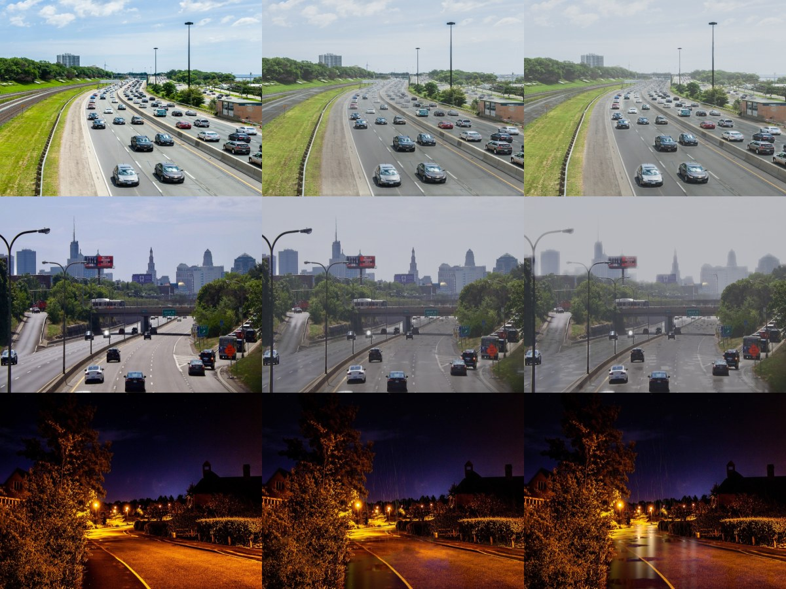
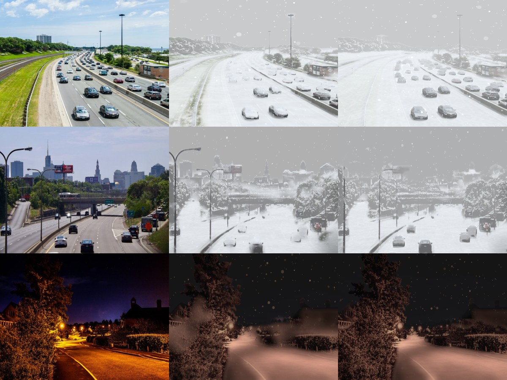
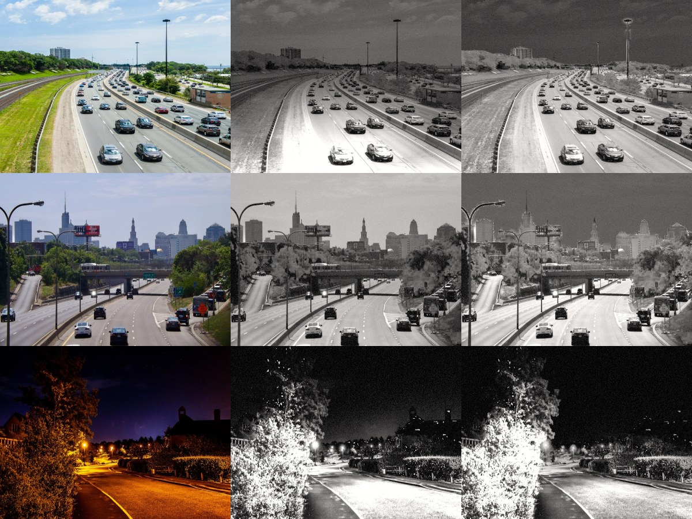
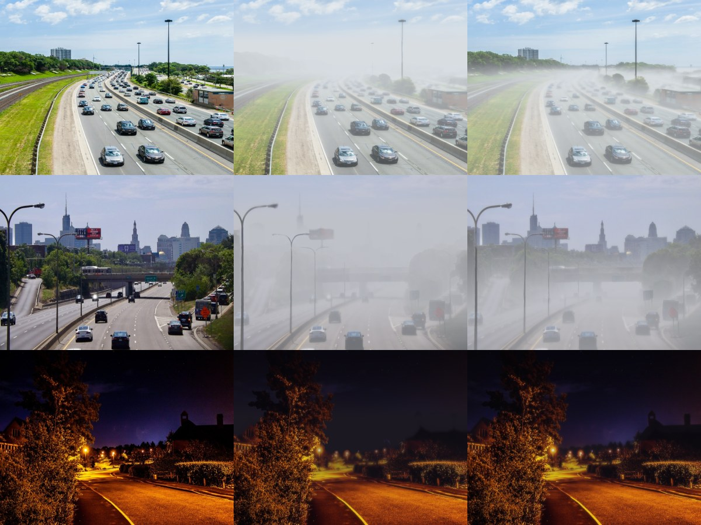
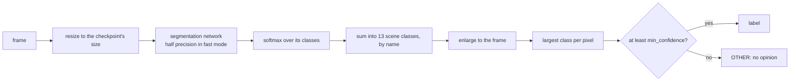
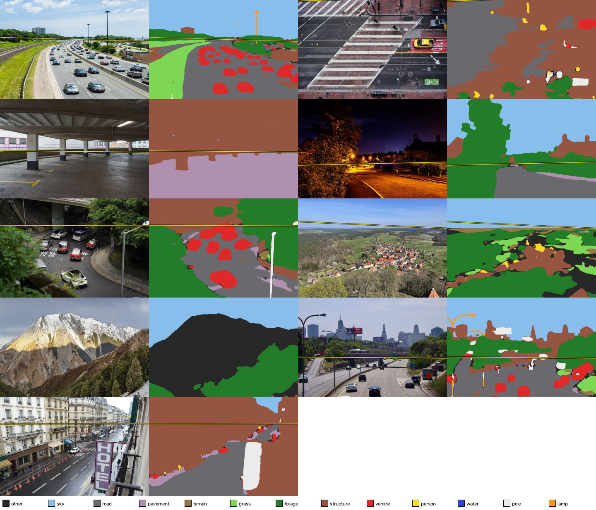
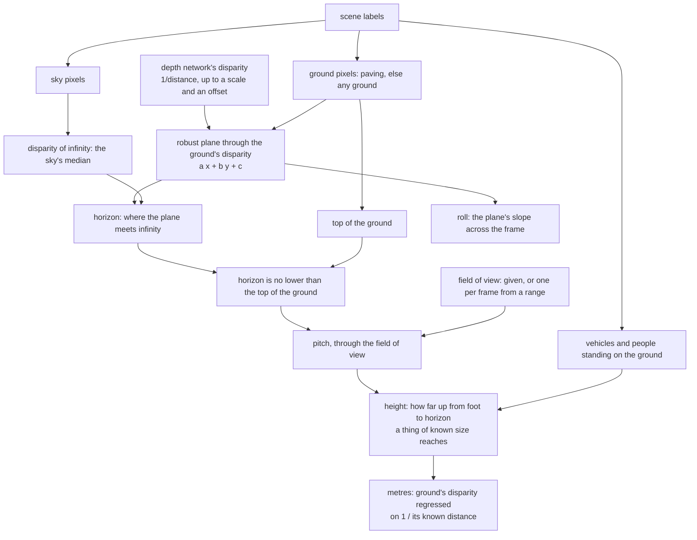
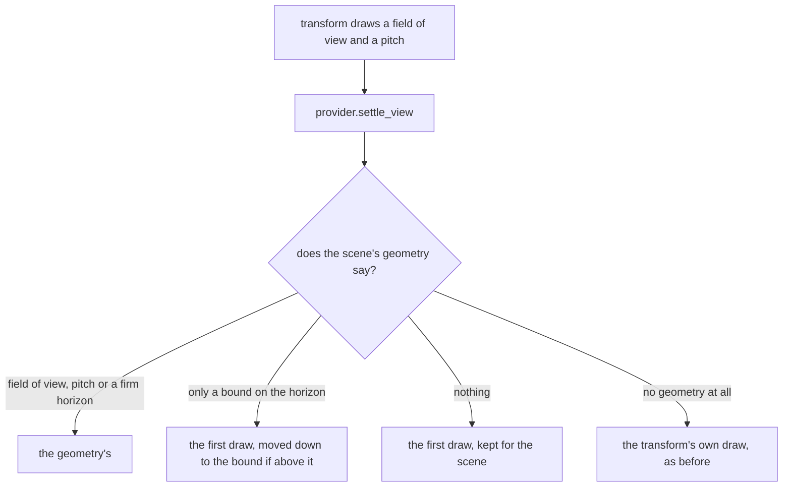

# Scene understanding: labels and installation geometry

Depth tells a transform how far away each pixel is. Two more things can be
worked out alongside it, once per scene, and shared the same way:

- **what each pixel is**: road, sky, vegetation, a vehicle
  ([`surmentations.perception.labels`](../src/surmentations/perception/labels.py));
- **how the camera is mounted**: its field of view, its tilt, its height
  ([`surmentations.perception.geometry`](../src/surmentations/perception/geometry.py)).

Both are optional. A provider given neither behaves exactly as before, and
so does every transform.

```python
from surmentations.depth import DepthAnythingV2Estimator, SharedDepthProvider
from surmentations.perception import (
    GroundPlaneGeometryEstimator,
    InstallationGeometry,
    SegmentationLabelEstimator,
)

# Worked out of every frame:
provider = SharedDepthProvider(
    DepthAnythingV2Estimator(),
    labels=SegmentationLabelEstimator(),
    geometry=GroundPlaneGeometryEstimator(),
)

# Or, for a fixed camera whose mounting is known, given once:
provider = SharedDepthProvider(
    DepthAnythingV2Estimator(),
    labels=SegmentationLabelEstimator(),
    geometry=InstallationGeometry(horizontal_fov_deg=92.0, pitch_deg=24.0, height_m=6.5),
)
```

Nothing else changes: the provider goes to the transforms and the
[ready-made pipelines](pipelines.md) as it always did.

## Why

Three things were being guessed, and each guess has a scene that defeats it.

**What is road.** Water lies as a film on paving, and snow settles on
ground. Which pixels are ground was read from the depth map's surface
normals, and what kind of ground from colour. A car two hundred metres off
is a smooth bump in a depth map with the road's own orientation, a tree's
crown reads as level from above, and nothing is green under a sodium lamp.

**Where the horizon is.** A wet road mirrors the scene about its horizon
and reflects more the shallower it is seen. The horizon was fitted from the
depth map and came out forty to three hundred rows off on the sample
scenes: a monocular depth map is right in the order of its distances and
wrong in their proportion.

**What camera this is.** Every transform that needs a field of view and a
pitch drew its own, at random, from a range. Rain, snow and shadows on one
frame each saw it through a different camera, and none through the one that
took the picture. Distances were "pseudo-metres": the nearest and farthest
point of every scene placed at two numbers given by hand.

## What changes

| Transform | With labels | With geometry |
| --- | --- | --- |
| [`RandomRain`](transforms/RandomRain.md) | The wet road is laid on what is labelled paving, including where its normals wander and far down the road; kept off vehicles, people, poles, vegetation and lawns | One field of view and pitch; the road's horizon; the veil over real metres |
| [`RandomSnow`](transforms/RandomSnow.md) | A labelled vehicle carries what `vehicle_cover_range` says; nothing settles on people, sky or water; a tree is a canopy and a lawn is ground, by name | One field of view and pitch; the veil over real metres |
| [`RandomFog`](transforms/RandomFog.md), [`NightFog`](transforms/NightFog.md) | The sky is what is labelled sky | Real metres, unless `depth_scale` is given |
| [`GroundFog`](transforms/GroundFog.md) | The sky | The layer is laid under the scene's camera: field of view, pitch and height |
| [`NightIrMode`](transforms/NightIrMode.md) | Vegetation is bright whatever its colour; the sky is dark | The illuminator's inverse-square law over real metres |
| [`CastShadows`](transforms/CastShadows.md) | | Which surfaces face up, through the scene's camera |
| [`HeatShimmer`](transforms/HeatShimmer.md), [`LocalPlumes`](transforms/LocalPlumes.md), [`FocusShift`](transforms/FocusShift.md) | | The scene's field of view; real metres |
| [`NightRain`](transforms/NightRain.md), [`NightSnow`](transforms/NightSnow.md), [`NightInsects`](transforms/NightInsects.md), [`WaterDroplets`](transforms/WaterDroplets.md), [`SpiderWeb`](transforms/SpiderWeb.md), [`FoliageIntrusion`](transforms/FoliageIntrusion.md) | | The scene's field of view, where a provider earlier in the pipeline settled one |

The same frame, without and with: the photograph, the effect with a plain
provider, and the effect with labels and an estimated geometry. The
[scene gallery](examples/scenes/README.md) has the same comparison for
every effect that reads the scene, over eight scenes, and for the pipeline.

A soaked road. The far road keeps its sheen, the rain's veil is over the
scene's real distances, and at night the lamps stand above a horizon that is
where the picture has it:



Settled snow. Traffic carries the share of snow it was given and no more,
and the verge is buried as ground:



Infrared night. Trees are bright and the sky is dark. The first scene is
seen from a bridge the estimator puts fourteen metres up, where no
illuminator reaches the road: it is lit by the ambient term alone, evenly,
with no hot spot:



Ground fog. The layer is a few metres deep, and a camera above it looks
down on it:



## Scene labels

A segmentation network names every pixel, and what it names is folded into
the thirteen classes of
[`SceneClass`](../src/surmentations/perception/labels.py): `OTHER`, `SKY`,
`ROAD`, `PAVEMENT`, `TERRAIN`, `GRASS`, `FOLIAGE`, `STRUCTURE`, `VEHICLE`,
`PERSON`, `WATER`, `POLE`, `LAMP`. The folding is by the *name* of each of
the network's classes, so any checkpoint trained on ADE20K or Cityscapes
works without a table of its own.



### Evidence, not a verdict

Networks small enough to run inside an augmentation were trained on
photographs taken from eye level by day. On the sample scenes the bundled
one is right about the sky, the vegetation and the vehicles in every scene,
including the lamp-lit street, and names a road seen from directly above
"building":



So no effect *requires* a class. Labels remove what plainly is not ground
(a vehicle, a person, a tree, the sky), and add what plainly is (a road the
normals read as uneven). `STRUCTURE` and `OTHER` decide nothing: the
crossing in that figure is still wet and still snowed on, because the depth
map says it is level ground and no label is allowed to overrule that.

### Which network

| Checkpoint | Licence | Classes | One frame |
| --- | --- | --- | --- |
| `openmmlab/upernet-convnext-tiny` (default) | MIT | ADE20K, 150 | 32 ms |
| `nvidia/segformer-b0-finetuned-ade-512-512` | NVIDIA, non-commercial | ADE20K, 150 | 7 ms |

The licences are as published on the model hub when this was written;
check them for your use. The default is the permissive one. The SegFormer
checkpoints work unchanged
(`SegmentationLabelEstimator(model_name="nvidia/segformer-b0-finetuned-ade-512-512")`)
and are four times faster; whether their licence suits you is yours to
decide. Times are for a 512-pixel frame on the machine in the table further
down.

### Labels you already have

Ground truth is better than a network. Fold a dataset's classes into
`SceneClass` and tell the provider before the pipeline runs:

```python
from surmentations.perception import classes_of

table = classes_of(["road", "sidewalk", "building", "sky", "car", "person"])  # your names
provider.remember(image, labels=table[mask])  # mask: your class index per pixel
augmented = pipeline(image=image, mask=mask)
```

Or implement
[`SceneLabelEstimator`](../src/surmentations/perception/labels.py), one
method that takes a frame and returns one class per pixel.

## Installation geometry

An
[`InstallationGeometry`](../src/surmentations/perception/geometry.py)
says what is known of the mounting: field of view, pitch, roll, height.
Anything may be left out.

### A fixed camera

One mast, one geometry, every frame. Give what you know:

```python
geometry = InstallationGeometry(horizontal_fov_deg=92.0, pitch_deg=24.0, height_m=6.5)
```

This is the reliable source, and for a surveillance dataset it is usually
available: the lens is in the camera's data sheet and the installer knows
the height. A dataset that mixes cameras can give each frame its own with
`provider.remember(image, geometry=...)`.

### Estimated from the frame

[`GroundPlaneGeometryEstimator`](../src/surmentations/perception/geometry.py)
recovers what one picture actually holds, and leaves the rest open.



- **The horizon and the roll.** On level ground the reciprocal of distance
  is a linear function of position in the picture, and a depth network's
  raw output *is* a reciprocal distance, up to a scale and an offset. A
  plane is fitted to the disparity of the ground, and the horizon is the
  line on which it reaches the sky's disparity. Then one fact the fit does
  not know is applied: the ground is never seen above the horizon.
- **Not the field of view.** A plane looks like a plane through any lens.
  Give it (`horizontal_fov_deg`) if you know it. Otherwise each frame is
  given one from `fov_range_deg`, chosen by the frame's own content so the
  same frame always gets the same lens. The pitch follows from the horizon,
  so whatever lens is assumed, the horizon stays where the picture has it.
- **The height, roughly.** A car is about a metre and a half high and a
  person a little more; how far up from its foot to the horizon a thing of
  known height reaches gives the camera's height. A car seen from above
  also shows its roof, so each is tried at every heading until its width
  fits as well. It takes three usable things, and is good to a few tens of
  per cent. Give the height (`height_m`) if you have it.
- **Only a bound, without a sky.** With no sky in the frame nothing marks
  the disparity of infinity. The horizon is then known to be at a row *or
  above it*, and a transform's own draw of the pitch stands unless it
  breaks that.

What it reads off the sample scenes, at an assumed 60° field of view,
beside the pitch the [scene gallery](examples/scenes/README.md) had been
giving each by eye:

| Scene | Horizon | Pitch | Pitch by eye | Height | Depth in metres |
| --- | --- | --- | --- | --- | --- |
| `reference` | 0.40 | +7° | +18° | 14 m | from 21 m |
| `crosswalk_day` | -0.02 or above | at least +20° | +70° | — | — |
| `parking_garage` | 0.53 or above | at least -1° | +4° | — | — |
| `street_night` | 0.65 | -7° | +5° | — | — |
| `underpass_from_above` | 0.27 or above | at least +10° | +25° | 6 m | — |
| `wooded_hills` | 0.27 | +11° | +6° | — | — |
| `mountain` | none found | open | +0° | — | — |
| `urban_road_day` | 0.60 | -4° | +10° | 7 m | from 26 m |
| `urban_street_wet` | 0.27 | +11° | +30° | 14 m | from 4 m |

The horizon is a fraction of the frame's height from the top, and is drawn
in yellow in the figure above. Where it can be judged by eye in that figure
it is within about forty rows. Two of the by-eye pitches had the wrong
sign: `street_night` and `urban_road_day` look slightly *up*, with the
horizon below the middle of the frame. The heights cannot be checked
against anything and should be read as rough.

### One camera per scene

The provider settles a scene's camera once, and every transform that asks
gets the same one. A transform still draws its own field of view and pitch,
so that seeded runs draw the same numbers as before, and then asks:



Transforms that take no depth provider (`NightRain`, `WaterDroplets`) ask
whichever provider in the pipeline holds the scene.

### Metres

With a height, level ground is at a known distance at every pixel. The
ground's disparity is regressed on the reciprocal of that distance, which
gives the scale and the disparity of infinity together, and the whole depth
map is then in metres measured from the camera. That takes the place of
`depth_range_m`.

The consequence is visible in the figures: a scene that is really twenty
metres to two kilometres deep is veiled like one by rain, snow and fog, and
is beyond an infrared illuminator's reach. A transform given an explicit
`depth_scale` still uses it. To keep `depth_range_m` for every frame, give
no height and pass `estimate_height=False`.

## What it costs

On one CPU core and a laptop GPU (RTX PRO 1000), once per new frame; from
`scripts/benchmark_single_core.py`:

| | 512 px | 1024 px |
| --- | --- | --- |
| Depth | 11 ms | 15 ms |
| Scene labels | 33 ms | 33 ms |
| Geometry | 5 ms | 6 ms |

They are made together, when the first transform asks for the scene's
depth, from the frame the pipeline was given. A pipeline in which no
depth-conditioned transform fires on a frame pays for none of them.

## Limits

- Labels are a network's opinion. Views from above, night frames and
  infrared frames are outside what it was trained on. The effects are built
  so that a wrong label can remove an object from the ground or add a road
  to it, and cannot do more.
- The field of view is not estimated. With it unknown, the pitch is right
  for the assumed lens and the horizon is right regardless.
- The height is rough, and with it every distance. A wrong height scales
  the whole scene.
- The ground is taken to be one level plane. A road on a slope, or a
  camera rolled past `max_roll_deg`, is read as level ground under a level
  camera.
- With no sky and no ground-level camera (a view straight down, a car
  park under a roof) the estimator gives a bound and no more; give the
  geometry for those cameras.
- A veil set for one scale is wrong for another. The
  [scene gallery](examples/scenes/README.md) shows every such effect twice,
  from the same parameters: its rain and snow veils were capped for the
  by-eye distances, and over the measured ones some are much thicker.

## Writing your own

Both estimators are small interfaces:

```python
class SceneLabelEstimator:
    def estimate(self, image) -> np.ndarray: ...            # (H, W) uint8 of SceneClass

class GeometryEstimator:
    def estimate(self, image, disparity, labels) -> InstallationGeometry: ...
```

A single-image calibration network that estimates the field of view as well
would be a `GeometryEstimator`. A depth backend makes the geometry
estimable by implementing `DepthEstimator.disparity`, which hands back the
disparity its depth was made from; the bundled one does.

`provider.describe(image)` returns what the provider read off a frame: the
geometry, the settled camera, the metric scale and the share of each class.

## References

- Xiao, T., Liu, Y., Zhou, B., Jiang, Y., Sun, J. (2018). Unified
  Perceptual Parsing for Scene Understanding. ECCV 2018, 432–448. [doi:10.1007/978-3-030-01228-1_26](https://doi.org/10.1007/978-3-030-01228-1_26)
- Liu, Z., Mao, H., Wu, C.-Y., Feichtenhofer, C., Darrell, T., Xie, S.
  (2022). A ConvNet for the 2020s. CVPR 2022, 11966–11976.
  [doi:10.1109/CVPR52688.2022.01167](https://doi.org/10.1109/CVPR52688.2022.01167)
- Zhou, B., Zhao, H., Puig, X., Fidler, S., Barriuso, A., Torralba, A.
  (2017). Scene Parsing through ADE20K Dataset. CVPR 2017, 5122–5130.
  [doi:10.1109/CVPR.2017.544](https://doi.org/10.1109/CVPR.2017.544)
- Cordts, M., et al. (2016). The Cityscapes Dataset for Semantic Urban
  Scene Understanding. CVPR 2016, 3213–3223.
  [doi:10.1109/CVPR.2016.350](https://doi.org/10.1109/CVPR.2016.350)
- Xie, E., Wang, W., Yu, Z., Anandkumar, A., Alvarez, J. M., Luo, P.
  (2021). SegFormer: Simple and Efficient Design for Semantic Segmentation
  with Transformers. [arXiv:2105.15203](https://arxiv.org/abs/2105.15203)
- Yang, L., Kang, B., Huang, Z., Zhao, Z., Xu, X., Feng, J., Zhao, H.
  (2024). Depth Anything V2. [arXiv:2406.09414](https://arxiv.org/abs/2406.09414)
- Ranftl, R., Lasinger, K., Hafner, D., Schindler, K., Koltun, V. (2022).
  Towards Robust Monocular Depth Estimation: Mixing Datasets for Zero-Shot
  Cross-Dataset Transfer. IEEE TPAMI 44(3), 1623–1637.
  [doi:10.1109/TPAMI.2020.3019967](https://doi.org/10.1109/TPAMI.2020.3019967)
  (why a depth network's output is a disparity up to a scale and an offset)
- Criminisi, A., Reid, I., Zisserman, A. (2000). Single View Metrology.
  International Journal of Computer Vision 40(2), 123–148.
  [doi:10.1023/A:1026598000963](https://doi.org/10.1023/A:1026598000963)
- Hoiem, D., Efros, A. A., Hebert, M. (2008). Putting Objects in
  Perspective. International Journal of Computer Vision 80(1), 3–15.
  [doi:10.1007/s11263-008-0137-5](https://doi.org/10.1007/s11263-008-0137-5)
  (camera height and horizon from objects of known size)
