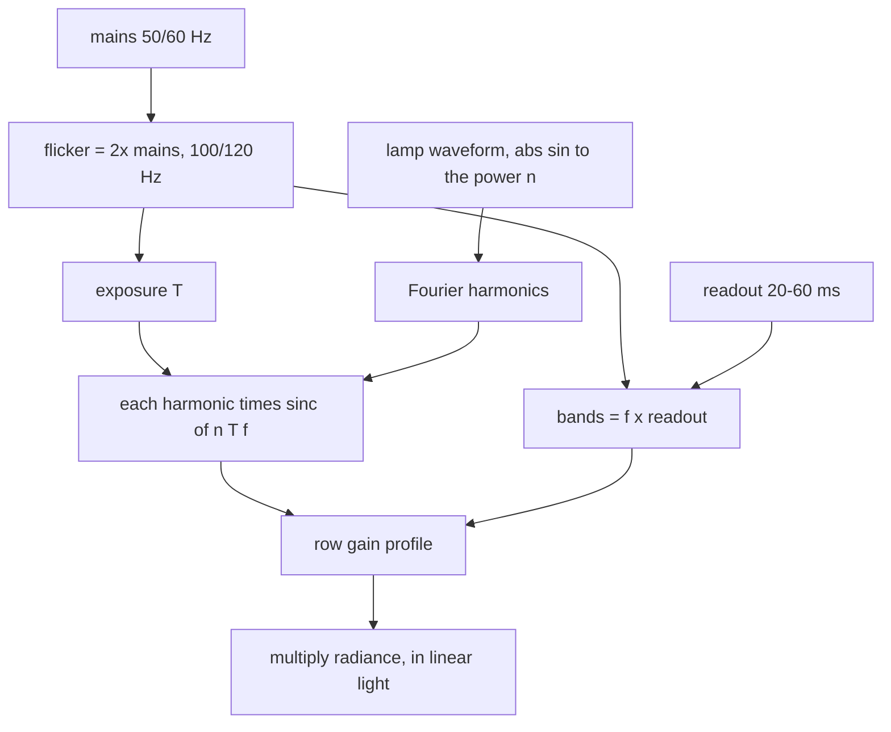

# `AcFlicker`

> Horizontal banding from AC-powered lighting beating against the shutter.

| | |
| --- | --- |
| Module | [`surmentations.camera.flicker`](../../src/surmentations/camera/flicker.py) |
| Stage | sensor |
| Needs depth | no |
| Annotations | untouched: the image only |

## Algorithm

## Model

Mains-frequency banding from artificial lighting.

### Physical model

A lamp on an AC supply does not emit steadily. Incandescent and (especially)
gas-discharge lamps dim twice per mains cycle as the current passes through
zero, so the illumination pulses at **twice** the mains frequency: 100 Hz on
a 50 Hz supply, 120 Hz on 60 Hz.

A rolling-shutter sensor reads its rows out one after another over the
readout interval, so each row integrates a different part of that pulse.
The frame therefore carries a *spatial* record of a temporal oscillation —
horizontal bands, with

    bands across the frame = 2 * f_mains * readout_time

Three consequences are worth getting right rather than drawing bands by eye:

* **The band count is what makes it legible.** Two broad bands across a frame
  is a smooth luminance gradient, and the eye discounts those as an exposure
  difference no matter how deep they are — a 27% peak-to-peak modulation over
  two cycles is genuinely hard to see. It is the *number* of bands, not their
  depth, that makes the artefact read as an artefact. Readout time is
  therefore worth getting right rather than assuming a fast sensor: a
  rolling-shutter camera reads out over roughly its frame period, so 25-30 fps
  gives 33-40 ms and a bandwidth-limited 17 fps stream gives 60 ms, for 2-7
  bands rather than 1-3.

* **The lamp is not a sinusoid.** Only an incandescent filament is, and only
  because its thermal mass low-passes everything. A discharge lamp follows
  `|sin|` and a cheap LED driver conducts in narrow pulses near the mains
  peaks, both of which carry harmonics of the flicker frequency. Each
  harmonic is box-filtered by the exposure *independently*, so each gets its
  own `sinc(n * T * f)`. Anti-flicker cancellation survives this exactly:
  when `T * f` is a whole number so is `n * T * f`, so every harmonic
  vanishes together.

* **The exposure time sets the band depth.** A row integrates the light over
  its exposure, so the modulation it records is the pulse averaged over that
  window — a `sinc` in the ratio of exposure to flicker period. When the
  exposure is an exact multiple of the flicker period the sinc is zero and
  the banding **vanishes completely**. That is not a curiosity; it is why
  cameras have a "50 Hz / 60 Hz" anti-flicker setting, and it means the
  effect must disappear at those exposures rather than merely getting
  weaker.
* **It is a change in illumination**, so it multiplies radiance and has to be
  applied in linear light. Applied to gamma-encoded values it lifts the
  mid-tones wrongly, exactly as with every other light-adding effect here.

Single-frame scope: on video the bands *drift* vertically frame to frame, as
the flicker phase advances against the frame period. Per frame that drift is
just the phase, which is drawn randomly here — so this effect loses nothing
by being single-frame, unlike the temporal artefacts in `denoise.py`.

## Parameters

| Parameter | Default | Meaning |
| --- | --- | --- |
| `mains_frequency_hz` | `50.0` | supply frequency. 50 Hz across most of the world, 60 Hz in the Americas and parts of Asia. The lighting pulses at twice this. |
| `readout_time_range_s` | `(0.02, 0.06)` | time the sensor takes to read all rows out. Together with the flicker frequency this fixes how many bands cross the frame, and that count is what makes the artefact legible — see the module docstring. A rolling shutter reads out over roughly its frame period, so the default spans a 50 fps sensor (20 ms) down to a bandwidth-limited 17 fps stream (60 ms), giving 2-6 bands on 50 Hz mains and 2.4-7.2 on 60 Hz. |
| `exposure_time_range_s` | `(0.001, 0.008)` | per-row exposure. Sets the band *depth* through the sinc term — an exposure that is a whole number of flicker periods cancels the banding entirely, which is exactly what a camera's "anti-flicker" setting arranges. **Sampled log-uniformly**, because exposure is a logarithmic quantity: photographers count it in stops, and the interval 1/1000-1/500 s is as large a change as 1/8-1/4 s. Drawing it uniformly puts most of the mass at the long end, which here is the end the sinc cancels. The default **stops below the first null** (8 ms, against 10 ms for 50 Hz mains and 8.33 ms for 60 Hz). That is not a fudge to make the effect show up: a shutter shorter than one flicker period is the condition under which banding is visible at all, and a camera sitting on the null is a camera whose anti-flicker setting is working — which is a camera you would not include in a set labelled "shows flicker banding". Whether a frame flickers is what `p` is for; this range decides how strongly it does. Widen it past the null deliberately to explore cancellation, and the sinc will duly cancel: median `\|sinc\|` over 1-16 ms is 0.76 at 50 Hz and 0.66 at 60 Hz with 17-24% of draws essentially blank, against 0.88 and 0.82 with none and 7% below 1-8 ms. |
| `pulse_exponent_range` | `(1.0, 5.0)` | shape of the lamp's output over one flicker period, as `\|sin\| ** exponent`. 1 is a gas-discharge lamp following the rectified current, 2 is exactly a sinusoid (an incandescent filament, thermally smoothed), 4 and above a cheap LED driver conducting in narrow pulses. Higher exponents put more energy in harmonics, which gives the bands visible edges instead of a smooth roll. |
| `modulation_depth_range` | `(0.05, 0.35)` | peak-to-mean modulation of the lamp itself, before the exposure averages it. Gas-discharge lamps without smoothing ballast approach 1; an incandescent filament has thermal inertia and modulates far less. |
| `p` | `0.5` | probability that the transform is applied |

## Samples

Severity 1 to 5, left to right, from the severity gallery.

`ac_flicker`

| 1 | 2 | 3 | 4 | 5 |
| --- | --- | --- | --- | --- |
|  |  |  |  |  |

## References

- Poplin, D. (2006). An automatic flicker detection method for embedded camera systems. *IEEE Transactions on Consumer Electronics* 52(2), 308-311. [doi:10.1109/TCE.2006.1649642](https://doi.org/10.1109/TCE.2006.1649642)

---

Generated by [`docs/make_transform_pages.py`](../make_transform_pages.py) from the source; edit the docstring or that script, not this page. [All transforms](README.md).
