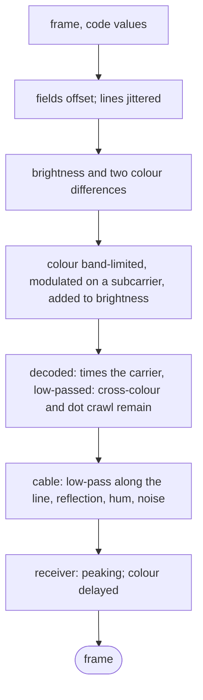
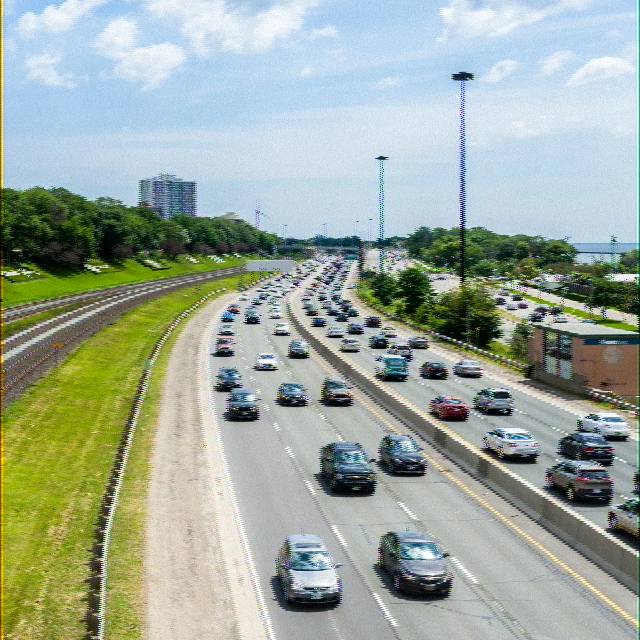
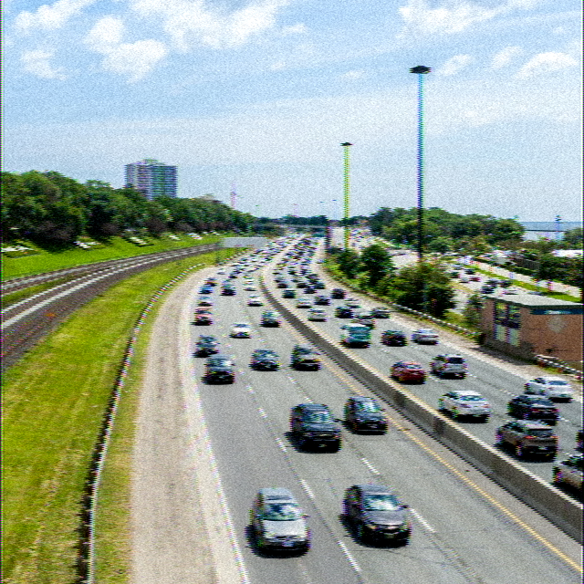

# `AnalogVideoArtifacts`

> A frame as it arrives over a composite or analog-HD link.

| | |
| --- | --- |
| Module | [`surmentations.camera.analog`](../../src/surmentations/camera/analog.py) |
| Stage | link |
| Needs depth | no |
| Annotations | untouched: the image only |
| Tests | [`tests/unit/test_analog.py`](../../tests/unit/test_analog.py) |

## Algorithm

## Model

What an analog video link does to a picture.

### Physical model

A great many cameras in service do not send a digital stream. They send a
composite signal down a coaxial cable, as PAL or NTSC did and as the analog
high-definition formats that replaced them (AHD, TVI, CVI) still do: one
voltage, a line at a time, carrying brightness directly and colour on a
subcarrier added to it. Everything characteristic of that picture follows
from the signal being one-dimensional and from the cable and the decoder
being imperfect. None of it is in a codec's repertoire, so
`VideoCodecArtifacts` does not produce it.

**Detail is lost along the line and not down the frame.** A cable is a
low-pass filter, more so the longer it is, and it acts on the signal, which
runs along the scan lines. Vertical edges soften; horizontal ones do not.
Receivers boost what is left, which rings on either side of an edge.

**Colour has a fraction of the brightness's resolution, and is late.** The
two colour-difference signals are band-limited to a few percent of the
picture's width before they are modulated, and the filters that recover
them delay them: colour is smeared along the line and sits a little to the
right of the edge it belongs to.

**Brightness and colour leak into each other.** They share one signal, and
a decoder can only separate them by frequency. Fine brightness detail near
the subcarrier's frequency is taken for colour, and shimmers in rainbow
(cross-colour); a sharp change of colour leaves subcarrier in the
brightness, a line of dots along the edge (dot crawl). This is done here
by doing it: the frame is encoded onto a subcarrier whose phase alternates
from line to line, and decoded by multiplying by the carrier and
low-passing. What a better decoder would have removed is the share of that
result which is mixed back in.

**The cable adds its own.** A mismatched termination reflects the signal,
and the reflection arrives late: a faint copy of the picture displaced to
the right. A ground loop adds mains hum, a broad dark and light bar or two
across the frame. Noise is added to the signal, so it too is smeared along
the line; and where the receiver's line sync wavers, lines start a little
early or late.

**The frame is two fields.** Interlaced video scans odd and even lines a
fiftieth or sixtieth of a second apart. Anything that moved in between is
drawn twice, a comb of alternate lines. A single frame has no motion to
show, so the comb is drawn for a camera that panned, by a shift of
alternate lines against each other.

The signal is gamma-encoded, so all of this is done on code values and not
in linear light. Lines are displaced by a few pixels at most; annotations
are not moved.

## Parameters

| Parameter | Default | Meaning |
| --- | --- | --- |
| `luma_bandwidth_range` | `(0.3, 0.9)` | how much of the frame's horizontal resolution the link passes, 0 to 1. A long cable is at the low end. |
| `peaking_range` | `(0.0, 0.6)` | how hard the receiver boosts what is left, which rings beside edges. Zero is none. |
| `chroma_bandwidth_range` | `(0.05, 0.2)` | the same for colour, which has far less. |
| `chroma_delay_range` | `(0.0, 0.004)` | how far colour sits to the right of where it belongs, as a fraction of the frame's width. |
| `subcarrier_range` | `(0.2, 0.3)` | the colour subcarrier's frequency, in cycles a pixel. Detail at about that pitch is what turns to rainbow. |
| `crosstalk_range` | `(0.2, 1.0)` | how much of the leakage between brightness and colour the decoder fails to remove, 0 to 1. One is the simplest decoder there is; a comb filter is near zero. |
| `ghost_strength_range` | `(0.0, 0.2)` | strength of the cable's reflection, a faint copy of the picture to the right. |
| `ghost_delay_range` | `(0.005, 0.03)` | how far to the right, as a fraction of the width. |
| `hum_depth_range` | `(0.0, 0.06)` | depth of the mains hum bars, in units of full scale. |
| `hum_cycles_range` | `(0.5, 2.5)` | how many of them fit down the frame. |
| `noise_range` | `(0.005, 0.035)` | noise on the signal, as a standard deviation in units of full scale. |
| `line_jitter_range` | `(0.0, 0.0012)` | how far lines start early or late, as a standard deviation in fractions of the width. |
| `comb_shift_range` | `(0.0, 0.004)` | how far the two fields are apart, as a fraction of the width: what a pan between them leaves. |
| `p` | `0.5` | probability that the transform is applied |

## Samples

Severity 1 to 5, left to right, from the severity gallery.

`analog_video`

| 1 | 2 | 3 | 4 | 5 |
| --- | --- | --- | --- | --- |
|  |  |  |  |  |

## References

- Poynton, C. (2012). *Digital Video and HD: Algorithms and Interfaces*, 2nd edition. Morgan Kaufmann. [doi:10.1016/C2010-0-68987-5](https://doi.org/10.1016/C2010-0-68987-5)
- ITU-R Recommendation BT.601. *Studio encoding parameters of digital television for standard 4:3 and wide screen 16:9 aspect ratios*. [link](https://www.itu.int/rec/R-REC-BT.601)
- ITU-R Recommendation BT.1700. *Characteristics of composite video signals for conventional analogue television systems*. [link](https://www.itu.int/rec/R-REC-BT.1700)

---

Generated by [`docs/make_transform_pages.py`](../make_transform_pages.py) from the source; edit the docstring or that script, not this page. [All transforms](README.md).
