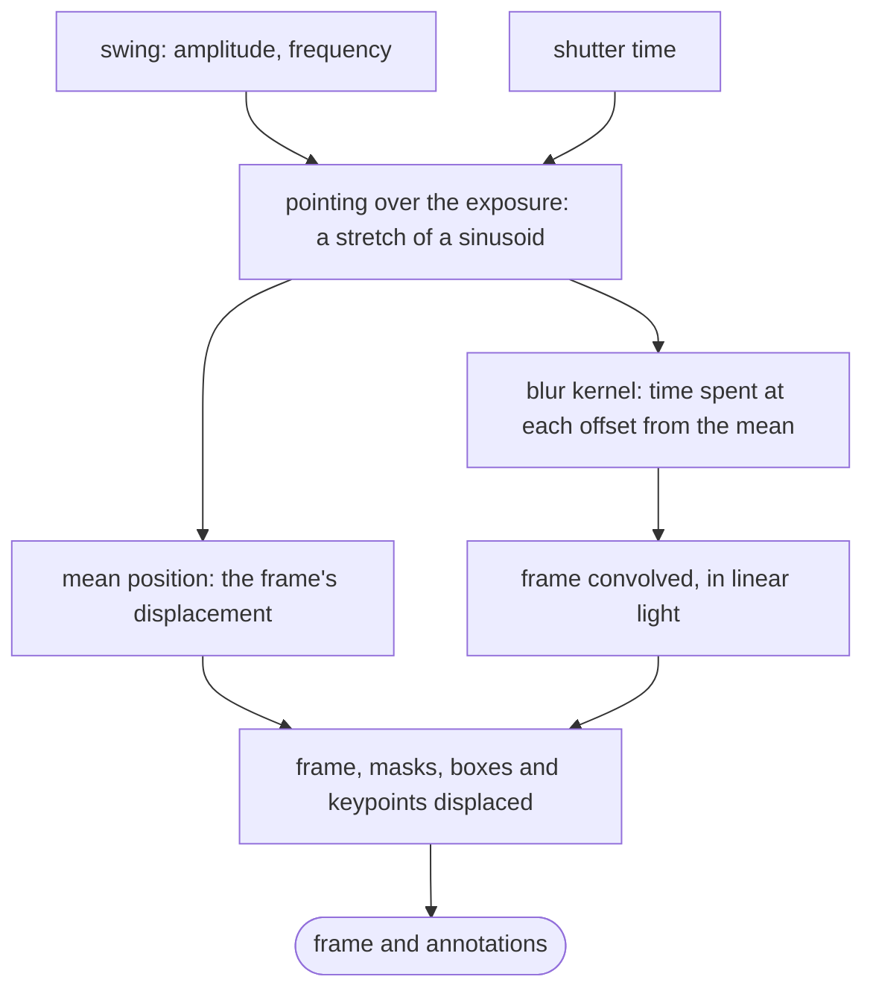
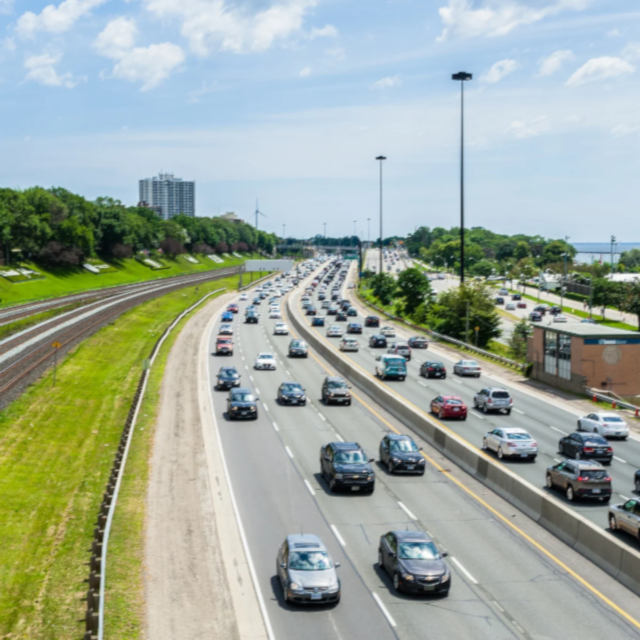

# `CameraVibration`

> The frame displaced and smeared by a camera swinging on its mount.

| | |
| --- | --- |
| Module | [`surmentations.camera.vibration`](../../src/surmentations/camera/vibration.py) |
| Stage | sensor |
| Needs depth | no |
| Annotations | moves masks, boxes and keypoints with the pixels |
| Tests | [`tests/unit/test_vibration.py`](../../tests/unit/test_vibration.py) |

## Algorithm

## Model

A camera that shakes on its mount.

### Physical model

A camera on a pole sways in wind at a few hertz; one on a bracket by a road
or a railway shakes with every lorry at tens of hertz. Either way the
camera's pointing swings about its mean, and a swing of a twentieth of a
degree is a pixel or more.

Two things reach the picture, and both follow from where the camera was
pointing while the shutter was open:

**The frame is displaced.** At the moment of the exposure the camera is
somewhere along its swing, so the whole picture sits a few pixels off
where it would be at rest: by the mean of the pointing over the exposure.

**It is smeared along the swing, by as much as it moved meanwhile.** The
exposure adds up the picture at every pointing it passed through. With a
short shutter, 1/2000 s by day, the camera has not moved and there is no
blur, only the displacement. With a long one, 1/25 s at night, it has
travelled a good part of the swing, or all of it and back. The smear is
that path: not a box along a line, but the time spent at each point of it,
which piles up at the ends of a swing where the motion turns round.

So the blur is drawn from the path, a sinusoid of the swing's amplitude
sampled over the exposure, and its length goes with the shutter time until
the exposure holds a whole half-cycle, where it stops growing at the full
swing.

The exposure is taken as the same instant for every row. A rolling
shutter reads rows at different times and turns the same motion into a
wobble, which `RollingShutter` models.

The displacement moves pixels, so masks, boxes and keypoints are moved
with them, and depth estimated before this transform is not carried past
it.

## Parameters

| Parameter | Default | Meaning |
| --- | --- | --- |
| `amplitude_range` | `(0.0008, 0.006)` | how far the picture swings either side of rest, as a fraction of the diagonal. A twentieth of a degree on a wide lens is about a thousandth. |
| `frequency_range_hz` | `(2.0, 40.0)` | how fast it swings: a few hertz for a pole in wind, tens for a bracket beside traffic. |
| `exposure_time_range` | `(0.0005, 0.04)` | shutter time. The smear is what the camera moved in that time, so 1/2000 s leaves the displacement alone and 1/25 s smears by most of the swing. |
| `direction_range_deg` | `(-90.0, 90.0)` | direction of the swing, from horizontal. |
| `p` | `0.5` | probability that the transform is applied |

## Samples

Severity 1 to 5, left to right, from the severity gallery.

`camera_vibration`

| 1 | 2 | 3 | 4 | 5 |
| --- | --- | --- | --- | --- |
|  |  |  |  |  |

## References

- Fergus, R., Singh, B., Hertzmann, A., Roweis, S. T. and Freeman, W. T. (2006). Removing camera shake from a single photograph. *ACM Transactions on Graphics* 25(3) (SIGGRAPH). [doi:10.1145/1179352.1141956](https://doi.org/10.1145/1179352.1141956)
- Liang, C.-K., Chang, L.-W. and Chen, H. H. (2008). Analysis and compensation of rolling shutter effect. *IEEE Transactions on Image Processing* 17(8), 1323-1330. [doi:10.1109/TIP.2008.925384](https://doi.org/10.1109/TIP.2008.925384)

---

Generated by [`docs/make_transform_pages.py`](../make_transform_pages.py) from the source; edit the docstring or that script, not this page. [All transforms](README.md).
