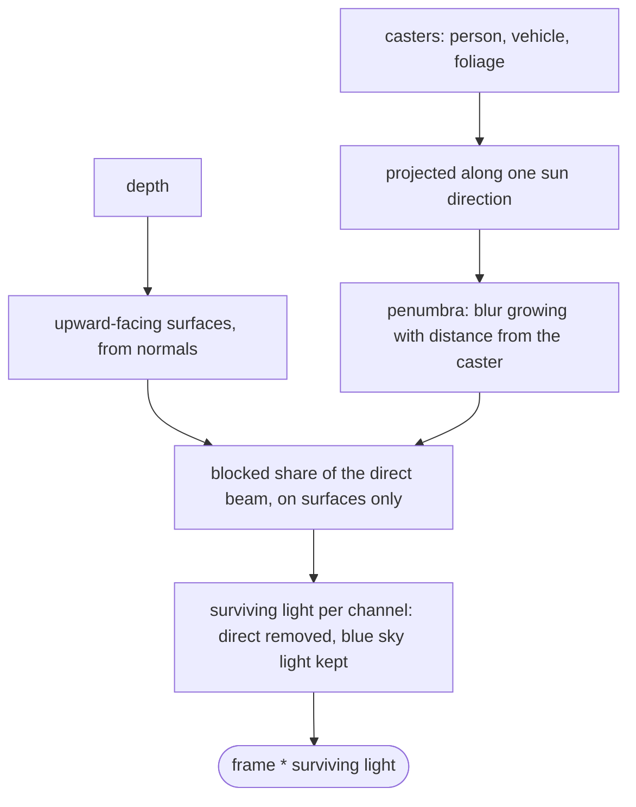
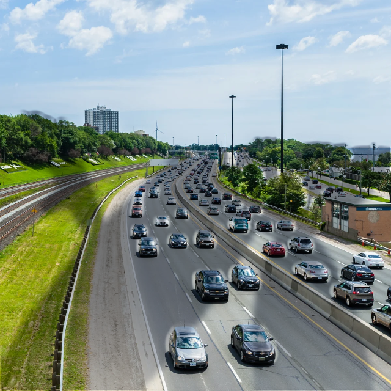

# `CastShadows`

> Hard-edged cast shadows on upward-facing surfaces.

| | |
| --- | --- |
| Module | [`surmentations.scene.shadows`](../../src/surmentations/scene/shadows.py) |
| Stage | scene |
| Needs depth | yes |
| Annotations | untouched: the image only |

## Algorithm

## Model

Hard cast shadows — the classic surveillance false positive.

### Physical model

A moving cast shadow is the single most reliable way to make a detector or a
background-subtraction model produce a false alarm. It is a sharply bounded,
person- or vehicle-shaped, *moving* dark region, which is nearly the
definition of what such a system is looking for. Shadows from clouds, trees
and passing vehicles sweep across a fixed camera's view all day.

Two things must be right or a shadow reads as a grey decal laid over the
image:

**A shadow is a loss of the direct beam, not a coat of grey paint.** Outdoor
daylight has two components: the direct sun, and the diffuse light of the
whole sky dome. A shadow removes the first and leaves the second, so the
shadowed region keeps its texture and its albedo and merely receives less
light. Multiplying the radiance by the surviving fraction preserves all that,
whereas blending toward grey flattens texture and washes colour out — the
tell-tale of a drawn-on shadow.

It also changes the *colour*. What remains is skylight, which is blue, so real
daylight shadows are measurably bluer than the sunlit areas around them. That
is why the shadow colour here is a per-channel fraction rather than a scalar.

**A shadow falls on surfaces, not on the frame.** It belongs on the ground and
on upward-facing surfaces, and it cannot land on the sky. The upward-facing
term already recovered from the depth map for snow accumulation is exactly the
right quantity, so it is reused — the two effects ask the same geometric
question and only differ in what they do with the answer.

Penumbra: the sun is a disc of about half a degree, not a point, so a shadow
edge is not sharp. Its softness grows with the distance between the occluder
and the surface — a shadow at someone's feet is crisp, the same shadow's head
is noticeably soft. That gradient is modelled, since a uniformly hard or
uniformly soft shadow both read as fake.

## With scene labels and geometry

With a provider that knows how the camera is mounted
(`geometry`), which surfaces face up is
read through that camera, in place of `camera_pitch_deg` and
`horizontal_fov_deg`.

See [scene understanding](../scene_understanding.md).

## Parameters

| Parameter | Default | Meaning |
| --- | --- | --- |
| `depth_provider` | required | shared `SharedDepthProvider`. |
| `shadow_count_range` | `(1, 5)` | how many cast shadows to place. |
| `shadow_scale_range` | `(0.06, 0.3)` | size of the things casting them, as a fraction of the image diagonal. |
| `direct_fraction_range` | `(0.45, 0.88)` | how much of the total illumination is the direct beam, which is what the shadow removes. 0.85 is hard sunlight and gives a deep shadow; 0.3 is hazy light and a faint one. Overcast approaches 0, where cast shadows disappear entirely — which is correct, and the reason this is a physical parameter rather than a "shadow darkness" dial. |
| `penumbra_range` | `(0.002, 0.02)` | softness of the shadow edge as a fraction of the diagonal, from the sun's angular diameter. |
| `casters` | `('person', 'vehicle', 'foliage')` | what casts the shadows, any of `"person"`, `"vehicle"` and `"foliage"`; each shadow picks one. A figure and a vehicle have outlines a detector recognises, which is what makes their shadows false alarms rather than merely dark patches. |
| `sun_elevation_range_deg` | `(20.0, 65.0)` | height of the sun, drawn per frame and shared by every shadow in it together with one azimuth. A low sun throws long shadows: an upright object's is `1 / tan(elevation)` times its height. |
| `surface_sharpness` | `4.0` | exponent on the upward-facing term. The cosine alone is how much light a surface *would* lose, but it does not fall off fast enough to keep shadows off things that are not really ground: with the camera pitched down even a fronto-parallel sky plane picks up a small upward component (0.14 at 8 degrees of pitch), which a linear term leaves as a faint shadow drawn across the sky. Raising it to a power suppresses that — the same threshold argument as snow accumulation's `accumulation_falloff`, for the same reason. |
| `camera_pitch_deg` | `8.0` | how far the camera is tilted down, which orients "up" for the surface test. |
| `horizontal_fov_deg` | `60.0` | field of view, for the same back-projection. |
| `p` | `0.5` | probability that the transform is applied |

## Samples

Severity 1 to 5, left to right, from the severity gallery.

`cast_shadows`

| 1 | 2 | 3 | 4 | 5 |
| --- | --- | --- | --- | --- |
|  |  |  |  |  |

## References

- Prati, A., Mikic, I., Trivedi, M. M. and Cucchiara, R. (2003). Detecting moving shadows: algorithms and evaluation. *IEEE Transactions on Pattern Analysis and Machine Intelligence* 25(7), 918-923. [doi:10.1109/TPAMI.2003.1206520](https://doi.org/10.1109/TPAMI.2003.1206520)
- Yang, L., Kang, B., Huang, Z., Zhao, Z., Xu, X., Feng, J. and Zhao, H. (2024). Depth Anything V2. *Advances in Neural Information Processing Systems (NeurIPS)*. [link](https://arxiv.org/abs/2406.09414)

---

Generated by [`docs/make_transform_pages.py`](../make_transform_pages.py) from the source; edit the docstring or that script, not this page. [All transforms](README.md).
