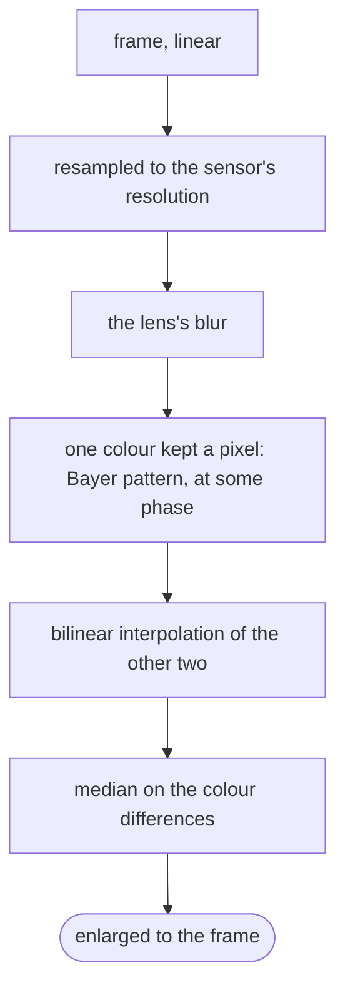

# `DemosaicArtifacts`

> False colour and zipped edges on fine detail, from a cheap camera's mosaic.

| | |
| --- | --- |
| Module | [`surmentations.camera.demosaic`](../../src/surmentations/camera/demosaic.py) |
| Stage | sensor |
| Needs depth | no |
| Annotations | untouched: the image only |
| Tests | [`tests/unit/test_demosaic.py`](../../tests/unit/test_demosaic.py) |

## Algorithm

## Model

False colour from the sensor's mosaic.

### Physical model

A sensor has one colour filter over each pixel, red, green or blue in a
Bayer pattern, and the other two colours at that pixel are interpolated
from its neighbours. Where the picture changes slowly that is invisible.
Where it has detail as fine as the pixels, a fence, a grille, a striped
shirt, lettering, the three colours have been sampled at different places
and no longer agree: the detail comes out fringed with colour that is not
in the scene, and edges show a one-pixel zip of alternating shades.

A photograph that is already a full-colour image has had this done to it
once, by the camera that took it, usually with a good interpolator on a
sensor with more pixels than the picture. A cheap camera at its native
resolution shows a great deal more, and this transform is that camera:

* **the lens and its low-pass filter** blur the scene slightly before the
  sensor, which is what limits the effect, and why a sharp lens on a
  sensor with no anti-alias filter is the worst case;
* **the sensor** samples one colour a pixel. It may have fewer pixels than
  the picture, the stream being enlarged afterwards, which makes the
  fringes as many pixels wide as the enlargement;
* **the processor** interpolates, bilinearly here as the cheapest do, and
  then smooths colour differences to hide the fringes, at the cost of
  colour resolution.

In linear light, on the sensor's own data: this happens before the tone
curve.

## Parameters

| Parameter | Default | Meaning |
| --- | --- | --- |
| `optical_blur_range_px` | `(0.0, 0.6)` | blur of the lens and its low-pass filter before the sensor, as a Gaussian sigma in sensor pixels. Near zero is a sharp lens with no anti-alias filter, and the most false colour. |
| `sensor_scale_range` | `(1.0, 2.0)` | output pixels for each sensor pixel. One is a sensor at the picture's resolution; two is one with half as many pixels each way, enlarged, with fringes twice as wide. |
| `chroma_filter_range_px` | `(0, 1)` | radius of the processor's median filter on the colour differences, in sensor pixels. Zero leaves the fringes as interpolated; two removes most of them. |
| `p` | `0.5` | probability that the transform is applied |

## Samples

Severity 1 to 5, left to right, from the severity gallery.

`demosaic_artifacts`

| 1 | 2 | 3 | 4 | 5 |
| --- | --- | --- | --- | --- |
|  |  |  |  |  |

## References

- Bayer, B. E. (1976). Color imaging array. US Patent 3,971,065. [link](https://patents.google.com/patent/US3971065A/en)
- Gunturk, B. K., Glotzbach, J., Altunbasak, Y., Schafer, R. W. and Mersereau, R. M. (2005). Demosaicking: color filter array interpolation. *IEEE Signal Processing Magazine* 22(1), 44-54. [doi:10.1109/MSP.2005.1407714](https://doi.org/10.1109/MSP.2005.1407714)

---

Generated by [`docs/make_transform_pages.py`](../make_transform_pages.py) from the source; edit the docstring or that script, not this page. [All transforms](README.md).
