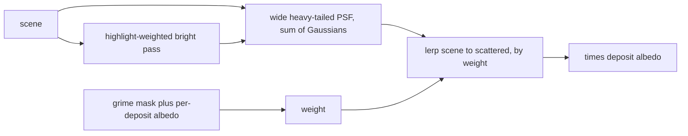

# `DirtSoil`

> Scattering dirt/grime on the lens: contrast-killing veil of scattered light.

| | |
| --- | --- |
| Module | [`surmentations.lens.dirt`](../../src/surmentations/lens/dirt.py) |
| Stage | optics: on the glass or the housing |
| Needs depth | no |
| Annotations | untouched: the image only |

## Algorithm

## Model

Dirt, dust and smudges on the lens.

### Physical model

Dirt on a front element does **not** work like paint. It sits far outside the
depth of field, so it never resolves as a shape; what it actually does is
*scatter* light. Two consequences drive this implementation, and both are
what make a dirty lens recognisable:

1. **It redistributes light rather than adding it.** The whole effect is a
   lerp toward a wide, heavy-tailed blur of the scene, weighted by how much
   grime covers each pixel. Because that blur is energy-conserving, the
   result cannot blow out — which an unbounded additive "bloom" very much
   can, and did: gain-driven bloom turned bright sky into flat white discs
   that read as lens flare rather than dirt.

   Highlights are weighted up *inside* the scattered term instead, because
   forward scatter off dust is strongly intensity-dependent. That keeps the
   defining behaviour — grime is near invisible in flat light and awful the
   moment a bright source is in or near frame — without the blowout.

2. **It costs local contrast through forward scatter.** Mie scattering off
   dust/grease is strongly forward-peaked with heavy tails, so a fraction of
   every ray is redistributed over a wide angle. We approximate the
   Lorentzian `1/(1 + (r/r0)^2)` point-spread function with a sum of
   Gaussians (cheap, and keeps the heavy tail) and lerp toward it under the
   mask — which washes out local contrast the way real haze on glass does.

3. **It is lit from everywhere, not only from where the camera looks.** The
   forward peak of that scattering is what smears a lamp across the grime,
   but the rest of it is wide-angle: every patch of dirt also sends the lens
   a share of the light arriving from the whole hemisphere in front of the
   glass. Most of that hemisphere is outside the frame, and by day most of
   its light is the sky. A camera angled down at a road therefore has dirt
   lit by something several times brighter than anything it is looking at,
   and that is the milky lift a dirty dome shows in daylight. Leaving it out
   — scattering only what is inside the frame, from close by — is why the
   earlier model was nearly invisible on a daylit scene: a patch of grime
   over asphalt was replaced by a blur of the same asphalt.

   So the light scattered in is a mix: the forward part from the scene
   around the pixel, the wide part from the surroundings as a whole, taken
   as the frame's mean radiance times `ambient_light` — how much brighter
   the world outside the frame is than the part inside it. At 1 the frame
   is representative and flat light still shows nothing; it is the sky
   overhead that raises it.

4. **It is not one substance, and not one colour.** This is the fourth thing
   that decides whether grime reads as real, and the easiest to get wrong.
   A pane collects several deposits at once, each with its own *single-
   scattering albedo* — the fraction of light it returns, per wavelength:

   * **Mineral dust and sand** (silica with iron-oxide staining) absorb
     strongly toward the blue, so they scatter a warm tan. This is the
     Ångström-exponent behaviour that makes dust-hazed skies yellow.
   * **Clay and soil splash** absorb harder still across the blue-green,
     reading light brown.
   * **Soot and urban road film** (black carbon) absorb almost flat across
     the visible band — the canonical *grey* absorber, dark but neutral.
   * **Limescale, sea salt and dried spray residue** barely absorb at all,
     so they scatter nearly white, and being highly scattering they are the
     most visible deposit per unit of thickness.
   * **Pollen and organic films** absorb blue and reflect yellow-green.

   The albedo multiplies the scattered term rather than being painted over
   the top, so each deposit both tints *and* dims what scatters through it,
   and `1 - albedo` is the light it absorbs. A single global brown tint —
   the previous model — collapses all of that into a decal.

Front-element dust specks are *not* drawn as visible specks: they are
optically invisible in their own right. Sharp dark spots come from sensor
dust, which is a different (and per-camera fixed) phenomenon.

The mask itself is deliberately multi-scale and anisotropic: a low-frequency
smudge field, plus curved *wipe arcs* (someone smeared it with a cloth or a
wiper blade, which leaves directional streaks rather than isotropic blobs),
plus dried water-spot rings — droplets dry via the coffee-ring effect,
leaving a high-scatter annulus with a cleaner centre. Each of those carries
its own deposit colour: a wipe arc is smeared road film, a dried spot is
mineral residue left by evaporating water, and they do not look alike.

All size-like parameters are fractions of the image diagonal, so the effect
looks the same at any resolution.

## Parameters

| Parameter | Default | Meaning |
| --- | --- | --- |
| `smudge_count_range` | `(4, 12)` | number of low-frequency grime patches. |
| `smudge_size_range` | `(0.04, 0.22)` | grime patch radius, as a fraction of the image diagonal. |
| `wipe_arc_count_range` | `(2, 6)` | number of directional smear arcs (cloth or wiper marks). Set to `(0, 0)` for untouched grime. |
| `water_spot_count_range` | `(0, 14)` | number of dried droplet rings. |
| `water_spot_radius_range` | `(0.004, 0.022)` | dried droplet radius, as a fraction of the image diagonal. |
| `coverage_range` | `(0.1, 0.32)` | fraction of the frame the patches are normalised to cover, roughly. |
| `dust_film_range` | `(0.0, 0.25)` | an even layer of dust over the whole pane, as the fraction of each pixel it veils. Glass left outdoors is rarely clean between its smudges: what settles from the air is a thin uniform film, and it is what takes the contrast out of the whole frame while the patches take it out of parts. |
| `ambient_light_range` | `(1.0, 3.0)` | how bright the surroundings outside the frame are, relative to the frame's own average. Dirt scatters light in from the whole hemisphere in front of the glass, so this decides how much it glows. 1 means the frame is representative — a view that already contains its share of sky, or a night scene. A camera looking down at a road under open sky is lit by something 3-5 times brighter than what it sees. |
| `highlight_boost_range` | `(1.5, 5.0)` | how much brighter-than-average scene content dominates the scattered light. Higher makes the grime near invisible in flat light and glaring when backlit. |
| `veil_strength_range` | `(0.35, 0.8)` | how much of each covered pixel is replaced by scattered light. This is the whole effect: contrast loss plus smeared highlights, energy-conserving by construction. |
| `scatter_radius_range` | `(0.02, 0.07)` | scatter PSF radius, as a fraction of the image diagonal — how far a bright source fogs out across the grime. |
| `absorption_range` | `(0.02, 0.12)` | how much genuinely *opaque* caked muck blocks the scene outright, on top of the scattering. Keep small; dirt mostly scatters. What it blocks toward is the deposit's own dark body colour, so this stays consistent with the mix on the glass. |
| `deposits` | `None` | which deposit types may appear, as keys of `DEPOSIT_ALBEDOS` (`None` uses all of them). Each smudge patch independently draws one, so a single frame normally shows several. Restrict it to model a specific environment — e.g. `("mineral_dust", "clay_soil")` for a dirt road, `("soot", "road_film")` for urban traffic, `("limescale",)` for dried sea spray. |
| `p` | `0.5` | probability that the transform is applied |

## Samples

Severity 1 to 5, left to right, from the severity gallery.

`dirt_soil`

| 1 | 2 | 3 | 4 | 5 |
| --- | --- | --- | --- | --- |
|  |  |  |  |  |

## References

- Gu, J., Ramamoorthi, R., Belhumeur, P. and Nayar, S. (2009). Removing image artifacts due to dirty camera lenses and thin occluders. *ACM Transactions on Graphics* 28(5) (SIGGRAPH Asia). [doi:10.1145/1661412.1618490](https://doi.org/10.1145/1661412.1618490)

---

Generated by [`docs/make_transform_pages.py`](../make_transform_pages.py) from the source; edit the docstring or that script, not this page. [All transforms](README.md).
