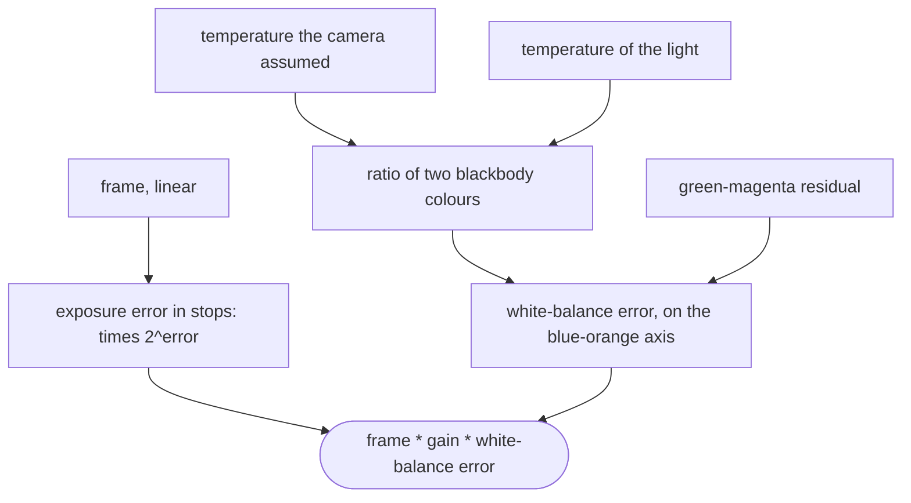
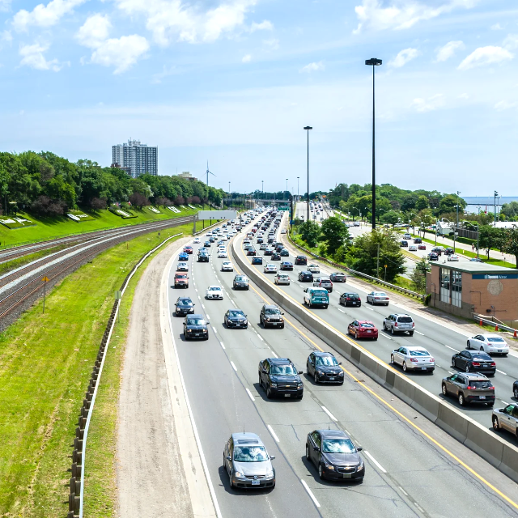
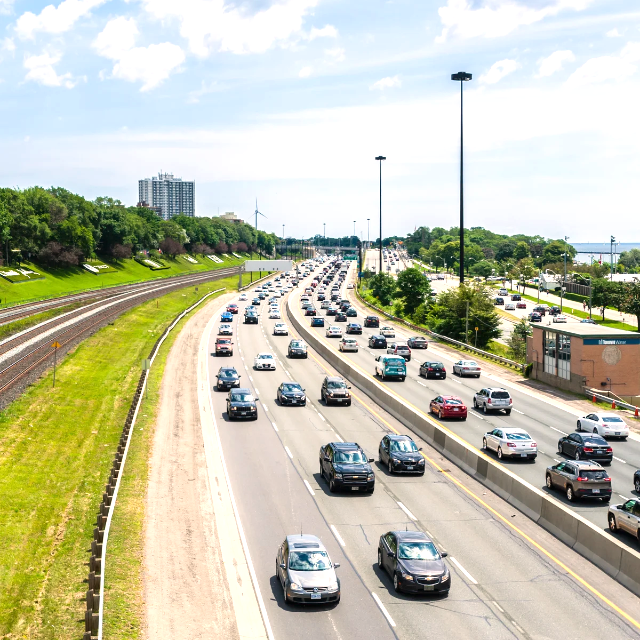
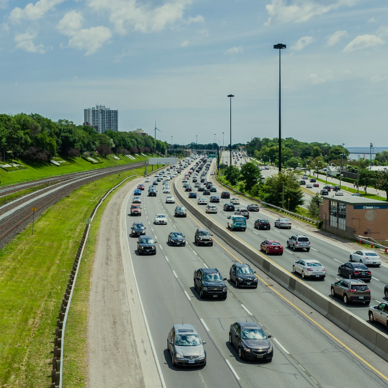
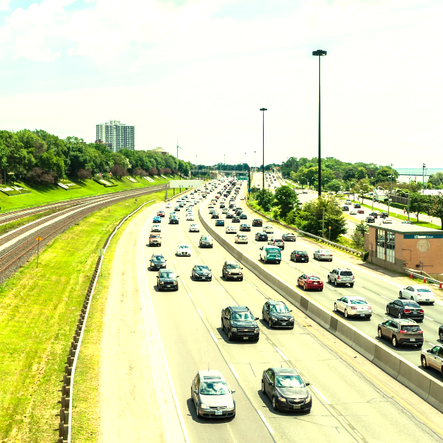
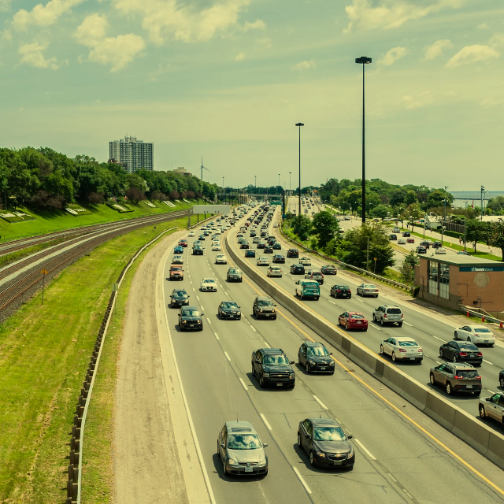

# `ExposureTransient`

> Auto-exposure / auto-white-balance error, as a camera mid-hunt shows it.

| | |
| --- | --- |
| Module | [`surmentations.camera.exposure`](../../src/surmentations/camera/exposure.py) |
| Stage | processor: exposure |
| Needs depth | no |
| Annotations | untouched: the image only |

## Algorithm

## Model

Auto-exposure and auto-white-balance caught mid-correction.

### Physical model

A fixed camera's automatic exposure and white balance are closed loops with
lag. They are *continuously* wrong by some amount and continuously correcting:
a headlight enters frame and the whole image darkens for a second before
recovering; a cloud crosses and the colour cast swings. The settled state a
training set is usually built from is only one of the states the camera
spends its time in, and the transient ones are just as common.

Two errors, modelled separately because they have different physics:

* **Exposure error** is a gain on radiance, so it is expressed in **stops**
  (powers of two) and applied in linear light. A stop is a factor of two in
  the light reaching the sensor; applying a "brightness" offset to
  gamma-encoded values is a different operation that no camera performs.
  Overshoot is signed, because a hunting loop passes through the right answer
  from both sides.

* **White-balance error** is *not* an arbitrary per-channel gain. AWB
  estimates the illuminant's colour temperature and divides it out; when it
  guesses wrong, what is left is the ratio between the blackbody colour it
  assumed and the one actually lighting the scene. That ratio lies along the
  blue-orange axis, because that is the axis real illuminants vary on.
  Independent random channel gains wander off it and leave casts — strong
  green, strong magenta — that a white-balance algorithm would never produce.
  See `blackbody_rgb`.

A smaller green-magenta error is applied on top, which *is* the residual AWB
leaves on non-blackbody illuminants such as fluorescent and LED lighting —
the "tint" axis, orthogonal to temperature.

## Parameters

| Parameter | Default | Meaning |
| --- | --- | --- |
| `exposure_error_stops_range` | `(-1.2, 1.2)` | signed exposure error in stops. +1 is one stop over (twice the light), -1 one stop under. |
| `assumed_temperature_range_k` | `(4000.0, 7000.0)` | the colour temperature AWB *thinks* it is correcting for. |
| `actual_temperature_range_k` | `(3000.0, 8000.0)` | the temperature actually lighting the scene. The residual cast is the ratio of the two blackbody colours, so equal ranges give a correct white balance on average and a realistic spread of errors around it. |
| `tint_error_range` | `(-0.08, 0.08)` | residual green-magenta error, the axis orthogonal to colour temperature. Positive is green, negative magenta; non- blackbody sources (fluorescent, LED) are what leave it. |
| `p` | `0.5` | probability that the transform is applied |

## Samples

Severity 1 to 5, left to right, from the severity gallery.

`exposure_transient`

| 1 | 2 | 3 | 4 | 5 |
| --- | --- | --- | --- | --- |
|  |  |  |  |  |

## References

- Wyszecki, G. and Stiles, W. S. (1982). *Color Science: Concepts and Methods, Quantitative Data and Formulae*, 2nd edition. Wiley.

---

Generated by [`docs/make_transform_pages.py`](../make_transform_pages.py) from the source; edit the docstring or that script, not this page. [All transforms](README.md).
