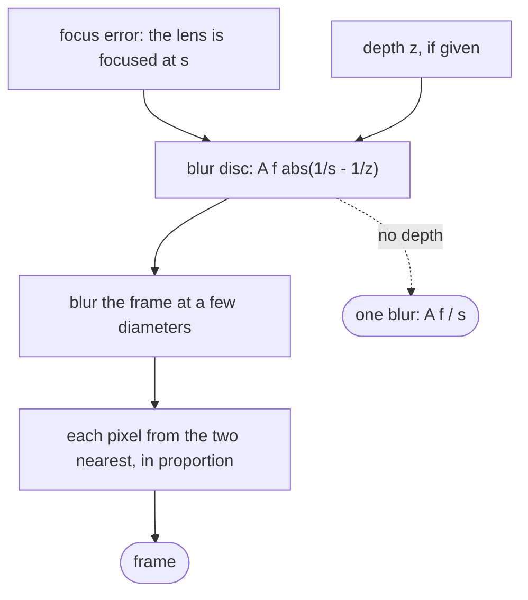

# `FocusShift`

> A lens focused too near: by infrared, by temperature, or by a loose ring.

| | |
| --- | --- |
| Module | [`surmentations.lens.focus`](../../src/surmentations/lens/focus.py) |
| Stage | optics: in the lens |
| Needs depth | optional |
| Annotations | untouched: the image only |
| Tests | [`tests/unit/test_focus.py`](../../tests/unit/test_focus.py) |

## Algorithm

## Model

A lens that is not focused where it should be.

### Physical model

A fixed-focus surveillance lens is set once, by eye, by day. Three things
then move the plane of focus without anyone touching it:

* **Infrared.** Glass bends near-infrared light less than visible light,
  so a lens that is not IR-corrected focuses the illuminator's light
  behind the sensor. The picture that was sharp at noon is soft every
  night. This is the commonest of the three, and the reason "IR-corrected"
  is printed on lens boxes.
* **Temperature.** A plastic lens barrel grows and shrinks by tens of
  micrometres between a winter night and a summer afternoon.
* **A ring that was never locked,** and turns with vibration.

All three displace the sensor from the plane where distant objects focus,
which is the same thing as the lens being focused at some near distance
`s` instead of far away. From that everything follows, by the thin-lens
formula:

**A point is drawn as the aperture.** At distance `z` its blur disc has
diameter `A f |1/s - 1/z|` pixels, for an aperture `A` and a focal
length of `f` pixels. It is a disc, with an edge, not a Gaussian.

**Far things are blurred most, and all alike.** Beyond a few times `s`
the disc is `A f / s` whatever the distance, which is why a mis-focused
wide lens looks evenly soft: a 4 mm lens with a 2 mm stop, focused at half
a metre, blurs everything past a few metres by about 3 px in 1000. With a
depth map the blur follows the formula per pixel, and whatever happens to
stand at `s` is sharp; without one the whole frame gets the far value.

The layers of blur are blended by depth with no account of what hides
what, so a sharp object in front of a blurred background does not bleed
its outline as a real lens would make it. At the few pixels involved that
is below what the picture resolves.

## Parameters

| Parameter | Default | Meaning |
| --- | --- | --- |
| `depth_provider` | `None` | one shared provider, or `None` for an even blur. |
| `focus_distance_range_m` | `(0.08, 1.5)` | where the lens is in fact focused. The nearer, the worse: everything far is blurred by a disc `A f / s` across. Drawn evenly in `1 / s`, which is what the blur is proportional to, so that the range is covered evenly in blur and not mostly at its sharp end. |
| `aperture_diameter_range_mm` | `(0.9, 2.6)` | the lens's stop. The blur disc is its image, so an open lens at night is blurred most. |
| `horizontal_fov_range_deg` | `(48.0, 78.0)` | field of view, which gives the focal length in pixels. |
| `p` | `0.5` | probability that the transform is applied |

## Samples

Severity 1 to 5, left to right, from the severity gallery.

`focus_shift`

| 1 | 2 | 3 | 4 | 5 |
| --- | --- | --- | --- | --- |
|  |  |  |  |  |

## References

- Potmesil, M. and Chakravarty, I. (1981). A lens and aperture camera model for synthetic image generation. *ACM SIGGRAPH Computer Graphics* 15(3), 297-305.
- Hecht, E. (2017). *Optics*, 5th edition. Pearson.

---

Generated by [`docs/make_transform_pages.py`](../make_transform_pages.py) from the source; edit the docstring or that script, not this page. [All transforms](README.md).
