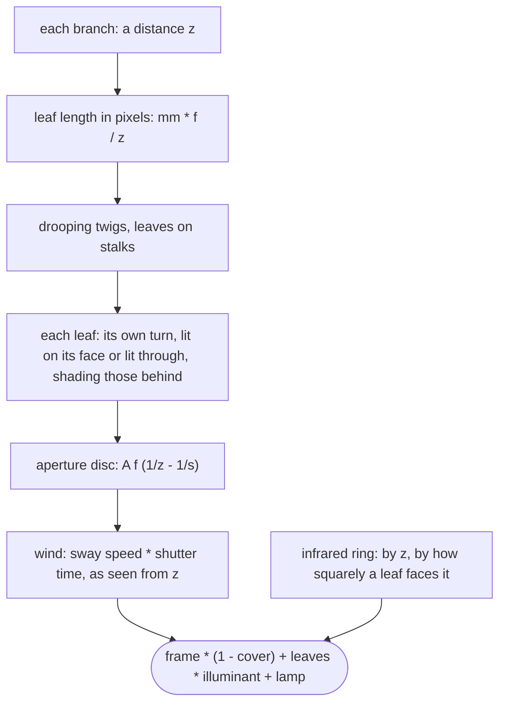
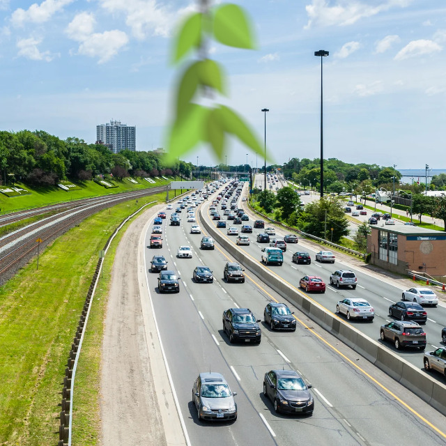
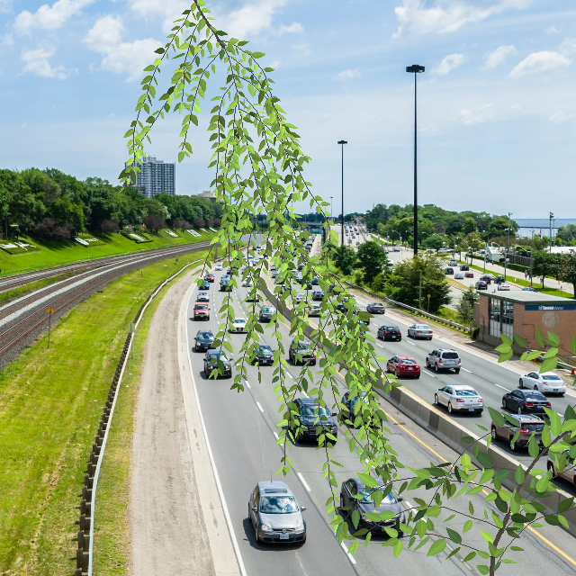
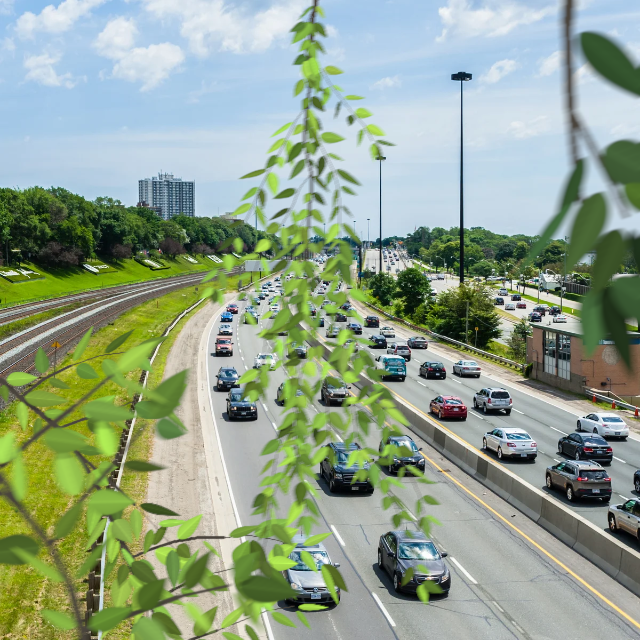
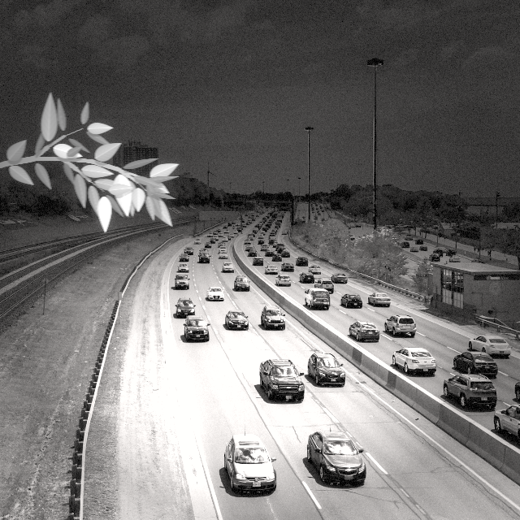
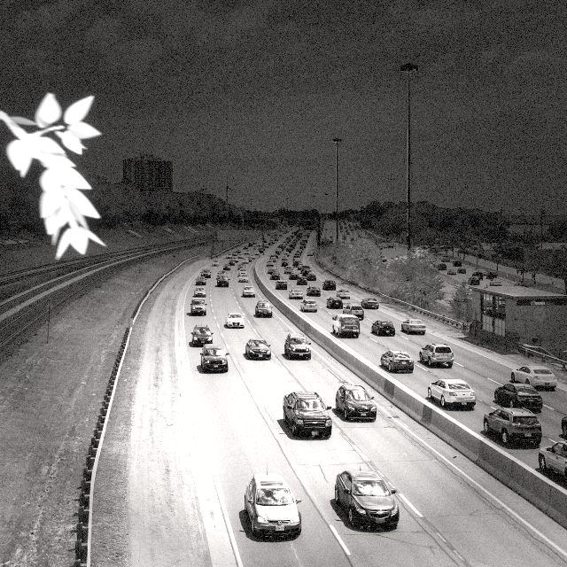
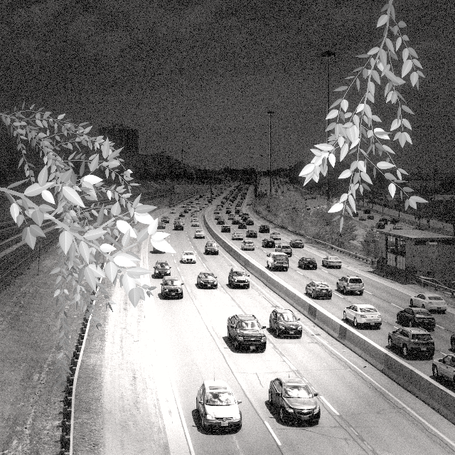
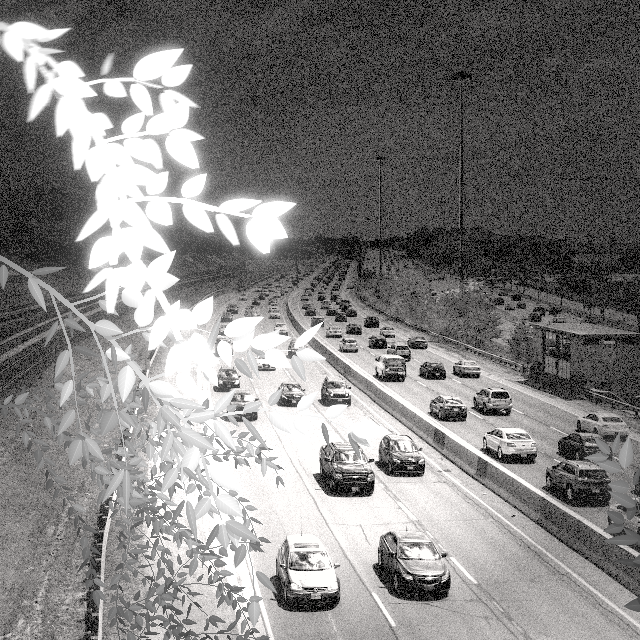
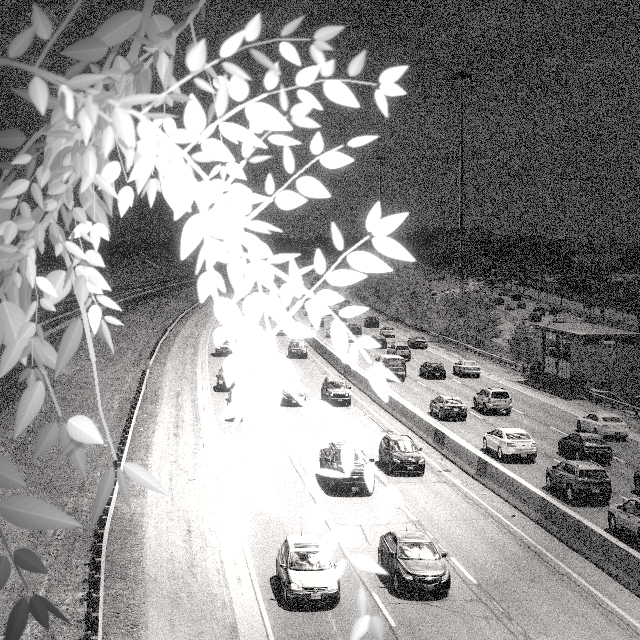

# `FoliageIntrusion`

> A leafy branch hanging in front of the lens, out of focus and swaying.

| | |
| --- | --- |
| Module | [`surmentations.lens.foliage`](../../src/surmentations/lens/foliage.py) |
| Stage | optics: on the glass or the housing |
| Needs depth | no |
| Annotations | untouched: the image only |
| Tests | [`tests/unit/test_foliage.py`](../../tests/unit/test_foliage.py) |

## Algorithm

## Model

A branch that has grown in front of the camera.

### Physical model

Cameras are installed in winter and by July there is a branch across the
view. It hangs a few tens of centimetres from the lens, moves in any wind,
and is the commonest cause of both lost coverage and false motion alarms on
an outdoor camera that is otherwise working.

**It is near, so it is large and soft.** A 6 cm leaf half a metre from a
4 mm lens is a fifth of the frame wide. It is inside the near focus limit,
so its edge is blurred by the aperture's disc, `A f / 2z` pixels in
radius: a few pixels by day, when the picture is exposed for daylight
through a small stop, and several times that at night with the lens open.

**It hides what is behind it.** A leaf is opaque enough: where it is, the
scene is not. Where its blurred edge is, the two mix.

**By day it is dark; by night it is white.** By day the camera sees the
underside of leaves against a brighter scene: green, at a fraction of the
light the scene is exposed for, more where the sun comes through a leaf
and less in the shade of the others. At night the infrared ring lights it
from a hand's width away, and leaves reflect about half of the near
infrared that reaches them, where they reflect a twentieth of red light.
So a branch that is a dark shape by day is the brightest thing in the
night picture, by the lamp's inverse square at its own distance.

**It moves.** Wind sways it during the exposure, which at night is long,
so the leaves are smeared along the sway by its speed times the shutter
time, as seen from where they are.

**A leaf is not a green shape.** What makes foliage read as foliage, at
the few pixels of blur it has by day, is that no two leaves look alike.
Each is turned its own way, so it is foreshortened along or across its
midrib; each is either catching light on the side the camera sees or
letting it through from behind, which are different colours, a dull blue
green and a bright yellow green; it has a midrib and veins, and one half
of the blade a little darker than the other; and the leaves in front
shade the ones behind. Under the lamp the same turning decides how bright
a leaf is, by the cosine of how far it faces away, and the nearer leaves
of a branch are brighter than the further ones.

## Parameters

| Parameter | Default | Meaning |
| --- | --- | --- |
| `branch_count_range` | `(1, 3)` | how many branches reach into the view. |
| `distance_range_m` | `(0.2, 1.2)` | how far from the lens they hang. Sets how large the leaves are, how blurred, and how brightly the lamp lights them. |
| `leaf_length_range_mm` | `(30.0, 90.0)` | the length of a leaf. |
| `reach_range` | `(0.25, 0.8)` | how far into the frame a branch runs, as a fraction of the frame's smaller side. |
| `leaf_light_range` | `(0.15, 0.9)` | how brightly a leaf's underside shows by day, as a share of what its colour would return in the open: low in the shade of the leaves above it, higher where the sun comes through. Each leaf draws its own. |
| `sway_speed_range_m_s` | `(0.0, 0.4)` | how fast the wind moves the branch, which with the shutter time smears it. |
| `exposure_time_range` | `(0.001, 0.04)` | shutter time. |
| `illuminator_gain_range` | `(0.0, 0.0)` | radiance of a white surface one metre from the infrared ring, in units of full scale; leaves return half of it. Zero by day. |
| `beam_falloff_range` | `(0.6, 2.2)` | how sharply the ring's beam dims off-axis. |
| `glare_range` | `(0.05, 0.25)` | fraction of the lamp-lit foliage's light that the dome and the lens scatter into a glow around it. |
| `horizontal_fov_range_deg` | `(48.0, 78.0)` | field of view, which projects metres to pixels. |
| `aperture_diameter_range_mm` | `(0.9, 2.6)` | the lens's stop, which sets the blur. |
| `focus_distance_range_m` | `(8.0, 40.0)` | where the lens is focused. |
| `p` | `0.5` | probability that the transform is applied |

## Samples

Severity 1 to 5, left to right, from the severity gallery.

`foliage_intrusion`

| 1 | 2 | 3 | 4 | 5 |
| --- | --- | --- | --- | --- |
|  |  |  |  |  |

`night_foliage`

| 1 | 2 | 3 | 4 | 5 |
| --- | --- | --- | --- | --- |
|  |  |  |  |  |

## References

- Gates, D. M., Keegan, H. J., Schleter, J. C. and Weidner, V. R. (1965). Spectral properties of plants. *Applied Optics* 4(1), 11. [doi:10.1364/AO.4.000011](https://doi.org/10.1364/AO.4.000011)
- Potmesil, M. and Chakravarty, I. (1981). A lens and aperture camera model for synthetic image generation. *ACM SIGGRAPH Computer Graphics* 15(3), 297-305. [doi:10.1145/965161.806818](https://doi.org/10.1145/965161.806818)

---

Generated by [`docs/make_transform_pages.py`](../make_transform_pages.py) from the source; edit the docstring or that script, not this page. [All transforms](README.md).
