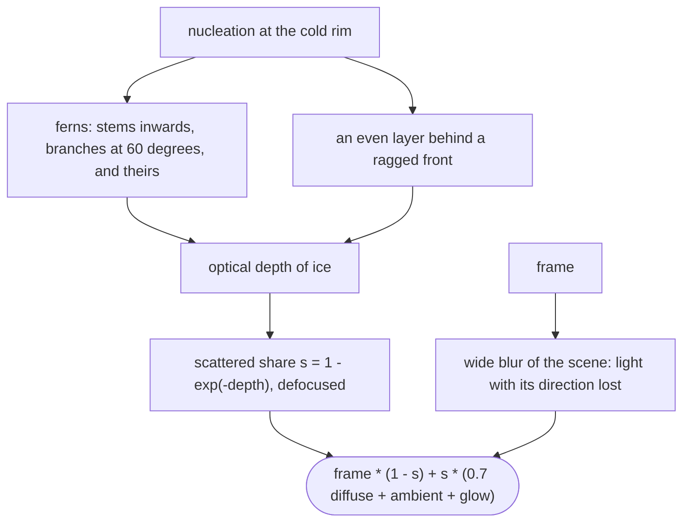

# `FrostOnGlass`

> A border of frost on the dome, grown in from the rim.

| | |
| --- | --- |
| Module | [`surmentations.lens.frost`](../../src/surmentations/lens/frost.py) |
| Stage | optics: on the glass or the housing |
| Needs depth | no |
| Annotations | untouched: the image only |
| Tests | [`tests/unit/test_frost.py`](../../tests/unit/test_frost.py) |

## Algorithm

## Model

Frost on the glass.

### Physical model

On a clear cold night the dome radiates its heat to the sky and falls below
the frost point, and ice grows on it. By morning the feed is a clear patch
in the middle of a white vignette, and it stays that way until the sun or
the camera's own warmth clears it.

**It grows in from the rim.** The centre of the glass is over the lens and
the electronics, which are warm; the rim is over nothing. Ice nucleates at
the edge and on whatever dirt is there and spreads inwards, so the frost is
a border whose inner edge is ragged, with the middle of the view the last
to go.

**It is feathered.** Ice on glass grows as ferns: a stem along the
direction it is spreading, side branches off it at sixty degrees, the
angle of the ice crystal's own lattice, and smaller branches off those.
So the border is not an even grey but a field of fronds pointing inwards,
longest where they started first. They are on the glass, centimetres
inside the lens's near focus limit, which does two things at once: it
magnifies them, a frond a centimetre long being a fifth of the frame, and
it blurs them by the aperture's disc. What is seen is the frond's shape,
soft, without the crystal's edges.

**It scatters; it does not absorb.** Ice is clear. A layer of small
crystals passes nearly all the light that reaches it, in the wrong
direction. So behind frost the scene is not darkened but replaced, by a
wide blur of itself and by light the frost picks up from everywhere else
in front of the glass, the sky above the frame included: frost is pale by
day, and under the infrared ring at night, which lights it from a few
centimetres away, it is white. The same model as `DirtSoil`'s, with a
deposit that has no colour of its own.

## Parameters

| Parameter | Default | Meaning |
| --- | --- | --- |
| `coverage_range` | `(0.25, 0.9)` | how far the frost has grown in from the rim, as a share of the way to the centre of the frame. |
| `thickness_range` | `(0.8, 3.0)` | optical depth of established frost. At 1 it passes a third of the scene directly; at 3, a twentieth. |
| `feather_range` | `(0.4, 1.0)` | how much of the frost is in ferns growing inwards, 0 to 1. Zero is an even layer with a ragged edge. |
| `crystal_scale_range` | `(0.006, 0.014)` | thickness of a fern's stem where it starts, as a fraction of the diagonal. The glass is centimetres from the lens, so a stem a millimetre thick is several pixels. |
| `defocus_range` | `(0.002, 0.006)` | blur of the frost's pattern, as a fraction of the diagonal. It is on the glass, far inside the near focus limit. |
| `ambient_light_range` | `(0.05, 0.3)` | light the frost picks up from in front of the glass and scatters into the lens, as a share of the scene's illuminant. What makes frost pale and not just blurred. |
| `illuminator_glow_range` | `(0.0, 0.0)` | light the frost returns from the infrared ring, in units of full scale. Zero by day. |
| `p` | `0.5` | probability that the transform is applied |

## Samples

Severity 1 to 5, left to right, from the severity gallery.

`frost_on_glass`

| 1 | 2 | 3 | 4 | 5 |
| --- | --- | --- | --- | --- |
|  |  |  |  |  |

## References

- Libbrecht, K. G. (2005). The physics of snow crystals. *Reports on Progress in Physics* 68, 855-895. [doi:10.1088/0034-4885/68/4/R03](https://doi.org/10.1088/0034-4885/68/4/R03)
- Gu, J., Ramamoorthi, R., Belhumeur, P. and Nayar, S. (2009). Removing image artifacts due to dirty camera lenses and thin occluders. *ACM Transactions on Graphics* 28(5) (SIGGRAPH Asia). [doi:10.1145/1661412.1618490](https://doi.org/10.1145/1661412.1618490)

---

Generated by [`docs/make_transform_pages.py`](../make_transform_pages.py) from the source; edit the docstring or that script, not this page. [All transforms](README.md).
