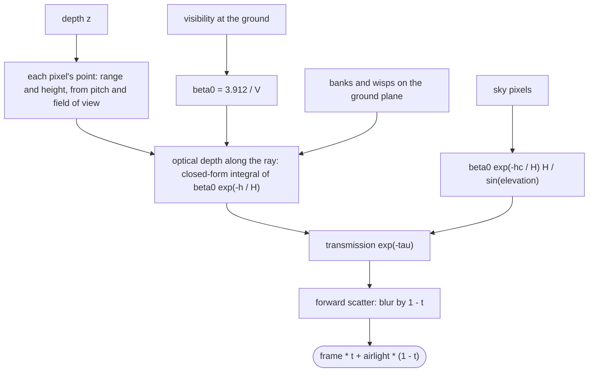
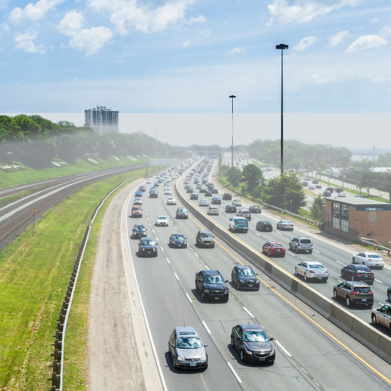
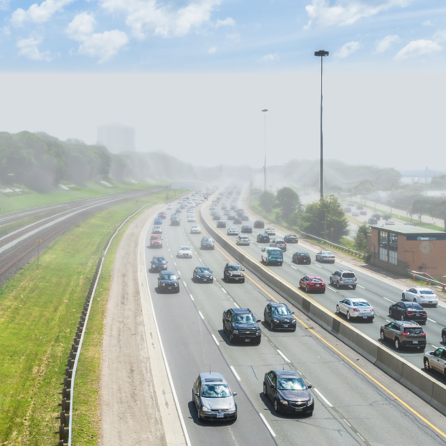
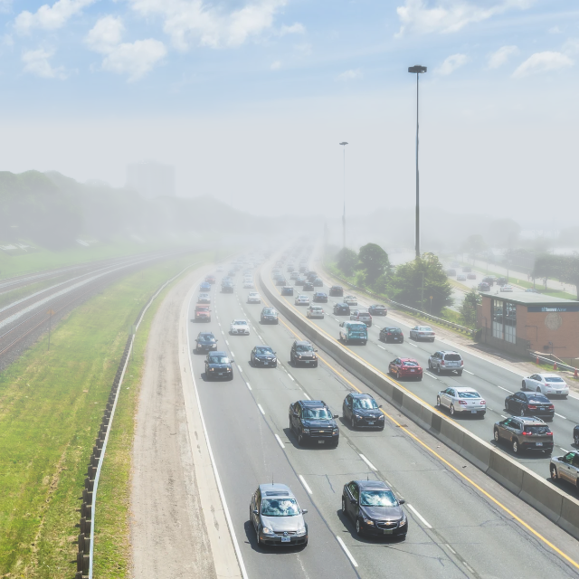
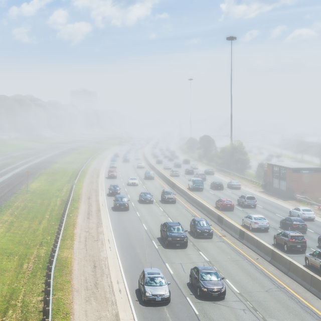
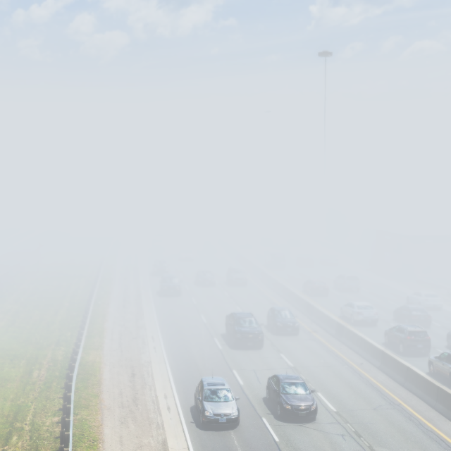

# `GroundFog`

> A shallow layer of fog over the ground, thinning with height and lying in banks.

| | |
| --- | --- |
| Module | [`surmentations.atmosphere.ground_fog`](../../src/surmentations/atmosphere/ground_fog.py) |
| Stage | atmosphere |
| Needs depth | yes |
| Annotations | untouched: the image only |
| Tests | [`tests/unit/test_ground_fog.py`](../../tests/unit/test_ground_fog.py) |

## Algorithm

## Model

Fog that lies on the ground.

### Physical model

`RandomFog` fills the world evenly: the same extinction at every height,
which is advection fog or cloud at ground level. The fog a camera on a pole
meets most often is not that. Radiation fog forms on still clear nights in
the air chilled by the ground, and it is a layer: thick at the surface,
thinning with height, often shallower than the pole. Seen from above it,
the road is gone and the roofs and lamp heads stand clear of it.

**Density falls with height.** The layer is taken as exponential,
`beta(h) = beta0 exp(-h / H)`: extinction `beta0` at the ground, given
through the visibility there by Koschmieder's relation as in `RandomFog`,
and a scale height `H` of a few metres.

**What a pixel sees is the integral along its ray.** From a camera at
height `hc` to a point at range `r` and height `hp`, the optical
depth has a closed form:

``
tau = beta0 r exp(-hc / H) (1 - exp(-u)) / u,   u = (hp - hc) / H
``

which is `beta0 r exp(-hc / H)` for a level ray and grows as the ray
dips into the layer. So the same distance is clear along a line of roofs
and opaque along the road, and a camera looking down from above the layer
sees the ground through less fog than one standing in it would. The
heights come from the depth map and the camera's height, pitch and field
of view; nothing is taken from image position alone.

**It is patchy.** A layer this shallow follows the ground and drifts in
banks, with wisps a few times smaller trailing from them. The extinction
is modulated by two noises laid out on the ground plane, in metres, and
read part-way along each ray, so that the banks have the size they are
given at any distance and foreshorten as the ground does.

**Above the layer the sky is clear, and the horizon is not.** A ray into
the sky leaves the layer and meets nothing more, so its optical depth is
finite however far it goes: `beta0 exp(-hc / H) H / sin(elevation)`.
Straight up that is very little. Towards the horizon it grows without
limit, so the fog closes the horizon in a white band and thins upwards
into clear sky, which is the look of ground fog from above it. Sky pixels
are given that value from the ray's direction alone, since their depth is
not a distance.

**It softens what it veils.** Fog scatters mostly forwards, so what is
seen through it is blurred as well as faded, by more the more fog is in
the way, as in `RandomFog`.

The veil's colour is `RandomFog`'s: the horizon sky's radiance, read
where sky is in frame and inferred where it is not.

## Parameters

| Parameter | Default | Meaning |
| --- | --- | --- |
| `depth_provider` | required | one shared provider. |
| `visibility_range_m` | `(10.0, 80.0)` | visibility at ground level, inside the layer. |
| `layer_height_range_m` | `(1.0, 8.0)` | the layer's scale height: how far up its density falls to 37%. A metre or two is mist on a field; ten is fog to the rooftops. |
| `camera_height_range_m` | `(3.0, 8.0)` | how high the camera is above the ground. A camera above the layer looks down through less of it. |
| `camera_pitch_range_deg` | `(5.0, 30.0)` | how far the camera looks down from horizontal. |
| `horizontal_fov_range_deg` | `(48.0, 78.0)` | field of view, which with the pitch turns depth into height. |
| `patchiness_range` | `(0.2, 0.9)` | how uneven the layer is, 0 to 1. Zero is an even sheet. |
| `patch_scale_range_m` | `(8.0, 60.0)` | the size of its banks. |
| `forward_scatter_range` | `(0.001, 0.004)` | blur of what is seen through the fog, as a fraction of the diagonal, where the fog is thick. |
| `depth_scale` | `None` | pseudo-metres at relative depth 1, for this transform alone; `None` uses the provider's own far plane. |
| `p` | `0.5` | probability that the transform is applied |

## Samples

Severity 1 to 5, left to right, from the severity gallery.

`ground_fog`

| 1 | 2 | 3 | 4 | 5 |
| --- | --- | --- | --- | --- |
|  |  |  |  |  |

## References

- Koschmieder, H. (1924). Theorie der horizontalen Sichtweite. *Beiträge zur Physik der freien Atmosphäre* 12, 33-53.
- Gultepe, I. et al. (2007). Fog research: a review of past achievements and future perspectives. *Pure and Applied Geophysics* 164, 1121-1159.
- Narasimhan, S. G. and Nayar, S. K. (2002). Vision and the atmosphere. *International Journal of Computer Vision* 48(3), 233-254.

---

Generated by [`docs/make_transform_pages.py`](../make_transform_pages.py) from the source; edit the docstring or that script, not this page. [All transforms](README.md).
