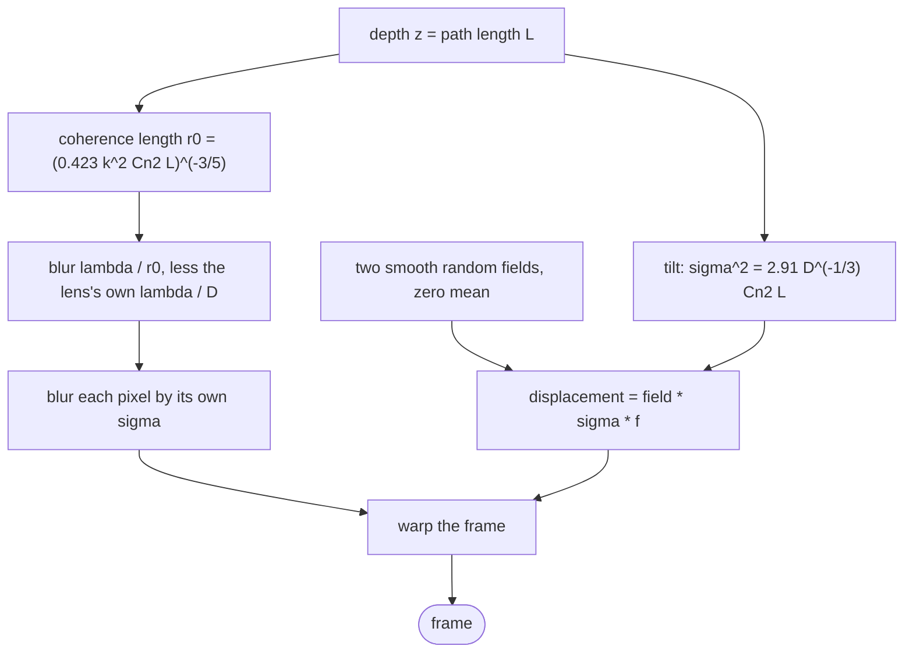

# `HeatShimmer`

> Distant detail rippled and softened by turbulent air over a long path.

| | |
| --- | --- |
| Module | [`surmentations.atmosphere.heat_shimmer`](../../src/surmentations/atmosphere/heat_shimmer.py) |
| Stage | atmosphere |
| Needs depth | yes |
| Annotations | untouched: the image only |
| Tests | [`tests/unit/test_heat_shimmer.py`](../../tests/unit/test_heat_shimmer.py) |

## Algorithm

## Model

Heat shimmer: the air itself as a bad lens.

### Physical model

Over ground warmer than the air, the air is a mixture of parcels at
different temperatures and so of different refractive index, churning. A
ray through it is bent a little at every parcel. Over a short path that is
nothing; over hundreds of metres, seen through a long lens, distant detail
ripples and loses its edges. It is what limits a long-range camera on a
warm afternoon, and it is the standard theory of seeing, Kolmogorov
turbulence, with the strength of the turbulence given by the
refractive-index structure constant `Cn2`: about `1e-14 m^-2/3` on a
mild day near the ground and `1e-12` over hot tarmac.

Two things happen to a point at distance `L`, both growing with `L`:

**It is displaced.** The wavefront reaching the lens is tilted, by an
angle whose variance over an aperture `D` is:

``
sigma^2 = 2.91 D^(-1/3) Cn2 L      (radians squared)
``

and the tilt differs from place to place across the picture, coherent
over patches of some tens of pixels. So the picture is warped by a smooth
random field, scaled at each pixel by the square root of its distance.

**It is blurred.** Scales of turbulence smaller than the aperture smear
the image instead of moving it. The blur is that of an aperture the size
of the coherence length `r0 = (0.423 k^2 Cn2 L)^(-3/5)` (`k` the
wavenumber of the light): an angle of about `lambda / r0`, where that is
worse than the lens's own diffraction, `lambda / D`, and nothing where
it is not.

What follows from the numbers is the test of the model: over the 3 to
50 m of an ordinary street view it does nothing at any turbulence, and it
takes a path of a kilometre and a lens of a few degrees to move a point by
a pixel. Give the transform a depth range and a field of view that say so.

The warp moves pixels by a pixel or two at most and by nothing on
average, so annotations are left where they are. A single frame shows
shimmer only as distortion; its motion from frame to frame is not
modelled.

## Parameters

| Parameter | Default | Meaning |
| --- | --- | --- |
| `depth_provider` | required | one shared provider. |
| `log10_cn2_range` | `(-13.5, -12.0)` | strength of the turbulence, as the base-10 logarithm of `Cn2` in `m^-2/3`: -14 on a mild day, -12 over hot ground. |
| `horizontal_fov_range_deg` | `(2.0, 12.0)` | field of view. Shimmer is an angle, so a long lens shows it and a wide one does not. |
| `aperture_diameter_range_mm` | `(10.0, 40.0)` | the lens's aperture. A larger one averages the tilt over more air and is displaced less, and resolves finer, so it is blurred more. |
| `cell_size_range` | `(0.01, 0.04)` | size of the patches the picture moves in as one, as a fraction of the diagonal. |
| `depth_scale` | `None` | pseudo-metres at relative depth 1, for this transform alone; `None` uses the provider's own far plane. |
| `p` | `0.5` | probability that the transform is applied |

## Samples

Severity 1 to 5, left to right, from the severity gallery.

`heat_shimmer`

| 1 | 2 | 3 | 4 | 5 |
| --- | --- | --- | --- | --- |
|  |  |  |  |  |

## References

- Kolmogorov, A. N. (1941). The local structure of turbulence in incompressible viscous fluid for very large Reynolds numbers. *Doklady Akademii Nauk SSSR* 30, 301-305.
- Tatarskii, V. I. (1961). *Wave Propagation in a Turbulent Medium*. McGraw-Hill.
- Fried, D. L. (1966). Optical resolution through a randomly inhomogeneous medium for very long and very short exposures. *Journal of the Optical Society of America* 56(10), 1372-1379.
- Roggemann, M. C. and Welsh, B. M. (1996). *Imaging Through Turbulence*. CRC Press.

---

Generated by [`docs/make_transform_pages.py`](../make_transform_pages.py) from the source; edit the docstring or that script, not this page. [All transforms](README.md).
