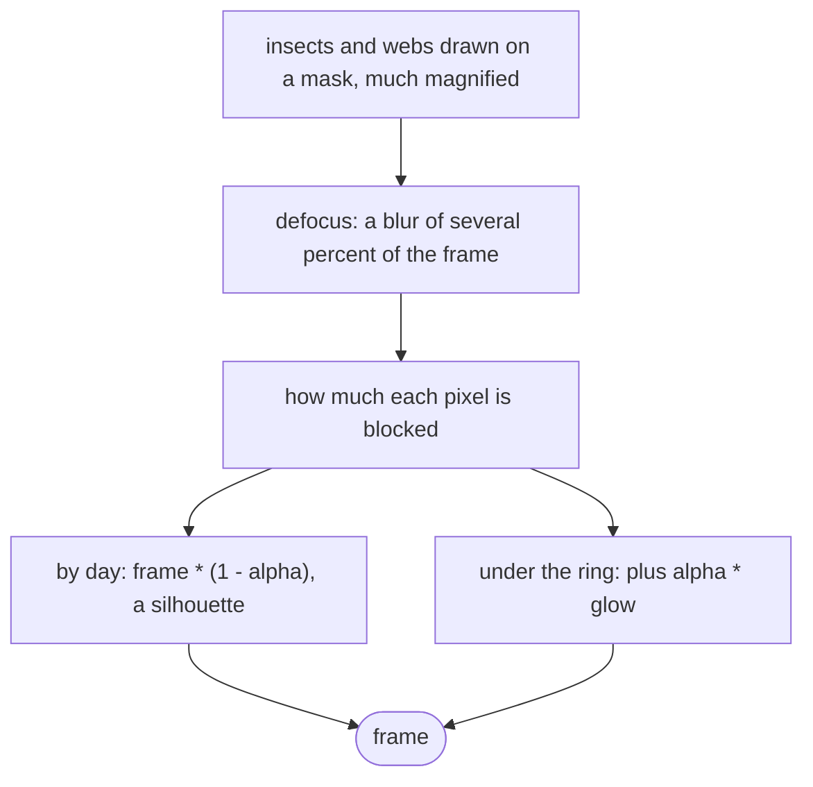

# `HousingOccluders`

> Insects and spider webs on the dome, far inside the near focus limit.

| | |
| --- | --- |
| Module | [`surmentations.lens.occluders`](../../src/surmentations/lens/occluders.py) |
| Stage | optics: on the glass or the housing |
| Needs depth | no |
| Annotations | untouched: the image only |

## Algorithm

## Model

Insects and spider webs on the camera housing.

### Physical model

This is a mundane, extremely common surveillance failure that no augmentation
pipeline simulates. Infrared illuminators attract insects, which land on and
walk across the dome directly in front of the lens; spiders follow the
insects and build webs across the housing, often anchored to the illuminator
ring itself. Both then sit a centimetre or two from the front element.

Two consequences follow from that distance, and they are what make these look
right rather than like stickers:

**They are wildly out of focus, and much larger than they sound.** An object
on the dome is far closer than any focus distance the lens can reach, so
nothing here has a hard edge. But the same short distance also *magnifies*
it enormously, and that is the part which is easy to get wrong. Take a 4 mm
lens with a 3 mm aperture and a dome 20 mm away: a 6 mm insect projects a
**160 px** image on a 640 px frame against an 80 px penumbra, so it reads as
a large, soft, substantially opaque blob. Size it as though it were a small
object in the scene and the blur swamps it into invisibility.

The same arithmetic explains why webs behave differently: a 0.1 mm strand
projects about 2 px against that same 80 px penumbra, so it is *correctly*
near-invisible by day. What makes a web show up is not its size but the
illuminator lighting it — which is the second point.

**Whether they are dark or bright depends on the illuminator, not the
object.** By day they are backlit against the scene and read as dark
silhouettes. At night the IR ring is *behind* them, a few centimetres away,
so they are lit far more strongly than anything in the scene and read as
bright glowing shapes. A web at night is the classic case: barely visible by
day, a blazing tangle of loops on the night feed. The same geometry produces
both, so one parameter — how strongly the near field is lit — covers it.

The webs here are lines, blurred. `SpiderWeb`
is a web as geometry, thread by thread at its own distance, and
`NightInsects` is the insect in
flight; this transform is what has settled on the dome.

## Parameters

| Parameter | Default | Meaning |
| --- | --- | --- |
| `insect_count_range` | `(0, 4)` | how many insects are on the dome. |
| `insect_size_range` | `(0.03, 0.16)` | body size as a fraction of the image diagonal. Large by default, and deliberately: an insect sitting on the dome is only centimetres from the lens, so it is magnified into a blob covering a good part of the frame. See the module docstring for the arithmetic. |
| `web_count_range` | `(0, 2)` | how many webs. |
| `web_radius_range` | `(0.06, 0.3)` | web radius as a fraction of the image diagonal. |
| `defocus_range` | `(0.01, 0.045)` | blur radius as a fraction of the diagonal. Large by construction — anything sitting on the housing is centimetres from a lens focused metres away, so this is not a softening but the dominant transformation of the shape. |
| `opacity_range` | `(0.5, 0.95)` | how much light the occluder blocks. |
| `glow_range` | `(0.0, 1.6)` | how brightly the occluder is lit from behind by the camera's own IR illuminator. 0 is daylight and they silhouette dark; high values are the night case, where the ring lights them far more strongly than the scene and they glow. |
| `p` | `0.5` | probability that the transform is applied |

## Samples

Severity 1 to 5, left to right, from the severity gallery.

`housing_occluders`

| 1 | 2 | 3 | 4 | 5 |
| --- | --- | --- | --- | --- |
|  |  |  |  |  |

## References

- Potmesil, M. and Chakravarty, I. (1981). A lens and aperture camera model for synthetic image generation. *ACM SIGGRAPH Computer Graphics* 15(3), 297-305. [doi:10.1145/965161.806818](https://doi.org/10.1145/965161.806818)
- Gu, J., Ramamoorthi, R., Belhumeur, P. and Nayar, S. (2009). Removing image artifacts due to dirty camera lenses and thin occluders. *ACM Transactions on Graphics* 28(5) (SIGGRAPH Asia). [doi:10.1145/1661412.1618490](https://doi.org/10.1145/1661412.1618490)

---

Generated by [`docs/make_transform_pages.py`](../make_transform_pages.py) from the source; edit the docstring or that script, not this page. [All transforms](README.md).
