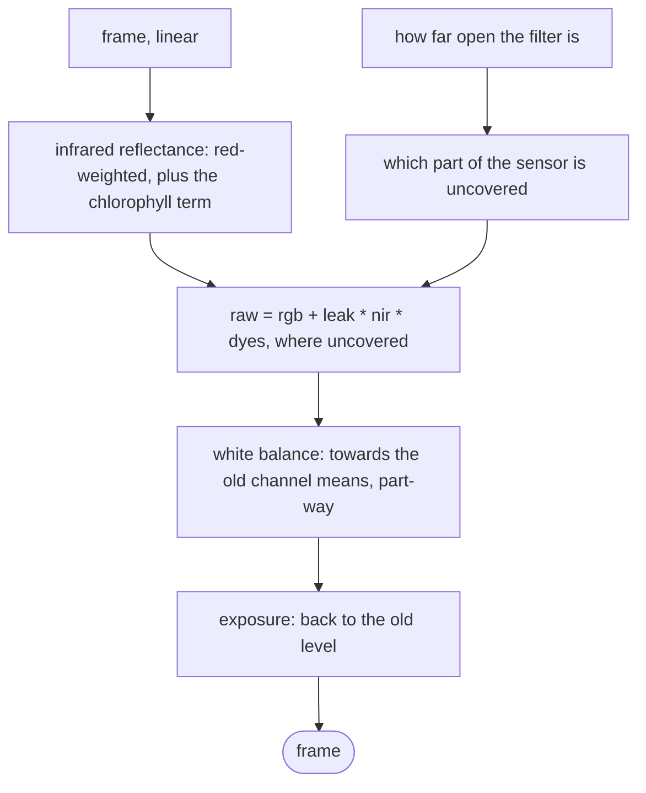
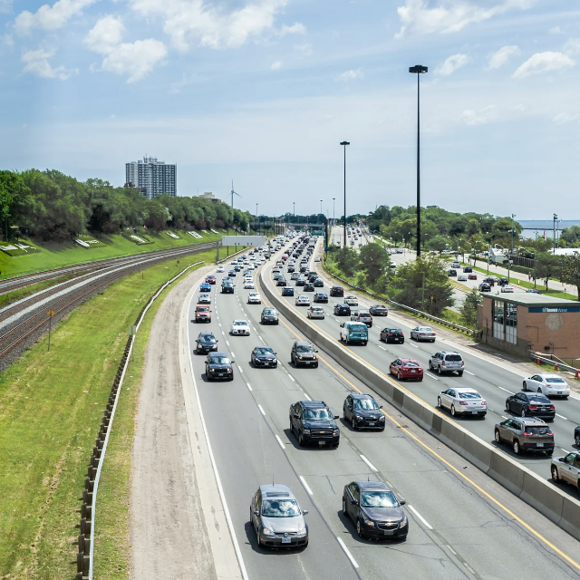
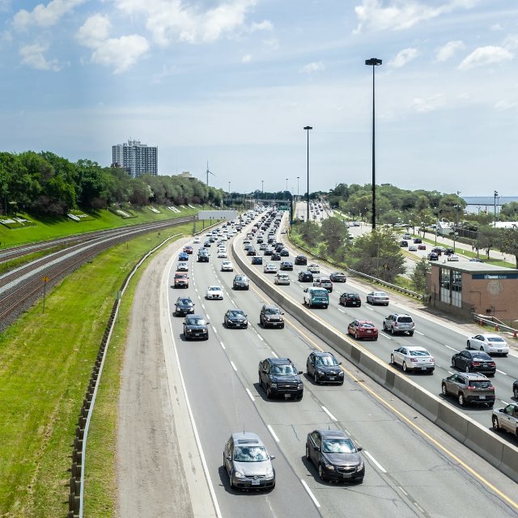
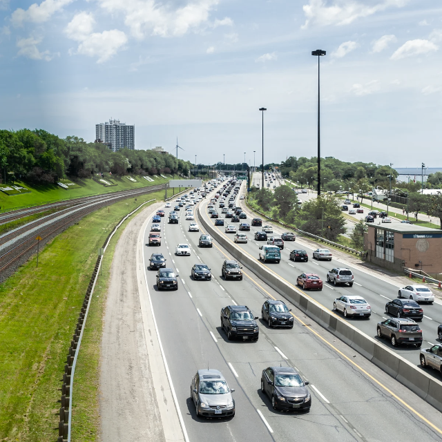
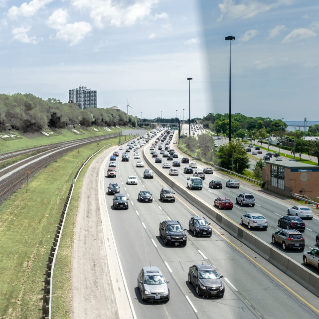
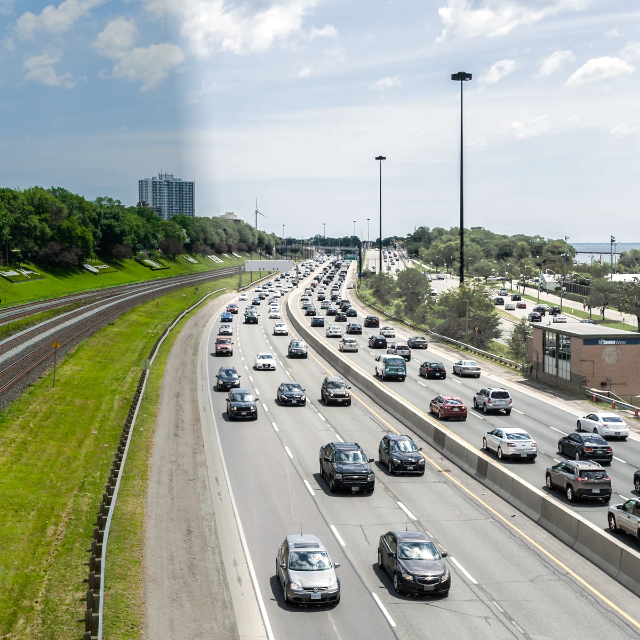

# `IrCutFilterFault`

> A colour picture taken with the infrared-cut filter stuck open.

| | |
| --- | --- |
| Module | [`surmentations.camera.ir_cut`](../../src/surmentations/camera/ir_cut.py) |
| Stage | sensor: day or night |
| Needs depth | no |
| Annotations | untouched: the image only |
| Tests | [`tests/unit/test_ir_cut.py`](../../tests/unit/test_ir_cut.py) |

## Algorithm

## Model

A day/night filter that has stuck open.

### Physical model

A silicon sensor sees to about 1000 nm, well past the red end of the
visible spectrum, and the dyes of its colour filters are all nearly clear
there. So a colour camera has an infrared-cut filter in front of the
sensor, and a day/night camera has one on a small motor: in place by day,
swung away at dusk so that the sensor can use the illuminator's light.

The motor is the camera's one moving part and it sticks. Stuck in place,
the night picture is black. Stuck open, the camera goes on producing a
colour picture by day with the near infrared added to all three channels,
and that is the fault this models, because it does not look like a fault
until one knows it:

**Every channel gains the same infrared signal, more or less.** Past
800 nm the red, green and blue filters pass much the same, so the infrared
image is added almost equally to all three: colours wash out. Red passes a
little more, so what is left is pink or purple.

**The infrared image is not the visible one.** Foliage reflects about half
of the near infrared and a twentieth of red, so trees and grass, dark
green by eye, gain most and turn pale, between pink and lavender. Black synthetic cloth and many
black plastics are bright in the infrared and turn purple-brown. Sky and
water are dark in it and keep their colour. The estimate of infrared
reflectance is `NightIrMode`'s.

**The camera then corrects what it can.** Auto-exposure brings the level
back down, and auto white balance takes out the cast on average. What
neither can undo is that the added signal follows a different picture: the
foliage stays pink against a scene that is otherwise nearly right.

**A filter stuck half-way covers half the sensor.** The edge of the filter
lies across the picture, blurred because it is just in front of the sensor
and not on it: one side normal, the other washed pink.

## Parameters

| Parameter | Default | Meaning |
| --- | --- | --- |
| `leak_range` | `(0.3, 1.0)` | how much infrared signal reaches the sensor, relative to the visible signal of a white surface. About 1 for a filter fully out of the way in sunlight. |
| `coverage_range` | `(0.5, 1.0)` | how much of the sensor is uncovered. One is a filter fully open; less is one stuck part-way, with its edge across the picture. |
| `white_balance_adaptation_range` | `(0.0, 0.8)` | how far the camera's auto white balance takes the cast back out, 0 to 1. At zero the picture keeps a pink cast overall; at one it is neutral on average and only what is bright in the infrared stays pink. |
| `vegetation_gain_range` | `(0.25, 0.7)` | how strongly foliage stands out in the infrared, as in `NightIrMode`. |
| `edge_softness_range` | `(0.02, 0.08)` | width of the blur of a half-open filter's edge, as a fraction of the diagonal. |
| `p` | `0.5` | probability that the transform is applied |

## Samples

Severity 1 to 5, left to right, from the severity gallery.

`ir_cut_filter_fault`

| 1 | 2 | 3 | 4 | 5 |
| --- | --- | --- | --- | --- |
|  |  |  |  |  |

## References

- Brown, M. and Süsstrunk, S. (2011). Multi-spectral SIFT for scene category recognition. *IEEE Conference on Computer Vision and Pattern Recognition (CVPR)*.
- Gates, D. M., Keegan, H. J., Schleter, J. C. and Weidner, V. R. (1965). Spectral properties of plants. *Applied Optics* 4(1), 11-20.

---

Generated by [`docs/make_transform_pages.py`](../make_transform_pages.py) from the source; edit the docstring or that script, not this page. [All transforms](README.md).
