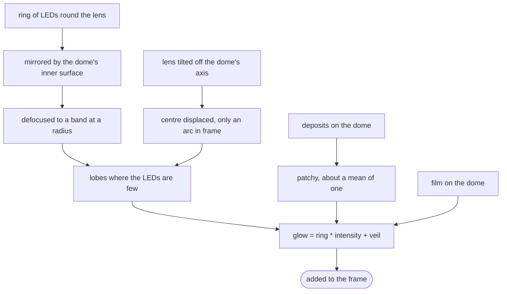

# `IrDomeGlare`

> The infrared ring reflected in a dome that is dirty or badly sealed.

| | |
| --- | --- |
| Module | [`surmentations.lens.dome_glare`](../../src/surmentations/lens/dome_glare.py) |
| Stage | lit by the camera's own lamp, after the infrared conversion |
| Needs depth | no |
| Annotations | untouched: the image only |
| Tests | [`tests/unit/test_dome_glare.py`](../../tests/unit/test_dome_glare.py) |

## Algorithm

## Model

The illuminator's own light, reflected in the dome.

### Physical model

A dome camera's LEDs and its lens sit under the same bubble of
polycarbonate. Most of the LEDs' light leaves through it; a few percent is
reflected by its inner surface, and more is scattered by whatever is on it:
dust, a film of dried rain, scratches. Some of that comes back into the
lens. Installers know it as IR bleed or IR reflection, and the foam gasket
around the lens of a dome camera is there to prevent it. When the gasket is
missing, perished or not seated, or the dome is dirty, the night picture
has a pale ring or arc of haze over it and the blacks are grey.

**It is a ring, because the lamp is.** The LEDs stand in a circle around
the lens, and the dome's inner surface mirrors them back as a circle. That
image is centimetres away, so it is far out of focus: a soft band, not a
row of points, though with few LEDs and a small stop the individual lamps
still show as lobes along it.

**It is usually an arc, because the lens is rarely centred.** A dome's
camera is tilted to look where it is needed, which puts the lens off the
dome's axis; the reflection moves across the frame and part of it leaves.
A crescent on one side is the usual picture.

**It is mottled, because the dome is dirty.** A clean surface reflects
evenly. Deposits scatter where they lie, so the band is patchy, and a film
over the whole dome adds an even veil that lifts the blacks everywhere.

It only adds light, in the sensor's terms, so it belongs after
`NightIrMode` with the other things the camera lights itself.

## Parameters

| Parameter | Default | Meaning |
| --- | --- | --- |
| `intensity_range` | `(0.08, 0.6)` | brightness of the reflected ring at its brightest, in units of full scale. |
| `ring_radius_range` | `(0.3, 0.9)` | radius of the ring, as a fraction of the frame's half-diagonal. |
| `ring_width_range` | `(0.06, 0.25)` | width of its band, the same way. Wide for a lens wide open, which blurs the reflection most. |
| `offset_range` | `(0.0, 0.5)` | how far the ring's centre is from the frame's, as a fraction of the half-diagonal: how far the lens is tilted off the dome's axis. |
| `arc_range` | `(0.2, 1.0)` | about how much of the ring is seen, 0 to 1. One is the whole ring; a quarter is a crescent. |
| `led_count_range` | `(4, 24)` | how many LEDs the ring has. |
| `led_contrast_range` | `(0.0, 0.7)` | how distinct the individual LEDs are along the band, 0 to 1. Zero is an even band. |
| `veil_range` | `(0.0, 0.06)` | an even haze over the whole frame, from a film on the dome, in units of full scale. |
| `dirt_range` | `(0.0, 0.6)` | how patchy the band is, 0 to 1, from deposits that scatter where they lie. |
| `p` | `0.5` | probability that the transform is applied |

## Samples

Severity 1 to 5, left to right, from the severity gallery.

`ir_dome_glare`

| 1 | 2 | 3 | 4 | 5 |
| --- | --- | --- | --- | --- |
|  |  |  |  |  |

## References

- Talvala, E.-V., Adams, A., Horowitz, M. and Levoy, M. (2007). Veiling glare in high dynamic range imaging. *ACM Transactions on Graphics* 26(3) (SIGGRAPH). [doi:10.1145/1275808.1276424](https://doi.org/10.1145/1275808.1276424)
- McCann, J. J. and Rizzi, A. (2007). Veiling glare: the dynamic range limit of HDR images. *Proceedings of SPIE* 6492, Human Vision and Electronic Imaging XII. [doi:10.1117/12.703042](https://doi.org/10.1117/12.703042)

---

Generated by [`docs/make_transform_pages.py`](../make_transform_pages.py) from the source; edit the docstring or that script, not this page. [All transforms](README.md).
