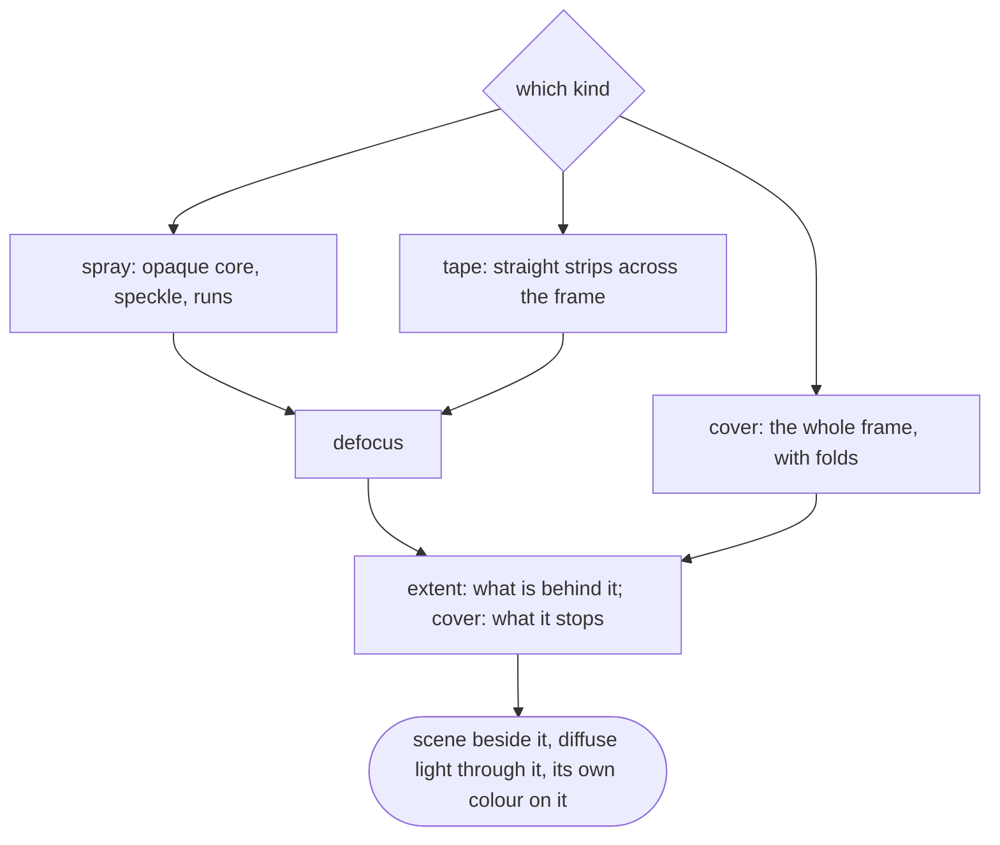
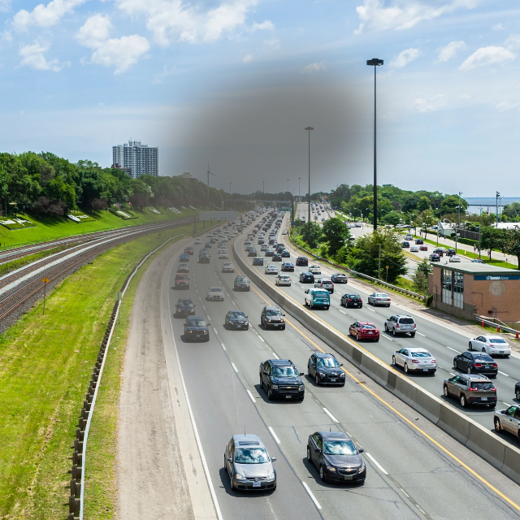
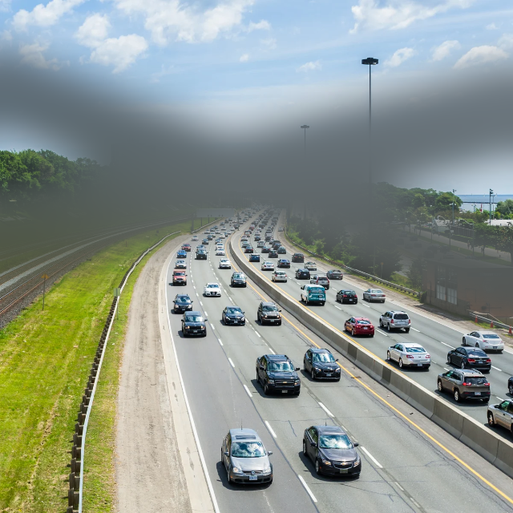
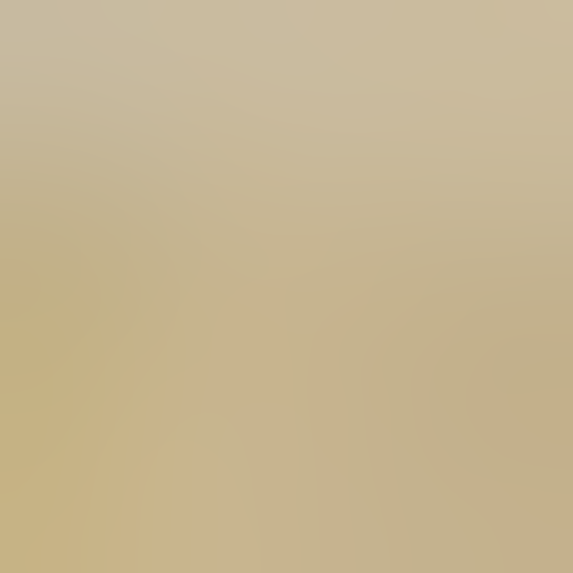
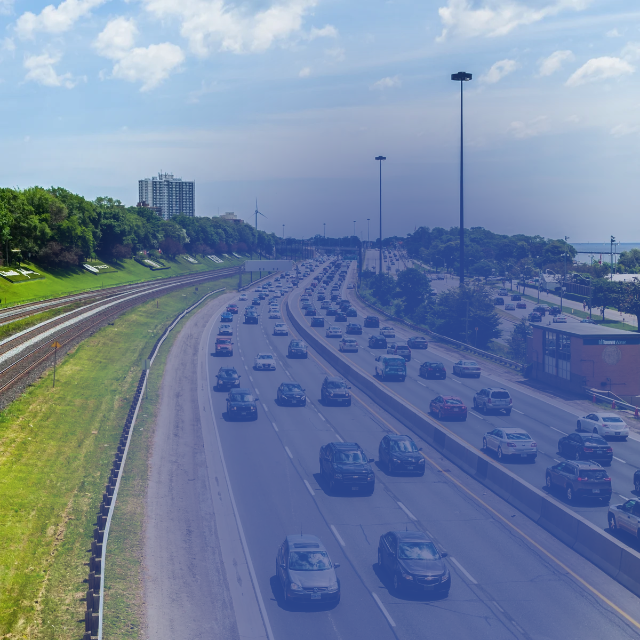
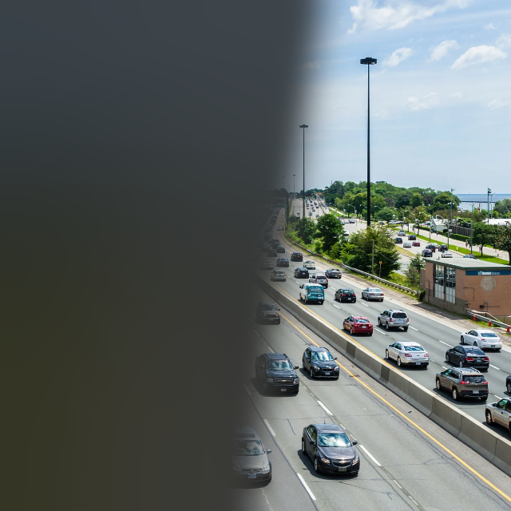

# `LensTamper`

> Paint sprayed on the lens, tape across it, or a cover over the housing.

| | |
| --- | --- |
| Module | [`surmentations.lens.tamper`](../../src/surmentations/lens/tamper.py) |
| Stage | optics: on the glass or the housing |
| Needs depth | no |
| Annotations | untouched: the image only |
| Tests | [`tests/unit/test_tamper.py`](../../tests/unit/test_tamper.py) |

## Algorithm

## Model

A lens that has been tampered with: sprayed, taped or covered.

### Physical model

Before a camera is stolen, or something is done that it should not see, it
is often blinded. Three ways account for nearly all of it, and they are the
cases a tamper detector is built to recognise:

* **Spray paint.** A burst from a can a hand's width away: an opaque core
  where the cone hit, thinning to a speckle of separate droplets around it,
  and runs where it went on thick enough to flow.
* **Tape or a sticker.** One or a few straight strips across the glass,
  opaque or nearly so, with clean parallel edges. What light a strip of
  masking tape lets through is diffused, as through a cover.
* **A cover.** A bag, a cloth or a cap over the whole housing. A little
  light comes through fabric or polythene, with no image in it, and the
  cover's folds show as slow changes in how much.

None of this is weather or optics, and only one thing about it is physics:
**it is on the housing**, so it is far out of focus. The edge of a strip of
tape is a gradient, the speckle of a spray merges into a haze, and what is
left is a soft shape of one colour, lit from behind the camera's point of
view: by day it is in its own shade and shows as its own colour, dimly; at
night the infrared ring lights it from centimetres away and anything that
is not black in the infrared glows.

This transform hides part or all of the scene by design. What a covered
object's annotation should then be is the caller's decision; the transform
leaves annotations alone.

## Parameters

| Parameter | Default | Meaning |
| --- | --- | --- |
| `kinds` | `('spray', 'tape', 'cover')` | which kinds of tampering to draw from, one a call: any of `"spray"`, `"tape"` and `"cover"`. |
| `coverage_range` | `(0.15, 0.8)` | how much of the frame paint or tape covers. A cover takes all of it whatever this says. |
| `opacity_range` | `(0.8, 1.0)` | how much light what is on the lens blocks. Paint and cloth are rarely quite opaque. |
| `defocus_range` | `(0.006, 0.03)` | blur of its outline, as a fraction of the diagonal. |
| `shade_range` | `(0.1, 0.5)` | how brightly it shows by day, as a share of what its colour would return in the open: it is seen from behind, in its own shade. |
| `glow_range` | `(0.0, 0.0)` | light it returns from the infrared ring, in units of full scale, for something white in the infrared; dark paint returns its share of that. Zero by day. |
| `p` | `0.5` | probability that the transform is applied |

## Samples

Severity 1 to 5, left to right, from the severity gallery.

`lens_tamper`

| 1 | 2 | 3 | 4 | 5 |
| --- | --- | --- | --- | --- |
|  |  |  |  |  |

## References

- Ribnick, E., Atev, S., Masoud, O., Papanikolopoulos, N. and Voyles, R. (2006). Real-time detection of camera tampering. *IEEE International Conference on Advanced Video and Signal Based Surveillance (AVSS)*.
- Saglam, A. and Temizel, A. (2009). Real-time adaptive camera tamper detection for video surveillance. *IEEE International Conference on Advanced Video and Signal Based Surveillance (AVSS)*.

---

Generated by [`docs/make_transform_pages.py`](../make_transform_pages.py) from the source; edit the docstring or that script, not this page. [All transforms](README.md).
