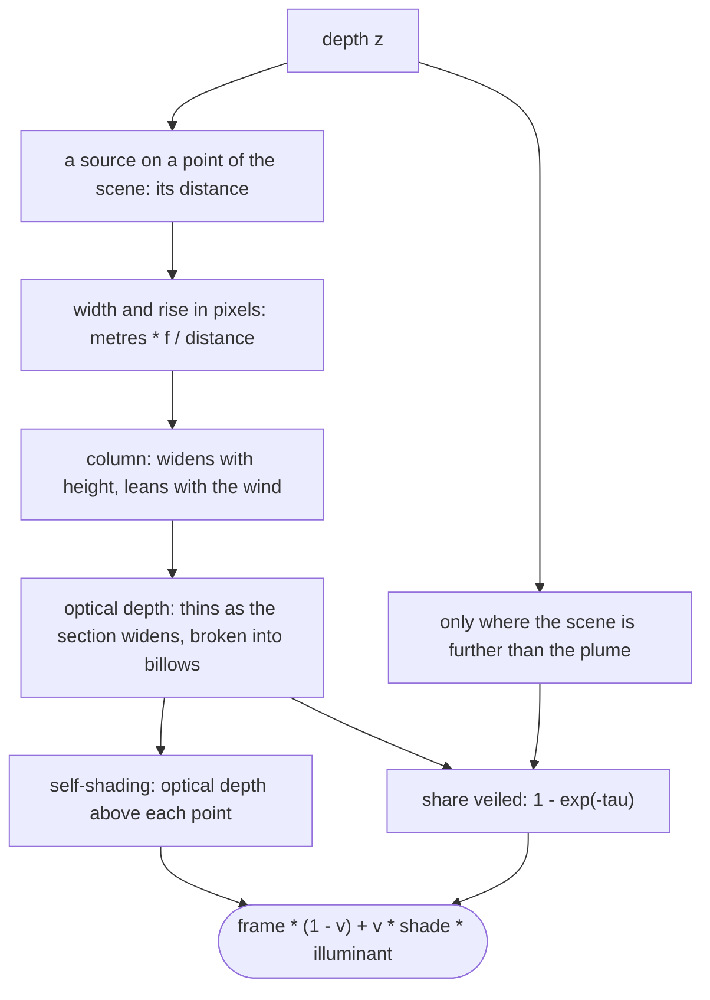
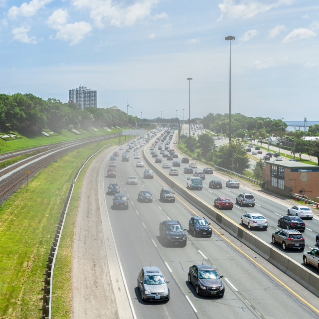
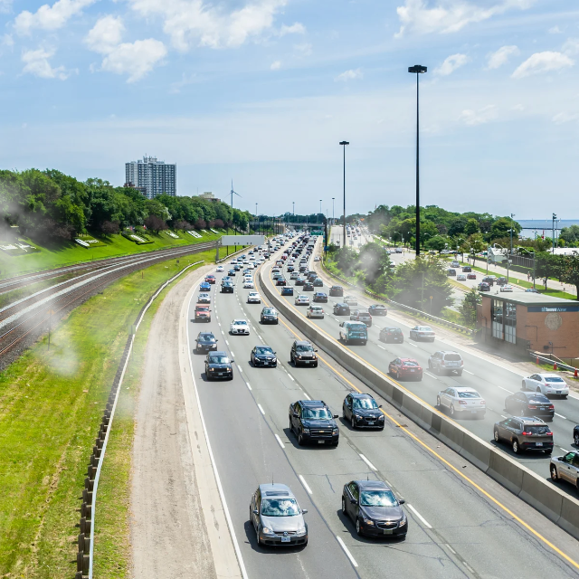
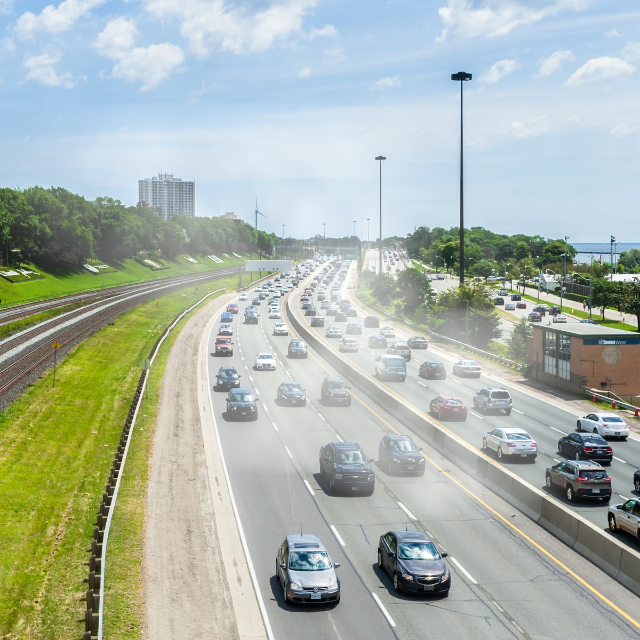
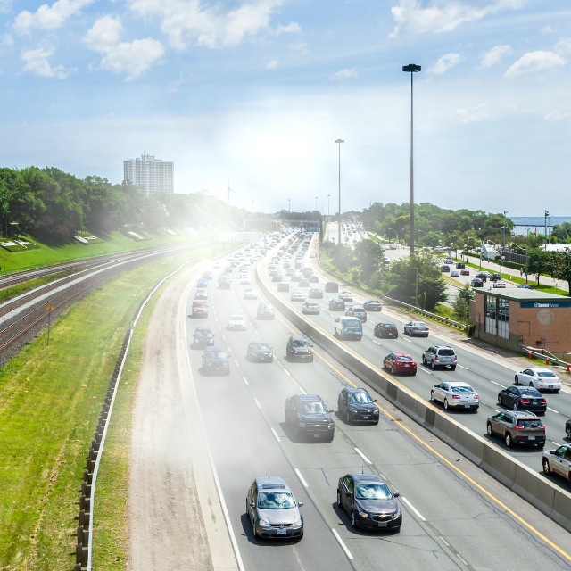
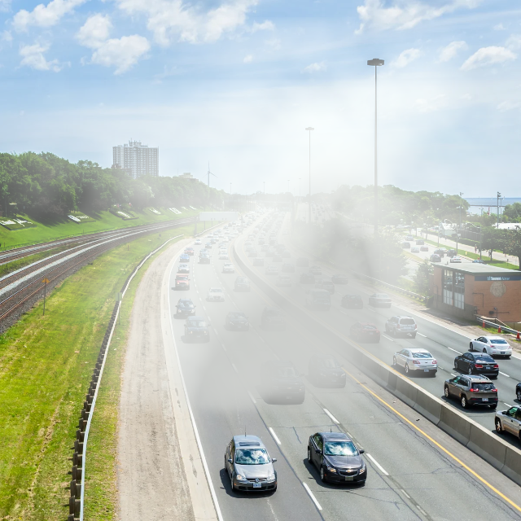

# `LocalPlumes`

> Plumes of steam or exhaust standing in the scene.

| | |
| --- | --- |
| Module | [`surmentations.atmosphere.plumes`](../../src/surmentations/atmosphere/plumes.py) |
| Stage | atmosphere |
| Needs depth | yes |
| Annotations | untouched: the image only |
| Tests | [`tests/unit/test_plumes.py`](../../tests/unit/test_plumes.py) |

## Algorithm

## Model

Steam and exhaust: fog in one place.

### Physical model

Cold weather puts small clouds into a street scene that no uniform fog
describes: steam from a manhole or a vent, the exhaust of an idling engine,
a boiler flue. Each is a plume: a volume of droplets a metre or so across
at its source, rising, spreading and thinning until it is gone a few
metres up, and leaning with whatever wind there is.

**It is somewhere.** A plume stands at one place on the ground, so it has
a distance. Its source is put on a point of the scene itself, read from
the depth map, and its width and height in pixels follow from metres at
that distance: the same vent is a wisp across the street and a wall beside
the camera.

**It hides only what is behind it.** A car nearer than the plume is in
front of it. Each pixel is veiled by the plume's optical depth there only
if the scene at that pixel is further away than the plume is.

**It spreads and thins as it rises.** The column widens with height and
the same water is spread over a wider section, so its optical depth falls
from the source up, and it ends by fading, not at an edge. Turbulence
breaks it into billows the size of its own width: a fractal noise
modulates the density and bends the column.

**It is white, and it shades itself.** Droplets scatter all colours alike
and absorb none. The plume takes the colour and level of the light
falling on it, estimated as for rain and snow from the frame;
`brightness_range` scales that, for exhaust in shadow or steam in the
sun. The light comes from above, through the plume's own upper part, so
each billow is brightest on top and greyer underneath by the optical
depth above it: what gives steam its modelling and stops it being a flat
white shape.

## Parameters

| Parameter | Default | Meaning |
| --- | --- | --- |
| `depth_provider` | required | one shared provider. |
| `plume_count_range` | `(1, 3)` | how many plumes. |
| `source_width_range_m` | `(0.3, 1.0)` | how wide a plume is where it starts. |
| `rise_range_m` | `(1.5, 5.0)` | how high it rises before it is gone. |
| `opacity_range` | `(0.4, 2.0)` | its optical depth through the middle at the source. At 1 it hides two thirds of what is behind it there; at 3, nearly all. |
| `lean_range` | `(-0.6, 0.6)` | how far it drifts sideways for each metre it rises: the wind. |
| `brightness_range` | `(0.3, 0.8)` | how bright the plume is, as a share of the light the frame is lit by. |
| `horizontal_fov_range_deg` | `(48.0, 78.0)` | field of view, which turns metres at the plume's distance into pixels. |
| `depth_scale` | `None` | pseudo-metres at relative depth 1, for this transform alone; `None` uses the provider's own far plane. |
| `p` | `0.5` | probability that the transform is applied |

## Samples

Severity 1 to 5, left to right, from the severity gallery.

`local_plumes`

| 1 | 2 | 3 | 4 | 5 |
| --- | --- | --- | --- | --- |
|  |  |  |  |  |

## References

- Morton, B. R., Taylor, G. I. and Turner, J. S. (1956). Turbulent gravitational convection from maintained and instantaneous sources. *Proceedings of the Royal Society A* 234, 1-23. [doi:10.1098/rspa.1956.0011](https://doi.org/10.1098/rspa.1956.0011)
- Narasimhan, S. G. and Nayar, S. K. (2002). Vision and the atmosphere. *International Journal of Computer Vision* 48(3), 233-254. [doi:10.1023/A:1016328200723](https://doi.org/10.1023/A:1016328200723)

---

Generated by [`docs/make_transform_pages.py`](../make_transform_pages.py) from the source; edit the docstring or that script, not this page. [All transforms](README.md).
