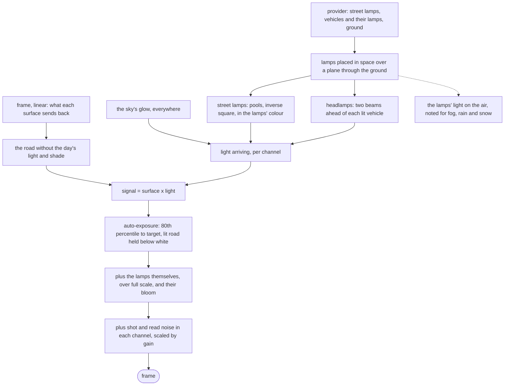

# `NightColorMode`

> A night in colour, lit by the scene's street lamps and its traffic.

| | |
| --- | --- |
| Module | [`surmentations.camera.night_color`](../../src/surmentations/camera/night_color.py) |
| Stage | optics: in the lens |
| Needs depth | yes |
| Annotations | untouched: the image only |

## Algorithm

## Model

Night in colour: the scene lit by its street lamps and its traffic.

### Physical model

Most cameras do not go to infrared at dusk. With a fast lens and a large
pixel they hold colour through an ordinary lit night, and a street at night
in colour is not a day frame turned down:

**It is lit from a few points.** Each street lamp throws a pool under
itself that falls off with the square of the distance, each vehicle throws
its beams, and between and beyond them there is only the glow of the sky.
A frame turned down is evenly dim, with the sun's shadows still in it.

**The light has a colour, and not one.** A high-pressure sodium lamp is a
black body of about 2100 K to a camera: orange, with almost no blue, and
under it a blue car is a grey one. A white LED is 3000 to 5700 K. A
headlamp is whiter than either and a tail lamp is red. The camera balances
for one of them, and everything lit by another has a cast.

**The lamps are in the frame.** They are far over full scale and bloom,
and the camera cannot expose for them and the road at once.

**The sensor is short of light.** It gains up, and the noise is in the
colour as much as in the brightness: each channel has its own.

Where the lamps are comes from the provider, as for
`NightIrMode`: its vehicle reader
finds the street lamps and the traffic's lamps
(`vehicles`), its scene labels say what is
ground and what is sky, and the light is worked out in space
(`night_lighting`). A provider that knows of no
lamps leaves the sky's glow alone to light the scene, which is a night
with no lighting at all: dim, even and noisy.

References:

* Elvidge, C. D., Keith, D. M., Tuttle, B. T., Baugh, K. E. (2010).
  Spectral Identification of Lighting Type and Character. Sensors 10(4),
  3961-3988. https://doi.org/10.3390/s100403961 (the spectra of sodium,
  metal halide and LED street lighting; the colour temperatures here are
  the round ones commonly quoted for each, not read off its tables)

## With scene labels and geometry

With a provider that carries scene labels
(`labels`) and a vehicle reader
(`vehicles`): the street lamps the reader
finds throw their pools in the lamps' own colour and burn, the
traffic's lamps are lit, white at the front and red at the rear, each
lit vehicle throws its beams, the road loses the day's light and shade,
and the sky is dark. With labels alone the nearest street lamps are
found from the lamp label. Without either there is nothing to say
where a lamp is, and the frame is lit by the sky's glow alone.

See [scene understanding](../scene_understanding.md).

## Parameters

| Parameter | Default | Meaning |
| --- | --- | --- |
| `depth_provider` | required | shared `SharedDepthProvider`. |
| `lamp_temperature_range_k` | `(1900.0, 5500.0)` | the colour temperature of the street lighting, drawn per call: one kind of lamp to a street. 1900 to 2200 K is high-pressure sodium, 2700 to 3000 K a warm LED, 4000 K a neutral one, 5000 K and over a cool one. |
| `street_lamp_range` | `(0.6, 1.4)` | how much light a street lamp throws on the road straight under it, in unit exposures, drawn per call; 0 is none. |
| `vehicle_lamp_range` | `(0.7, 1.3)` | how brightly the traffic's lamps are lit, drawn per call; 1 is dipped beams, 0 none. It needs a vehicle reader on the provider. |
| `sky_glow_range` | `(0.01, 0.05)` | the light of the night sky on everything, as a share of what a street lamp puts under itself, drawn per call. A few hundredths in a town; it is all the light there is where the provider knows of no lamps. |
| `target_level_range` | `(0.12, 0.3)` | the level the camera's auto-exposure drives the scene to, as a fraction of full scale at the 80th percentile. Once lamps light the scene it also holds the lit road below white, as a camera does. |
| `gain_range` | `(1.0, 3.0)` | sensor gain, which sets how far the noise is lifted and not how bright the frame is: the auto-exposure has placed that. |
| `read_noise_range` | `(0.004, 0.02)` | signal-independent noise per channel, as a fraction of full scale. |
| `p` | `0.5` | probability that the transform is applied |

## Samples

Severity 1 to 5, left to right, from the severity gallery.

`night_color`

| 1 | 2 | 3 | 4 | 5 |
| --- | --- | --- | --- | --- |
|  |  |  |  |  |

## References

- Elvidge, C. D., Keith, D. M., Tuttle, B. T. and Baugh, K. E. (2010). Spectral identification of lighting type and character. *Sensors* 10(4), 3961-3988. [doi:10.3390/s100403961](https://doi.org/10.3390/s100403961)
- Sun, B., Ramamoorthi, R., Narasimhan, S. G. and Nayar, S. K. (2005). A practical analytic single scattering model for real time rendering. *ACM SIGGRAPH 2005 Papers*, 1040-1049. [doi:10.1145/1186822.1073309](https://doi.org/10.1145/1186822.1073309)
- Yang, L., Kang, B., Huang, Z., Zhao, Z., Xu, X., Feng, J. and Zhao, H. (2024). Depth Anything V2. *Advances in Neural Information Processing Systems (NeurIPS)*. [link](https://arxiv.org/abs/2406.09414)

---

Generated by [`docs/make_transform_pages.py`](../make_transform_pages.py) from the source; edit the docstring or that script, not this page. [All transforms](README.md).
