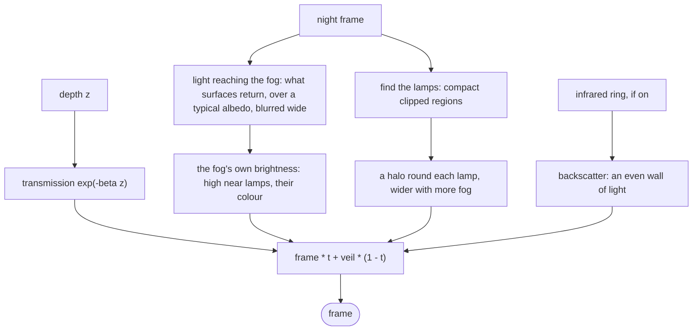
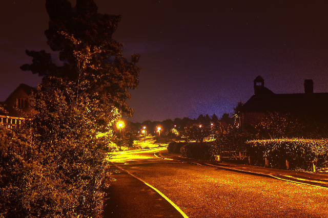
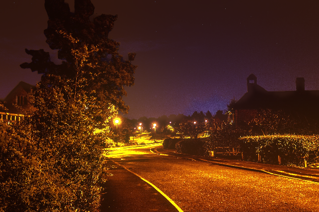
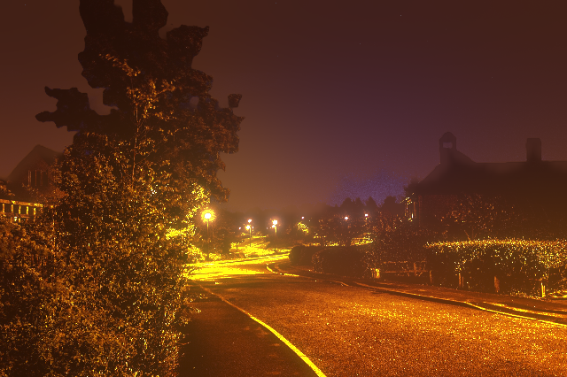
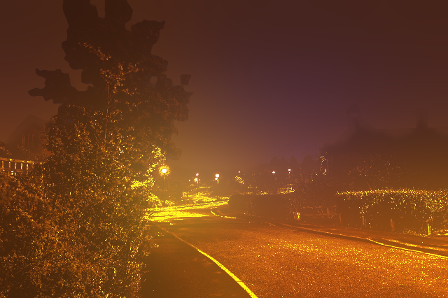

# `NightFog`

> Fog lit by the lamps in the frame, and optionally by the camera.

| | |
| --- | --- |
| Module | [`surmentations.atmosphere.night_fog`](../../src/surmentations/atmosphere/night_fog.py) |
| Stage | lit by the camera's own lamp, after the infrared conversion |
| Needs depth | yes |
| Annotations | untouched: the image only |

## Algorithm

## Model

Fog at night: light that stays near the lamps.

`RandomFog` is a daylight model. By day the fog is lit from everywhere by
the sky, so the light it scatters towards the camera is the same along every
line of sight and the result is a veil that thickens with distance. At night
there is no such light. The fog is lit by the lamps that are in it, and what
the camera sees is not a veil at all:

* **Everything is dimmed with distance**, as by day: `exp(-beta z)`.
* **The fog is lit where the lamps light it, and that is the veil.** A lamp
  lights the air under it as it lights the road, and fog is white: a thick
  bank of it under a lamp is brighter than the asphalt the same lamp falls
  on. So the frame does not fade to black with distance. It fades to the
  fog's own brightness, which is high near the lamps, takes their colour,
  and falls away into the dark between and above them. This is what makes
  a picture read as fog and not as a dim, soft copy of itself: the blacks
  lift, most where the light is.
* **Each lamp has a halo.** Fog droplets scatter strongly forward, so much
  of what leaves a lamp's direct beam is turned by a few degrees and still
  reaches the lens from a little to one side. The halo is wider and
  brighter relative to its core the more fog lies in between.
* **The camera's own illuminator lights the fog in front of it.** With the
  infrared ring on, the droplets nearest the lens scatter its light straight
  back. The `1/z^2` fall of the lamp and the `z^2` growth of the lit
  volume cancel, so this is an even wall of light across the beam that
  builds up over the first few metres and then saturates — the reason an
  infrared camera sees almost nothing in fog. The scene behind it is also
  attenuated twice, out and back.

Nobody tells the transform where the lamps are or how strong, so it reads
both off the frame. How much light reaches the fog in some part of the
picture is taken from the surfaces there: what they send back, divided by a
typical albedo, is what fell on them, blurred wide because the air a lamp
lights is a volume and not the patch of road under it. A clipped pixel is
counted as several times full scale, a lamp's recorded value being only a
lower bound.

An earlier version had only the halo, built by blurring whatever the fog
removed from the whole picture. With no veil that is a dimmed frame plus a
blurred copy of itself, and it looked like exactly that.

What it does not know about is a lamp outside the frame, which lights fog
inside it all the same.

## Parameters

| Parameter | Default | Meaning |
| --- | --- | --- |
| `depth_provider` | required | shared `SharedDepthProvider`. |
| `visibility_range_m` | `(40.0, 600.0)` | meteorological visibility, drawn per call on a log scale. 1000 m is mist, 200 m fog, 50 m dense fog. It has to be read against the provider's `depth_range_m`: 200 m of visibility does little to a scene 50 m deep. |
| `glow_radius_range` | `(0.02, 0.06)` | how far the glow round a light spreads, as a fraction of the image diagonal, for fog one optical depth thick. It widens with the fog in front of each light. |
| `illuminator_backscatter_range` | `(0.0, 0.0)` | brightness of the wall of light the camera's own illuminator raises in the fog, relative to full scale. Zero — the default — means the illuminator is off. Set it only for frames in infrared mode, and apply this transform *after* `NightIrMode`; the shipped pipelines do both. |
| `beam_falloff_range` | `(0.6, 2.2)` | how sharply the illuminator's beam dims off-axis. |
| `visibility_range_scene` | `None` | visibility as a multiple of the scene's depth, in place of `visibility_range_m`: the same fog on a courtyard and on a long street. See `RandomFog`. `None`, the default, uses `visibility_range_m`. |
| `p` | `0.5` | probability that the transform is applied |

## Samples

Severity 1 to 5, left to right, from the severity gallery.

`night_fog`

| 1 | 2 | 3 | 4 | 5 |
| --- | --- | --- | --- | --- |
|  |  |  |  |  |

## References

- Koschmieder, H. (1924). Theorie der horizontalen Sichtweite. *Beiträge zur Physik der freien Atmosphäre* 12, 33-53. [link](https://library.metoffice.gov.uk/portal/Default/en-GB/RecordView/Index/457195)
- Narasimhan, S. G. and Nayar, S. K. (2003). Shedding light on the weather. *IEEE Conference on Computer Vision and Pattern Recognition (CVPR)*, I-665-I-672. [doi:10.1109/CVPR.2003.1211417](https://doi.org/10.1109/CVPR.2003.1211417)
- Narasimhan, S. G. and Nayar, S. K. (2002). Vision and the atmosphere. *International Journal of Computer Vision* 48(3), 233-254. [doi:10.1023/A:1016328200723](https://doi.org/10.1023/A:1016328200723)

---

Generated by [`docs/make_transform_pages.py`](../make_transform_pages.py) from the source; edit the docstring or that script, not this page. [All transforms](README.md).
