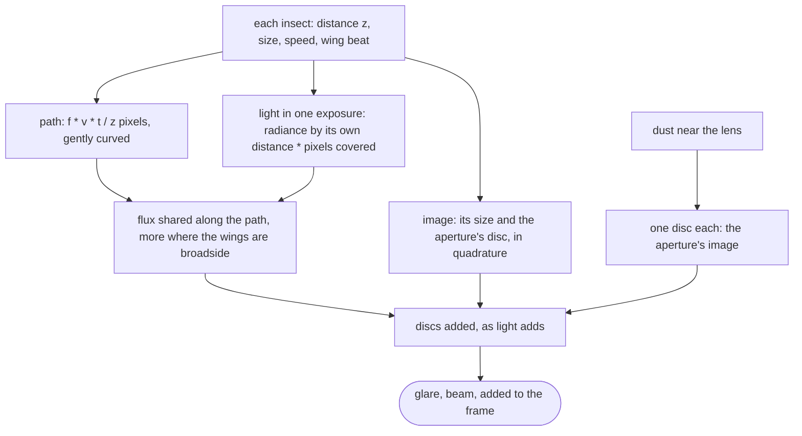

# `NightInsects`

> Insects flying through the illuminator's beam, and dust hanging in it.

| | |
| --- | --- |
| Module | [`surmentations.atmosphere.night_insects`](../../src/surmentations/atmosphere/night_insects.py) |
| Stage | lit by the camera's own lamp, after the infrared conversion |
| Needs depth | no |
| Annotations | untouched: the image only |
| Tests | [`tests/unit/test_night_insects.py`](../../tests/unit/test_night_insects.py) |

## Algorithm

## Model

Insects and dust in the illuminator's beam.

### Physical model

An infrared ring is a lamp, and a lamp at night collects insects. They fly
through the first metre or two in front of the lens, lit from centimetres
away against a scene lit from metres, so each is far brighter than anything
behind it. Recorders that trigger on motion fill up with them, and the
streaks they leave are common enough to have a folk name, "rods".

Three things make the picture, all of them consequences of where the insect
is and how long the shutter is open:

**It is a streak, because it moves.** A night camera exposes for 1/50 to
1/25 s. A moth at 1.5 m/s half a metre away crosses 60 to 120 px of a
640 px frame in that time, several times its own image, so what is recorded
is its path. The light it returns in the exposure is fixed, so the longer
the streak the dimmer each part of it: flux is conserved along the path.

**The streak is beaded, because the wings beat.** A wing broadside to the
lamp returns far more light than one edge-on, so the light along the path
rises and falls once a beat. A moth at 40 Hz makes one to two beats in an
exposure; a midge at 250 Hz makes ten. That modulation, on a streak, is the
"rod" with its row of lobes.

**It is out of focus, and lit by its own distance.** A point of it is drawn
as the aperture's disc, `A f / 2z` pixels in radius, so a near insect is a
broad soft band and a far one a fine line; and its brightness follows the
lamp's inverse square at *its* distance, not the depth of what is behind
it, which is the same correction `NightRain` and `NightSnow` make.

**Dust is the same thing, standing still.** A mote a few centimetres from
the lens is an unresolved point: it is drawn as the aperture's disc and
nothing else, a faint round "orb" that drifts too slowly to streak.

Composition: after `NightIrMode`, with the other things the camera lights
itself.

## Parameters

| Parameter | Default | Meaning |
| --- | --- | --- |
| `insect_count_range` | `(1, 10)` | how many insects cross the view in one exposure. |
| `body_length_range_mm` | `(2.0, 25.0)` | their size, midge to large moth. |
| `distance_range_m` | `(0.15, 4.0)` | how far from the lens they fly. Drawn evenly in the logarithm, so near ones are as common as far ones, as they are around a lamp. |
| `flight_speed_range_m_s` | `(0.3, 3.0)` | how fast, which with the shutter time and the distance gives the streak's length. |
| `wing_beat_range_hz` | `(20.0, 250.0)` | wing-beat frequency: about 30 for a moth, hundreds for a midge. With the shutter time it gives the number of lobes along the streak. |
| `wing_share_range` | `(0.3, 0.9)` | how much of an insect's light comes from its wings and so rises and falls with the beat, 0 to 1. |
| `dust_count_range` | `(0, 25)` | motes of dust near the lens, each one faint disc. |
| `dust_brightness_range` | `(0.02, 0.2)` | brightness of a mote's disc 10 cm from the lens, in units of full scale. |
| `illuminator_gain_range` | `(0.6, 3.0)` | radiance of an insect one metre away, in units of full scale. An insect at 10 cm is some eighty times that, and clips. |
| `beam_falloff_range` | `(0.6, 2.2)` | how sharply the beam dims off-axis. |
| `exposure_time_range` | `(0.02, 0.04)` | shutter time. |
| `horizontal_fov_range_deg` | `(48.0, 78.0)` | field of view, which projects metres to pixels. |
| `aperture_diameter_range_mm` | `(0.9, 2.6)` | the lens's stop, which a point out of focus is drawn as. |
| `focus_distance_range_m` | `(8.0, 40.0)` | where the lens is focused. |
| `glare_range` | `(0.05, 0.25)` | fraction of the light that the dome and the lens scatter into a glow around it. |
| `p` | `0.5` | probability that the transform is applied |

## Samples

Severity 1 to 5, left to right, from the severity gallery.

`night_insects`

| 1 | 2 | 3 | 4 | 5 |
| --- | --- | --- | --- | --- |
|  |  |  |  |  |

## References

- Greenewalt, C. H. (1962). Dimensional relationships for flying animals. *Smithsonian Miscellaneous Collections* 144(2). [link](https://librarycatalog.ecu.edu/catalog/62078)
- Fabian, S. T. et al. (2024). Why flying insects gather at artificial light. *Nature Communications* 15, 689. [doi:10.1038/s41467-024-44785-3](https://doi.org/10.1038/s41467-024-44785-3)
- Potmesil, M. and Chakravarty, I. (1981). A lens and aperture camera model for synthetic image generation. *ACM SIGGRAPH Computer Graphics* 15(3), 297-305. [doi:10.1145/965161.806818](https://doi.org/10.1145/965161.806818)

---

Generated by [`docs/make_transform_pages.py`](../make_transform_pages.py) from the source; edit the docstring or that script, not this page. [All transforms](README.md).
