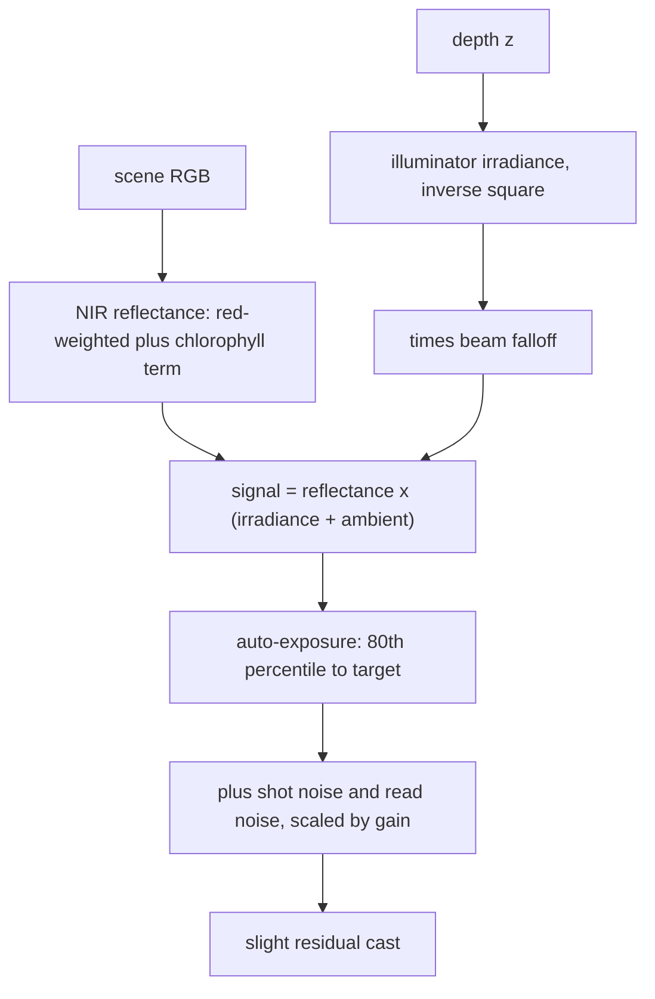
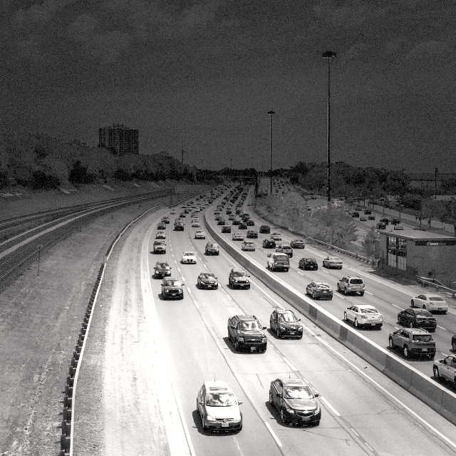
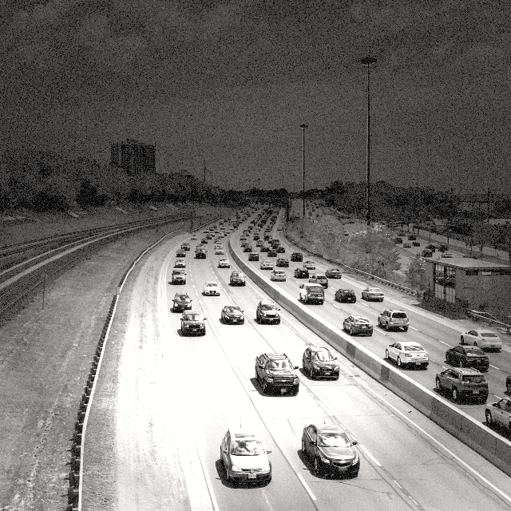
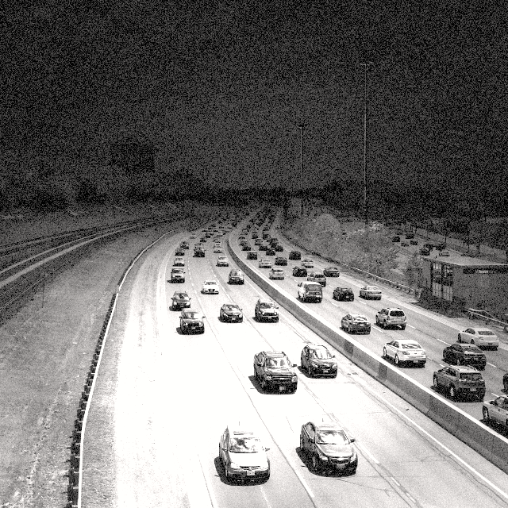
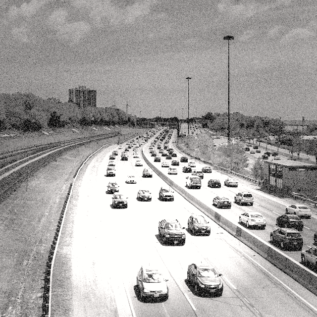
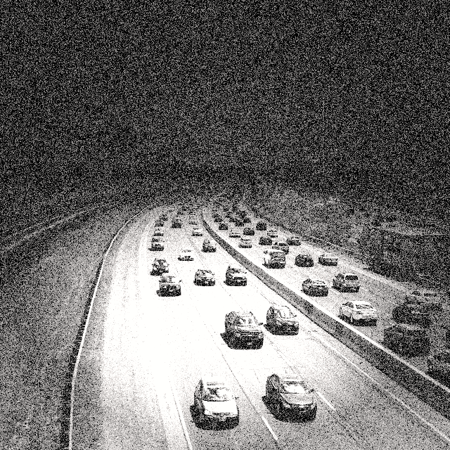

# `NightIrMode`

> Monochrome IR night mode with the camera's own illuminator.

| | |
| --- | --- |
| Module | [`surmentations.camera.night_ir`](../../src/surmentations/camera/night_ir.py) |
| Stage | sensor: day or night |
| Needs depth | yes |
| Annotations | untouched: the image only |

## Algorithm

## Model

Night mode: IR-cut filter removed, scene lit by the camera's own illuminator.

### Physical model

A day/night camera swings its IR-cut filter out of the optical path after
dark and switches on a ring of 850 nm LEDs around the lens. Three things
change at once, and none of them is "the image gets darker":

**The image goes monochrome, and not by luminance.** Silicon is sensitive
well past 700 nm, and all three Bayer dyes transmit there, so every channel
sees mostly the same infrared signal and the colour collapses. But what it
collapses *to* is near-infrared **reflectance**, which is not the visible
brightness of a material. The largest discrepancy is vegetation: chlorophyll
absorbs red strongly and reflects NIR strongly — the "red edge" at ~700 nm —
so foliage that reads dark green by day is among the *brightest* things in
frame at night. Converting to luminance gets this exactly backwards, which is
the single most visible error in a naive night-mode augmentation.

We have no NIR channel to read, so reflectance is estimated from RGB: a broad
red-weighted response (silicon's sensitivity rises toward the red end) plus
an explicit boost where the pixel is green relative to red, which is where
chlorophyll is. It is an approximation, and it is calibrated to reproduce the
one large, well-known material difference rather than to be spectrally exact.

**The scene is lit by the camera, not by the sun.** The illuminator sits at
the lens, so irradiance falls as `1/z^2` and is shaped by the LED beam
profile. This is why night CCTV looks the way it does: a subject at two
metres is blown to featureless white while the background five metres behind
is nearly black, and no exposure setting fixes it, because the ratio is 6:1
in the illumination itself. Getting the inverse-square right is what produces
that automatically instead of having to paint it on.

**Gain goes up, so noise does.** Shot noise scales with the square root of
the signal and read noise does not scale at all, so a gained-up dark frame is
noisiest in the shadows — not uniformly noisy.

## With scene labels and geometry

With a provider that carries scene labels
(`labels`): vegetation is lifted by
name as well as by colour, so a tree is bright in the near infrared in
shade, in autumn and under a sodium lamp too; and the sky, which
reflects neither the illuminator nor the ambient light, is dark. Where
the camera's height is known the illuminator's inverse-square law runs
over real metres, and a scene beyond its reach is lit by the ambient
term alone.

See [scene understanding](../scene_understanding.md).

## Parameters

| Parameter | Default | Meaning |
| --- | --- | --- |
| `depth_provider` | required | shared `SharedDepthProvider`. |
| `illuminator_range_m` | `(4.0, 14.0)` | distance at which the illuminator delivers unit exposure. Objects nearer than this blow out, objects further fade into the noise — and the `1/z^2` between them is why night CCTV has such a narrow band of usable distance. |
| `beam_falloff_range` | `(1.0, 4.0)` | how tightly the LED beam is focused. Higher concentrates light on the optical axis and darkens the corners further; the exponent of a `cos^k` beam profile. |
| `ambient_range` | `(0.01, 0.12)` | residual scene lighting (moon, streetlights, spill) as a fraction of unit exposure, so the far field is not pure black. |
| `vegetation_gain_range` | `(0.25, 0.7)` | how strongly foliage lifts relative to a plain broad-band conversion — the chlorophyll red-edge term. |
| `target_level_range` | `(0.35, 0.6)` | level the camera's auto-exposure drives the scene to, as a fraction of full scale measured at the 80th percentile. This is not a cosmetic normalisation — a night camera really does gain up until the scene is usable, and without modelling it the result depends entirely on how the depth map happened to be scaled: pick an illuminator range slightly too short and the whole lower frame saturates. Auto-exposure fixes the *level* while leaving the `1/z^2` **ratio** between near and far intact, and that ratio is the part that makes night footage recognisable. |
| `gain_range` | `(0.8, 1.6)` | sensor gain, which sets how far the noise floor is lifted. It does not scale the signal: the auto-exposure has already placed that, and gain is one of the levers it used to get there. Higher gain therefore means a noisier frame at the same brightness, which is what raising ISO actually buys you. |
| `read_noise_range` | `(0.004, 0.03)` | signal-independent noise, as a fraction of unit exposure. Unlike shot noise this does not shrink in the shadows, which is why a gained-up night frame is noisiest where it is darkest. |
| `residual_tint` | `0.04` |  |
| `p` | `0.5` | probability that the transform is applied |

## Samples

Severity 1 to 5, left to right, from the severity gallery.

`night_ir`

| 1 | 2 | 3 | 4 | 5 |
| --- | --- | --- | --- | --- |
|  |  |  |  |  |

## References

- Gates, D. M., Keegan, H. J., Schleter, J. C. and Weidner, V. R. (1965). Spectral properties of plants. *Applied Optics* 4(1), 11. [doi:10.1364/AO.4.000011](https://doi.org/10.1364/AO.4.000011)
- Brown, M. and Süsstrunk, S. (2011). Multi-spectral SIFT for scene category recognition. *IEEE Conference on Computer Vision and Pattern Recognition (CVPR)*. [doi:10.1109/CVPR.2011.5995637](https://doi.org/10.1109/CVPR.2011.5995637)
- European Machine Vision Association. *EMVA Standard 1288: Standard for Characterization of Image Sensors and Cameras*. [link](https://www.emva.org/standards-technology/emva-1288/)
- Yang, L., Kang, B., Huang, Z., Zhao, Z., Xu, X., Feng, J. and Zhao, H. (2024). Depth Anything V2. *Advances in Neural Information Processing Systems (NeurIPS)*. [link](https://arxiv.org/abs/2406.09414)

---

Generated by [`docs/make_transform_pages.py`](../make_transform_pages.py) from the source; edit the docstring or that script, not this page. [All transforms](README.md).
