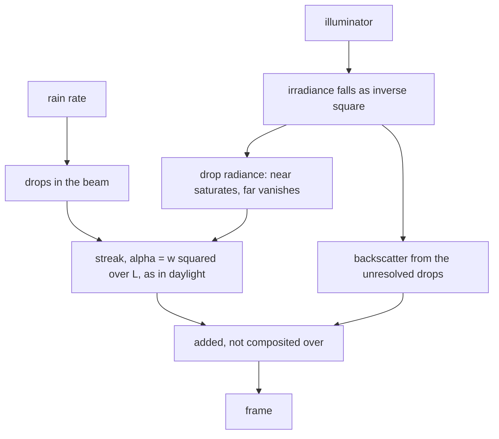
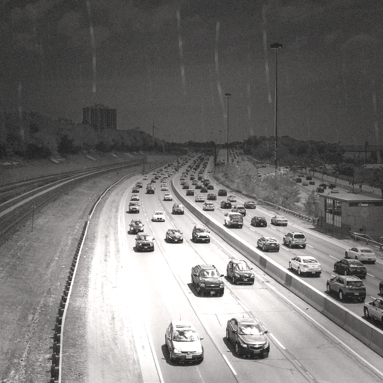
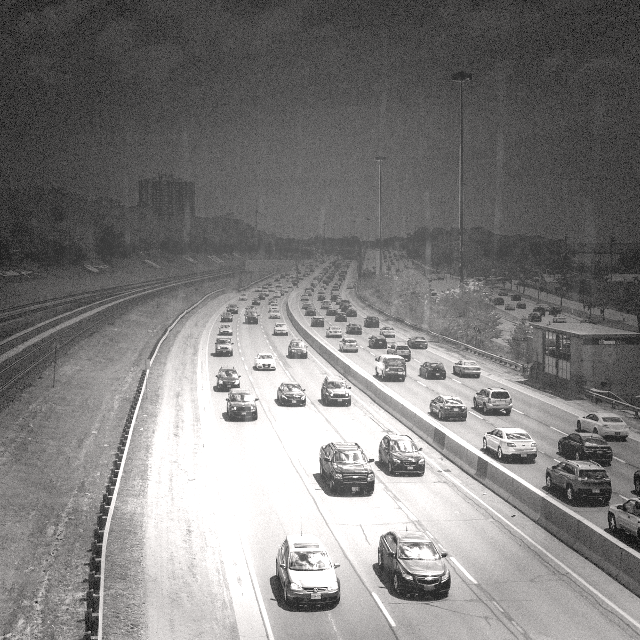
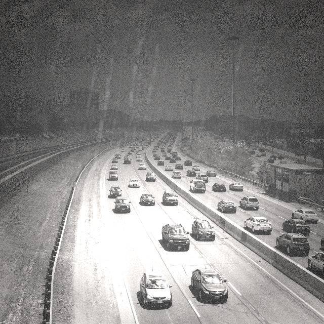
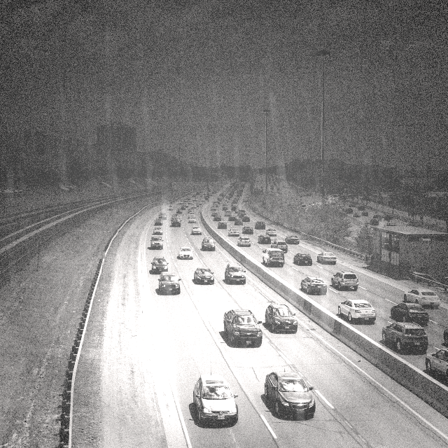
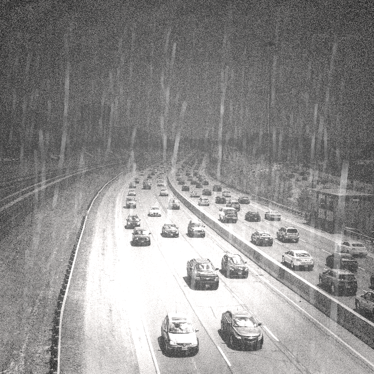

# `NightRain`

> Rain streaks lit by the camera's infrared illuminator.

| | |
| --- | --- |
| Module | [`surmentations.atmosphere.night_rain`](../../src/surmentations/atmosphere/night_rain.py) |
| Stage | lit by the camera's own lamp, after the infrared conversion |
| Needs depth | no |
| Annotations | untouched: the image only |
| Tests | [`tests/unit/test_night_rain.py`](../../tests/unit/test_night_rain.py) |

## Algorithm

## Model

Rain lit by the camera's own infrared illuminator.

This is the case everyone pictures when they picture rain on CCTV, and it is
the only one in which rain reliably reads as *streaks* rather than as haze and
a wet road. `docs/rain_visibility.md` measures why: in daylight a streak
takes the sky's radiance and lifts the pixels it crosses by about 8 sRGB
levels, against 17 levels of the asphalt's own texture, so a physically
correct streak is half a sigma into the background and cannot be seen.

At night nothing about the drop changes. What changes is both terms of the
contrast:

* **The drop is lit by the camera**, not by the sky. The illuminator's
  irradiance falls as `1/z^2`, so a drop at 0.5 m receives a hundred times
  what one at 5 m does. Near drops become far brighter than anything in the
  scene instead of matching it.
* **The background is dark.** A night frame's road sits near the bottom of
  the range, so the same absolute lift is a much larger relative one.

Together those turn the 8-level lift into a saturated streak, which is why
the effect is dramatic in IR footage and absent in daylight. Nothing here
raises the amount of light the physics gives a drop; it puts the light
somewhere it can be seen.

Two further consequences worth having, both visible in real footage:

* **Long streaks.** A night camera runs a long shutter — 1/25 to 1/50 s is
  normal where daylight would use 1/500 — so streaks are tens of pixels long
  rather than ten. The opacity drops in proportion (`alpha = w^2/L`), but
  against a dark background there is contrast to spare.
* **Backscatter.** The illuminator lights the whole near column, not only the
  drops that resolve, and that unresolved rain scatters light straight back
  into the lens. It is the same veil daylight rain has, except lit from the
  camera, so it is brightest at the centre of the beam and falls off with it —
  the "wall of light" that makes an IR camera nearly useless in heavy rain.

Composition: this belongs **after** `NightIrMode`, not before it. The
streaks are already in infrared terms — the illuminator lit them and the
sensor sees them directly — so running them through the scene's
reflectance-to-IR conversion would convert them twice.

## Parameters

| Parameter | Default | Meaning |
| --- | --- | --- |
| `rain_rate_range_mm_h` | `(5.0, 90.0)` | precipitation rate, which fixes the drop-size distribution and hence how many drops are in the beam. |
| `drop_diameter_range_mm` | `(0.8, 6.0)` | truncation window for the distribution. |
| `dsd_shape_mu` | `0.0` | `0` for Marshall & Palmer's exponential, 2-4 for Ulbrich's gamma. See `RandomRain`. |
| `distance_range_m` | `(0.25, 12.0)` | the column of air the illuminator lights. Its near bound matters more here than in daylight, because `1/z^2` makes the nearest drops the whole effect. |
| `illuminator_range_m` | `(4.0, 14.0)` | how far the lamp throws. Drops beyond it are unlit and effectively invisible, which is what limits the depth of the visible rain. |
| `beam_falloff_range` | `(0.6, 2.2)` | how sharply the beam dims off-axis. An IR ring around the lens is fairly even; a single lamp is not. |
| `exposure_time_range` | `(0.02, 0.04)` | shutter time. Defaults to the 1/50-1/25 s a night camera actually uses, which is what makes the streaks long. |
| `illuminator_gain_range` | `(1.5, 6.0)` | radiance a drop at 1 m returns to the sensor, in units of full scale. This is what makes night rain visible and daylight rain not: a drop lit by the lamp is *brighter than anything in the scene* rather than matching the sky, so with the `1/z^2` term a drop at 0.4 m saturates while one at 4 m is invisible. Values near 1 give a restrained drizzle; the upper end gives the hard white streaks of heavy rain in a strong beam. |
| `backscatter_range` | `(0.02, 0.14)` | strength of the glow from the unresolved drops the beam lights. 0 disables it; heavy rain in a strong beam approaches the upper end and washes the frame out, as it does in reality. |
| `backscatter_grain_range` | `(0.7, 1.2)` | how much of its grain that glow keeps, drawn per call. At 0 it is an even wall of light, as it was. At 1 it varies as a count of drops does: what comes back from the air just beyond the last streak drawn is half of it, and there a pixel looks through a handful of them, so the glow is a fine streaked grain that thins into evenness with distance. See `far_field_texture`. |
| `lamp_cone_range` | `(0.6, 1.4)` | how strongly the rain shows in the light of the scene's lamps, drawn per call; 0 is not at all. It does something on a frame that `NightIrMode` or `NightColorMode` made a night of with a provider that knows where its lamps are: the rain is lit in a cone under each street lamp and in a wedge ahead of each headlamp, and dark elsewhere, which is how rain at night is mostly seen. See `lamp_cones`. |
| `horizontal_fov_range_deg` | `(48.0, 78.0)` | field of view, used to project drop sizes and distances into pixels. |
| `aperture_diameter_range_mm` | `(0.9, 2.6)` | aperture, which sets the circle of confusion for drops far from the focal plane. |
| `focus_distance_range_m` | `(8.0, 40.0)` | where the lens is focused. |
| `wind_angle_range` | `(-14.0, 14.0)` | fall direction from vertical, in degrees. |
| `max_streaks` | `16000` | render budget. |
| `min_streak_width_px` | `0.35` | resolvability cut, in projected width. |
| `p` | `0.5` | probability that the transform is applied |

## Samples

Severity 1 to 5, left to right, from the severity gallery.

`night_rain`

| 1 | 2 | 3 | 4 | 5 |
| --- | --- | --- | --- | --- |
|  |  |  |  |  |

## References

- Garg, K. and Nayar, S. K. (2007). Vision and rain. *International Journal of Computer Vision* 75(1), 3-27. [doi:10.1007/s11263-006-0028-6](https://doi.org/10.1007/s11263-006-0028-6)
- Marshall, J. S. and Palmer, W. McK. (1948). The distribution of raindrops with size. *Journal of Meteorology* 5, 165-166. [doi:10.1175/1520-0469(1948)005&lt;0165:TDORWS&gt;2.0.CO;2](https://doi.org/10.1175/1520-0469%281948%29005%3C0165:TDORWS%3E2.0.CO;2)
- Gunn, R. and Kinzer, G. D. (1949). The terminal velocity of fall for water droplets in stagnant air. *Journal of Meteorology* 6, 243-248. [doi:10.1175/1520-0469(1949)006&lt;0243:TTVOFF&gt;2.0.CO;2](https://doi.org/10.1175/1520-0469%281949%29006%3C0243:TTVOFF%3E2.0.CO;2)

---

Generated by [`docs/make_transform_pages.py`](../make_transform_pages.py) from the source; edit the docstring or that script, not this page. [All transforms](README.md).
