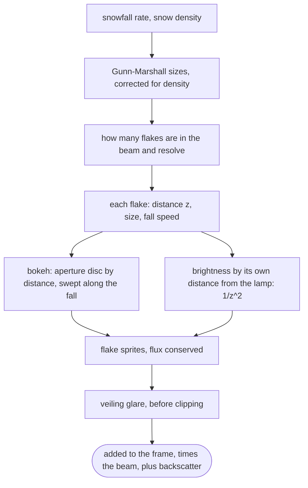
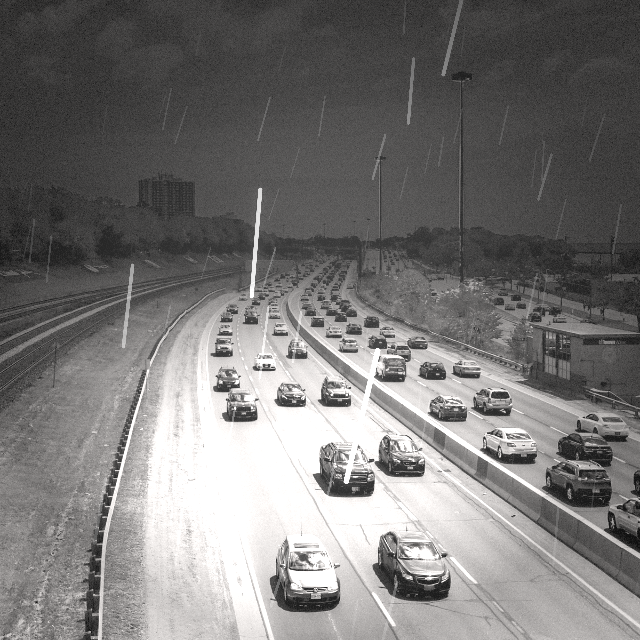
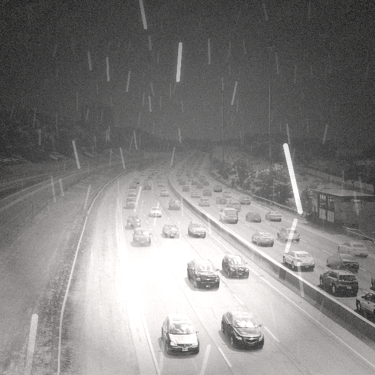
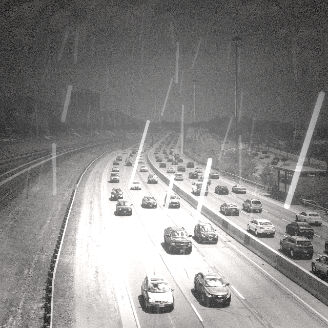
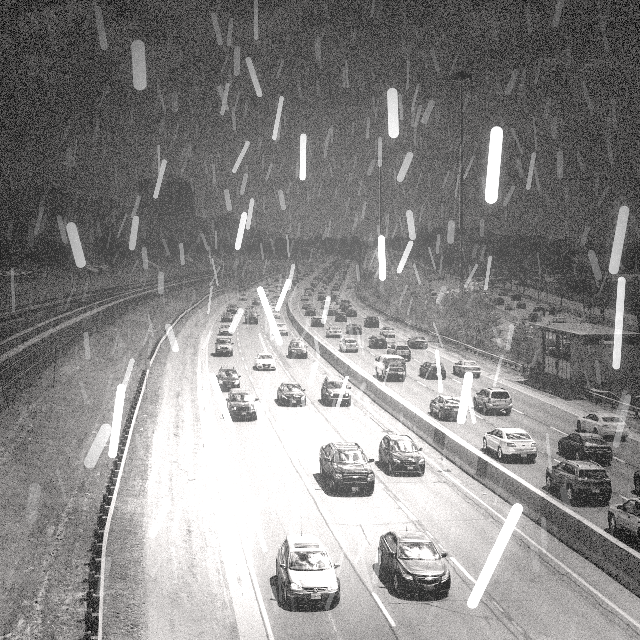
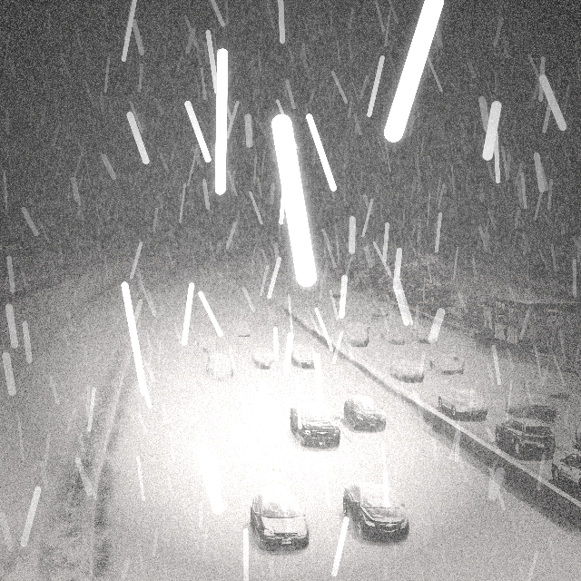

# `NightSnow`

> Falling snow lit by the camera's infrared illuminator.

| | |
| --- | --- |
| Module | [`surmentations.atmosphere.night_snow`](../../src/surmentations/atmosphere/night_snow.py) |
| Stage | lit by the camera's own lamp, after the infrared conversion |
| Needs depth | no |
| Annotations | untouched: the image only |
| Tests | [`tests/unit/test_night_snow.py`](../../tests/unit/test_night_snow.py) |

## Algorithm

## Model

Snow lit by the camera's own infrared illuminator.

The night counterpart of `RandomSnow`,
for the same reason `NightRain` is the counterpart of `RandomRain`: at
night the thing lighting a flake is no longer the sky.

`RandomSnow` composites each flake toward the scene's illuminant. Run before
`NightIrMode` — which is where the pipelines put it — the flakes then go
through the reflectance-to-infrared conversion with everything else, and that
conversion lights each pixel by the depth of the *scene* at that pixel. A
flake half a metre from the lens, drawn over a sky fifty metres away, is lit
as if it were fifty metres away: it goes dark. The result is night snow that
is nearly invisible exactly where real footage shows it best.

In real infrared footage snow is the opposite of subtle. A flake is a bright
diffuse scatterer — snow reflects most of the near infrared that reaches it —
sitting a metre from a lamp whose light falls off as `1/z^2`, in front of a
dark scene. It is the brightest thing in the frame. So:

* **A flake's brightness is set by its own distance from the lamp**, not by
  what is behind it: `(1/z)^2`, rolled off at the lamp's reach.
* **Near flakes are large, soft and streaked.** A night camera runs a long
  shutter (1/50-1/25 s), so a flake a metre away travels several times its
  own width during the exposure, and it is far inside the lens's near focus
  limit. The sprite model is `RandomSnow`'s — an image of the aperture swept
  along the fall direction, flux-conserving — with only the lighting changed.
* **The unresolved flakes glow back.** Snow scatters roughly seven times as
  hard as rain at the same precipitation rate, so the backscatter that makes
  an IR camera struggle in rain makes it nearly blind in a snowstorm.

Composition: after `NightIrMode`, like `NightRain`. The veil and the
settled snow are properties of the scene and still belong to `RandomSnow`
*before* the conversion — build it with `max_flakes=0` so the two do not
both draw the falling flakes. The ready-made pipelines do exactly that.

## Parameters

| Parameter | Default | Meaning |
| --- | --- | --- |
| `snowfall_rate_range_mm_h` | `(0.8, 8.0)` | precipitation rate in mm/h of melted water equivalent. Sets the size distribution and how many flakes are in the beam, exactly as in `RandomSnow`. |
| `snow_density_range_g_cm3` | `(0.035, 0.11)` | bulk density of the falling snow, which converts the melted-equivalent diameters the distribution is stated in to the size the camera sees. |
| `flake_diameter_range_mm` | `(1.0, 15.0)` | truncation window for the size distribution, in melted-equivalent millimetres. |
| `distance_range_m` | `(0.15, 8.0)` | the column of air in which flakes are drawn. The near bound matters most: `1/z^2` makes the nearest flakes the whole effect. |
| `illuminator_range_m` | `(4.0, 14.0)` | how far the lamp throws. Flakes beyond it are unlit, which is what limits the depth of the visible snowfall. |
| `illuminator_gain_range` | `(0.6, 2.5)` | radiance a flake one metre away returns, in units of full scale. Snow is a bright diffuse scatterer, so this sits higher for a given lamp than a raindrop's does. |
| `beam_falloff_range` | `(0.6, 2.2)` | how sharply the beam dims off-axis. |
| `backscatter_range` | `(0.03, 0.2)` | glow from the flakes the beam lights but the lens cannot resolve. Heavy snow in a strong beam approaches the upper end and whites the frame out, as it does in reality. |
| `backscatter_grain_range` | `(0.7, 1.2)` | how much of its grain that glow keeps, drawn per call. At 0 it is an even wall of light, as it was. At 1 it varies as a count of flakes does: what comes back from the air just beyond the last flake drawn is half of it, and there a pixel looks through a handful of them, so the glow is a speckle that thins into evenness with distance. See `far_field_texture`. |
| `lamp_cone_range` | `(0.6, 1.4)` | how strongly the snow shows in the light of the scene's lamps, drawn per call; 0 is not at all. It does something on a frame that `NightIrMode` or `NightColorMode` made a night of with a provider that knows where its lamps are: the snow is lit in a cone under each street lamp and in a wedge ahead of each headlamp, and dark elsewhere, which is how snow at night is mostly seen. See `lamp_cones`. |
| `exposure_time_range` | `(0.02, 0.04)` | shutter time. The default is the 1/50-1/25 s of a night camera, long enough to draw near flakes out into streaks. |
| `fall_speed_scale_range` | `(0.7, 1.8)` | multiplier on the still-air fall speed, for wind-driven snow. |
| `fall_angle_range` | `(-12.0, 12.0)` | prevailing slant from vertical, in degrees. |
| `flutter_range` | `(8.0, 30.0)` | how far each flake's path deviates from that slant. |
| `horizontal_fov_range_deg` | `(48.0, 78.0)` | field of view, used to project sizes and distances into pixels. |
| `aperture_diameter_range_mm` | `(0.9, 2.6)` | lens aperture, which sets the bokeh of a flake inside the near focus limit. |
| `focus_distance_range_m` | `(8.0, 40.0)` | where the lens is focused. |
| `glare_range` | `(0.05, 0.25)` | fraction of a flake's light that the dome and the lens scatter into a soft glow around it. A flake a hand's width from the lamp is tens of times brighter than full scale, and that much light does not stay inside its own outline: without this every near flake is a hard-edged white cut-out. |
| `max_flakes` | `9000` | render budget. When it binds, the flakes drawn are the widest ones. |
| `min_flake_width_px` | `1.0` | flakes projecting narrower than this are left to the backscatter glow. |
| `p` | `0.5` | probability that the transform is applied |

## Samples

Severity 1 to 5, left to right, from the severity gallery.

`night_snow`

| 1 | 2 | 3 | 4 | 5 |
| --- | --- | --- | --- | --- |
|  |  |  |  |  |

## References

- Garg, K. and Nayar, S. K. (2007). Vision and rain. *International Journal of Computer Vision* 75(1), 3-27. [doi:10.1007/s11263-006-0028-6](https://doi.org/10.1007/s11263-006-0028-6)
- Garg, K. and Nayar, S. K. (2006). Photorealistic rendering of rain streaks. *ACM Transactions on Graphics* 25(3), 996-1002 (SIGGRAPH). [doi:10.1145/1141911.1141985](https://doi.org/10.1145/1141911.1141985)
- Marshall, J. S. and Palmer, W. McK. (1948). The distribution of raindrops with size. *Journal of Meteorology* 5, 165-166. [doi:10.1175/1520-0469(1948)005&lt;0165:TDORWS&gt;2.0.CO;2](https://doi.org/10.1175/1520-0469%281948%29005%3C0165:TDORWS%3E2.0.CO;2)
- Gunn, R. and Kinzer, G. D. (1949). The terminal velocity of fall for water droplets in stagnant air. *Journal of Meteorology* 6, 243-248. [doi:10.1175/1520-0469(1949)006&lt;0243:TTVOFF&gt;2.0.CO;2](https://doi.org/10.1175/1520-0469%281949%29006%3C0243:TTVOFF%3E2.0.CO;2)

---

Generated by [`docs/make_transform_pages.py`](../make_transform_pages.py) from the source; edit the docstring or that script, not this page. [All transforms](README.md).
