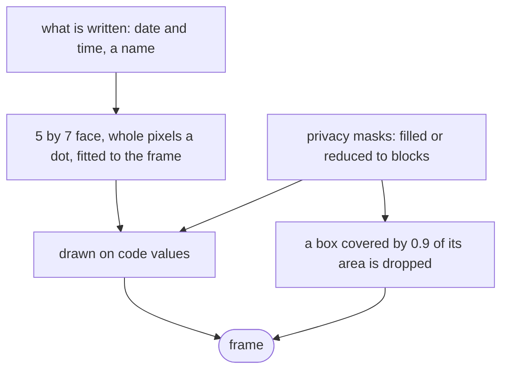
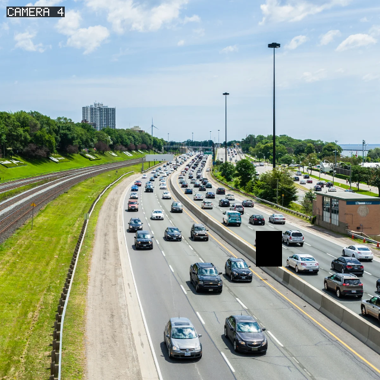
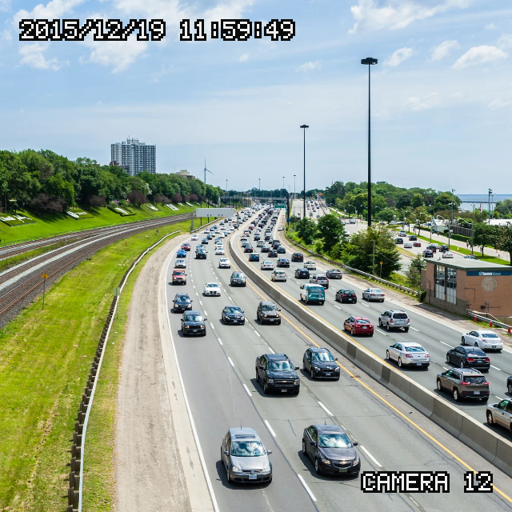
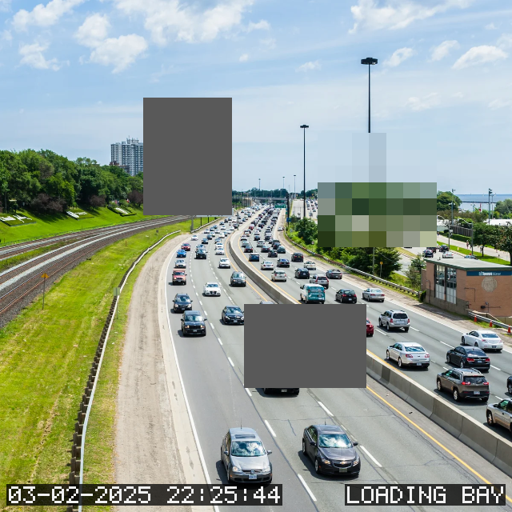
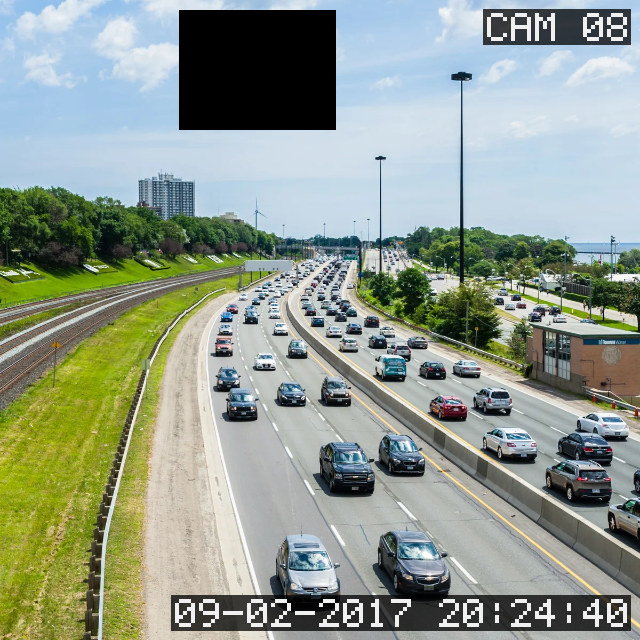
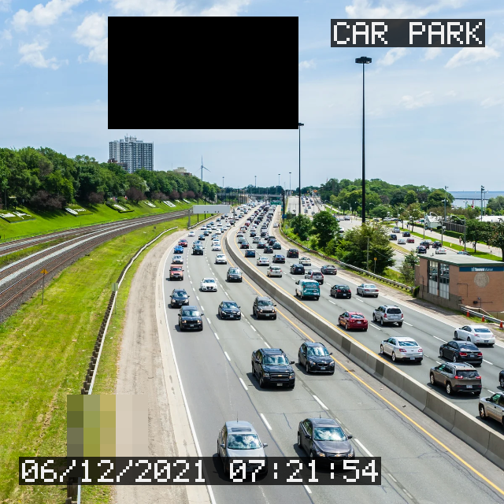

# `OnScreenOverlay`

> A timestamp, a camera name and privacy masks drawn over the frame.

| | |
| --- | --- |
| Module | [`surmentations.camera.overlay`](../../src/surmentations/camera/overlay.py) |
| Stage | overlay drawn by the camera, before the link |
| Needs depth | no |
| Annotations | drops boxes it hides; masks and keypoints untouched |
| Tests | [`tests/unit/test_overlay.py`](../../tests/unit/test_overlay.py) |

## Algorithm

## Model

What a camera or a recorder writes over the picture.

### Not physics

Nearly every frame of surveillance footage has something drawn on it that
was never in front of the lens: the date and time, the camera's name, and
on many sites rectangles blanked out for privacy. None of it is weather or
optics and nothing here is derived from anything. It is in this library
because it is in the footage: it sits in the corners, where objects enter
the view; a detector that has never seen it treats lettering as texture;
and a privacy mask removes what is under it altogether.

What is modelled is what such overlays look like and where they are:

* **Text** in a small fixed-pitch bitmap face, white with a dark outline or
  on a dark bar, scaled by whole pixels so its edges stay hard, in a corner
  a little way in from the edge. A date and time in one of the orders
  recorders use, and a channel or site name in another corner.
* **Privacy masks**: rectangles filled with black or grey, or reduced to
  coarse blocks.

**Who draws it decides where in the chain it goes.** A camera burns its
overlay in before it encodes the stream, so the lettering is compressed
with the picture and carries the codec's ringing. A recorder draws its own
on the decoded picture, and it stays clean. `drawn_by` says which, and
`physical_order` places the
transform accordingly.

**What is under a privacy mask is gone**, so a box that a mask covers, by
`hidden_box_coverage` or more of its area, is dropped. Masks and
keypoints are left as they are: the transform does not move anything.

Drawn on code values, as a character generator does, and not in linear
light.

## Parameters

| Parameter | Default | Meaning |
| --- | --- | --- |
| `timestamp_probability` | `0.9` | chance the frame carries a date and time. |
| `label_probability` | `0.6` | chance it carries a camera or site name. |
| `text_height_range` | `(0.022, 0.045)` | height of the lettering, as a fraction of the frame's height. Drawn at the nearest whole number of pixels a dot, and never under one. |
| `margin_range` | `(0.01, 0.04)` | how far in from the frame's edges the text sits, as a fraction of its height. |
| `privacy_mask_count_range` | `(0, 2)` | how many rectangles are blanked. |
| `privacy_mask_size_range` | `(0.06, 0.3)` | each one's width and height, as fractions of the frame's. |
| `hidden_box_coverage` | `0.9` | a box with at least this share of its area under privacy masks is dropped. Above 1, none are. |
| `drawn_by` | `'camera'` | `"camera"`, burned in before the stream is encoded, or `"recorder"`, drawn on the decoded picture. Decides where `physical_order` puts the transform. |
| `p` | `0.5` | probability that the transform is applied |

## Samples

Severity 1 to 5, left to right, from the severity gallery.

`on_screen_overlay`

| 1 | 2 | 3 | 4 | 5 |
| --- | --- | --- | --- | --- |
|  |  |  |  |  |

## References

None: this transform models a convention, not a physical process.

---

Generated by [`docs/make_transform_pages.py`](../make_transform_pages.py) from the source; edit the docstring or that script, not this page. [All transforms](README.md).
