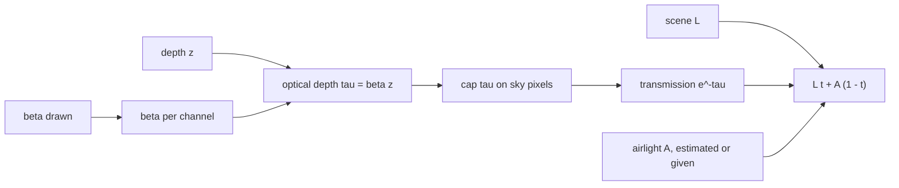
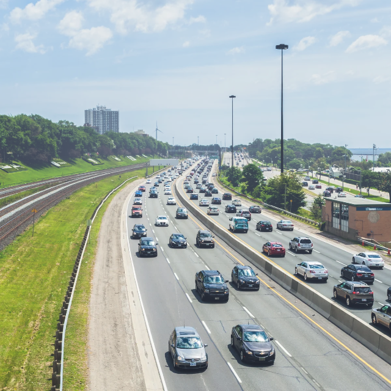
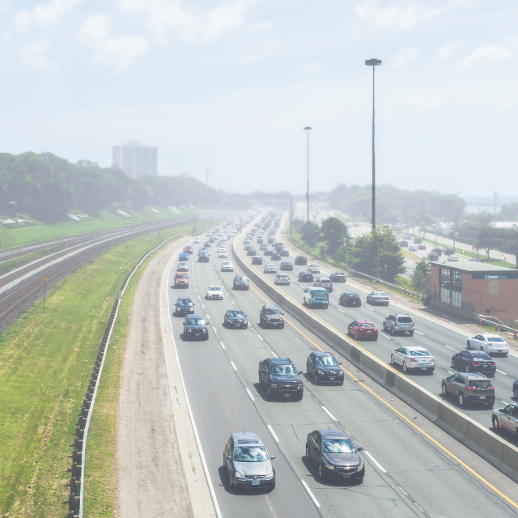
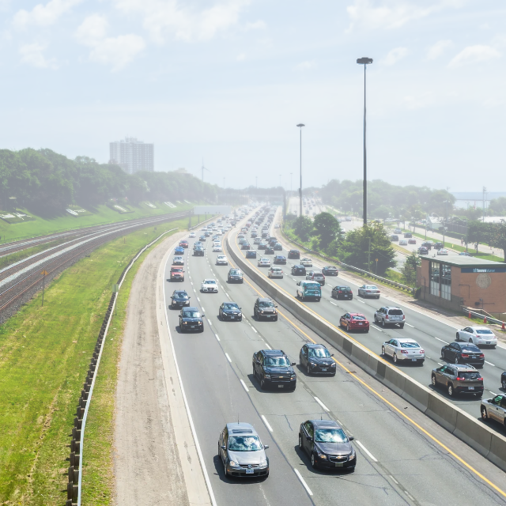
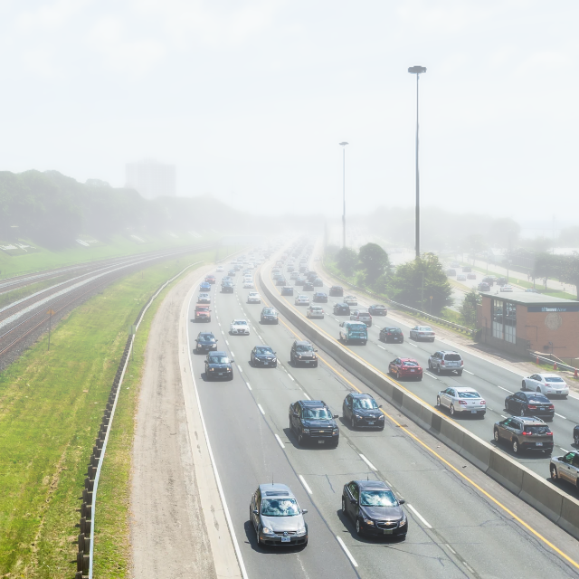
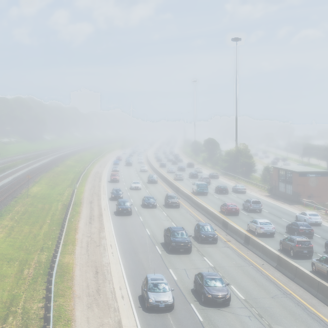

# `RandomFog`

> Physically-grounded fog/haze, conditioned on scene depth.

| | |
| --- | --- |
| Module | [`surmentations.atmosphere.fog`](../../src/surmentations/atmosphere/fog.py) |
| Stage | atmosphere |
| Needs depth | yes |
| Annotations | untouched: the image only |
| Tests | [`tests/unit/test_fog.py`](../../tests/unit/test_fog.py) |

## Algorithm

## Model

Depth-conditioned fog / haze via atmospheric scattering.

Core model (Koschmieder), evaluated **in linear light**:

``
I(x) = I0(x) * t(x) + A * (1 - t(x))
t(x) = exp(-beta * d(x))
``

where `d` is scene depth, `beta` the extinction coefficient (1/m) and
`A` the airlight colour. Extinction relates to meteorological visibility
by `MOR = 3.912 / beta` (the 2% contrast threshold), so beta 0.005 / 0.01 /
0.02 / 0.06 correspond to roughly 780 / 390 / 195 / 65 m of visibility — the
same ladder the Foggy Cityscapes benchmark uses.

Three things beyond the bare equation are what actually make it read as fog
rather than a white wash, and all three are implemented here:

* **Linear light.** Radiance adds linearly; sRGB values do not. Compositing
  airlight directly onto gamma-encoded pixels lifts the mid-tones far too
  much, which is the single biggest cause of the flat, milky look.
* **Wavelength-dependent extinction.** Scattering goes as
  `beta(lambda) ~ lambda^-gamma`: gamma ~ 4 for Rayleigh (clean air),
  ~1-1.5 for thin haze, ~0 for dense fog whose droplets are much larger than
  the wavelength. Thin haze therefore goes *cool and blue* with distance,
  while dense fog is neutral grey. A single achromatic beta can only ever
  produce the latter.
* **Forward-scatter blur.** Fog is a low-pass filter, not just a blend:
  multiply-scattered light smears detail, so distant edges soften as well as
  fade. Sigma grows with optical depth (`~ sqrt(beta*d)`).

Sky is special-cased. At `d -> infinity` the model collapses to exactly
`A`, which would flatten a sky that in reality keeps its gradient and its
brightest region near the sun; optical depth is therefore capped for
sky-like pixels so the sky desaturates and loses contrast instead of turning
into a single flat colour.

References: Koschmieder 1924; He, Sun & Tang 2009 (dark-channel prior, used
here for airlight estimation); Sakaridis et al. 2018 (Foggy Cityscapes,
beta ladder and sky handling); Quilez, "Better Fog" (separate extinction and
inscattering, sun-tinted fog colour).

## With scene labels and geometry

With a provider that knows more than depth
(`perception`): the sky is what the scene's labels
call sky, and the fog is over real metres where the camera's height is
known, unless `depth_scale` says otherwise.

See [scene understanding](../scene_understanding.md).

## Parameters

| Parameter | Default | Meaning |
| --- | --- | --- |
| `depth_provider` | required | shared `SharedDepthProvider`. |
| `beta_range` | `(0.01, 0.08)` | extinction coefficient, in 1/m against `depth_scale`'s pseudo-metres. Visibility is `3.912 / beta`; 0.005 is light haze, 0.02 is fog, 0.06+ is dense fog. |
| `scattering_gamma_range` | `(0.0, 1.5)` | wavelength dependence of extinction. 0 = neutral dense fog, ~1.3 = blue-shifted thin haze, 4 = Rayleigh. |
| `atmospheric_light` | `None` | fixed airlight RGB, or `None` to estimate it per image with a dark-channel-prior-style search for the brightest haze-opaque region. |
| `depth_scale` | `None` | pseudo-metres at relative depth 1.0, for this transform only. `None` uses the provider's `depth_range_m`, which is the place to calibrate a whole pipeline. |
| `forward_scatter_range` | `(0.001, 0.005)` | how strongly fog blurs distant detail, as a fraction of the image diagonal at full optical depth. 0 disables the blur and leaves fog as a pure blend. |
| `sky_optical_depth_cap` | `1.6` | optical depth ceiling applied to sky-like pixels, so the sky desaturates instead of collapsing to a flat airlight colour. |
| `visibility_range_scene` | `None` | visibility as a multiple of the scene's depth, drawn per call, in place of `beta_range`. A fog of one extinction is a different picture on every scene: a visibility of a hundred metres hides nothing of a car park and all of a valley. `(0.5, 1.0)` is fog that takes the far half of whatever scene it is given. The scene's depth is the distance of the farthest thing in it that is not sky. `None`, the default, uses `beta_range`. |
| `p` | `0.5` | probability that the transform is applied |

## Samples

Severity 1 to 5, left to right, from the severity gallery.

`fog`

| 1 | 2 | 3 | 4 | 5 |
| --- | --- | --- | --- | --- |
|  |  |  |  |  |

## References

- Koschmieder, H. (1924). Theorie der horizontalen Sichtweite. *Beiträge zur Physik der freien Atmosphäre* 12, 33-53. [link](https://library.metoffice.gov.uk/portal/Default/en-GB/RecordView/Index/457195)
- Middleton, W. E. K. (1952). *Vision through the Atmosphere*. University of Toronto Press. [doi:10.3138/9781487586140](https://doi.org/10.3138/9781487586140)
- Narasimhan, S. G. and Nayar, S. K. (2002). Vision and the atmosphere. *International Journal of Computer Vision* 48(3), 233-254. [doi:10.1023/A:1016328200723](https://doi.org/10.1023/A:1016328200723)
- He, K., Sun, J. and Tang, X. (2011). Single image haze removal using dark channel prior. *IEEE Transactions on Pattern Analysis and Machine Intelligence* 33(12), 2341-2353. [doi:10.1109/TPAMI.2010.168](https://doi.org/10.1109/TPAMI.2010.168)
- Sakaridis, C., Dai, D. and Van Gool, L. (2018). Semantic foggy scene understanding with synthetic data. *International Journal of Computer Vision* 126(9), 973-992. [doi:10.1007/s11263-018-1072-8](https://doi.org/10.1007/s11263-018-1072-8)
- Quilez, I. Better fog. Article, iquilezles.org. [link](https://iquilezles.org/articles/fog/)
- Yang, L., Kang, B., Huang, Z., Zhao, Z., Xu, X., Feng, J. and Zhao, H. (2024). Depth Anything V2. *Advances in Neural Information Processing Systems (NeurIPS)*. [link](https://arxiv.org/abs/2406.09414)

---

Generated by [`docs/make_transform_pages.py`](../make_transform_pages.py) from the source; edit the docstring or that script, not this page. [All transforms](README.md).
