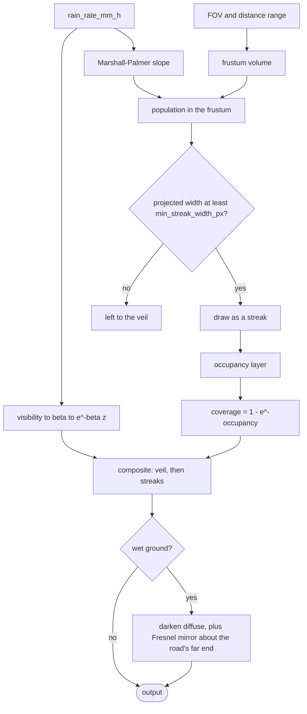
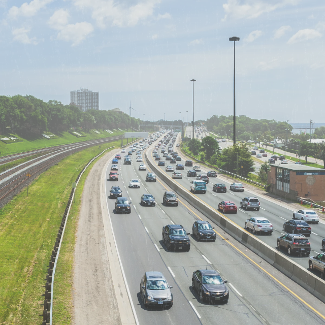
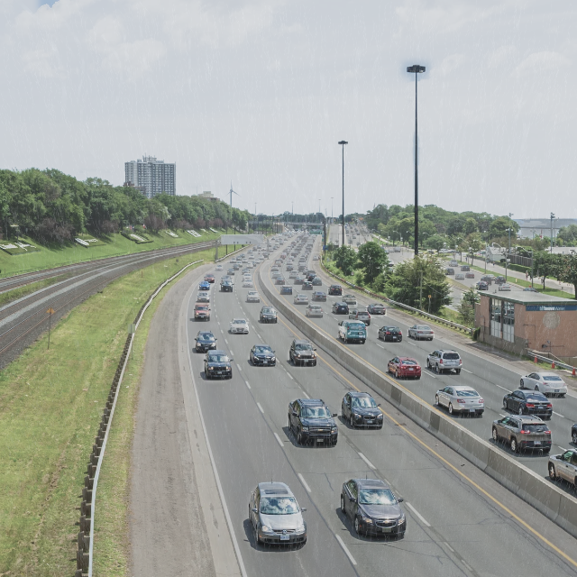
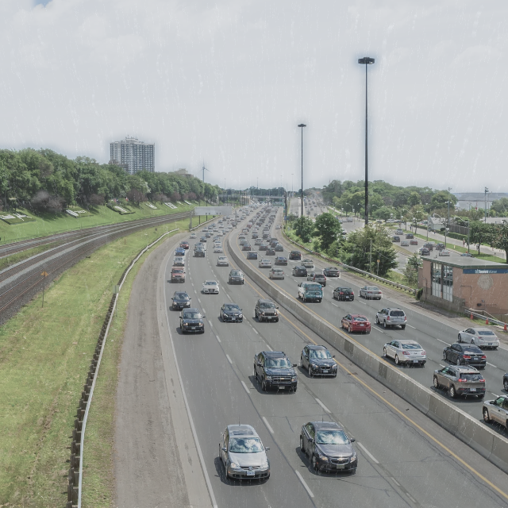
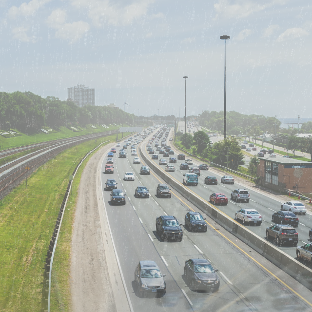
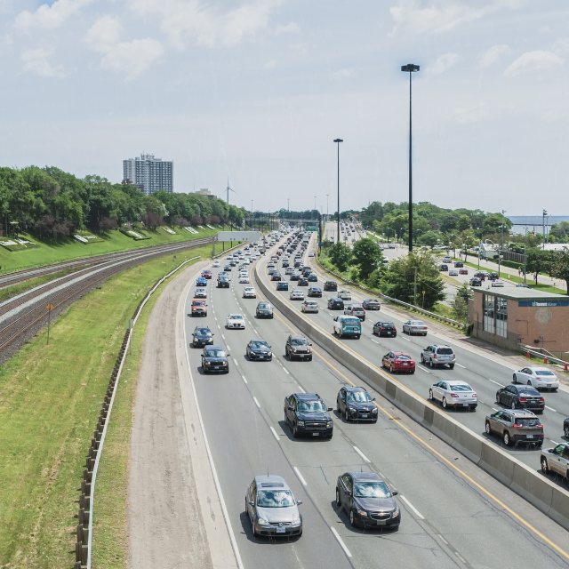
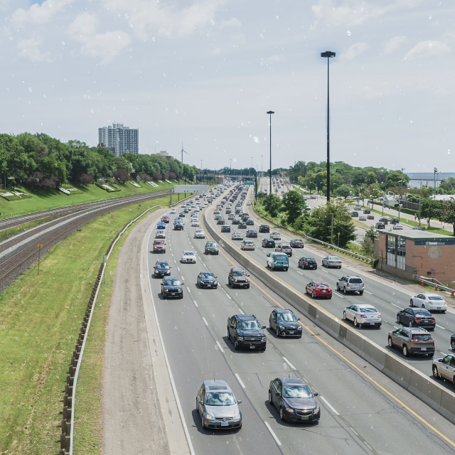
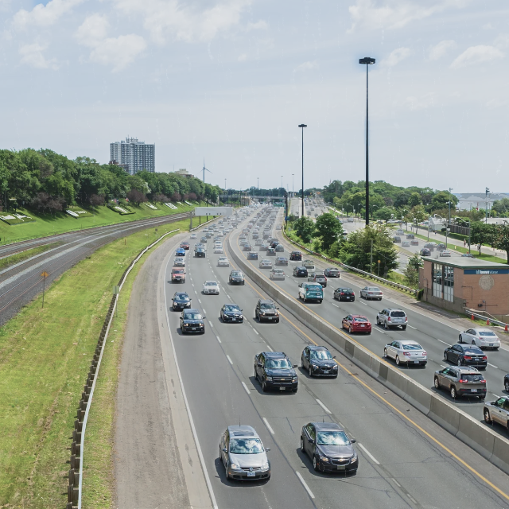
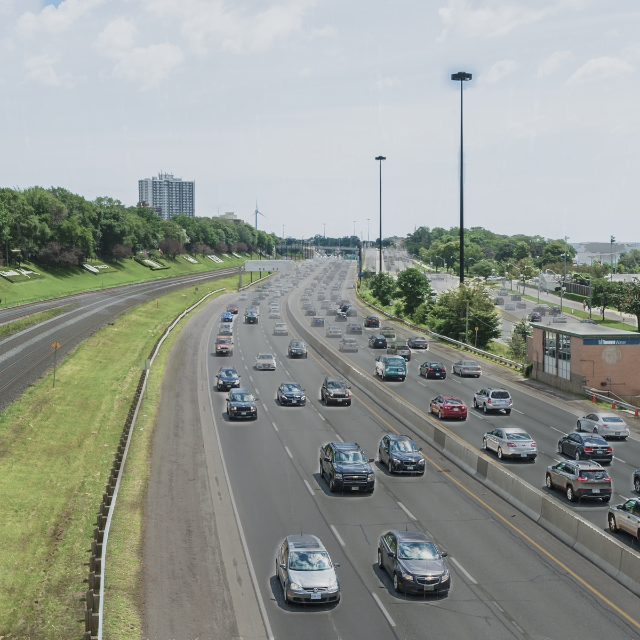

# `RandomRain`

> Physically-grounded rain: photometrically correct streaks, veil, wet ground.

| | |
| --- | --- |
| Module | [`surmentations.atmosphere.rain`](../../src/surmentations/atmosphere/rain.py) |
| Stage | atmosphere |
| Needs depth | yes |
| Annotations | untouched: the image only |
| Tests | [`tests/unit/test_rain.py`](../../tests/unit/test_rain.py) |

## Algorithm

## Model

Depth-conditioned rain: streaks, a distant rain veil, and optional ground wetness.

Photometric model (Garg & Nayar, "Vision and Rain" IJCV 2007;
### "Photorealistic Rendering of Rain Streaks" SIGGRAPH 2006)

A raindrop crossing a pixel during exposure only occupies it for a fraction
of the exposure time, so the pixel is a *time average*:

``
I = (1 - alpha) * I_background + alpha * L_streak
alpha = tau / T_exposure = 2 * r0 / (v * T_exposure)
``

with terminal velocity `v(r0) = 9.40 * (1 - exp(-3.45e6 * r0^1.31))` m/s.
For a 1 mm drop, `v ~ 6.9 m/s`, and at 1/60 s that gives **alpha ~ 0.017**
— a streak is only a *few percent* opaque. Painting streaks at 30-60% alpha,
as a naive implementation does, is the main reason synthetic rain reads as
white scratches drawn on top of a photo instead of rain.

Getting alpha right also buys contrast-dependent visibility for free: since
`dI = alpha * (L_streak - L_background)`, a streak is obvious against dark
foliage and nearly invisible against bright sky, exactly as in real photos —
no special-casing needed.

`L_streak` is *not* white. A drop refracts light from a ~165 degree field
of view and reflects about 6% of its whole environment, so it is essentially
an image of the sky. We take it from the scene's own bright/sky radiance,
which is why streaks tint with the weather rather than staying neutral.

Real streaks are also not uniform bars of light: the drop oscillates as it
falls, so the streak is beaded, with several smeared highlights along its
length. We modulate each streak's intensity with a quasi-periodic profile
(two harmonics and a random phase) to approximate that without shipping
Garg & Nayar's 400 MB measured streak database. That profile is sampled
*per pixel* through a lookup table rather than per drawn segment: evaluating
a three-cycle sine at six segment midpoints aliases it into a strict
two-level alternation, which turns every streak in the frame into the same
three-bright/three-dark dashed line — precisely the hatch pattern the
per-streak variation exists to avoid.

Finally, near drops are *defocused*: closer means wider **and dimmer**,
since the same light spreads over a larger circle of confusion — the
opposite of the intuitive "closer is brighter".

Everything composites in linear light, and the frame's mean level is
renormalised afterwards to stand in for the camera's auto-exposure.

### The camera's exposure decides what rain looks like

The same shower is three different pictures depending on how the camera is
exposing, and none of the three is the weather's doing:

* **Shutter time** sets how far a drop travels while the shutter is open. At
  1/2000 s a 2 mm drop moves 3 mm, barely more than its own width, and is
  recorded as a near-opaque fleck; at 1/30 s it is drawn 22 cm long and 1%
  opaque. The light it deposits is the same either way.
* **Aperture** sets how defocused the near drops are — the ones wide enough
  to resolve at all. A small aperture keeps them thin and therefore opaque;
  a wide one spreads each over its circle of confusion.
* **The two are not independent.** For a given light level the camera needs
  a given exposure, `T = K N^2 / E`: a lens stopped down four stops needs
  a shutter sixteen times longer. So a stopped-down iris comes with long,
  thin, faint streaks and an open one with short soft flecks, and drawing
  the two from separate ranges produces the pairs no camera would choose —
  a wide-open lens at 1/30 s in daylight, six or seven stops over-exposed.

So the shutter time is not drawn. The light level is, along with the
aperture, and the shutter follows from them through the metering equation,
held within the range the camera can actually run.

### Accumulating many streaks

Streaks are accumulated as **occupancy**, not as repeated "over" composites:
each streak deposits its `alpha` additively into a layer, and the final
coverage is `1 - exp(-layer)`. For independent drops crossing the same
pixel during one exposure that is the right composition law — the pixel is
uncovered only if *no* drop covered it, so the transmissions multiply — and
unlike sequential `over` blending it does not depend on the order the
streaks happen to be drawn in. That order-independence is what lets the whole
field be rasterised in one batch (and, on a GPU, with a plain scatter-add).

## With scene labels and geometry

With a provider that knows more than depth
(`perception`): the field of view and the pitch
are the scene's camera's, and the two ranges below are drawn only for
what it leaves open; the veil is over real metres where the camera's
height is known; the wet road's horizon is the camera's; and the road
is laid on what is labelled as paving and kept off the vehicles, people
and vegetation on it. Without one, nothing here changes.

See [scene understanding](../scene_understanding.md).

## Parameters

| Parameter | Default | Meaning |
| --- | --- | --- |
| `depth_provider` | required | shared `SharedDepthProvider`. |
| `rain_rate_range_mm_h` | `(5.0, 200.0)` | rainfall rate, drawn per call. This is the *physical* intensity knob: it sets the Marshall-Palmer slope, so heavier rain means a longer tail of large, fast, conspicuous drops rather than simply more of the same drop. It also sets how many drops are in frame, since the count is derived from the drop concentration and the volume of air being simulated. |
| `drop_diameter_range_mm` | `(0.8, 6.0)` | truncation window for the drop-size distribution, in millimetres. |
| `dsd_shape_mu` | `0.0` | shape parameter of the drop-size distribution. `0` is Marshall & Palmer's exponential, the default and what every published number in this library was measured against. Ulbrich (1983) showed observed spectra are better fitted by a gamma, `N(D) = N0 D^mu exp(-Lambda D)`, with `mu` near 2-4: it removes the pile-up of very small drops an exponential predicts and puts the mode at a finite diameter. At 50 mm/h, `mu = 3` raises the share of drops above 2 mm from 11.5% to 14.8%. It will not make rain more visible, and that is worth stating plainly: what decides visibility is the summed projected area of the drops, and at a fixed rain rate that moves by 2.5% across the whole useful range of `mu`. See `docs/rain_visibility.md`. |
| `distance_range_m` | `(0.4, 6.0)` | near and far bounds of the column of air in front of the lens whose drops are drawn individually. Drops beyond it are sub-pixel in width and are represented by the veil instead. |
| `exposure_time_range` | `(0.000125, 0.04)` | the shortest and longest shutter time the camera can run, in seconds. With the drop's terminal velocity the shutter time fixes the streak length, and therefore the opacity `alpha = D / (v T)`: a longer exposure draws a longer *and proportionally fainter* streak, conserving deposited light. The time itself is not drawn from this range but metered — see `scene_illuminance_range_lux` — and held inside it; give the two ends the same value to pin the shutter. |
| `horizontal_fov_range_deg` | `(48.0, 78.0)` | camera field of view, drawn per call. Used to project physical drop sizes and distances into pixels. |
| `aperture_diameter_range_mm` | `(0.4, 3.0)` | lens aperture diameter, drawn per call on a log scale (evenly in stops), which sets the circle of confusion for drops away from the focal plane. Small values are both realistic for a surveillance or dash camera (f/1.6 on a 4 mm lens is a 2.5 mm aperture) and what makes rain *visible* in such footage: the deep depth of field keeps streaks narrow, and since defocus spreads a streak's fixed light over a wider band, a narrower streak is a proportionally more opaque one. It is the only lever that raises streak contrast without also shortening the streaks, which shutter time does. The default spans a lens stopped down in daylight (0.4 mm, about f/10 at 4 mm) to one wide open (3 mm). |
| `scene_illuminance_range_lux` | `(800.0, 25000.0)` | how much light the scene is under, drawn per call on a log scale. Together with the aperture this sets the shutter time, `T = K N^2 / E`, which is why the two come out correlated the way a camera's are: stopped down, a long shutter and long thin streaks; wide open, a short one and soft flecks. Rainy daylight runs from about 800 lux under a storm cloud to 25 000 in a sunlit shower; a street at night is 5-150. `None` draws the shutter time from `exposure_time_range` directly, on a log scale, independent of the aperture. |
| `focus_distance_range_m` | `(8.0, 40.0)` | what the camera is focused on, drawn per call. |
| `camera_pitch_range_deg` | `(0.0, 22.0)` | how far the camera is tilted **down** from level, drawn per call. Rain falls along parallel lines in the world, and parallel lines project to lines through a common vanishing point, so a tilted camera makes the streaks visibly *splay*. A level camera puts that point at infinity and the streaks come out parallel. |
| `max_streaks` | `16000` | hard cap on individually-rendered streaks, so an extreme rain rate cannot make one call unboundedly slow. |
| `min_streak_width_px` | `0.4` | drops projecting narrower than this are not drawn individually — they are what the veil represents. |
| `wind_angle_range` | `(-10.0, 10.0)` | slant of the fall direction in degrees, from wind. |
| `angle_jitter_range` | `(2.0, 8.0)` | per-streak random deviation from the perspective direction, so streaks are not perfectly regular (gust turbulence). |
| `wobble_range` | `(0.05, 0.2)` | per-streak mid-point bend, as a fraction of its length. |
| `definition_softness` | `0.45` | how soft a defocused streak's edges get, as a multiple of its own defocus spread. |
| `veil_beta_range` | `None` | extinction coefficient for the distant rain veil. `None` (the default) derives it from `rain_rate_mm_h` via the Atlas (1953) visibility-in-rain relation, which is the physically consistent choice: the veil *is* the drops too small to draw individually, so setting it independently permits a frame with a downpour's haze and a drizzle's streaks. Pass an explicit range only to override that deliberately. |
| `min_visibility_scene` | `None` | the least visibility the veil may leave, as a multiple of the scene's depth, or `None` for no limit. The veil follows from the precipitation rate, per metre, which is right and which over a long view hides the far end of the scene outright: 1.5 lets the veil thin the distance without ever closing it. The scene's depth is the distance of the farthest thing in it that is not sky. |
| `wetness_probability` | `0.4` | chance of rendering the ground-wetness pass. Deliberately not tied to the drawn rain rate: a road stays wet long after the rain stops and is dry for the first seconds of a downpour, so wetness follows the rain's *history*, which a single-frame transform cannot know. `GROUND_SEVERITY` in `presets/severity.py` is a ladder for this and `wetness_darkening_range` on their own, from dry to soaked. The wet road is also most of what this transform costs: a frame with it takes two to three times one without, which is why the default is 0.4 and not higher. |
| `wetness_darkening_range` | `(0.4, 0.9)` | diffuse albedo of wet ground relative to dry. Water fills the surface pores and traps light in the film by total internal reflection, so wet asphalt scatters back much less than dry: measured albedos run about 0.10-0.15 dry against 0.05-0.08 wet, i.e. roughly a halving, which is what this brackets. It also decides how much of a mirror the ground is: near 0.9 the surface is only damp and reflects nothing, and the Fresnel reflection reaches full strength at 0.5, where there is a continuous film. The default spans both. |
| `wetness_falloff_range` | `(4.0, 9.0)` | exponent on the upward-facing cosine. Water sheets on horizontal surfaces and runs off anything steeper, more sharply than snow settles, so this sits above snow's equivalent. |
| `overcast_range` | `(0.7, 1.0)` | how much of the light that goes with this much rain the frame is given, drawn per call. Precipitation falls from cloud, so by default the scene is relit towards overcast in step with the rate: contrast and saturation fall and any sky in view turns to cloud. 1 is the full change for the rate, 0 leaves the light as photographed — right for frames that already are overcast. It cannot remove shadows the photograph has; it softens a sunny scene and does not convert it. See `utils/overcast.py`. |
| `lamp_glint_range` | `(0.0, 0.0)` | at night, how many times full scale the lamps in the frame are taken to be when they light the rain, drawn per call. Zero — the default — leaves every streak lit by the frame's average light, which is right by day, when that light is the sky. At night it is wrong: a drop near a lamp's line of sight throws the lamp's light at the lens and is the brightest thing near it, and a drop against the dark between lamps is invisible, so real night rain is seen as a swarm of bright flecks round each lamp and nowhere else. A positive value lights each streak by the lamps near it in the picture, in their colour, and lets a soaked road reflect them: at this strength close under each lamp, and many times it in the long streak the lamp lays down the road towards the camera, which is the lamp spread over hundreds of times its own area and still the brightest thing on a wet street. A clipped lamp's true brightness is not in the frame, hence a range and not a measurement. Set it for night frames only; the shipped pipelines do. |
| `puddle_coverage_range` | `(0.0, 0.45)` | share of soaked ground under standing water, drawn per call. Water does not lie evenly: it collects in ruts and hollows, and those are smooth where the film on the rest of the road is as rough as the road. A puddle is a clean mirror of what is above it, sky mostly, and by day the brightest thing on a wet road; between puddles the road is dark and glossy. Scaled by how wet the ground is, so a damp road has none. |
| `spray_range` | `(0.0, 0.0)` | how much spray the traffic on a wet road throws up, drawn per call. 0, the default, is none. Above it, a road with a film of water and vehicles on it gets the three things spray is made of: low dense tufts at the rear wheels; a long, turbulent wake behind each vehicle, bigger behind a bigger one; and a mist over the whole carriageway that thickens with distance, so that far traffic is lost from the wheels up. At 0.3 it is a haze, at 1 a motorway in a downpour. It needs scene labels on the provider, for the vehicles and the road they are on, and does nothing without. Off by default because of what a single frame cannot say: how fast the traffic is moving, and, where no lamp or lens shows, which way. See `vehicle_spray` and `road_mist`. |
| `p` | `0.5` | probability that the transform is applied |

## Samples

Severity 1 to 5, left to right, from the severity gallery.

`rain`

| 1 | 2 | 3 | 4 | 5 |
| --- | --- | --- | --- | --- |
|  |  |  |  |  |

`wet_ground`

| 1 | 2 | 3 | 4 | 5 |
| --- | --- | --- | --- | --- |
|  |  |  |  |  |

## References

- Marshall, J. S. and Palmer, W. McK. (1948). The distribution of raindrops with size. *Journal of Meteorology* 5, 165-166. [doi:10.1175/1520-0469(1948)005&lt;0165:TDORWS&gt;2.0.CO;2](https://doi.org/10.1175/1520-0469%281948%29005%3C0165:TDORWS%3E2.0.CO;2)
- Ulbrich, C. W. (1983). Natural variations in the analytical form of the raindrop size distribution. *Journal of Climate and Applied Meteorology* 22, 1764-1775. [doi:10.1175/1520-0450(1983)022&lt;1764:NVITAF&gt;2.0.CO;2](https://doi.org/10.1175/1520-0450%281983%29022%3C1764:NVITAF%3E2.0.CO;2)
- Gunn, R. and Kinzer, G. D. (1949). The terminal velocity of fall for water droplets in stagnant air. *Journal of Meteorology* 6, 243-248. [doi:10.1175/1520-0469(1949)006&lt;0243:TTVOFF&gt;2.0.CO;2](https://doi.org/10.1175/1520-0469%281949%29006%3C0243:TTVOFF%3E2.0.CO;2)
- Garg, K. and Nayar, S. K. (2007). Vision and rain. *International Journal of Computer Vision* 75(1), 3-27. [doi:10.1007/s11263-006-0028-6](https://doi.org/10.1007/s11263-006-0028-6)
- Garg, K. and Nayar, S. K. (2006). Photorealistic rendering of rain streaks. *ACM Transactions on Graphics* 25(3), 996-1002 (SIGGRAPH). [doi:10.1145/1141911.1141985](https://doi.org/10.1145/1141911.1141985)
- Atlas, D. (1953). Optical extinction by rainfall. *Journal of Meteorology* 10, 486-488. [doi:10.1175/1520-0469(1953)010&lt;0486:OEBR&gt;2.0.CO;2](https://doi.org/10.1175/1520-0469%281953%29010%3C0486:OEBR%3E2.0.CO;2)
- Schlick, C. (1994). An inexpensive BRDF model for physically-based rendering. *Computer Graphics Forum* 13(3), 233-246. [doi:10.1111/1467-8659.1330233](https://doi.org/10.1111/1467-8659.1330233)

---

Generated by [`docs/make_transform_pages.py`](../make_transform_pages.py) from the source; edit the docstring or that script, not this page. [All transforms](README.md).
