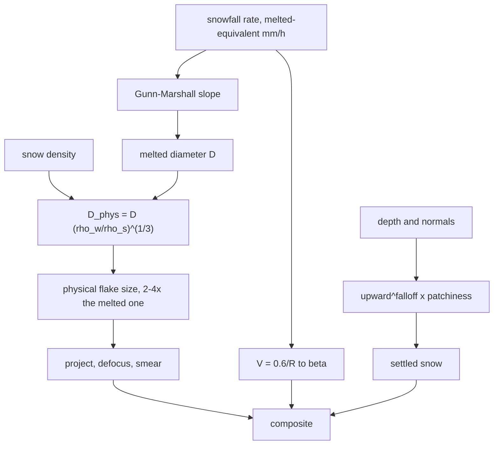
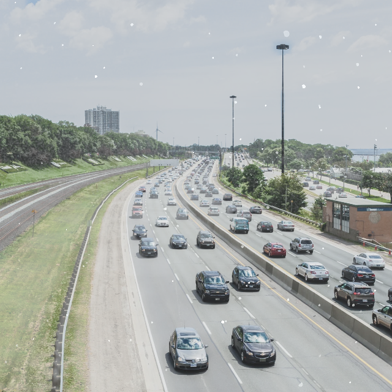
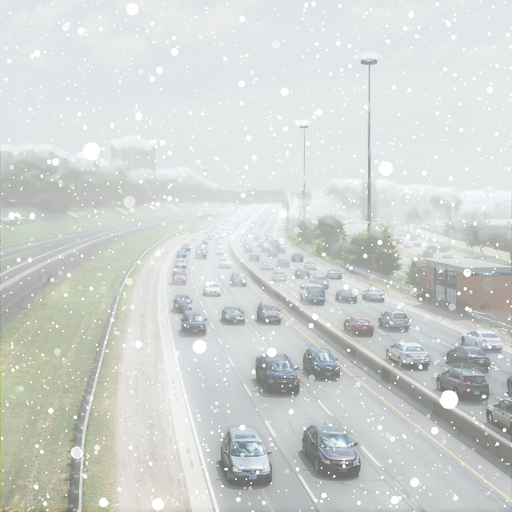
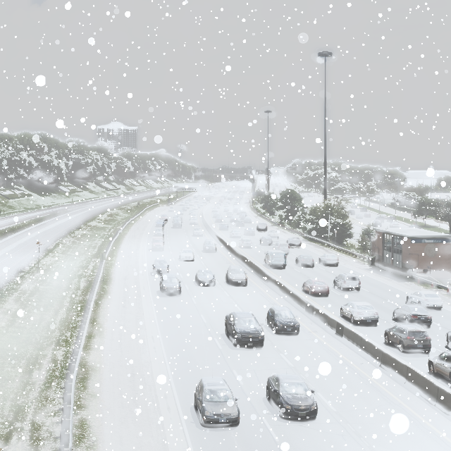
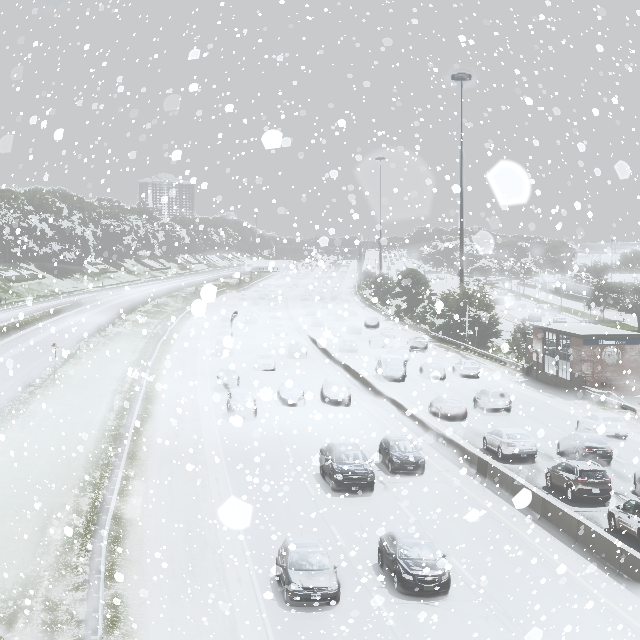
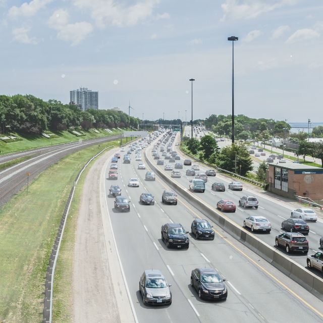
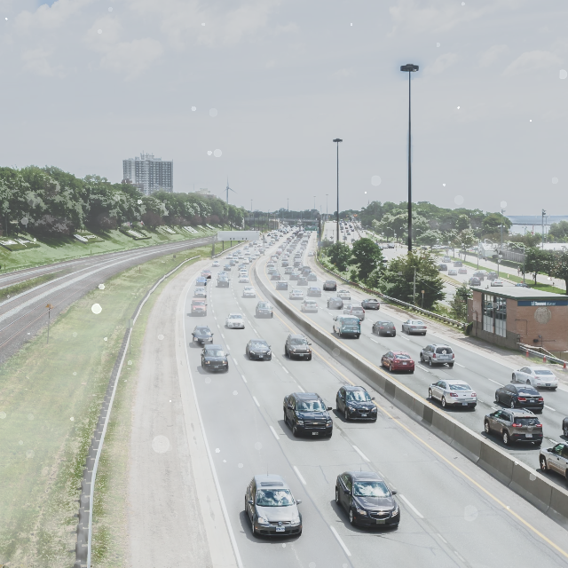
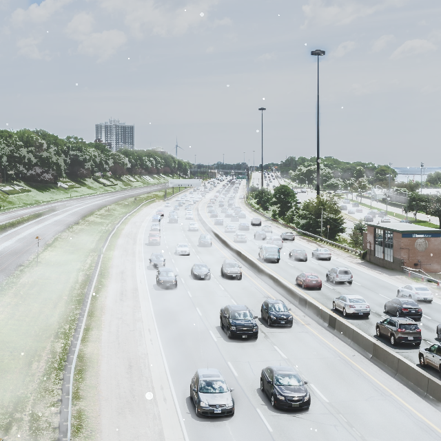
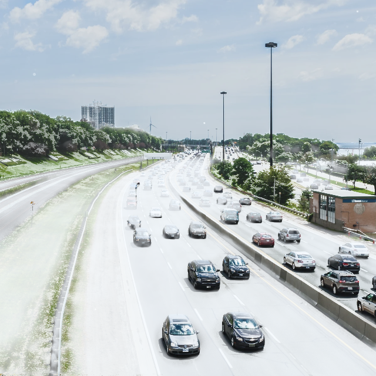
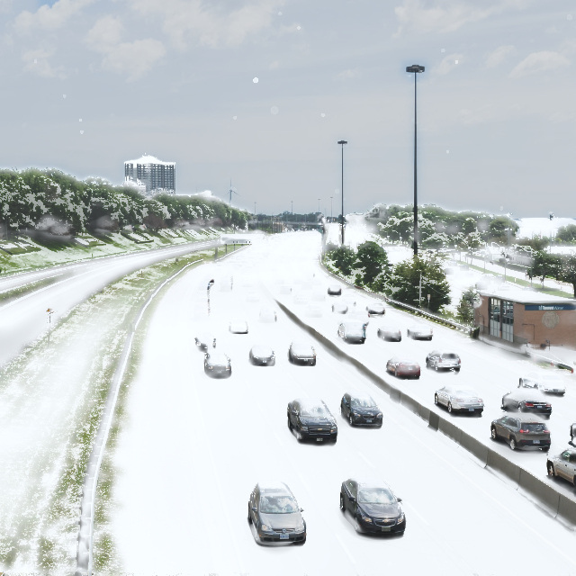

# `RandomSnow`

> Physically-parameterised falling snow with depth-derived accumulation.

| | |
| --- | --- |
| Module | [`surmentations.atmosphere.snow`](../../src/surmentations/atmosphere/snow.py) |
| Stage | atmosphere |
| Needs depth | yes |
| Annotations | untouched: the image only |
| Tests | [`tests/unit/test_snow.py`](../../tests/unit/test_snow.py) |

## Algorithm

## Model

Depth-conditioned snow: falling flakes plus depth-derived ground accumulation.

### Physical model

Snow is parameterised in **physical units** — flake diameters in millimetres,
distances in metres, an exposure time in seconds — and projected through a
pinhole camera. That is what keeps the three things a flake's appearance
depends on locked together instead of being three independent tuning knobs:

* **Apparent size** `= f * D / z`. A flake's distance `z` comes from a
  volume-uniform draw through the air in front of the lens (see
  `utils/precipitation.py`), never from the depth map — a falling flake is
  *in front of* the scene, so what is behind it says nothing about how far
  away it is. Sizing flakes from the scene depth is what makes them look
  pasted onto surfaces: big over the near road, tiny over the distant sky.

* **Defocus**. A camera focused several metres out renders anything within a
  few centimetres of the lens as a large, very soft, translucent disc, well
  beyond the flake's true size. A defocused flake is not a Gaussian blob but
  an **image of the aperture**: a polygon with one side per blade,
  bright-rimmed from spherical aberration, and clipped into a cat's-eye lemon
  off-axis by optical vignetting.

* **Motion smear** `= f * v * T / z`. This used to be a single global blur
  applied to the finished flake layer, which is wrong in the way that matters
  most: it smears near and far flakes by the *same* number of pixels, when
  the smear scales with distance exactly as the size does. Each flake now
  carries its own smear, and the ratio between smear and size is
  `v T / D` — independent of distance but inversely proportional to flake
  size, so small flakes read as short dashes and large ones stay blobby,
  which is the texture real snowfall has.

Snow falls *slowly*: aggregates reach only about 0.5-1.5 m/s, near enough
independent of size (Locatelli & Hobbs 1974 measure `v ~ 1.1 D^0.12` m/s
for unrimed dendrite aggregates, i.e. barely varying at all) because a
snowflake's drag and its mass grow together. That is roughly a fifth of a
raindrop's fall speed and is why snow streaks are short and rain streaks are
long at the same shutter speed.

Flakes also **flutter**: they are low-density plates and aggregates that
tumble and swing as they fall rather than dropping on a straight line, so
each one's smear direction deviates from the prevailing wind slant. Without
that, a field of flakes reads as a combed, unnaturally parallel texture.

Smearing a shape along a line is a **Minkowski sum**, which for a convex
aperture polygon is exact and free: the support distance of each edge simply
grows by the segment's extent projected onto that edge's normal. So the
smear costs no convolution — it is built into the sprite's own distance
field.

### Accumulation

Snow settles on surfaces that face **up**. Earlier versions brightened the
bottom band of the frame, which is a proxy for "ground" that fails on
anything interesting: a wall at the bottom of the frame got snow it should
not have, and a car roof or a rooftop higher up got none when it should be
the most obvious snow in the shot.

The depth map is enough to do this properly. Back-projecting it gives a
surface normal per pixel, and what lands on a surface goes as
`max(0, n . up)` — Lambert's cosine law, applied to falling snow instead of
to light, since the geometry is the same. See `depth/normals.py`, which
also documents where the estimate breaks down (it does not model shelter, so
the underside of a bridge collects snow it never would).

Four things had to be added before a covering looked like one:

* **Level ground is covered all over, up to the foot of what stands on it.**
  Estimated normals wander a few degrees, which left a road at half cover
  with a bare outline round every car.
* **Trees carry snow on top of their foliage, in clumps.** A canopy has no
  surface whose normal can be read, and reading one anyway covered trees in
  grey blotches the size of the depth map's errors. On foliage the snow
  goes on the parts that catch the light, which are the parts facing up.
* **Bare patches are patches of the ground.** Laid out in ground
  coordinates and with an edge, they are where wind and traffic cleared
  it. As soft screen-space noise they were a mist.
* **Snow is white because of what lights it.** It is shaded by the light
  on the patch it lies on, and that estimate has a floor: black asphalt
  says almost nothing about the light on it, and snow shaded by asphalt's
  own darkness came out grey. At night under sodium lamps the same snow is
  orange, so it takes the frame's colour cast when the frame has one.

The veil is the other half of "it is snowing": snow scatters some thirty
times more than rain at the same liquid-equivalent rate, so heavy snowfall
drops visibility hard, and that loss of contrast with distance is a stronger cue than the
flakes themselves.

## Parameters

| Parameter | Default | Meaning |
| --- | --- | --- |
| `depth_provider` | required | shared `SharedDepthProvider`. |
| `flake_count_scale` | `1.0` | multiplier on the flake count, which is otherwise *derived* rather than chosen: the number of flakes in frame is the Gunn-Marshall number density above `flake_diameter_range_mm[0]` times the volume of the simulated column, so it follows from the snowfall rate and the camera geometry instead of being a knob that can contradict them. Use this only to trade fidelity for speed, or for deliberate exaggeration. |
| `max_flakes` | `9000` | hard cap on the rendered flake count, so an extreme snowfall rate or a very deep column cannot make a single call unboundedly slow. |
| `flake_diameter_range_mm` | `(1.0, 15.0)` | truncation window for the flake size distribution, in **melted-equivalent** millimetres — the size of the water drop a flake would melt into, which is the unit every gauge-derived precipitation distribution is stated in. Sizes inside it follow the Gunn-Marshall exponential law rather than being uniform, so a frame gets many small flakes and a few large ones. The flake's real optical size is larger; see `snow_density_g_cm3`. |
| `snowfall_rate_range_mm_h` | `(0.8, 8.0)` |  |
| `snow_density_range_g_cm3` | `(0.035, 0.11)` |  |
| `min_flake_width_px` | `1.5` | flakes projecting narrower than this are not drawn individually — they are what the veil represents. The cut is on *projected* width rather than on diameter, because a large distant flake and a small near one can subtend the same angle; cutting on diameter alone discards exactly the near flakes that carry the visible texture. |
| `distance_range_m` | `(0.12, 5.0)` | near and far bounds of the column of air in front of the lens that is simulated, in metres. Flakes fill it uniformly *by volume*, so most land near the far bound. The default stops at a couple of metres deliberately. At any sane resolution a flake further away than that is well under a pixel across, so drawing it individually costs a sprite to deposit a sub-pixel smudge; everything beyond this column is represented by the veil instead. That division of labour is why the counts here are in the hundreds rather than the tens of thousands a physically complete column would need. |
| `fall_speed_scale_range` | `(0.7, 1.8)` |  |
| `exposure_time_range` | `(0.001, 0.005)` | shutter time in seconds. Together with the fall speed this sets how far a flake travels during the exposure, and therefore how much it streaks. |
| `fall_angle_range` | `(-12.0, 12.0)` | slant angle in degrees from vertical (wind). |
| `flutter_range` | `(8.0, 30.0)` | how far an individual flake's path deviates from that slant, in degrees. Snowflakes tumble and swing rather than falling on rails; 0 gives an unnaturally combed field. |
| `horizontal_fov_range_deg` | `(48.0, 78.0)` |  |
| `aperture_diameter_range_mm` | `(4.0, 14.0)` | physical diameter of the lens aperture. This is what sets the bokeh: the circle of confusion is `f * A * \|1/z - 1/z_focus\|`, so a wide aperture turns nearby flakes into large soft translucent discs while a small one (a typical surveillance camera) keeps the whole column sharp. |
| `focus_distance_range_m` | `(10.0, 45.0)` |  |
| `veil_beta_range` | `None` | extinction coefficient for the snow veil. `None` (the default) derives it from `snowfall_rate_mm_h`, which is the physically consistent choice — the veil is the flakes too small to draw individually, so the two cannot be set apart without contradiction. Snow scatters roughly 7x more than rain at the same precipitation rate, so heavy snowfall drops visibility hard; this is the single biggest cue that it is *snowing* rather than that white dots have been pasted on. |
| `aperture_blades_range` | `(5, 9)` |  |
| `rim_gain_range` | `(0.95, 1.45)` | brightness of a bokeh disc's rim relative to its centre (>1 = bright-rimmed, as most modern fast lenses render). |
| `cats_eye_strength_range` | `(0.15, 0.7)` |  |
| `accumulation_probability` | `0.4` | chance of rendering settled snow. Not tied to the snowfall rate: what lies on the ground is how long it has been snowing and how cold the ground was, so a blizzard over bare tarmac and a flurry over deep snow are both ordinary. `GROUND_SEVERITY` in `presets/severity.py` is a ladder for this and the strength on their own, from bare to buried. |
| `accumulation_strength_range` | `(0.1, 1.0)` | how strongly upward-facing surfaces are pushed toward the settled-snow colour: 0.1 is a dusting the road shows through, 1 a coat that hides it. The default spans both. |
| `camera_pitch_range_deg` | `(0.0, 22.0)` |  |
| `accumulation_patchiness_range` | `(0.0, 0.3)` |  |
| `vehicle_cover_range` | `(0.0, 0.6)` | how much of the settled snow also lies on things small enough to be vehicles, drawn per call. 0 is moving traffic, which carries none; 1 is a car park after a night's snow. A level patch a car's width across is taken for a vehicle, since nothing else tells a roof from the road. |
| `accumulation_falloff_range` | `(2.0, 5.0)` |  |
| `overcast_range` | `(0.7, 1.0)` | how much of the light that goes with this much snow the frame is given, drawn per call. Precipitation falls from cloud, so by default the scene is relit towards overcast in step with the rate: contrast and saturation fall and any sky in view turns to cloud. 1 is the full change for the rate, 0 leaves the light as photographed — right for frames that already are overcast. It cannot remove shadows the photograph has; it softens a sunny scene and does not convert it. See `utils/overcast.py`. |
| `p` | `0.5` | probability that the transform is applied |

## Samples

Severity 1 to 5, left to right, from the severity gallery.

`snow`

| 1 | 2 | 3 | 4 | 5 |
| --- | --- | --- | --- | --- |
|  |  |  |  |  |

`snow_cover`

| 1 | 2 | 3 | 4 | 5 |
| --- | --- | --- | --- | --- |
|  |  |  |  |  |

## References

- Gunn, K. L. S. and Marshall, J. S. (1958). The distribution with size of aggregate snowflakes. *Journal of Meteorology* 15, 452-461. [doi:10.1175/1520-0469(1958)015&lt;0452:TDWSOA&gt;2.0.CO;2](https://doi.org/10.1175/1520-0469%281958%29015%3C0452:TDWSOA%3E2.0.CO;2)
- Locatelli, J. D. and Hobbs, P. V. (1974). Fall speeds and masses of solid precipitation particles. *Journal of Geophysical Research* 79(15), 2185-2197. [doi:10.1029/JC079i015p02185](https://doi.org/10.1029/JC079i015p02185)
- Warren, S. G. (1982). Optical properties of snow. *Reviews of Geophysics* 20(1), 67-89. [doi:10.1029/RG020i001p00067](https://doi.org/10.1029/RG020i001p00067)

---

Generated by [`docs/make_transform_pages.py`](../make_transform_pages.py) from the source; edit the docstring or that script, not this page. [All transforms](README.md).
