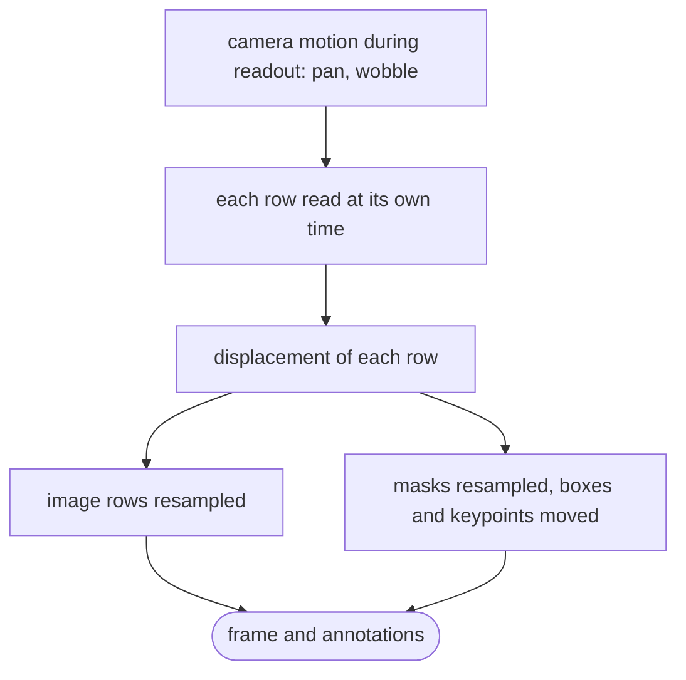
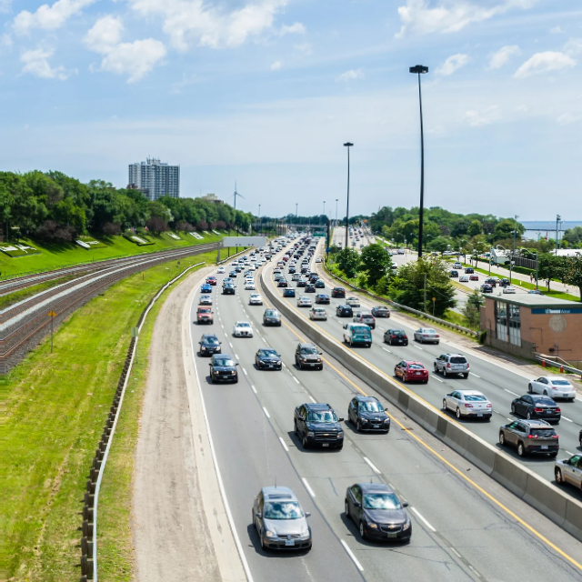
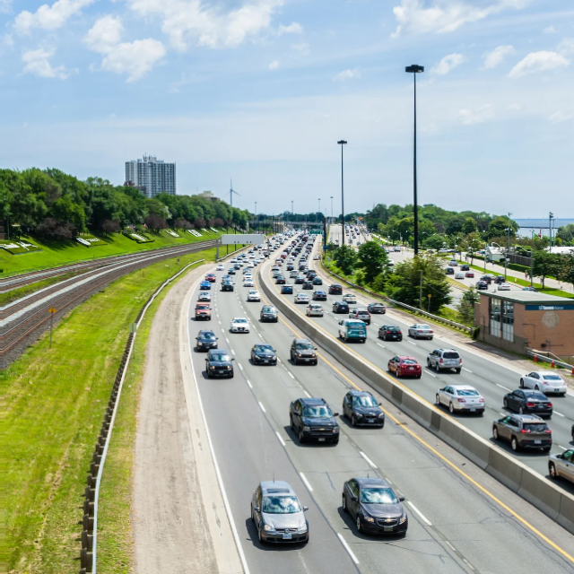
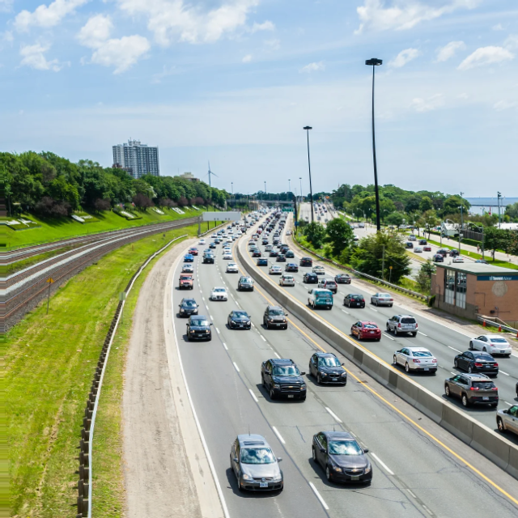
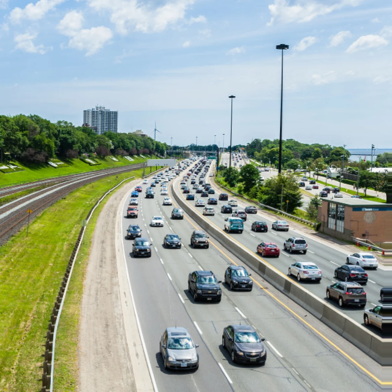

# `RollingShutter`

> Shear and wobble from line-by-line readout under camera motion.

| | |
| --- | --- |
| Module | [`surmentations.camera.rolling_shutter`](../../src/surmentations/camera/rolling_shutter.py) |
| Stage | sensor |
| Needs depth | no |
| Annotations | moves masks, boxes and keypoints with the pixels |

## Algorithm

## Model

Rolling-shutter distortion from camera motion during readout.

### Physical model

A CMOS sensor exposes and reads its rows sequentially rather than all at
once. Row `r` is therefore sampled at a different instant from row 0, later
by `r/H * readout_time`. If the camera moves during that interval, each row
records the scene from a slightly different pose, and the frame is distorted
rather than merely blurred.

Two motions matter for a fixed surveillance camera, and both are whole-frame:

* **Pole sway and pan.** A steady angular rate `omega` displaces row `r`
  by `f * omega * (r/H) * readout_time` — a displacement growing linearly
  down the frame, i.e. a **shear**. Vertical structures lean.
* **Vibration.** Wind, traffic and nearby machinery excite the mount at a few
  Hz to a few tens of Hz. The displacement is then oscillatory in row index
  and the frame **wobbles**: verticals take on an S-bend rather than a lean.
  The number of wiggles across the frame is the vibration frequency times the
  readout time.

Scope, stated plainly: this models motion of the **camera**, which shifts
every row of the frame together. Rolling shutter also skews *individual
moving objects* relative to a static background — a passing car leans while
the building behind it does not — and that needs per-object motion, which a
single image does not carry. This transform does not attempt it; nothing here
silently stands in for it.

## Parameters

| Parameter | Default | Meaning |
| --- | --- | --- |
| `pan_shift_range_px` | `(-12.0, 12.0)` | horizontal displacement accumulated between the first row and the last, from a steady pan or sway. Signed: the camera can drift either way. |
| `wobble_amplitude_range_px` | `(0.0, 5.0)` | amplitude of the oscillatory component from mount vibration. |
| `wobble_cycles_range` | `(0.5, 4.0)` | how many vibration cycles elapse during readout, i.e. how many wiggles appear down the frame. Below 1 the wobble is indistinguishable from a lean; a few cycles gives the characteristic S-bend. |
| `vertical_fraction_range` | `(0.0, 0.35)` |  |
| `p` | `0.5` | probability that the transform is applied |

## Samples

Severity 1 to 5, left to right, from the severity gallery.

`rolling_shutter`

| 1 | 2 | 3 | 4 | 5 |
| --- | --- | --- | --- | --- |
|  |  |  |  |  |

## References

- Liang, C.-K., Chang, L.-W. and Chen, H. H. (2008). Analysis and compensation of rolling shutter effect. *IEEE Transactions on Image Processing* 17(8), 1323-1330.

---

Generated by [`docs/make_transform_pages.py`](../make_transform_pages.py) from the source; edit the docstring or that script, not this page. [All transforms](README.md).
