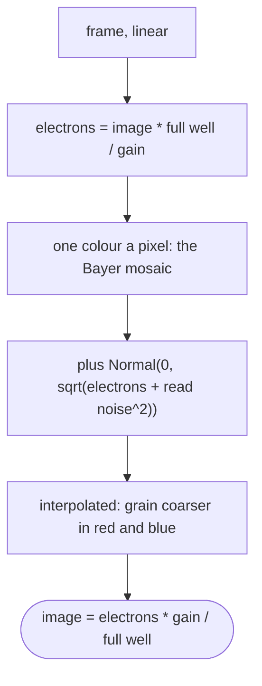

# `SensorNoise`

> Shot and read noise on the colour filter mosaic, set by sensor gain.

| | |
| --- | --- |
| Module | [`surmentations.camera.sensor_noise`](../../src/surmentations/camera/sensor_noise.py) |
| Stage | sensor |
| Needs depth | no |
| Annotations | untouched: the image only |
| Tests | [`tests/unit/test_sensor_noise.py`](../../tests/unit/test_sensor_noise.py) |

## Algorithm

## Model

Sensor noise for a camera still in colour.

### Physical model

A pixel counts photoelectrons, and counting is noisy in two ways that behave
differently:

* **Shot noise.** Photon arrivals are Poisson, so a pixel that collected
  `N` electrons carries a noise of `sqrt(N)`. It grows with the signal
  but more slowly, so it is worst *relative to the signal* in the shadows.
* **Read noise.** The readout chain adds a few electrons of its own whatever
  the signal was. It is what is left in the dark.

Neither depends on gain. What gain does is decide how few electrons count as
a full-scale picture: at 0 dB a white pixel is a full well, several thousand
electrons, and at 30 dB it is a few hundred, with the same read noise and
proportionally more shot noise. That is the whole reason a night frame is
noisy, and why `gain_range_db` is the parameter that matters here.

So, with the image in linear light and `g` the linear gain:

``
electrons = image * full_well / g
noisy     = electrons + Normal(0, sqrt(electrons + read_noise^2))
image'    = noisy * g / full_well
``

(The Gaussian stands in for the Poisson, which it matches closely above ten
electrons or so. Below that real shot noise is skewed; this is not.)

**The noise is drawn on the colour filter mosaic, not per channel.** A sensor
has one colour sample per pixel, in a Bayer pattern — half green, a quarter
each red and blue — and the other two values at each pixel are interpolated
from neighbours. Interpolation is linear, so the noise goes through it too:
what reaches the picture is not three independent grains but one, spread by
the demosaicing kernel, wider in red and blue than in green because those
samples are further apart. That is the coarse coloured blotching of a real
low-light frame, and independent per-channel Gaussian noise — fine, sharp and
evenly coloured — does not look like it.

### Where it sits

At the sensor, before everything the image processor does. It is what
`TemporalDenoiseArtifacts` exists to clean up: without a noise source ahead
of it, that transform smears a frame that had nothing to remove.

`NightIrMode` carries its own noise for the monochrome case and should not
be followed by this.

## Parameters

| Parameter | Default | Meaning |
| --- | --- | --- |
| `gain_range_db` | `(0.0, 30.0)` | analogue gain, drawn per call. **This is the knob.** Gain does not create noise; it decides how few electrons make a full-scale picture, and so how large the fixed noise is beside it. 0 dB is a camera in daylight; 18-24 dB a street at night; 36 dB is the top of most sensors' range, a frame that is mostly grain. |
| `full_well_range_e` | `(4000.0, 12000.0)` | electrons a pixel holds at saturation with no gain. Small surveillance pixels (2-3 micrometres) hold a few thousand; a larger pixel holds more and is cleaner at any gain. |
| `read_noise_range_e` | `(1.5, 5.0)` | electrons of signal-independent noise from the readout chain. Modern CMOS sensors are at 1-3; older or hotter ones several times that. It sets the floor in the shadows. |
| `p` | `0.5` | probability that the transform is applied |

## Samples

Severity 1 to 5, left to right, from the severity gallery.

`sensor_noise`

| 1 | 2 | 3 | 4 | 5 |
| --- | --- | --- | --- | --- |
|  |  |  |  |  |

## References

- Healey, G. E. and Kondepudy, R. (1994). Radiometric CCD camera calibration and noise estimation. *IEEE Transactions on Pattern Analysis and Machine Intelligence* 16(3), 267-276. [doi:10.1109/34.276126](https://doi.org/10.1109/34.276126)
- European Machine Vision Association. *EMVA Standard 1288: Standard for Characterization of Image Sensors and Cameras*. [link](https://www.emva.org/standards-technology/emva-1288/)
- Janesick, J. R. (2007). *Photon Transfer*. SPIE Press. [doi:10.1117/3.725073](https://doi.org/10.1117/3.725073)

---

Generated by [`docs/make_transform_pages.py`](../make_transform_pages.py) from the source; edit the docstring or that script, not this page. [All transforms](README.md).
