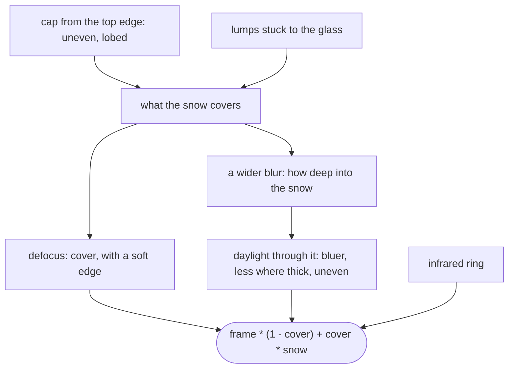

# `SnowOnHousing`

> A cap of snow hanging into the top of the view, and patches of it on the glass.

| | |
| --- | --- |
| Module | [`surmentations.lens.snow_cap`](../../src/surmentations/lens/snow_cap.py) |
| Stage | optics: on the glass or the housing |
| Needs depth | no |
| Annotations | untouched: the image only |
| Tests | [`tests/unit/test_snow_cap.py`](../../tests/unit/test_snow_cap.py) |

## Algorithm

## Model

Snow on the housing.

### Physical model

Snow settles on a camera as it does on everything else. It builds a cap on
the top of the housing or its sunshield, which sags over the front edge and
hangs into the top of the view; and wind plasters wet snow onto the glass
itself in patches. Until it slides off or melts, part of the picture is
gone.

**It hides what is behind it.** Unlike a web or a film of frost, a lump of
snow is thick: it covers, and what is seen in its place is the snow.

**It is a soft shape with no detail.** It is on the housing, centimetres
from a lens focused metres away, so its edge is a gradient tens of pixels
wide and its surface is featureless. What identifies it is the outline: an
uneven lobed edge hanging from the top of the frame.

**How bright it is depends on what lights it.** By day the camera looks at
the cap's underside, which is in its own shade and lit two ways: through
the snow from above, and by the sky and the ground from below. Light
through snow is what makes it glow at its thin edge and dull in its
thick middle, and it comes through bluer than it went in, snow absorbing
red a little more than blue; so the mass is a pale blue grey, brightest
along its lower edge, and its surface is never quite even. At night under
the infrared ring it is a white diffuser a hand's width from the lamp,
and clips.

## Parameters

| Parameter | Default | Meaning |
| --- | --- | --- |
| `cap_depth_range` | `(0.06, 0.4)` | how far the cap hangs into the frame, as a fraction of its height, on average along the top edge. Zero is no cap. |
| `lumpiness_range` | `(0.2, 0.9)` | how uneven the cap's lower edge is, 0 to 1. |
| `patch_count_range` | `(0, 4)` | lumps of snow stuck to the glass, besides the cap. |
| `patch_size_range` | `(0.03, 0.14)` | their size, as a fraction of the diagonal. |
| `defocus_range` | `(0.01, 0.04)` | blur of the snow's outline, as a fraction of the diagonal. Large: it is on the housing. |
| `brightness_range` | `(0.35, 0.75)` | how bright the snow's underside is by day, as a share of the scene's illuminant. |
| `glow_range` | `(0.0, 0.0)` | light the snow returns from the infrared ring, in units of full scale. Zero by day; above 1 at night, where it clips. |
| `p` | `0.5` | probability that the transform is applied |

## Samples

Severity 1 to 5, left to right, from the severity gallery.

`snow_on_housing`

| 1 | 2 | 3 | 4 | 5 |
| --- | --- | --- | --- | --- |
|  |  |  |  |  |

## References

- Warren, S. G. (1982). Optical properties of snow. *Reviews of Geophysics* 20(1), 67-89. [doi:10.1029/RG020i001p00067](https://doi.org/10.1029/RG020i001p00067)
- Bohren, C. F. (1983). Colors of snow, frozen waterfalls, and icebergs. *Journal of the Optical Society of America* 73(12), 1646. [doi:10.1364/JOSA.73.001646](https://doi.org/10.1364/JOSA.73.001646)

---

Generated by [`docs/make_transform_pages.py`](../make_transform_pages.py) from the source; edit the docstring or that script, not this page. [All transforms](README.md).
