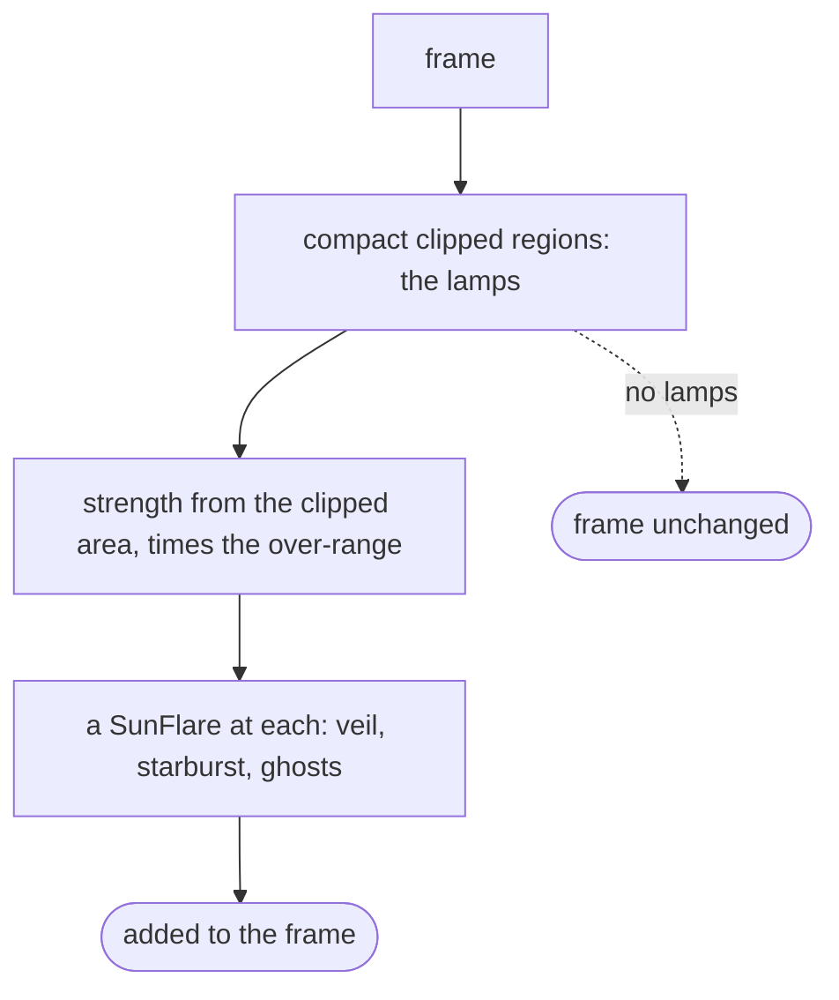
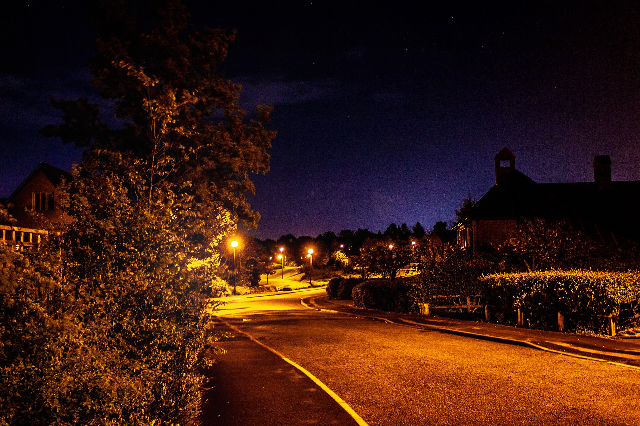
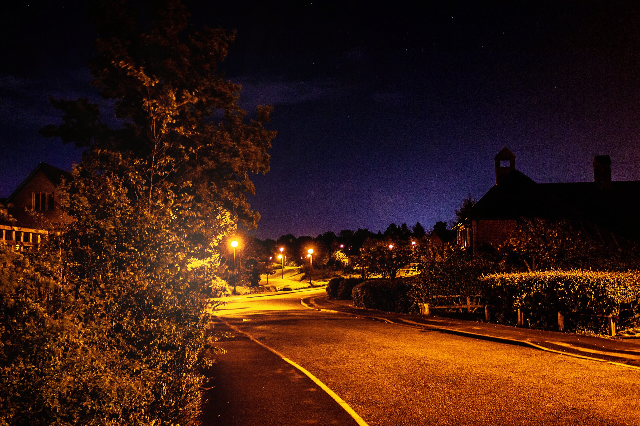
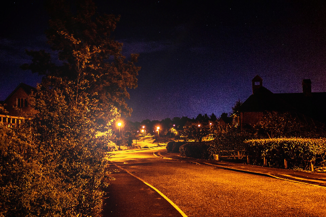
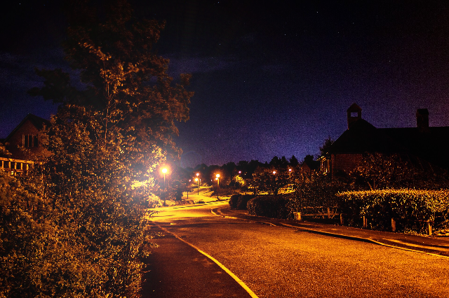
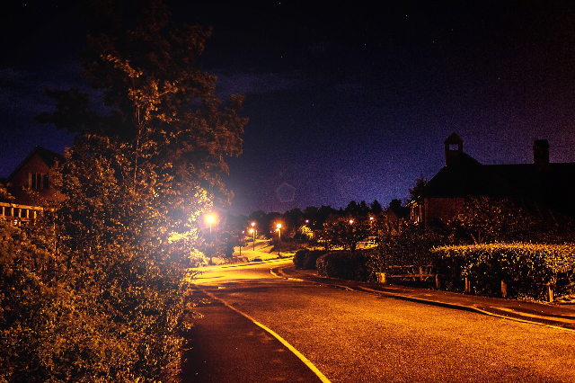

# `SourceGlare`

> Flare from each compact light in the frame.

| | |
| --- | --- |
| Module | [`surmentations.lens.source_glare`](../../src/surmentations/lens/source_glare.py) |
| Stage | optics: in the lens |
| Needs depth | no |
| Annotations | untouched: the image only |

## Algorithm

## Model

Lens glare from the lights that are in the frame.

`SunFlare` has the optics — the veiling glare, the diffraction starburst,
the chain of ghosts along the line through the image centre — and puts them
on one source at a position the caller chooses. At night the sources are in
the picture, there are several, and that is where glare has to come from: a
headlight or a street lamp, each with its own flare.

So this finds the compact clipped regions of the frame
(`sources`) and renders a `SunFlare` at each.
Nothing optical is reimplemented; the one new quantity is how strong each
flare is. A clipped pixel only says the light was *at least* full scale, so
strength is taken from the clipped area — a bigger blown region is a
brighter or nearer lamp — times `intensity_range`, which stands for the
over-range no photograph records.

Artefacts of an ageing camera that `SunFlare` also carries (dome scratches,
CCD smear, infrared leak, the housing-window ghost) are left to it. They are
properties of one camera in sunlight, and repeating them per lamp would draw
the same scratch three times.

A frame with no compact light in it comes back unchanged. That is the right
answer for most daylit frames, and it means this transform, unlike the
others, can do nothing with `p=1`.

## Parameters

| Parameter | Default | Meaning |
| --- | --- | --- |
| `max_sources_range` | `(1, 3)` | how many of the frame's lights flare, largest first, drawn per call. Each costs one `SunFlare` render. |
| `intensity_range` | `(0.08, 0.35)` | flare strength for a source of the reference size, in `SunFlare`'s units, drawn per call. It stands for how far past full scale the lights really were, which is not recorded. A lamp is orders of magnitude dimmer than the sun those units were set for, so useful values are a fraction of `SunFlare`'s. Larger clipped regions flare more, as the square root of their area, within a factor of two either way. |
| `ghost_count_range` | `(2, 6)` | as for `SunFlare`. |
| `halo_radius_range` | `(0.04, 0.1)` | as for `SunFlare`. |
| `aperture_blades_range` | `(5, 9)` | as for `SunFlare`. |
| `streak_probability` | `0.75` | as for `SunFlare`. |
| `p` | `0.5` | probability that the transform is applied |

## Samples

Severity 1 to 5, left to right, from the severity gallery.

`source_glare`

| 1 | 2 | 3 | 4 | 5 |
| --- | --- | --- | --- | --- |
|  |  |  |  |  |

## References

- Hullin, M., Eisemann, E., Seidel, H.-P. and Lee, S. (2011). Physically-based real-time lens flare rendering. *ACM Transactions on Graphics* 30(4) (SIGGRAPH). [doi:10.1145/1964921.1965003](https://doi.org/10.1145/1964921.1965003)
- Talvala, E.-V., Adams, A., Horowitz, M. and Levoy, M. (2007). Veiling glare in high dynamic range imaging. *ACM Transactions on Graphics* 26(3) (SIGGRAPH). [doi:10.1145/1275808.1276424](https://doi.org/10.1145/1275808.1276424)
- McCann, J. J. and Rizzi, A. (2007). Veiling glare: the dynamic range limit of HDR images. *Proceedings of SPIE* 6492, Human Vision and Electronic Imaging XII. [doi:10.1117/12.703042](https://doi.org/10.1117/12.703042)

---

Generated by [`docs/make_transform_pages.py`](../make_transform_pages.py) from the source; edit the docstring or that script, not this page. [All transforms](README.md).
