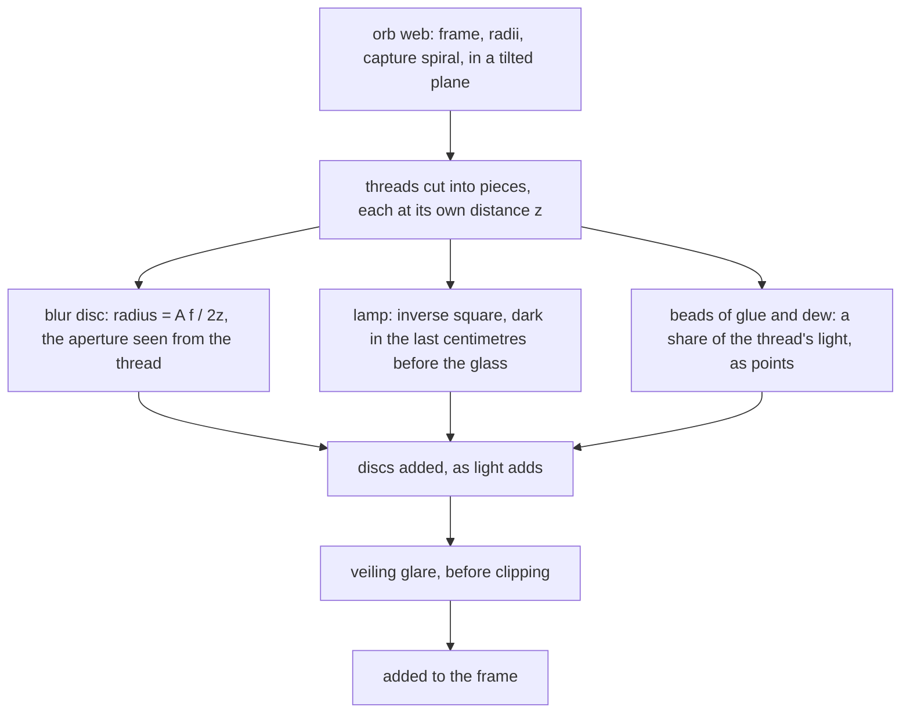
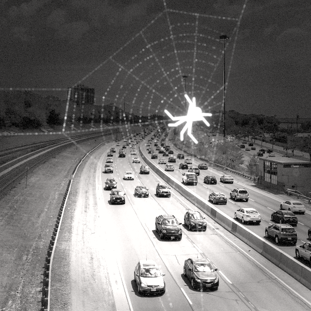
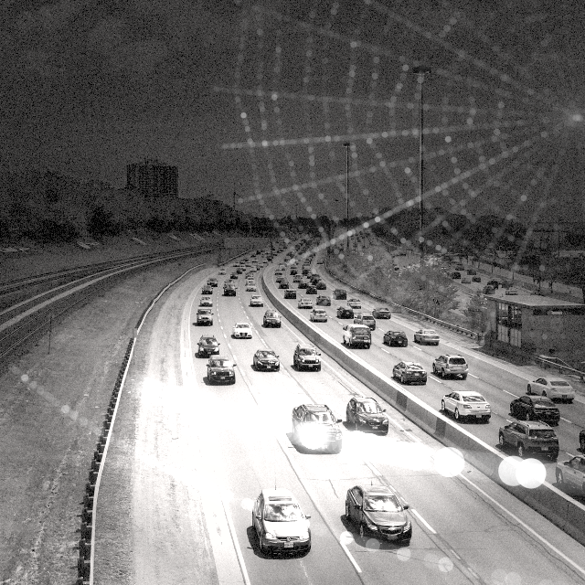
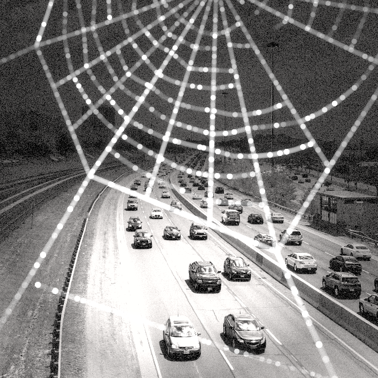
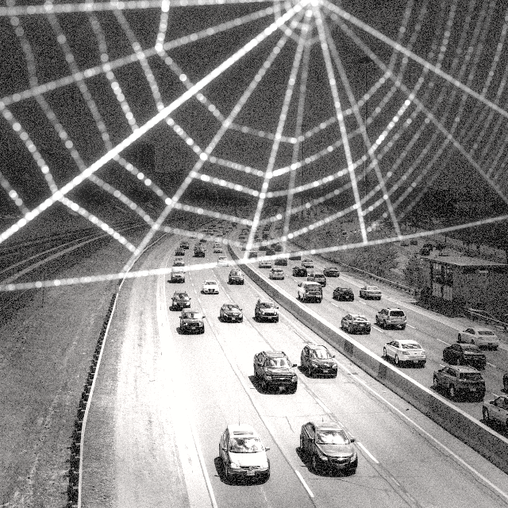
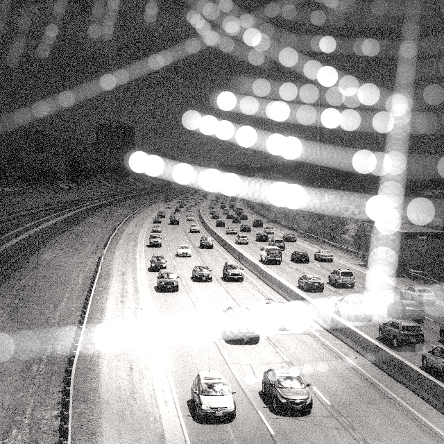

# `SpiderWeb`

> An orb web in front of the lens, lit by the camera's infrared illuminator.

| | |
| --- | --- |
| Module | [`surmentations.lens.spider_web`](../../src/surmentations/lens/spider_web.py) |
| Stage | lit by the camera's own lamp, after the infrared conversion |
| Needs depth | no |
| Annotations | untouched: the image only |
| Tests | [`tests/unit/test_spider_web.py`](../../tests/unit/test_spider_web.py) |

## Algorithm

## Model

A spider's web across the housing, lit by the camera's own illuminator.

### Physical model

Infrared illuminators attract insects and spiders follow them, so an outdoor
camera that is not cleaned ends up with an orb web anchored to its housing,
its hub a hand's width in front of the lens. By day the feed shows nothing.
At night the web is the brightest thing in the frame: rows of soft glowing
discs strung along curves, across a scene that was already dark.

`HousingOccluders` draws a web as blurred lines and leaves it at that. This
transform is the web itself, as geometry in front of a lens, because the three
things that make the night picture are all consequences of where each thread
is:

**The silk is far too thin to see, and far too close to be dim.** A thread is
a few micrometres across. Ten centimetres from a 4 mm lens it projects 0.04 px
wide, and it is so far inside the near focus limit that this is spread over a
blur disc some 15 px across: it covers a four-hundredth of each pixel it
touches. Lit by the sky it adds a quarter of a percent of full scale, which
is why a web is invisible by day. Lit by a lamp 10 cm away, against a scene
lit by the same lamp from 10 m, it receives ten thousand times the scene's
irradiance, and a four-hundredth of that is 25 times a white wall. So what is
drawn here is added light, never a shadow, and it is driven by the lamp.

**Each point of a thread is an image of the aperture.** Out of focus, a point
is drawn as the lens's stop: a disc of radius `A f / 2z` pixels for an
aperture `A`, a focal length of `f` pixels and a distance `z`. A thread
is a row of them. The light it returns falls as the lamp's does, `1/z^2`,
so the near side of a tilted web is both brighter and blurred wider than the
far side. Only down to a point: the LEDs stand in a ring around the lens and
shine forwards, so the last centimetres in front of the glass are beside
their beams, and a thread across the dome itself is in the dark.

**The beads are what catch the light.** The capture spiral carries droplets
of glue, and by night every thread carries dew. Each is a point glint, so
each is one disc, and a thread reads as a string of pearls. Whether the
pearls touch is decided by one ratio: their spacing along the thread over
the aperture's diameter, at any distance, because the spacing and the disc
both project as `1/z`. Beads a millimetre apart in front of a 2 mm stop
merge into a band; 4 mm apart they are separate discs, each brighter than
the band by that same ratio; and on a thread far enough to be nearly in
focus they are a dotted line.

The web is an orb web as it is built: a frame moored to the housing, radial
threads from a hub to the frame, and a capture spiral across them from the
edge of a free zone outwards, straight from radius to radius and a little
slack. Holes are torn in it, as they are in any web a day old. It stands in a
plane tilted to the lens, with the hub wherever it happens to be, usually
outside the frame. Loose threads may cross the view on their own, and the
spider may be at home: a body centimetres from the lamp, which no exposure
holds, so it is a white shape with a glow around it.

Composition: after `NightIrMode`, like `NightRain` and `NightSnow` and
for their reason. The web's light is the camera's own, already in the
sensor's terms; converted with the scene it would be lit by the depth of
whatever is behind it and go dark.

## Parameters

| Parameter | Default | Meaning |
| --- | --- | --- |
| `distance_range_m` | `(0.04, 0.25)` | how far the web's hub is from the lens. |
| `web_radius_range_m` | `(0.06, 0.2)` | the web's radius, hub to frame. |
| `tilt_range_deg` | `(0.0, 65.0)` | angle between the web's plane and the image plane. At zero the web faces the lens and is evenly blurred; tilted, one side is near, bright and blurred wide, the other far, dim and fine. |
| `radial_count_range` | `(14, 30)` | how many radii the web has. |
| `mesh_spacing_range_mm` | `(3.0, 9.0)` | distance between turns of the capture spiral. |
| `bead_spacing_range_mm` | `(1.0, 4.0)` | distance between the droplets along a thread. Against the aperture's diameter this decides the look: closer than the aperture is wide and the discs merge into a band; further apart and they are a string of pearls. |
| `bead_share_range` | `(0.5, 0.95)` | how much of a thread's light comes from its beads, 0 to 1. Zero is dry silk, a smooth band; near one, the thread between the beads is hardly there. |
| `damage_range` | `(0.0, 0.6)` | how much of the capture spiral is torn away, 0 to 1. |
| `stray_thread_count_range` | `(0, 3)` | loose threads crossing the view on their own, besides the web. |
| `spider_probability` | `0.25` | chance the spider is at home, at the hub. It is in the picture when the hub is. |
| `spider_size_range_mm` | `(4.0, 14.0)` | its body length. |
| `illuminator_gain_range` | `(0.15, 1.0)` | brightness of a bare thread's band 10 cm from the lens, on the beam's axis, in units of full scale. The near side of a web is several times this and separate beads are brighter again, so well below 1 the near threads already clip, which a web against the housing does. |
| `beam_falloff_range` | `(0.6, 2.2)` | how sharply the beam dims off-axis. |
| `horizontal_fov_range_deg` | `(48.0, 78.0)` | field of view, which projects metres to pixels. |
| `aperture_diameter_range_mm` | `(0.9, 2.6)` | the lens's stop. The blur disc of a thread is its image. |
| `focus_distance_range_m` | `(8.0, 40.0)` | where the lens is focused. |
| `glare_range` | `(0.05, 0.25)` | fraction of the web's light the dome and the lens scatter into a soft glow around it. |
| `max_discs` | `60000` | render budget. When it binds, a thread's continuous light is drawn with fewer discs, wider apart, holding the same light; the beads are never thinned. |
| `p` | `0.5` | probability that the transform is applied |

## Samples

Severity 1 to 5, left to right, from the severity gallery.

`spider_web`

| 1 | 2 | 3 | 4 | 5 |
| --- | --- | --- | --- | --- |
|  |  |  |  |  |

## References

- Zschokke, S. (1999). Nomenclature of the orb-web. *Journal of Arachnology* 27, 542-546.
- Vollrath, F. and Edmonds, D. T. (1989). Modulation of the mechanical properties of spider silk by coating with water. *Nature* 340, 305-307.
- Foelix, R. F. (2011). *Biology of Spiders*, 3rd edition. Oxford University Press.
- Potmesil, M. and Chakravarty, I. (1981). A lens and aperture camera model for synthetic image generation. *ACM SIGGRAPH Computer Graphics* 15(3), 297-305.

---

Generated by [`docs/make_transform_pages.py`](../make_transform_pages.py) from the source; edit the docstring or that script, not this page. [All transforms](README.md).
